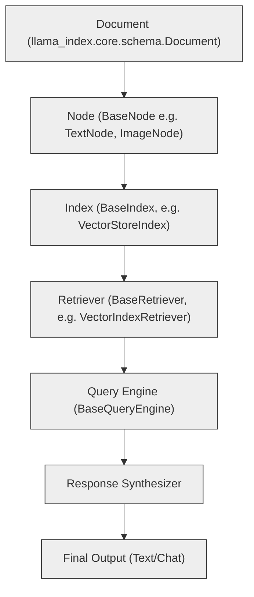

<!-- source: DeepWiki mcp.deepwiki.com · repo run-llama/llama_index · page 1.2 Core Concepts Primer · fetched 2026-10-26 -->

# Core Concepts Primer

<details>
<summary>Relevant source files</summary>

The following files were used as context for generating this wiki page:

- [.github/workflows/close_new_integration_prs.yml](.github/workflows/close_new_integration_prs.yml)
- [CONTRIBUTING.md](CONTRIBUTING.md)
- [README.md](README.md)
- [docs/DOCS_README.md](docs/DOCS_README.md)
- [llama-index-core/llama_index/core/bridge/pydantic.py](llama-index-core/llama_index/core/bridge/pydantic.py)
- [llama-index-core/llama_index/core/img_utils.py](llama-index-core/llama_index/core/img_utils.py)
- [llama-index-core/llama_index/core/indices/base.py](llama-index-core/llama_index/core/indices/base.py)
- [llama-index-core/llama_index/core/indices/vector_store/base.py](llama-index-core/llama_index/core/indices/vector_store/base.py)
- [llama-index-core/llama_index/core/multi_modal_llms/base.py](llama-index-core/llama_index/core/multi_modal_llms/base.py)
- [llama-index-core/llama_index/core/multi_modal_llms/generic_utils.py](llama-index-core/llama_index/core/multi_modal_llms/generic_utils.py)
- [llama-index-core/llama_index/core/node_parser/node_utils.py](llama-index-core/llama_index/core/node_parser/node_utils.py)
- [llama-index-core/llama_index/core/node_parser/text/code.py](llama-index-core/llama_index/core/node_parser/text/code.py)
- [llama-index-core/llama_index/core/node_parser/text/semantic_double_merging_splitter.py](llama-index-core/llama_index/core/node_parser/text/semantic_double_merging_splitter.py)
- [llama-index-core/llama_index/core/node_parser/text/utils.py](llama-index-core/llama_index/core/node_parser/text/utils.py)
- [llama-index-core/llama_index/core/postprocessor/optimizer.py](llama-index-core/llama_index/core/postprocessor/optimizer.py)
- [llama-index-core/llama_index/core/prompts/__init__.py](llama-index-core/llama_index/core/prompts/__init__.py)
- [llama-index-core/llama_index/core/response/notebook_utils.py](llama-index-core/llama_index/core/response/notebook_utils.py)
- [llama-index-core/llama_index/core/schema.py](llama-index-core/llama_index/core/schema.py)
- [llama-index-core/llama_index/core/storage/index_store/keyval_index_store.py](llama-index-core/llama_index/core/storage/index_store/keyval_index_store.py)
- [llama-index-core/llama_index/core/storage/index_store/types.py](llama-index-core/llama_index/core/storage/index_store/types.py)
- [llama-index-core/tests/indices/list/test_index.py](llama-index-core/tests/indices/list/test_index.py)
- [llama-index-core/tests/indices/vector_store/test_simple.py](llama-index-core/tests/indices/vector_store/test_simple.py)
- [llama-index-core/tests/indices/vector_store/test_simple_async.py](llama-index-core/tests/indices/vector_store/test_simple_async.py)
- [llama-index-core/tests/multi_modal_llms/test_base_multi_modal_llm_metadata.py](llama-index-core/tests/multi_modal_llms/test_base_multi_modal_llm_metadata.py)
- [llama-index-core/tests/multi_modal_llms/test_generic_utils.py](llama-index-core/tests/multi_modal_llms/test_generic_utils.py)
- [llama-index-core/tests/node_parser/test_semantic_double_merging_splitter.py](llama-index-core/tests/node_parser/test_semantic_double_merging_splitter.py)
- [llama-index-core/tests/schema/test_image_document.py](llama-index-core/tests/schema/test_image_document.py)
- [llama-index-core/tests/schema/test_media_resource.py](llama-index-core/tests/schema/test_media_resource.py)
- [llama-index-core/tests/schema/test_node.py](llama-index-core/tests/schema/test_node.py)
- [llama-index-core/tests/schema/test_schema.py](llama-index-core/tests/schema/test_schema.py)
- [llama-index-core/tests/text_splitter/test_code_splitter.py](llama-index-core/tests/text_splitter/test_code_splitter.py)
- [llama-index-integrations/readers/llama-index-readers-kibela/llama_index/readers/kibela/base.py](llama-index-integrations/readers/llama-index-readers-kibela/llama_index/readers/kibela/base.py)
- [llama-index-integrations/storage/index_store/llama-index-storage-index-store-dynamodb/llama_index/storage/index_store/dynamodb/base.py](llama-index-integrations/storage/index_store/llama-index-storage-index-store-dynamodb/llama_index/storage/index_store/dynamodb/base.py)
- [llama-index-integrations/storage/index_store/llama-index-storage-index-store-elasticsearch/llama_index/storage/index_store/elasticsearch/base.py](llama-index-integrations/storage/index_store/llama-index-storage-index-store-elasticsearch/llama_index/storage/index_store/elasticsearch/base.py)
- [llama-index-integrations/storage/index_store/llama-index-storage-index-store-elasticsearch/pyproject.toml](llama-index-integrations/storage/index_store/llama-index-storage-index-store-elasticsearch/pyproject.toml)
- [llama-index-integrations/storage/index_store/llama-index-storage-index-store-firestore/llama_index/storage/index_store/firestore/base.py](llama-index-integrations/storage/index_store/llama-index-storage-index-store-firestore/llama_index/storage/index_store/firestore/base.py)
- [llama-index-integrations/storage/index_store/llama-index-storage-index-store-mongodb/llama_index/storage/index_store/mongodb/base.py](llama-index-integrations/storage/index_store/llama-index-storage-index-store-mongodb/llama_index/storage/index_store/mongodb/base.py)
- [llama-index-integrations/storage/index_store/llama-index-storage-index-store-postgres/llama_index/storage/index_store/postgres/base.py](llama-index-integrations/storage/index_store/llama-index-storage-index-store-postgres/llama_index/storage/index_store/postgres/base.py)
- [llama-index-integrations/storage/index_store/llama-index-storage-index-store-redis/llama_index/storage/index_store/redis/base.py](llama-index-integrations/storage/index_store/llama-index-storage-index-store-redis/llama_index/storage/index_store/redis/base.py)

</details>


This page introduces the foundational concepts that form the core of the LlamaIndex framework. Understanding these concepts — **Document, Node, Index, Retriever, Query Engine, Response Synthesizer, Agent, and Workflow** — is essential before delving deeper into the subsystems. This primer explains their technical implementations, data flow, and interrelationships to prepare you for more detailed exploration of the framework.

---

## 1. Document

A **Document** is the fundamental data entry representing a unit of source information ingested into LlamaIndex. In code, the `Document` class encapsulates raw text content alongside metadata. It is typically the initial abstraction used to ingest raw corpora.

- Implementation: The `Document` class inherits from `BaseNode` and extends it to hold text and metadata used for querying and indexing.
- Contains:  
  - `text`: The main content string.
  - `metadata`: Optional dictionary of key-value pairs for additional context.
  - `id_`: Unique identifier string.
  - Supports legacy field `doc_id` for backward compatibility.

### Code entity

- Defined in: `llama-index-core/llama_index/core/schema.py:10-210` (main Document and Node-related classes partway)

### Important notes

- Documents can be legacy initialized with `doc_id`.
- Metadata is accessible transparently alongside text.
- Creation typically happens before node parsing.

---

## 2. Node

A **Node** is a more granular content unit derived by splitting or parsing Documents. Nodes are the primary indexing items that represent chunks of content with context and semantic meaning.

- Implementation: `BaseNode` is the abstract base. Concrete subclasses include:  
  - `TextNode` — contains text with optional metadata and embeddings.  
  - `ImageNode` — extends to image content (including base64, URLs).  
- Nodes maintain relationships (e.g., source document pointers) via `NodeRelationship`.
- Nodes expose methods for getting content with or without metadata, hash computation for content identity, and embedding storage.

### Key functions/classes

- `build_nodes_from_splits`: Utility to convert text splits into nodes with IDs and relationships.
- Nodes store embeddings and metadata for retrieval relevance.

### Code entity

- Defined in: `llama-index-core/llama_index/core/schema.py:10-210` (base schema and node classes)  
- Utilities: `llama-index-core/llama_index/core/node_parser/node_utils.py:1-91`

---

## 3. Index

An **Index** is a structured data representation built from Nodes enabling efficient retrieval and querying. It abstracts different methods of data structuring (vector, keyword, graph, etc.).

- Base class: `BaseIndex` (a generic abstraction over an index structure).
- Subclasses implement specific behaviors:  
  - `VectorStoreIndex`: Uses an underlying vector store for embedding-based retrieval.
  - Other index types (not detailed here) include hierarchical and keyword-based indices.

### Data flow in Index creation

1. Nodes (from Documents) are generated (possibly after transformations).
2. Nodes are embedded (if vector index) and inserted into vector stores or other structures.
3. Index maintains metadata, references to nodes, and integrates with storage context.

### Key methods/classes

- `BaseIndex` constructor requires nodes, index structures, or index objects explicitly.
- `from_documents()` class method ingests documents, runs transformations, builds nodes, and constructs an index.
- Vector index asynchronously embeds nodes in batches and inserts into the store.
- Index holds references to a docstore, storage context, and callback manager for instrumentation.

### Code entities

- `BaseIndex`: `llama-index-core/llama_index/core/indices/base.py:24-178`
- `VectorStoreIndex`: `llama-index-core/llama_index/core/indices/vector_store/base.py:1-200`

---

## 4. Retriever

A **Retriever** is the component responsible for fetching relevant nodes from the Index based on a query or search criteria.

- Retrievers abstract query-time retrieval strategies.
- The main retriever interacts with the underlying index and vector store (when applicable).
- They apply filtering, reranking, and possibly combining results.

### Code entities

- Base retriever class: `BaseRetriever` (imported in indices but implementation not shown here).
- Vector retriever example: `VectorIndexRetriever` used by `VectorStoreIndex.as_retriever()` [see: `llama-index-core/llama_index/core/indices/vector_store/base.py:112-124`].

---

## 5. Query Engine

The **Query Engine** is the higher-level interface that allows users to submit queries against the LlamaIndex ecosystem.

- Internally uses one or more Retrievers to get relevant nodes.
- Applies query logic, including optional prompt-based orchestration and response synthesis.
- Supports configurations related to LLM calls, prompt templates, and retrieval parameters.

### Relationship to other components

- Encapsulates retrieval behavior and response generation.
- May chain multiple components like retrievers and synthesizers.

---

## 6. Response Synthesizer

The **Response Synthesizer** composes a final answer or output from the raw nodes retrieved by a Retriever.

- Takes retrieved nodes, applies LLM prompt templates, and generates text or chat completions.
- Supports multiple strategies: concatenation, summarization, question answering, chat-based synthesis, etc.
- Abstracted as a distinct module for modularity and interchangeability.

---

## 7. Agent

An **Agent** in LlamaIndex is an autonomous or semi-autonomous program that uses indices, workflows, and tool integrations to complete tasks.

- Built using Workflow steps and tools.
- Controls task execution, memory management, and decision-making.
- Integrates with LLMs for reasoning and task planning.
- Agents can call tools, access indices for knowledge, and carry context over time.

### Code entities

- Agent base classes and implementations are in agent-related packages (not shown here but referenced in roadmap).

---

## 8. Workflow

A **Workflow** is an event-driven orchestration engine that defines task steps and transitions.

- Supports asynchronous execution and complex multi-step processes.
- Uses decorators for steps and manages Context for state.
- Fire events, handle retries, checkpointing, and integrate with agents.

### Purpose

- Facilitates building pipelines such as document ingestion, indexing, query answering, and autonomous task execution.
- Allows scripted logic with LLM integration for building agents and applications.

---

# How These Concepts Fit Together

At a high level, the data and control flow in the LlamaIndex framework proceeds as follows:

- Raw data sources are ingested as **Documents**.
- Documents are parsed and split into smaller **Nodes** for granular semantic understanding.
- Nodes are processed, optionally embedded, and stored in structured **Indices**.
- When a query arrives, a **Retriever** accesses these indices to get relevant nodes.
- A **Query Engine** orchestrates query processing, invokes retrievers, and forwards nodes to a **Response Synthesizer**.
- The synthesizer crafts the final response, often using LLMs with prompt templates.
- For complex or autonomous tasks, **Agents** utilize **Workflows** to execute multi-step logic, interact with indices, use tools, and manage state.

---

# Mermaid Diagram 1: Core Data Flow from Document to Response



---

# Mermaid Diagram 2: Code Entities Aligned to Concepts

```mermaid
flowchart TD
  subgraph Document_Node_Space
    doc[Document<br/>(llama_index.core.schema:10-210)]
    node[Node: BaseNode / TextNode / ImageNode<br/>(llama_index.core.schema:10-210)]
    node_utils[build_nodes_from_splits()<br/>(node_utils.py:29-91)]
    doc --> node_utils --> node
  end

  subgraph Index_Retrieval_Space
    base_index[BaseIndex<br/>(indices/base.py:24-178)]
    vector_index[VectorStoreIndex<br/>(indices/vector_store/base.py:1-200)]
    retriever[VectorIndexRetriever (retriever)<br/>(indices/vector_store/retrievers.py)]
    base_index --> vector_index --> retriever
  end

  subgraph Query_Response_Space
    query_engine[BaseQueryEngine<br/>(base_query_engine.py)]
    synthesizer[ResponseSynthesizer<br/>(response/response_synthesizer.py)]
    retriever --> query_engine --> synthesizer
  end

  doc --> base_index
```

---

# Summary Table of Core Concepts

| Concept           | Role / Definition                                         | Key Code Entity or Function                      | File Reference                         |
|-------------------|-----------------------------------------------------------|-------------------------------------------------|--------------------------------------|
| Document          | Raw input unit with text and metadata                      | `Document` class                                | `core/schema.py:10-210`               |
| Node              | Chunked, parsed content units derived from Documents      | `BaseNode`, `TextNode`, `build_nodes_from_splits` | `core/schema.py:10-210`, `node_utils.py:29-91` |
| Index             | Data structure for organizing nodes for retrieval          | `BaseIndex`, `VectorStoreIndex`                 | `core/indices/base.py:24-178`, `vector_store/base.py:1-200` |
| Retriever         | Retrieves relevant Nodes from an Index                      | `BaseRetriever`, `VectorIndexRetriever`         | Indices vector_store retriever (partial) |
| Query Engine      | Orchestrates querying processes and retrieval              | `BaseQueryEngine` (not detailed here)           | `core/base/base_query_engine.py`      |
| Response Synthesizer | Combines retrieved nodes and generates the final output   | `ResponseSynthesizer` (module level)             | `core/response/response_synthesizer.py` (implied) |
| Agent             | Autonomous task executor using indices and workflows       | Agent base classes (not detailed here)           | Agent packages (outside core shown)  |
| Workflow          | Event-driven orchestrator for multi-step processes         | `Workflow`, step decorators, Context            | Workflow modules (outside core shown) |

---

# Detailed Data Flow Description

1. **Document ingestion**: Raw data is wrapped in `Document` objects.
2. **Parsing and splitting**: Documents are parsed into smaller Nodes using Node Parers (`build_nodes_from_splits`, specialized text or code splitters).
3. **Index construction**: Nodes are provided to an Index constructor (e.g. `VectorStoreIndex`), which runs transformations and embeds nodes if necessary.
4. **Storage**: Index stores nodes and their embeddings in a Vector Store or other backends.
5. **Retrieval**: When querying, a Retriever fetches most relevant Nodes based on embedding similarity or other criteria.
6. **Query engine**: Runs retrieval, manages LLM calls, and returns synthesized results.
7. **Response synthesizer**: Aggregates, summarizes or reformats retrieved Nodes into a user-facing answer.
8. **Agent/Workflow orchestration**: For complex application workflows, they coordinate calls across these components and tools with state management.

---

# Example: From Documents to a Vector Store Index and Retrieval

```python
from llama_index.core.schema import Document
from llama_index.core.indices.vector_store.base import VectorStoreIndex

# Ingest raw text document
documents = [Document(text="Hello world.")]

# Create index from documents
index = VectorStoreIndex.from_documents(documents)

# Obtain a retriever
retriever = index.as_retriever()

# (Further steps could apply a query engine and response synthesizer)
```

---

# Notes

This primer intentionally abstracts away detailed subsystem implementations such as agent internals, advanced retriever types, and richer workflow orchestration to focus on the core building blocks.

Comprehensive explorations of each component follow in subsequent pages.

---

## Sources

- `README.md:1-93`  
- `llama-index-core/llama_index/core/schema.py:1-210`  
- `llama-index-core/llama_index/core/node_parser/node_utils.py:1-91`  
- `llama-index-core/llama_index/core/indices/base.py:1-178`  
- `llama-index-core/llama_index/core/indices/vector_store/base.py:1-200`  
- `llama-index-core/tests/schema/test_schema.py:1-209`  
- `llama-index-core/tests/indices/vector_store/test_simple_async.py:1-175`

---

