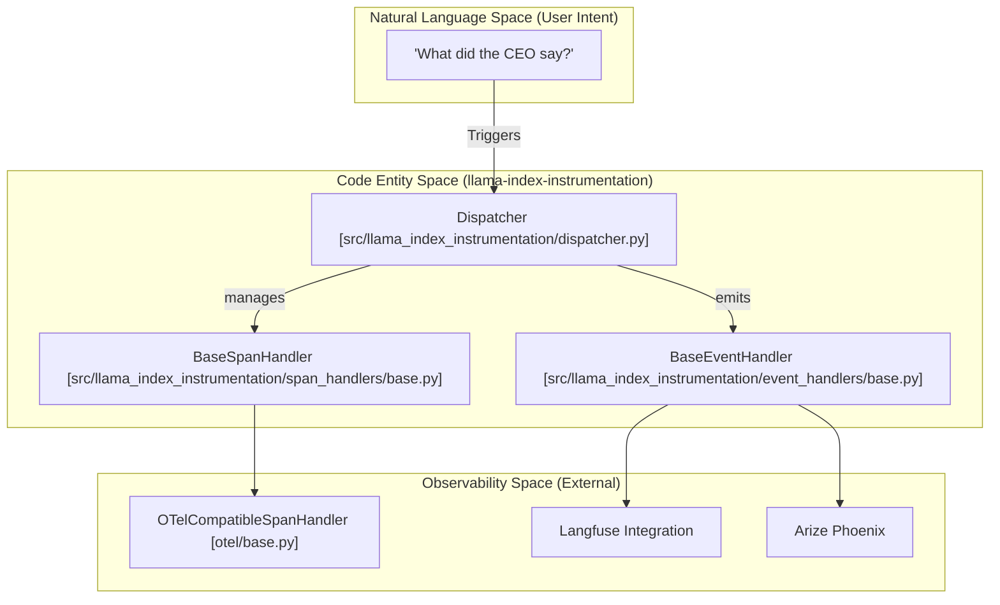
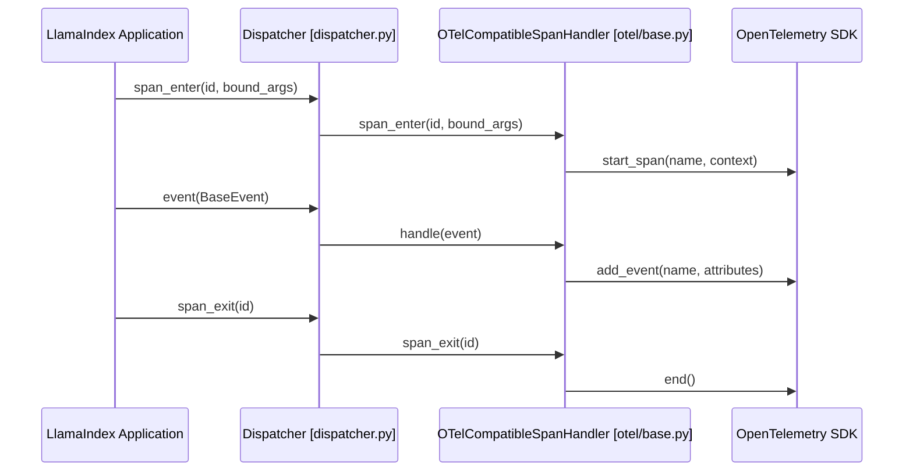

<!-- source: DeepWiki mcp.deepwiki.com · repo run-llama/llama_index · page 11 Observability and Instrumentation · fetched 2026-10-26 -->

# Observability and Instrumentation

Relevant source files

The following files were used as context for generating this wiki page:

- [llama-index-instrumentation/pyproject.toml](llama-index-instrumentation/pyproject.toml)
- [llama-index-instrumentation/src/llama_index_instrumentation/dispatcher.py](llama-index-instrumentation/src/llama_index_instrumentation/dispatcher.py)
- [llama-index-instrumentation/src/llama_index_instrumentation/event_handlers/base.py](llama-index-instrumentation/src/llama_index_instrumentation/event_handlers/base.py)
- [llama-index-instrumentation/src/llama_index_instrumentation/py.typed](llama-index-instrumentation/src/llama_index_instrumentation/py.typed)
- [llama-index-instrumentation/src/llama_index_instrumentation/span_handlers/base.py](llama-index-instrumentation/src/llama_index_instrumentation/span_handlers/base.py)
- [llama-index-instrumentation/tests/test_dispatcher.py](llama-index-instrumentation/tests/test_dispatcher.py)
- [llama-index-instrumentation/tests/test_propagation.py](llama-index-instrumentation/tests/test_propagation.py)
- [llama-index-instrumentation/tests/test_shutdown.py](llama-index-instrumentation/tests/test_shutdown.py)
- [llama-index-instrumentation/uv.lock](llama-index-instrumentation/uv.lock)
- [llama-index-integrations/observability/llama-index-observability-otel/.gitignore](llama-index-integrations/observability/llama-index-observability-otel/.gitignore)
- [llama-index-integrations/observability/llama-index-observability-otel/LICENSE](llama-index-integrations/observability/llama-index-observability-otel/LICENSE)
- [llama-index-integrations/observability/llama-index-observability-otel/Makefile](llama-index-integrations/observability/llama-index-observability-otel/Makefile)
- [llama-index-integrations/observability/llama-index-observability-otel/README.md](llama-index-integrations/observability/llama-index-observability-otel/README.md)
- [llama-index-integrations/observability/llama-index-observability-otel/llama_index/observability/otel/__init__.py](llama-index-integrations/observability/llama-index-observability-otel/llama_index/observability/otel/__init__.py)
- [llama-index-integrations/observability/llama-index-observability-otel/llama_index/observability/otel/base.py](llama-index-integrations/observability/llama-index-observability-otel/llama_index/observability/otel/base.py)
- [llama-index-integrations/observability/llama-index-observability-otel/llama_index/observability/otel/utils.py](llama-index-integrations/observability/llama-index-observability-otel/llama_index/observability/otel/utils.py)
- [llama-index-integrations/observability/llama-index-observability-otel/pyproject.toml](llama-index-integrations/observability/llama-index-observability-otel/pyproject.toml)
- [llama-index-integrations/observability/llama-index-observability-otel/tests/test_otel.py](llama-index-integrations/observability/llama-index-observability-otel/tests/test_otel.py)
- [llama-index-integrations/observability/llama-index-observability-otel/uv.lock](llama-index-integrations/observability/llama-index-observability-otel/uv.lock)

LlamaIndex provides a robust, event-driven instrumentation framework designed to give developers deep visibility into the execution of LLM applications. This system allows for the tracking of spans, events, and metadata across complex RAG pipelines and agentic workflows. By decoupling the telemetry logic from the core functional code, LlamaIndex enables seamless integration with various third-party observability platforms.

The observability system is built on two primary pillars:
1.  **Instrumentation Framework**: The internal engine that manages the lifecycle of spans and events via the `llama-index-instrumentation` package.
2.  **Observability Integrations**: A collection of provider-specific implementations (e.g., OpenTelemetry, Langfuse, Arize Phoenix) that consume these signals.

### System Architecture Overview

The following diagram illustrates how the instrumentation logic bridges the gap between high-level application code and low-level telemetry data.

**Instrumentation Entity Mapping**

**Sources:** [llama-index-instrumentation/src/llama_index_instrumentation/dispatcher.py:50-89](), [llama-index-integrations/observability/llama-index-observability-otel/llama_index/observability/otel/base.py:48-61]()

---

## Instrumentation Framework

The `llama-index-instrumentation` package is the core engine for telemetry [llama-index-instrumentation/pyproject.toml:9-11](). It centers around the `Dispatcher`, which is responsible for managing the hierarchy of spans and dispatching events to registered handlers [llama-index-instrumentation/src/llama_index_instrumentation/dispatcher.py:50-64](). 

The framework is designed to be thread-safe and async-aware, ensuring that trace trees are maintained correctly across asynchronous coroutines by leveraging `ContextVar` and `contextvars` [llama-index-instrumentation/src/llama_index_instrumentation/dispatcher.py:30-42](). It handles complex execution patterns, such as those found in `run_jobs`, by propagating the instrumentation context through async tasks [llama-index-core/llama_index/core/async_utils.py:138-175]().

### Key Components
| Component | Role | Code Reference |
| :--- | :--- | :--- |
| `Dispatcher` | Central hub for span management and event emission. | [llama-index-instrumentation/src/llama_index_instrumentation/dispatcher.py:50]() |
| `BaseSpanHandler` | Interface for processing the start and end of spans. | [llama-index-instrumentation/src/llama_index_instrumentation/span_handlers/base.py:19]() |
| `BaseEventHandler` | Interface for processing discrete events within a span. | [llama-index-instrumentation/src/llama_index_instrumentation/event_handlers/base.py:15]() |
| `@dispatcher.span` | Decorator used to automatically instrument functions. | [llama-index-instrumentation/tests/test_dispatcher.py:79]() |
| `instrument_tags` | Context manager for attaching metadata to events/spans. | [llama-index-instrumentation/src/llama_index_instrumentation/dispatcher.py:37-42]() |

For details on creating custom handlers and manually instrumenting code, see [Instrumentation Framework](#11.1).

**Sources:** [llama-index-instrumentation/src/llama_index_instrumentation/dispatcher.py:1-230](), [llama-index-instrumentation/tests/test_dispatcher.py:79](), [llama-index-instrumentation/pyproject.toml:9-16]()

---

## Observability Integrations

LlamaIndex supports a wide array of third-party observability tools through the integration ecosystem. These integrations typically implement a `SpanHandler` or `EventHandler` that translates LlamaIndex's internal signals into the format required by the target platform.

### OpenTelemetry (OTel)
The `llama-index-observability-otel` package provides a first-class integration with OpenTelemetry [llama-index-integrations/observability/llama-index-observability-otel/pyproject.toml:28-30](). It utilizes the `OTelCompatibleSpanHandler` to map LlamaIndex spans to OTel spans, supporting cross-process propagation via `capture_propagation_context` and `restore_propagation_context` [llama-index-integrations/observability/llama-index-observability-otel/llama_index/observability/otel/base.py:48-126]().

**OTel Integration Flow**

**Sources:** [llama-index-integrations/observability/llama-index-observability-otel/llama_index/observability/otel/base.py:112-190](), [llama-index-instrumentation/src/llama_index_instrumentation/dispatcher.py:192-230]()

### Supported Platforms
In addition to OpenTelemetry, LlamaIndex integrates with several industry-standard tools:
*   **Langfuse**: For tracing, prompt management, and evaluation.
*   **Arize Phoenix**: For RAG evaluation and trace visualization.
*   **Weights & Biases (WandB)**: For experiment tracking and pipeline logging.
*   **Opik**: For LLM observability and evaluation.

The `LlamaIndexOpenTelemetry` class serves as the primary entry point for OTel setup, allowing configuration of `service_name`, `span_exporter`, and `span_processor` [llama-index-integrations/observability/llama-index-observability-otel/tests/test_otel.py:30-54]().

For a full list of supported providers and setup instructions, see [Observability Integrations](#11.2).

**Sources:** [llama-index-integrations/observability/llama-index-observability-otel/pyproject.toml:28-41](), [llama-index-integrations/observability/llama-index-observability-otel/llama_index/observability/otel/base.py:29-46](), [llama-index-integrations/observability/llama-index-observability-otel/tests/test_otel.py:8-92]()

---

