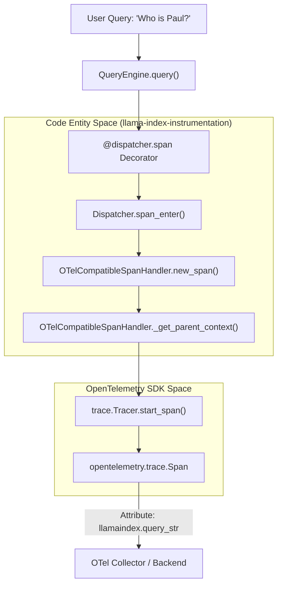
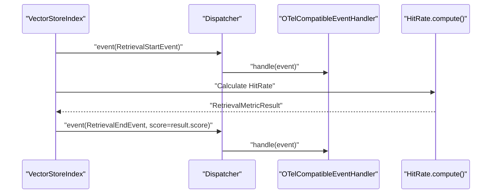

<!-- source: DeepWiki mcp.deepwiki.com · repo run-llama/llama_index · page 11.2 Observability Integrations · fetched 2026-10-26 -->

# Observability Integrations

<details>
<summary>Relevant source files</summary>

The following files were used as context for generating this wiki page:

- [llama-index-instrumentation/pyproject.toml](llama-index-instrumentation/pyproject.toml)
- [llama-index-instrumentation/src/llama_index_instrumentation/dispatcher.py](llama-index-instrumentation/src/llama_index_instrumentation/dispatcher.py)
- [llama-index-instrumentation/src/llama_index_instrumentation/event_handlers/base.py](llama-index-instrumentation/src/llama_index_instrumentation/event_handlers/base.py)
- [llama-index-instrumentation/src/llama_index_instrumentation/py.typed](llama-index-instrumentation/src/llama_index_instrumentation/py.typed)
- [llama-index-instrumentation/src/llama_index_instrumentation/span_handlers/base.py](llama-index-instrumentation/src/llama_index_instrumentation/span_handlers/base.py)
- [llama-index-instrumentation/tests/test_dispatcher.py](llama-index-instrumentation/tests/test_dispatcher.py)
- [llama-index-instrumentation/tests/test_propagation.py](llama-index-instrumentation/tests/test_propagation.py)
- [llama-index-instrumentation/tests/test_shutdown.py](llama-index-instrumentation/tests/test_shutdown.py)
- [llama-index-instrumentation/uv.lock](llama-index-instrumentation/uv.lock)
- [llama-index-integrations/callbacks/llama-index-callbacks-langfuse/README.md](llama-index-integrations/callbacks/llama-index-callbacks-langfuse/README.md)
- [llama-index-integrations/callbacks/llama-index-callbacks-langfuse/llama_index/callbacks/langfuse/__init__.py](llama-index-integrations/callbacks/llama-index-callbacks-langfuse/llama_index/callbacks/langfuse/__init__.py)
- [llama-index-integrations/callbacks/llama-index-callbacks-langfuse/pyproject.toml](llama-index-integrations/callbacks/llama-index-callbacks-langfuse/pyproject.toml)
- [llama-index-integrations/embeddings/llama-index-embeddings-huggingface-openvino/Makefile](llama-index-integrations/embeddings/llama-index-embeddings-huggingface-openvino/Makefile)
- [llama-index-integrations/embeddings/llama-index-embeddings-huggingface-openvino/README.md](llama-index-integrations/embeddings/llama-index-embeddings-huggingface-openvino/README.md)
- [llama-index-integrations/embeddings/llama-index-embeddings-huggingface-openvino/llama_index/embeddings/huggingface_openvino/__init__.py](llama-index-integrations/embeddings/llama-index-embeddings-huggingface-openvino/llama_index/embeddings/huggingface_openvino/__init__.py)
- [llama-index-integrations/embeddings/llama-index-embeddings-huggingface-openvino/llama_index/embeddings/huggingface_openvino/base.py](llama-index-integrations/embeddings/llama-index-embeddings-huggingface-openvino/llama_index/embeddings/huggingface_openvino/base.py)
- [llama-index-integrations/embeddings/llama-index-embeddings-huggingface-openvino/pyproject.toml](llama-index-integrations/embeddings/llama-index-embeddings-huggingface-openvino/pyproject.toml)
- [llama-index-integrations/embeddings/llama-index-embeddings-openvino-genai/LICENSE](llama-index-integrations/embeddings/llama-index-embeddings-openvino-genai/LICENSE)
- [llama-index-integrations/embeddings/llama-index-embeddings-openvino-genai/Makefile](llama-index-integrations/embeddings/llama-index-embeddings-openvino-genai/Makefile)
- [llama-index-integrations/embeddings/llama-index-embeddings-openvino-genai/README.md](llama-index-integrations/embeddings/llama-index-embeddings-openvino-genai/README.md)
- [llama-index-integrations/embeddings/llama-index-embeddings-openvino-genai/llama_index/embeddings/openvino_genai/__init__.py](llama-index-integrations/embeddings/llama-index-embeddings-openvino-genai/llama_index/embeddings/openvino_genai/__init__.py)
- [llama-index-integrations/embeddings/llama-index-embeddings-openvino-genai/llama_index/embeddings/openvino_genai/base.py](llama-index-integrations/embeddings/llama-index-embeddings-openvino-genai/llama_index/embeddings/openvino_genai/base.py)
- [llama-index-integrations/embeddings/llama-index-embeddings-openvino-genai/pyproject.toml](llama-index-integrations/embeddings/llama-index-embeddings-openvino-genai/pyproject.toml)
- [llama-index-integrations/llms/llama-index-llms-openvino/llama_index/llms/openvino/base.py](llama-index-integrations/llms/llama-index-llms-openvino/llama_index/llms/openvino/base.py)
- [llama-index-integrations/observability/llama-index-observability-otel/.gitignore](llama-index-integrations/observability/llama-index-observability-otel/.gitignore)
- [llama-index-integrations/observability/llama-index-observability-otel/LICENSE](llama-index-integrations/observability/llama-index-observability-otel/LICENSE)
- [llama-index-integrations/observability/llama-index-observability-otel/Makefile](llama-index-integrations/observability/llama-index-observability-otel/Makefile)
- [llama-index-integrations/observability/llama-index-observability-otel/README.md](llama-index-integrations/observability/llama-index-observability-otel/README.md)
- [llama-index-integrations/observability/llama-index-observability-otel/llama_index/observability/otel/__init__.py](llama-index-integrations/observability/llama-index-observability-otel/llama_index/observability/otel/__init__.py)
- [llama-index-integrations/observability/llama-index-observability-otel/llama_index/observability/otel/base.py](llama-index-integrations/observability/llama-index-observability-otel/llama_index/observability/otel/base.py)
- [llama-index-integrations/observability/llama-index-observability-otel/llama_index/observability/otel/utils.py](llama-index-integrations/observability/llama-index-observability-otel/llama_index/observability/otel/utils.py)
- [llama-index-integrations/observability/llama-index-observability-otel/pyproject.toml](llama-index-integrations/observability/llama-index-observability-otel/pyproject.toml)
- [llama-index-integrations/observability/llama-index-observability-otel/tests/test_otel.py](llama-index-integrations/observability/llama-index-observability-otel/tests/test_otel.py)
- [llama-index-integrations/observability/llama-index-observability-otel/uv.lock](llama-index-integrations/observability/llama-index-observability-otel/uv.lock)
- [llama-index-integrations/postprocessor/llama-index-postprocessor-openvino-rerank/llama_index/postprocessor/openvino_rerank/base.py](llama-index-integrations/postprocessor/llama-index-postprocessor-openvino-rerank/llama_index/postprocessor/openvino_rerank/base.py)

</details>


LlamaIndex provides deep integrations with various observability and tracing platforms to monitor LLM application performance, debug complex RAG pipelines, and track execution costs. These integrations are built upon the `llama-index-instrumentation` framework, which utilizes a system of dispatchers, span handlers, and event handlers to capture granular data during execution [llama-index-instrumentation/src/llama_index_instrumentation/dispatcher.py:50-89]().

## OpenTelemetry Integration

The OpenTelemetry (OTel) integration allows LlamaIndex to export traces and spans to any OTel-compliant backend (e.g., Jaeger, Honeycomb, or AWS X-Ray). It maps LlamaIndex's internal instrumentation logic to the standardized OpenTelemetry API [llama-index-integrations/observability/llama-index-observability-otel/llama_index/observability/otel/base.py:48-51]().

### Architecture and Data Flow

The `LlamaIndexOpenTelemetry` class serves as the primary entry point. It configures a `TracerProvider` and attaches an `OTelCompatibleSpanHandler` to the global LlamaIndex dispatcher [llama-index-integrations/observability/llama-index-observability-otel/llama_index/observability/otel/base.py:307-315]().

**Trace Propagation Flow:**
1.  **Span Entry**: When a decorated function (using `@dispatcher.span`) is called, `OTelCompatibleSpanHandler.new_span()` is triggered [llama-index-integrations/observability/llama-index-observability-otel/llama_index/observability/otel/base.py:170-172]().
2.  **Context Resolution**: The handler checks for an existing OTel context. If a `parent_span_id` is provided and exists in `all_spans`, it links the new OTel span to that parent via `_get_parent_context()` [llama-index-integrations/observability/llama-index-observability-otel/llama_index/observability/otel/base.py:127-136]().
3.  **Attribute Injection**: LlamaIndex `instrument_tags` are converted into OTel span attributes. The system uses `_is_otel_supported_type()` to ensure values are compliant with OTel's expected primitive types or sequences [llama-index-integrations/observability/llama-index-observability-otel/llama_index/observability/otel/base.py:230-245]().
4.  **Span Exit**: Upon function completion, `prepare_to_exit_span()` flushes pending events from `_events_by_span` to the OTel span and ends the span context [llama-index-integrations/observability/llama-index-observability-otel/llama_index/observability/otel/base.py:210-223]().

### Mapping Natural Language Space to Code Entities

The following diagram illustrates how a high-level user query transitions into the OTel instrumentation code space.

**User Query to OTel Span Mapping**

Sources: [llama-index-instrumentation/src/llama_index_instrumentation/dispatcher.py:192-205](), [llama-index-integrations/observability/llama-index-observability-otel/llama_index/observability/otel/base.py:161-185]()

## Langfuse and WandB Integrations

LlamaIndex supports specialized callbacks for platforms like Langfuse and Weights & Biases (WandB). These integrations often use the legacy `CallbackManager` or the newer `BaseEventHandler` to track execution flow.

*   **Langfuse**: Tracks nested traces and generations, capturing input/output tokens and model metadata [llama-index-integrations/callbacks/llama-index-callbacks-langfuse/pyproject.toml:37-38]().
*   **WandB**: Logs traces and spans to Weights & Biases, enabling visualization of RAG pipelines and performance metrics over time.

## Arize Phoenix and Evaluation

Observability integrations frequently bridge to evaluation metrics. For example, when running retrieval tasks, metrics like `HitRate`, `MRR`, and `NDCG` are computed and can be logged to observability backends.

### Instrumentation Event Flow
When a component like a retriever or reranker executes, it dispatches events that handlers capture for logging.

**RAG Evaluation Event Flow**

Sources: [llama-index-instrumentation/src/llama_index_instrumentation/dispatcher.py:137-154]()

## Instrumentation Utilities

The observability ecosystem relies on utility functions to handle data serialization and type checking for external platforms.

### OTel Type Support
The `_is_otel_supported_type` function in the OTel integration ensures that only types compatible with the OTel SDK (int, str, bool, float, or sequences of these) are passed as span attributes [llama-index-integrations/observability/llama-index-observability-otel/llama_index/observability/otel/utils.py:8-17]().

### Dictionary Flattening
Complex metadata dictionaries are often flattened into dot-notation strings to satisfy the flat key-value requirements of backends. The `flatten_dict` function recursively processes nested dictionaries and JSON-serializes unsupported types [llama-index-integrations/observability/llama-index-observability-otel/llama_index/observability/otel/utils.py:29-53]().

**Data Transformation Example**
| Original Dictionary | Flattened Result |
| :--- | :--- |
| `{"user": {"id": 123}}` | `{"user.id": 123}` |
| `{"meta": [1, 2]}` | `{"meta": [1, 2]}` |
| `{"meta": [{"a": 1}]}` | `{"meta": "[{'a': 1}]"}` (JSON string) |

Sources: [llama-index-integrations/observability/llama-index-observability-otel/llama_index/observability/otel/utils.py:29-53]()

## Configuration and Usage

Observability is typically enabled by initializing the specific instrumentor and calling `start_registering()`. This attaches the handlers to the `llama_index_instrumentation` system.

```python
from llama_index.observability.otel import LlamaIndexOpenTelemetry

# 1. Initialize OTel Integration
instrumentor = LlamaIndexOpenTelemetry(
    service_name_or_resource="my-llm-app",
    debug=True
)

# 2. Register handlers with the global dispatcher
# This adds OTelCompatibleSpanHandler to the dispatcher's span_handlers
instrumentor.start_registering()

# 3. Execution (automatically instrumented via @dispatcher.span)
# The dispatcher will now call span_enter/span_exit on the OTel handler
```
Sources: [llama-index-integrations/observability/llama-index-observability-otel/llama_index/observability/otel/base.py:307-315](), [llama-index-instrumentation/src/llama_index_instrumentation/dispatcher.py:192-200]()

---

