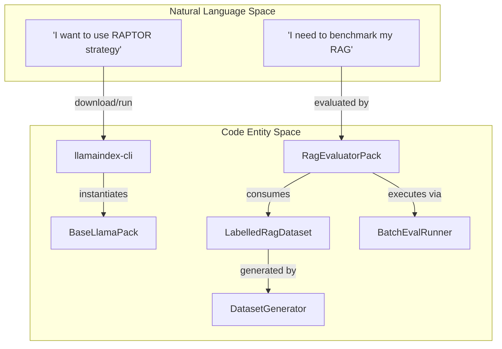
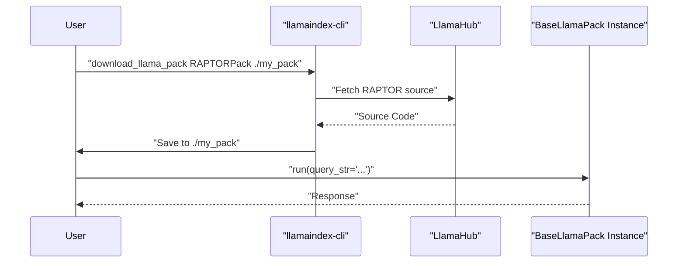

<!-- source: DeepWiki mcp.deepwiki.com · repo run-llama/llama_index · page 12 LlamaPacks and Datasets · fetched 2026-10-26 -->

# LlamaPacks and Datasets

Relevant source files

The following files were used as context for generating this wiki page:

- [docs/examples/retrievers/composable_retrievers.ipynb](docs/examples/retrievers/composable_retrievers.ipynb)
- [llama-index-core/llama_index/core/agent/react/prompts.py](llama-index-core/llama_index/core/agent/react/prompts.py)
- [llama-index-core/llama_index/core/agent/react/templates/system_header_template.md](llama-index-core/llama_index/core/agent/react/templates/system_header_template.md)
- [llama-index-core/llama_index/core/command_line/upgrade.py](llama-index-core/llama_index/core/command_line/upgrade.py)
- [llama-index-core/llama_index/core/embeddings/utils.py](llama-index-core/llama_index/core/embeddings/utils.py)
- [llama-index-core/llama_index/core/evaluation/batch_runner.py](llama-index-core/llama_index/core/evaluation/batch_runner.py)
- [llama-index-core/llama_index/core/evaluation/dataset_generation.py](llama-index-core/llama_index/core/evaluation/dataset_generation.py)
- [llama-index-core/llama_index/core/evaluation/eval_utils.py](llama-index-core/llama_index/core/evaluation/eval_utils.py)
- [llama-index-core/llama_index/core/ingestion/api_utils.py](llama-index-core/llama_index/core/ingestion/api_utils.py)
- [llama-index-core/llama_index/core/question_gen/llm_generators.py](llama-index-core/llama_index/core/question_gen/llm_generators.py)
- [llama-index-core/tests/embeddings/test_utils.py](llama-index-core/tests/embeddings/test_utils.py)
- [llama-index-core/tests/evaluation/test_batch_runner.py](llama-index-core/tests/evaluation/test_batch_runner.py)
- [llama-index-core/tests/evaluation/test_dataset_generation.py](llama-index-core/tests/evaluation/test_dataset_generation.py)
- [llama-index-core/tests/question_gen/test_llm_generators.py](llama-index-core/tests/question_gen/test_llm_generators.py)
- [llama-index-integrations/callbacks/llama-index-callbacks-wandb/llama_index/callbacks/wandb/base.py](llama-index-integrations/callbacks/llama-index-callbacks-wandb/llama_index/callbacks/wandb/base.py)
- [llama-index-integrations/callbacks/llama-index-callbacks-wandb/pyproject.toml](llama-index-integrations/callbacks/llama-index-callbacks-wandb/pyproject.toml)
- [llama-index-integrations/callbacks/llama-index-callbacks-wandb/tests/test_wandb_callback.py](llama-index-integrations/callbacks/llama-index-callbacks-wandb/tests/test_wandb_callback.py)
- [llama-index-integrations/indices/llama-index-indices-managed-llama-cloud/README.md](llama-index-integrations/indices/llama-index-indices-managed-llama-cloud/README.md)
- [llama-index-integrations/indices/llama-index-indices-managed-llama-cloud/pyproject.toml](llama-index-integrations/indices/llama-index-indices-managed-llama-cloud/pyproject.toml)
- [llama-index-integrations/indices/llama-index-indices-managed-llama-cloud/uv.lock](llama-index-integrations/indices/llama-index-indices-managed-llama-cloud/uv.lock)
- [llama-index-integrations/readers/llama-index-readers-llama-parse/README.md](llama-index-integrations/readers/llama-index-readers-llama-parse/README.md)
- [llama-index-integrations/readers/llama-index-readers-llama-parse/pyproject.toml](llama-index-integrations/readers/llama-index-readers-llama-parse/pyproject.toml)

LlamaIndex provides a suite of high-level templates and benchmarking tools to accelerate the development and evaluation of RAG (Retrieval-Augmented Generation) pipelines. **LlamaPacks** offer pre-packaged, end-to-end solutions for complex retrieval strategies, while **LlamaDatasets** provide the standardized data needed to measure their performance.

### System Overview

The relationship between these components is centered around the ability to quickly instantiate advanced patterns and then rigorously test them using the CLI or core evaluation abstractions. While LlamaPacks provide the implementation logic, LlamaDatasets provide the gold-standard evaluation data.

#### Code Entity Mapping
The following diagram shows how the high-level concepts map to specific classes and command-line entry points.

"LlamaPacks and Datasets Entity Mapping"

Sources: [llama-index-core/llama_index/core/evaluation/batch_runner.py:75-90](), [llama-index-core/llama_index/core/evaluation/dataset_generation.py:3-6](), [llama-index-integrations/indices/llama-index-indices-managed-llama-cloud/pyproject.toml:54-62]()

---

## LlamaPacks

LlamaPacks are templates designed to jumpstart LLM applications by providing a "full-stack" RAG pipeline in a single package. Unlike core components which are modular and atomic, a LlamaPack typically includes the index, retriever, and query engine configured for a specific advanced technique.

Key characteristics include:
- **Ready-to-use**: Can be initialized with minimal parameters.
- **Customizable**: The source code is often downloaded directly into your project, allowing for deep modification.
- **Advanced Strategies**: Includes implementations for RAPTOR, DenseXRetrieval, and RecursiveRetriever.

For details on installation and a directory of available packs, see [LlamaPacks](#12.1).

### CLI Usage for Packs
The `llamaindex-cli` serves as the primary interface for managing packs. It allows users to download packs from LlamaHub and run them directly.

"CLI to LlamaPack Interaction"

Sources: [llama-index-integrations/indices/llama-index-indices-managed-llama-cloud/pyproject.toml:54-62]()

---

## LlamaDatasets

Evaluation is critical for moving RAG pipelines from prototype to production. **LlamaDatasets** are standardized collections of documents, questions, and ground-truth answers used for benchmarking.

- **LabelledRagDataset**: The core class representing a dataset containing query-answer pairs and reference context.
- **RagEvaluatorPack**: A specialized LlamaPack that automates the evaluation of a query engine against a `LabelledRagDataset`.
- **Batch Evaluation**: The `BatchEvalRunner` class handles parallelized evaluation across multiple workers to speed up benchmarking [llama-index-core/llama_index/core/evaluation/batch_runner.py:75-98]().
- **Dataset Generation**: Use `DatasetGenerator` utilities to automatically create evaluation pairs from your own documents using LLMs [llama-index-core/llama_index/core/evaluation/dataset_generation.py:3-6]().

For details on the dataset formats and benchmarking procedures, see [LlamaDatasets](#12.2).

---

## Managed Indices and LlamaCloud

The framework integrates with managed services like **LlamaCloud** to provide production-grade parsing and retrieval. The `LlamaCloudIndex` and `LlamaCloudRetriever` allow users to offload the heavy lifting of ingestion and retrieval to a managed API [llama-index-integrations/indices/llama-index-indices-managed-llama-cloud/README.md:5-10]().

### Key Capabilities
- **Managed Ingestion**: Uses `LlamaParse` to handle complex document formats like PDFs, providing markdown or text outputs [llama-index-integrations/readers/llama-index-readers-llama-parse/README.md:33-40]().
- **Batch Processing**: The `BatchEvalRunner` validates and cleans input lists to ensure queries, responses, and contexts are aligned for scoring [llama-index-core/llama_index/core/evaluation/batch_runner.py:112-142]().
- **Visualization**: Evaluation results can be converted into DataFrames using `get_results_df` for easy analysis [llama-index-core/llama_index/core/evaluation/eval_utils.py:42-74]().
- **Sub-Question Generation**: The `LLMQuestionGenerator` can be used to decompose complex queries into smaller, evaluatable sub-questions [llama-index-core/llama_index/core/question_gen/llm_generators.py:20-38]().

For more information on managed indices and LlamaCloud, see [Managed Indices and LlamaCloud](#12.3).

| Component | Purpose | Code Reference |
| :--- | :--- | :--- |
| **BatchEvalRunner** | Parallel evaluation of query/response pairs | [llama-index-core/llama_index/core/evaluation/batch_runner.py:75]() |
| **LlamaCloudIndex** | Managed parsing and retrieval index | [llama-index-integrations/indices/llama-index-indices-managed-llama-cloud/pyproject.toml:59]() |
| **LlamaParse** | Advanced PDF and layout parsing | [llama-index-integrations/readers/llama-index-readers-llama-parse/pyproject.toml:65]() |
| **DatasetGenerator** | LLM-based QA pair generation from nodes | [llama-index-core/llama_index/core/evaluation/dataset_generation.py:117]() |
| **get_results_df** | Formats evaluation metrics into a table | [llama-index-core/llama_index/core/evaluation/eval_utils.py:42]() |
| **LLMQuestionGenerator** | Generates sub-questions for multi-step RAG | [llama-index-core/llama_index/core/question_gen/llm_generators.py:20]() |

Sources: [llama-index-core/llama_index/core/evaluation/batch_runner.py:75-142](), [llama-index-integrations/indices/llama-index-indices-managed-llama-cloud/README.md:45-70](), [llama-index-core/llama_index/core/evaluation/eval_utils.py:42-74](), [llama-index-core/llama_index/core/question_gen/llm_generators.py:20-50](), [llama-index-integrations/indices/llama-index-indices-managed-llama-cloud/pyproject.toml:59](), [llama-index-integrations/readers/llama-index-readers-llama-parse/pyproject.toml:65](), [llama-index-core/llama_index/core/evaluation/dataset_generation.py:117]()

---

