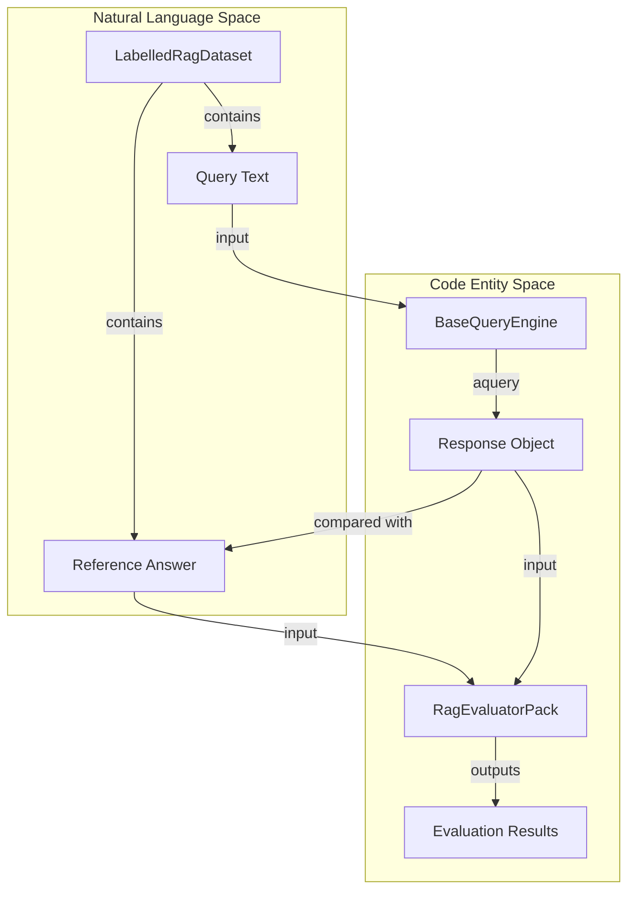
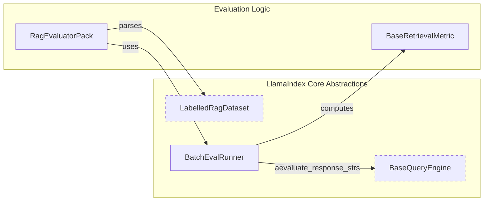

<!-- source: DeepWiki mcp.deepwiki.com · repo run-llama/llama_index · page 12.2 LlamaDatasets · fetched 2026-10-26 -->

# LlamaDatasets

<details>
<summary>Relevant source files</summary>

The following files were used as context for generating this wiki page:

- [docs/examples/retrievers/composable_retrievers.ipynb](docs/examples/retrievers/composable_retrievers.ipynb)
- [llama-index-core/llama_index/core/agent/react/prompts.py](llama-index-core/llama_index/core/agent/react/prompts.py)
- [llama-index-core/llama_index/core/agent/react/templates/system_header_template.md](llama-index-core/llama_index/core/agent/react/templates/system_header_template.md)
- [llama-index-core/llama_index/core/command_line/upgrade.py](llama-index-core/llama_index/core/command_line/upgrade.py)
- [llama-index-core/llama_index/core/embeddings/utils.py](llama-index-core/llama_index/core/embeddings/utils.py)
- [llama-index-core/llama_index/core/evaluation/batch_runner.py](llama-index-core/llama_index/core/evaluation/batch_runner.py)
- [llama-index-core/llama_index/core/evaluation/context_relevancy.py](llama-index-core/llama_index/core/evaluation/context_relevancy.py)
- [llama-index-core/llama_index/core/evaluation/dataset_generation.py](llama-index-core/llama_index/core/evaluation/dataset_generation.py)
- [llama-index-core/llama_index/core/evaluation/eval_utils.py](llama-index-core/llama_index/core/evaluation/eval_utils.py)
- [llama-index-core/llama_index/core/evaluation/faithfulness.py](llama-index-core/llama_index/core/evaluation/faithfulness.py)
- [llama-index-core/llama_index/core/evaluation/guideline.py](llama-index-core/llama_index/core/evaluation/guideline.py)
- [llama-index-core/llama_index/core/evaluation/pairwise.py](llama-index-core/llama_index/core/evaluation/pairwise.py)
- [llama-index-core/llama_index/core/evaluation/relevancy.py](llama-index-core/llama_index/core/evaluation/relevancy.py)
- [llama-index-core/llama_index/core/evaluation/retrieval/metrics.py](llama-index-core/llama_index/core/evaluation/retrieval/metrics.py)
- [llama-index-core/llama_index/core/evaluation/retrieval/metrics_base.py](llama-index-core/llama_index/core/evaluation/retrieval/metrics_base.py)
- [llama-index-core/llama_index/core/indices/multi_modal/retriever.py](llama-index-core/llama_index/core/indices/multi_modal/retriever.py)
- [llama-index-core/llama_index/core/ingestion/api_utils.py](llama-index-core/llama_index/core/ingestion/api_utils.py)
- [llama-index-core/llama_index/core/question_gen/llm_generators.py](llama-index-core/llama_index/core/question_gen/llm_generators.py)
- [llama-index-core/tests/embeddings/test_utils.py](llama-index-core/tests/embeddings/test_utils.py)
- [llama-index-core/tests/evaluation/test_batch_runner.py](llama-index-core/tests/evaluation/test_batch_runner.py)
- [llama-index-core/tests/evaluation/test_dataset_generation.py](llama-index-core/tests/evaluation/test_dataset_generation.py)
- [llama-index-core/tests/evaluation/test_metrics.py](llama-index-core/tests/evaluation/test_metrics.py)
- [llama-index-core/tests/question_gen/test_llm_generators.py](llama-index-core/tests/question_gen/test_llm_generators.py)
- [llama-index-integrations/callbacks/llama-index-callbacks-wandb/llama_index/callbacks/wandb/base.py](llama-index-integrations/callbacks/llama-index-callbacks-wandb/llama_index/callbacks/wandb/base.py)
- [llama-index-integrations/callbacks/llama-index-callbacks-wandb/pyproject.toml](llama-index-integrations/callbacks/llama-index-callbacks-wandb/pyproject.toml)
- [llama-index-integrations/callbacks/llama-index-callbacks-wandb/tests/test_wandb_callback.py](llama-index-integrations/callbacks/llama-index-callbacks-wandb/tests/test_wandb_callback.py)
- [llama-index-integrations/indices/llama-index-indices-managed-llama-cloud/README.md](llama-index-integrations/indices/llama-index-indices-managed-llama-cloud/README.md)
- [llama-index-integrations/indices/llama-index-indices-managed-llama-cloud/pyproject.toml](llama-index-integrations/indices/llama-index-indices-managed-llama-cloud/pyproject.toml)
- [llama-index-integrations/indices/llama-index-indices-managed-llama-cloud/uv.lock](llama-index-integrations/indices/llama-index-indices-managed-llama-cloud/uv.lock)
- [llama-index-integrations/readers/llama-index-readers-llama-parse/README.md](llama-index-integrations/readers/llama-index-readers-llama-parse/README.md)
- [llama-index-integrations/readers/llama-index-readers-llama-parse/pyproject.toml](llama-index-integrations/readers/llama-index-readers-llama-parse/pyproject.toml)

</details>


LlamaDatasets provide a standardized framework for benchmarking LLM applications, specifically Retrieval-Augmented Generation (RAG) pipelines. They allow developers to evaluate their systems against curated, high-quality "golden" datasets or to generate their own synthetic datasets for domain-specific evaluation.

## LabelledRagDataset

The core abstraction for RAG evaluation is the `LabelledRagDataset`. This dataset format encapsulates the necessary components to verify both retrieval and generation performance.

### Data Structure
A `LabelledRagDataset` consists of a collection of examples, where each example typically includes:
- **Query**: The input question or task.
- **Reference Answer**: The "ground truth" response (often generated by a superior model or human).
- **Reference Contexts**: The specific source text segments that justify the answer.

### Data Flow: Evaluation with LlamaDatasets

The following diagram illustrates how a `LabelledRagDataset` interacts with a user's `BaseQueryEngine` through the `RagEvaluatorPack`.

**RAG Evaluation Data Flow**


Sources:
- `[llama-index-core/llama_index/core/evaluation/batch_runner.py:65-72]()`

## RagEvaluatorPack

The `RagEvaluatorPack` is a specialized LlamaPack designed to streamline the evaluation of a `BaseQueryEngine` against a `LabelledRagDataset`. It automates the process of running queries, collecting responses, and calculating metrics such as faithfulness, relevancy, and hit rate.

### Key Components
- **Dataset Input**: Accepts a `LabelledRagDataset` or a path to one.
- **Query Engine**: Integrates with any implementation of `BaseQueryEngine`.
- **Judge LLM**: Uses an LLM (typically GPT-4) to act as a judge for qualitative metrics.
- **Batch Execution**: Uses `BatchEvalRunner` to parallelize evaluations across multiple workers `[llama-index-core/llama_index/core/evaluation/batch_runner.py:75-98]()`.

**System Association Diagram**


Sources:
- `[llama-index-core/llama_index/core/evaluation/batch_runner.py:75-98]()`
- `[llama-index-core/llama_index/core/evaluation/retrieval/metrics.py:16-161]()`

## Available Benchmark Datasets

LlamaIndex provides access to various pre-constructed datasets through LlamaHub. These datasets cover different domains and RAG complexities. Evaluation is performed using standard retrieval metrics implemented in the core library.

### Retrieval Metrics
When evaluating datasets, the following metrics are commonly used to measure performance:

| Metric | Code Entity | Description |
|--------|-------------|-------------|
| **Hit Rate** | `HitRate` | Measures if the expected document ID is within the retrieved list `[llama-index-core/llama_index/core/evaluation/retrieval/metrics.py:16-29]()`. |
| **MRR** | `MRR` | Mean Reciprocal Rank of the first relevant document `[llama-index-core/llama_index/core/evaluation/retrieval/metrics.py:83-96]()`. |
| **Precision** | `Precision` | Fraction of retrieved documents that are relevant `[llama-index-core/llama_index/core/evaluation/retrieval/metrics.py:161-172]()`. |
| **Recall** | `Recall` | Fraction of relevant documents that are retrieved `[llama-index-core/llama_index/core/evaluation/retrieval/metrics.py:230-241]()`. |
| **NDCG** | `NDCG` | Normalized Discounted Cumulative Gain `[llama-index-core/llama_index/core/evaluation/retrieval/metrics.py:359-373]()`. |

Metric calculations can be performed in "granular" mode (e.g., `use_granular_hit_rate` or `use_granular_mrr`) to account for multiple relevant documents rather than just the first hit `[llama-index-core/llama_index/core/evaluation/retrieval/metrics.py:70-74]()`, `[llama-index-core/llama_index/core/evaluation/retrieval/metrics.py:137-150]()`.

### Synthetic Dataset Generation
Developers can create custom `LabelledRagDataset` instances using the `RagDatasetGenerator`. This tool takes a set of `Document` objects and uses an LLM to generate pairs of queries and answers based on the content. The `LabelledRagDataset` is then populated with these synthetic examples for testing local RAG configurations.

Sources:
- `[llama-index-core/llama_index/core/evaluation/retrieval/metrics.py:16-400]()`
- `[llama-index-core/llama_index/core/evaluation/dataset_generation.py:10-50]()`
- `[llama-index-core/tests/evaluation/test_metrics.py:15-110]()`

## Implementation Example

The evaluation process typically follows these steps:
1. **Download**: Retrieve a dataset from LlamaHub.
2. **Initialize**: Setup your `VectorStoreIndex` and `QueryEngine`.
3. **Run**: Use `RagEvaluatorPack` to execute the benchmark.

The `BatchEvalRunner` handles the parallel execution of evaluators, allowing for simultaneous assessment of multiple metrics `[llama-index-core/llama_index/core/evaluation/batch_runner.py:87-98]()`. Evaluation results can be aggregated into a Pandas DataFrame for analysis using `get_results_df` `[llama-index-core/llama_index/core/evaluation/eval_utils.py:42-74]()`.

```python
from llama_index.core.llama_dataset import download_llama_dataset
from llama_index.packs.rag_evaluator import RagEvaluatorPack
from llama_index.core import VectorStoreIndex

# 1. Download dataset
rag_dataset, documents = download_llama_dataset("PaulGrahamEssayDataset", "./data")

# 2. Setup Query Engine
index = VectorStoreIndex.from_documents(documents)
query_engine = index.as_query_engine()

# 3. Evaluate using the pack
evaluator = RagEvaluatorPack(query_engine=query_engine, rag_dataset=rag_dataset)
benchmark_results = evaluator.run()
```

Sources:
- `[llama-index-core/llama_index/core/evaluation/batch_runner.py:75-98]()`
- `[llama-index-core/llama_index/core/evaluation/eval_utils.py:42-74]()`

---

