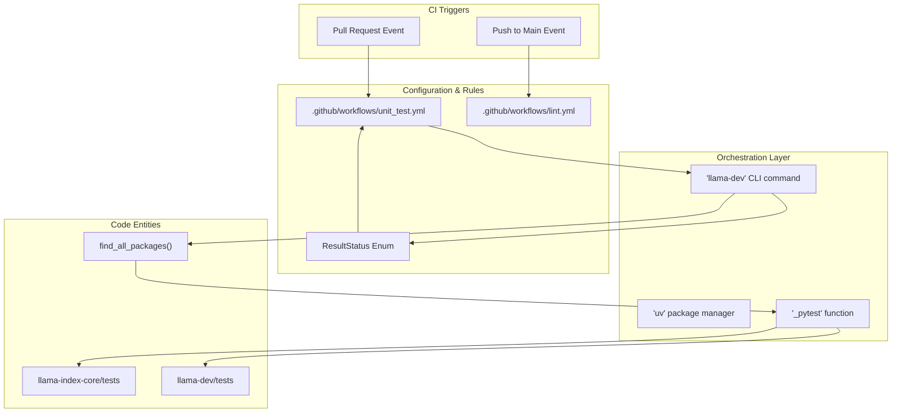
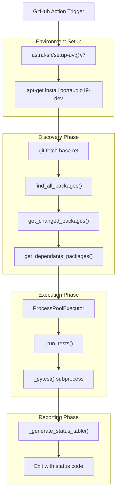

<!-- source: DeepWiki mcp.deepwiki.com · repo run-llama/llama_index · page 13.1 Testing System · fetched 2026-10-26 -->

# Testing System

<details>
<summary>Relevant source files</summary>

The following files were used as context for generating this wiki page:

- [.github/workflows/build_package.yml](.github/workflows/build_package.yml)
- [.github/workflows/codeql.yml](.github/workflows/codeql.yml)
- [.github/workflows/core-typecheck.yml](.github/workflows/core-typecheck.yml)
- [.github/workflows/coverage_check.yml](.github/workflows/coverage_check.yml)
- [.github/workflows/issue_classifier.yml](.github/workflows/issue_classifier.yml)
- [.github/workflows/lint.yml](.github/workflows/lint.yml)
- [.github/workflows/llama_dev_tests.yml](.github/workflows/llama_dev_tests.yml)
- [.github/workflows/pre_release.yml](.github/workflows/pre_release.yml)
- [.github/workflows/publish_sub_package.yml](.github/workflows/publish_sub_package.yml)
- [.github/workflows/release.yml](.github/workflows/release.yml)
- [.github/workflows/unit_test.yml](.github/workflows/unit_test.yml)
- [docs/scripts/prepare_for_build.py](docs/scripts/prepare_for_build.py)
- [llama-dev/.gitignore](llama-dev/.gitignore)
- [llama-dev/LICENSE](llama-dev/LICENSE)
- [llama-dev/README.md](llama-dev/README.md)
- [llama-dev/llama_dev/__init__.py](llama-dev/llama_dev/__init__.py)
- [llama-dev/llama_dev/__main__.py](llama-dev/llama_dev/__main__.py)
- [llama-dev/llama_dev/cli.py](llama-dev/llama_dev/cli.py)
- [llama-dev/llama_dev/pkg/__init__.py](llama-dev/llama_dev/pkg/__init__.py)
- [llama-dev/llama_dev/pkg/cmd_exec.py](llama-dev/llama_dev/pkg/cmd_exec.py)
- [llama-dev/llama_dev/pkg/info.py](llama-dev/llama_dev/pkg/info.py)
- [llama-dev/llama_dev/release/check.py](llama-dev/llama_dev/release/check.py)
- [llama-dev/llama_dev/test/__init__.py](llama-dev/llama_dev/test/__init__.py)
- [llama-dev/tests/__init__.py](llama-dev/tests/__init__.py)
- [llama-dev/tests/conftest.py](llama-dev/tests/conftest.py)
- [llama-dev/tests/data/llama-index-utils/util/pyproject.toml](llama-dev/tests/data/llama-index-utils/util/pyproject.toml)
- [llama-dev/tests/pkg/test_bump.py](llama-dev/tests/pkg/test_bump.py)
- [llama-dev/tests/pkg/test_cmd_exec.py](llama-dev/tests/pkg/test_cmd_exec.py)
- [llama-dev/tests/pkg/test_info.py](llama-dev/tests/pkg/test_info.py)
- [llama-dev/tests/release/test_check.py](llama-dev/tests/release/test_check.py)
- [llama-dev/tests/test/test_test.py](llama-dev/tests/test/test_test.py)
- [llama-dev/tests/test_cli.py](llama-dev/tests/test_cli.py)

</details>


This document describes the testing infrastructure for the LlamaIndex monorepo, including the `llama-dev` CLI tool that orchestrates test execution, selective testing strategies for 300+ packages, parallel execution, coverage enforcement, and the Python version test matrix.

## Purpose and Scope

The testing system ensures code quality across the entire LlamaIndex monorepo while enabling rapid development. The system handles the unique challenges of testing 300+ packages in a single repository, including:

-   **Selective testing**: Running tests only for changed packages and their dependants to minimize CI execution time [[llama-dev/llama_dev/test/__init__.py:126-139]]().
-   **Parallel execution**: Distributing test workload across multiple workers (default 8) [[.github/workflows/unit_test.yml:7-8]]().
-   **Coverage enforcement**: Maintaining a minimum test coverage threshold during CI runs [[.github/workflows/unit_test.yml:69-70]]().
-   **Multi-version compatibility**: Testing across Python 3.10, 3.11, 3.12 [[.github/workflows/unit_test.yml:16-16]](), and experimental support for 3.14 [[.github/workflows/unit_test.yml:58-58]]().
-   **Mocking patterns**: Requiring external systems to be mocked to prevent flakey tests and dependency on external APIs.

The core orchestrator for all testing operations is the `llama-dev` CLI tool, which provides intelligent test discovery, execution, and reporting.

## Testing Architecture

The testing system uses a centralized CLI tool (`llama-dev`) to coordinate test execution across the monorepo. Tests are executed using `pytest`, with support for coverage measurement, parallel execution via `ProcessPoolExecutor`, and selective package discovery.

### Natural Language to Code Entity Space: Test Orchestration

The following diagram maps high-level testing concepts to specific code entities and configurations used in the LlamaIndex repository.

Title: Test Orchestration Mapping


Sources: [[.github/workflows/unit_test.yml:1-42]](), [[llama-dev/llama_dev/test/__init__.py:25-34]](), [[llama-dev/llama_dev/test/__init__.py:72-102]](), [[llama-dev/llama_dev/utils.py:14-22]]()

## llama-dev CLI: Central Test Orchestrator

The `llama-dev` CLI is the keystone of the testing system. It provides intelligent test execution that understands the monorepo structure and can selectively test only changed packages and their dependants.

### Core Testing Command

The typical invocation used in CI environments is as follows:

```bash
uv run -- llama-dev \
  --repo-root ".." test \
  --workers 8 \
  --base-ref origin/main
```

### Key Features

| Feature | Flag | Description |
|---------|------|-------------|
| **Selective Testing** | `--base-ref <ref>` | Tests only packages changed since the specified git reference [[llama-dev/llama_dev/test/__init__.py:90-90]](). |
| **Parallel Execution** | `--workers <n>` | Distributes tests across n concurrent workers (default: 8) [[llama-dev/llama_dev/test/__init__.py:91-91]](). |
| **Coverage Measurement** | `--cov` | Collects code coverage for the specified package [[llama-dev/llama_dev/test/__init__.py:80-84]](). |
| **Fail Fast** | `--fail-fast` | Exits the command at the first failure [[llama-dev/llama_dev/test/__init__.py:74-78]](). |

Sources: [[llama-dev/llama_dev/test/__init__.py:72-102]](), [[.github/workflows/unit_test.yml:33-41]]()

## Test Execution Flow

The testing pipeline transitions from high-level CI events to granular package testing using a process pool.

Title: Data Flow for Test Execution


Sources: [[.github/workflows/unit_test.yml:22-41]](), [[llama-dev/llama_dev/test/__init__.py:121-158]](), [[llama-dev/llama_dev/test/__init__.py:40-69]]()

## Selective Testing Strategy

The `llama-dev test` command implements a sophisticated discovery logic to minimize redundant testing:

1.  **Identify Changed Files**: Uses `git diff` against the `--base-ref` to find modified files [[llama-dev/llama_dev/test/__init__.py:127-127]]().
2.  **Map to Packages**: Determines which packages contain the modified files [[llama-dev/llama_dev/test/__init__.py:129-129]]().
3.  **Identify Dependants**: If coverage is not being measured, it finds all packages that depend on the changed packages [[llama-dev/llama_dev/test/__init__.py:136-136]]().
4.  **Combined Set**: Tests the union of directly affected packages and their dependants [[llama-dev/llama_dev/test/__init__.py:139-139]]().

### Python Version Matrix
Compatibility is validated across a matrix of Python versions:
-   **3.10, 3.11, 3.12**: Standard matrix for all PRs [[.github/workflows/unit_test.yml:16-16]]().
-   **3.14**: Experimental testing specifically for `llama-index-core` [[.github/workflows/unit_test.yml:43-71]]().

Sources: [[llama-dev/llama_dev/test/__init__.py:123-140]](), [[.github/workflows/unit_test.yml:13-16]]()

## Mocking and Linting Patterns

### Mocking External Services
LlamaIndex requires external systems (LLMs, Vector Stores, APIs) to be mocked in unit tests to ensure they are deterministic. The `ResultStatus` enum includes `TESTS_FAILED` and `INSTALL_FAILED` to distinguish between execution errors and environment setup issues [[llama-dev/llama_dev/test/__init__.py:25-34]](). Examples of mocked failure scenarios are implemented in `llama-dev`'s own test suite [[llama-dev/tests/test/test_test.py:11-58]]().

### Linting Suite
Before tests are considered passing, code must comply with the linting rules. The linting workflow uses `uv run -- pre-commit run -a` [[.github/workflows/lint.yml:23-23]]().
-   **Mypy**: Specifically enforced for `llama-index-core` [[.github/workflows/core-typecheck.yml:25-25]]().
-   **Pre-commit**: Orchestrates various hooks including formatters and linters [[.github/workflows/lint.yml:23-23]]().

Sources: [[.github/workflows/lint.yml:1-24]](), [[.github/workflows/core-typecheck.yml:1-26]](), [[llama-dev/tests/test/test_test.py:11-58]]()

## Running Tests Locally

Developers use the `llama-dev` CLI or standard `pytest` for local validation.

### Local Commands

| Task | Command | Description |
|------|---------|-------------|
| **Setup** | `uv sync` | Installs dependencies and sets up the environment [[.github/workflows/release.yml:34-34]](). |
| **Test Package** | `uv run pytest tests` | Runs tests for a specific package directory [[.github/workflows/release.yml:52-52]](). |
| **Full Monorepo Test** | `uv run -- llama-dev test --base-ref main` | Runs selective tests locally against the main branch. |
| **Typecheck** | `uv run -- mypy llama_index` | Runs static type checking for core [[.github/workflows/core-typecheck.yml:25-25]](). |

### Environment Pre-population
For `llama-index-core` tests, the CI pre-populates caches for `nltk` and `tiktoken` to avoid network calls during test execution:
-   Populates stopwords and punkt tokenizer [[.github/workflows/release.yml:39-39]]().
-   Populates default and specific (e.g., gpt-5-mini) tiktoken tokenizers [[.github/workflows/release.yml:40-41]]().

Sources: [[.github/workflows/release.yml:36-41]](), [[.github/workflows/core-typecheck.yml:25-25]]()

---

