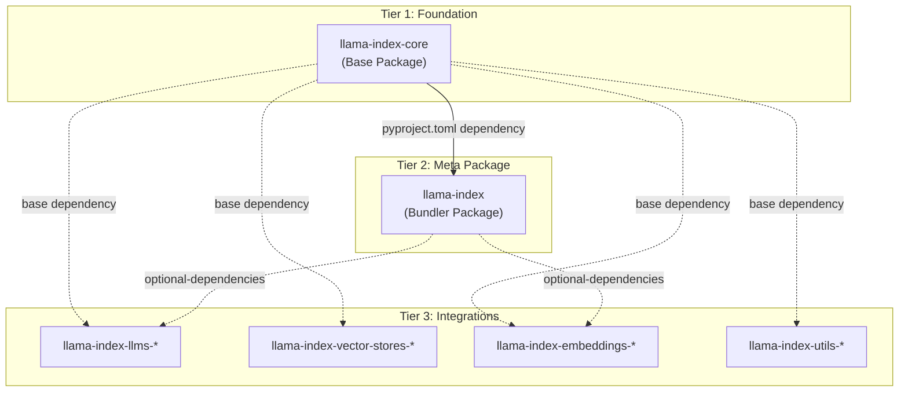
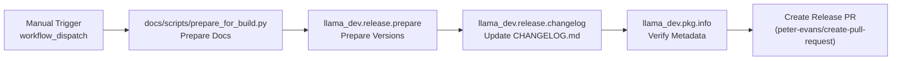
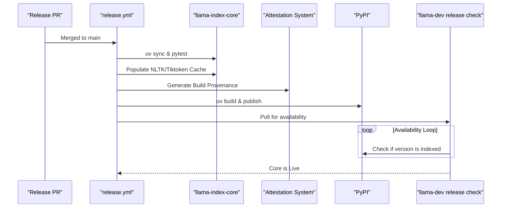

<!-- source: DeepWiki mcp.deepwiki.com · repo run-llama/llama_index · page 13.2 Release Process · fetched 2026-10-26 -->

# Release Process

<details>
<summary>Relevant source files</summary>

The following files were used as context for generating this wiki page:

- [.github/workflows/build_package.yml](.github/workflows/build_package.yml)
- [.github/workflows/codeql.yml](.github/workflows/codeql.yml)
- [.github/workflows/core-typecheck.yml](.github/workflows/core-typecheck.yml)
- [.github/workflows/coverage_check.yml](.github/workflows/coverage_check.yml)
- [.github/workflows/issue_classifier.yml](.github/workflows/issue_classifier.yml)
- [.github/workflows/lint.yml](.github/workflows/lint.yml)
- [.github/workflows/llama_dev_tests.yml](.github/workflows/llama_dev_tests.yml)
- [.github/workflows/pre_release.yml](.github/workflows/pre_release.yml)
- [.github/workflows/publish_sub_package.yml](.github/workflows/publish_sub_package.yml)
- [.github/workflows/release.yml](.github/workflows/release.yml)
- [.github/workflows/unit_test.yml](.github/workflows/unit_test.yml)
- [CHANGELOG.md](CHANGELOG.md)
- [docs/api_reference/api_reference/llms/azure_openai.md](docs/api_reference/api_reference/llms/azure_openai.md)
- [docs/api_reference/api_reference/llms/minimax.md](docs/api_reference/api_reference/llms/minimax.md)
- [docs/api_reference/api_reference/llms/openai_like.md](docs/api_reference/api_reference/llms/openai_like.md)
- [docs/api_reference/api_reference/llms/sarvam.md](docs/api_reference/api_reference/llms/sarvam.md)
- [docs/api_reference/api_reference/memory/bedrock_agentcore.md](docs/api_reference/api_reference/memory/bedrock_agentcore.md)
- [docs/api_reference/api_reference/postprocessor/google_rerank.md](docs/api_reference/api_reference/postprocessor/google_rerank.md)
- [docs/api_reference/api_reference/storage/vector_store/solr.md](docs/api_reference/api_reference/storage/vector_store/solr.md)
- [docs/api_reference/api_reference/tools/aws_bedrock_agentcore.md](docs/api_reference/api_reference/tools/aws_bedrock_agentcore.md)
- [docs/api_reference/mkdocs.yml](docs/api_reference/mkdocs.yml)
- [docs/scripts/prepare_for_build.py](docs/scripts/prepare_for_build.py)
- [docs/src/content/docs/framework/CHANGELOG.md](docs/src/content/docs/framework/CHANGELOG.md)
- [docs/src/content/docs/framework/CONTRIBUTING.md](docs/src/content/docs/framework/CONTRIBUTING.md)
- [llama-dev/.gitignore](llama-dev/.gitignore)
- [llama-dev/LICENSE](llama-dev/LICENSE)
- [llama-dev/README.md](llama-dev/README.md)
- [llama-dev/llama_dev/__init__.py](llama-dev/llama_dev/__init__.py)
- [llama-dev/llama_dev/__main__.py](llama-dev/llama_dev/__main__.py)
- [llama-dev/llama_dev/cli.py](llama-dev/llama_dev/cli.py)
- [llama-dev/llama_dev/pkg/__init__.py](llama-dev/llama_dev/pkg/__init__.py)
- [llama-dev/llama_dev/pkg/cmd_exec.py](llama-dev/llama_dev/pkg/cmd_exec.py)
- [llama-dev/llama_dev/pkg/info.py](llama-dev/llama_dev/pkg/info.py)
- [llama-dev/llama_dev/release/check.py](llama-dev/llama_dev/release/check.py)
- [llama-dev/llama_dev/test/__init__.py](llama-dev/llama_dev/test/__init__.py)
- [llama-dev/tests/__init__.py](llama-dev/tests/__init__.py)
- [llama-dev/tests/conftest.py](llama-dev/tests/conftest.py)
- [llama-dev/tests/data/llama-index-utils/util/pyproject.toml](llama-dev/tests/data/llama-index-utils/util/pyproject.toml)
- [llama-dev/tests/pkg/test_bump.py](llama-dev/tests/pkg/test_bump.py)
- [llama-dev/tests/pkg/test_cmd_exec.py](llama-dev/tests/pkg/test_cmd_exec.py)
- [llama-dev/tests/pkg/test_info.py](llama-dev/tests/pkg/test_info.py)
- [llama-dev/tests/release/test_check.py](llama-dev/tests/release/test_check.py)
- [llama-dev/tests/test/test_test.py](llama-dev/tests/test/test_test.py)
- [llama-dev/tests/test_cli.py](llama-dev/tests/test_cli.py)
- [llama-index-core/llama_index/core/__init__.py](llama-index-core/llama_index/core/__init__.py)
- [llama-index-core/pyproject.toml](llama-index-core/pyproject.toml)
- [llama-index-core/uv.lock](llama-index-core/uv.lock)
- [pyproject.toml](pyproject.toml)
- [uv.lock](uv.lock)

</details>


This document describes the automated release process for publishing LlamaIndex packages to PyPI. It covers the three-phase release workflow (pre-release, core publishing, and dependent publishing), sub-package auto-publishing, and the tooling infrastructure that orchestrates the entire monorepo.

---

## Release Architecture Overview

The LlamaIndex release process is designed to handle a monorepo with hundreds of packages through a three-tier architecture. The system ensures correct dependency ordering, provides human review checkpoints, and automates most of the publishing workflow.

**Three-Tier Package Structure:**



**Release Workflows:**

The release system consists of four primary GitHub Actions workflows:

| Workflow | Trigger | Purpose | Key Commands |
|----------|---------|---------|-------------|
| `pre_release.yml` | Manual dispatch | Prepare release PR with version bumps and changelog | `llama-dev release prepare`, `llama-dev release changelog` |
| `release.yml` | PR merge to main | Publish core and meta packages | `uv build`, `uv publish`, `llama-dev release check` |
| `publish_sub_package.yml` | Push to main | Auto-publish changed integration sub-packages | `uv publish` (triggered by `pyproject.toml` changes) |
| `sync-docs.yml` | Push to docs/ | Sync markdown and API refs to developer hub | `scripts/sync-docs-to-developer-hub.sh` |

Sources: [.github/workflows/pre_release.yml:3-13](), [.github/workflows/release.yml:3-10](), [.github/workflows/publish_sub_package.yml:3-16](), [docs/scripts/prepare_for_build.py:1-10]()

---

## Phase 1: Pre-Release Preparation

The pre-release phase is initiated manually by maintainers and prepares all version bumps and changelogs for review via the `llama-dev` CLI tool.

**Pre-Release Flow:**



**Implementation Details:**

The `prepare-release` job uses `llama-dev` to automate monorepo-wide updates:

1.  **Documentation Preparation**: The `docs/scripts/prepare_for_build.py` script is run to prepare documentation assets before versioning changes are applied [.github/workflows/pre_release.yml:35-38]().
2.  **Version Bumping**: The `release prepare` command calculates the next version based on the input `version-type` (patch, minor, or major) [.github/workflows/pre_release.yml:47]().
3.  **Changelog Maintenance**: The `release changelog` command updates the project's history based on recent commits [.github/workflows/pre_release.yml:48](). This command generates the content for `CHANGELOG.md` and `docs/src/content/docs/framework/CHANGELOG.md` files.
4.  **Validation**: It runs `pre-commit` hooks across the repo to ensure consistency before opening the PR [.github/workflows/pre_release.yml:51]().

Sources: [.github/workflows/pre_release.yml:20-62](), [docs/scripts/prepare_for_build.py:1-10](), [CHANGELOG.md:1-161](), [docs/src/content/docs/framework/CHANGELOG.md:1-114]()

---

## Phase 2: Core Package Publishing

Once the release PR is merged into `main`, the core publishing workflow begins. This phase is critical because all other packages depend on `llama-index-core`.

**Core Publishing Workflow:**



**Cache Population & Provenance:**

The workflow pre-populates NLTK and Tiktoken data to ensure `llama-index-core` has necessary static assets cached before build [.github/workflows/release.yml:36-41](). This involves importing `globals_helper` and `get_tokenizer` from `llama_index.core.utils` to trigger the caching mechanism. It also generates build provenance attestations for security [.github/workflows/release.yml:43-48]().

**Propagation Check:**

To avoid race conditions where dependent packages fail to find the new core version, `llama-dev release check` polls PyPI until the new version is available [.github/workflows/release.yml:61-69](). The `release check` command is implemented in `llama-dev/llama_dev/release/check.py`.

Sources: [.github/workflows/release.yml:17-70](), [llama-index-core/llama_index/core/__init__.py:87-88](), [llama-dev/llama_dev/release/check.py:1-20]()

---

## Phase 3: Meta Package and GitHub Release

After the core package is confirmed available on PyPI, the `llama-index` meta-package (located at the repo root) is published.

**Meta Package Workflow:**

1.  **Version Extraction**: The version is retrieved dynamically using `llama-dev pkg info --json .` [.github/workflows/release.yml:109](). This command queries the `pyproject.toml` file at the repository root to get the current version, e.g., `0.14.25` as seen in [pyproject.toml:69]().
2.  **Publishing**: Standard `uv build` and `uv publish` steps are executed using the `LLAMA_INDEX_PYPI_TOKEN` [.github/workflows/release.yml:116-120]().
3.  **GitHub Release**: Uses the `gh` CLI to create a release with notes parsed from the CHANGELOG [.github/workflows/release.yml:130-137](). The release notes are generated by `CSchoel/release-notes-from-changelog@v1` action, which extracts relevant entries from `CHANGELOG.md`.

Sources: [.github/workflows/release.yml:91-137](), [pyproject.toml:69]()

---

## Sub-Package Auto-Publishing

Integration packages (e.g., `llama-index-llms-openai`) follow an automated continuous deployment model.

**Detection Logic:**

The `publish_sub_package.yml` workflow detects changes to `pyproject.toml` files in any directory *except* `llama-index-core` [.github/workflows/publish_sub_package.yml:23-25](). It also supports manual triggering via `workflow_dispatch` where specific packages can be provided, or it can scan all sub-packages to publish any whose local version is missing from PyPI [.github/workflows/publish_sub_package.yml:9-15](). The `uv.lock` files, such as [uv.lock:1-57]() and [llama-index-core/uv.lock:1-58](), are also part of the package definition and are considered during change detection.

**Publishing Loop:**

For every detected package directory, the workflow executes:
```bash
uv sync && uv build && uv publish --token "$PYPI_TOKEN"
```
If one package fails to publish (e.g., version already exists), the script logs the error but continues with the remaining packages in the queue [.github/workflows/publish_sub_package.yml:47-54](). The `uv sync` command is skipped during `workflow_dispatch` to avoid exhausting runner resources when publishing many packages [.github/workflows/publish_sub_package.yml:77-80]().

Sources: [.github/workflows/publish_sub_package.yml:1-124](), [uv.lock:1-57](), [llama-index-core/uv.lock:1-58]()

---

## Documentation and API Sync

The release process includes a synchronization step to the `run-llama/developers` hub.

**Sync Workflow (`sync-docs.yml`):**

This workflow triggers on pushes to the `docs/` path on the `main` branch [.github/workflows/sync-docs.yml:3-7](). It executes `scripts/sync-docs-to-developer-hub.sh`, which performs:

1.  **Markdown Sync**: Rsyncs framework docs from `docs/src/content/docs/framework` [.scripts/sync-docs-to-developer-hub.sh:45-80]().
2.  **API Reference Build**: Uses `mkdocs` with a specific dependency set (including `mkdocstrings`, `griffe-fieldz`, and `mkdocs-material`) to build the HTML reference [.scripts/sync-docs-to-developer-hub.sh:98-115](). The `mkdocs.yml` configuration file, such as [docs/api_reference/mkdocs.yml:1-116](), specifies the paths for API reference generation, including `llama-index-core` and various integration packages.
3.  **Notebook Conversion**: Converts Jupyter examples to markdown using `nbconvert` and `scripts/convert-examples.py` [.scripts/sync-docs-to-developer-hub.sh:133-151]().

Sources: [scripts/sync-docs-to-developer-hub.sh:1-154](), [.github/workflows/sync-docs.yml:1-83](), [docs/api_reference/mkdocs.yml:1-116]()

---

