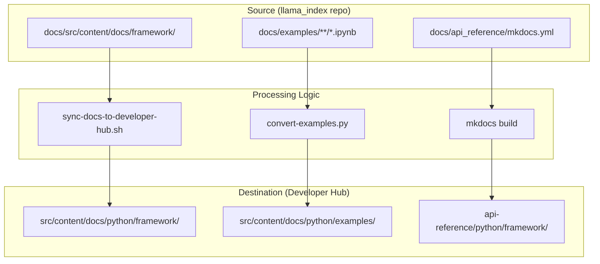
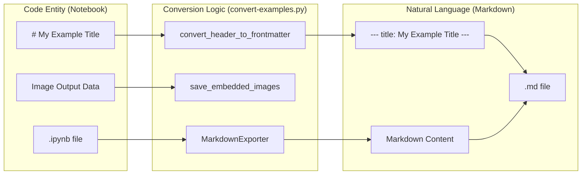

<!-- source: DeepWiki mcp.deepwiki.com · repo run-llama/llama_index · page 13.3 Documentation System · fetched 2026-10-26 -->

# Documentation System

Relevant source files

The following files were used as context for generating this wiki page:

- [.github/workflows/sync-docs.yml](.github/workflows/sync-docs.yml)
- [docs/api_reference/poetry.lock](docs/api_reference/poetry.lock)
- [docs/api_reference/pyproject.toml](docs/api_reference/pyproject.toml)
- [docs/examples/llama_cloud/figure_retrieval.ipynb](docs/examples/llama_cloud/figure_retrieval.ipynb)
- [llama-index-core/llama_index/core/node_parser/file/markdown.py](llama-index-core/llama_index/core/node_parser/file/markdown.py)
- [llama-index-core/tests/node_parser/test_markdown.py](llama-index-core/tests/node_parser/test_markdown.py)
- [llama-index-integrations/embeddings/llama-index-embeddings-gaudi/Makefile](llama-index-integrations/embeddings/llama-index-embeddings-gaudi/Makefile)
- [llama-index-integrations/embeddings/llama-index-embeddings-gaudi/README.md](llama-index-integrations/embeddings/llama-index-embeddings-gaudi/README.md)
- [llama-index-integrations/embeddings/llama-index-embeddings-gaudi/examples/README.md](llama-index-integrations/embeddings/llama-index-embeddings-gaudi/examples/README.md)
- [llama-index-integrations/embeddings/llama-index-embeddings-gaudi/examples/basic.py](llama-index-integrations/embeddings/llama-index-embeddings-gaudi/examples/basic.py)
- [llama-index-integrations/embeddings/llama-index-embeddings-gaudi/examples/graphrag.py](llama-index-integrations/embeddings/llama-index-embeddings-gaudi/examples/graphrag.py)
- [llama-index-integrations/embeddings/llama-index-embeddings-gaudi/examples/requirements.txt](llama-index-integrations/embeddings/llama-index-embeddings-gaudi/examples/requirements.txt)
- [llama-index-integrations/embeddings/llama-index-embeddings-gaudi/llama_index/embeddings/gaudi/__init__.py](llama-index-integrations/embeddings/llama-index-embeddings-gaudi/llama_index/embeddings/gaudi/__init__.py)
- [llama-index-integrations/embeddings/llama-index-embeddings-gaudi/llama_index/embeddings/gaudi/base.py](llama-index-integrations/embeddings/llama-index-embeddings-gaudi/llama_index/embeddings/gaudi/base.py)
- [llama-index-integrations/embeddings/llama-index-embeddings-gaudi/pyproject.toml](llama-index-integrations/embeddings/llama-index-embeddings-gaudi/pyproject.toml)
- [llama-index-integrations/extractors/llama-index-extractors-entity/uv.lock](llama-index-integrations/extractors/llama-index-extractors-entity/uv.lock)
- [llama-index-integrations/readers/llama-index-readers-docling/uv.lock](llama-index-integrations/readers/llama-index-readers-docling/uv.lock)
- [llama-index-integrations/readers/llama-index-readers-sec-filings/requirements.txt](llama-index-integrations/readers/llama-index-readers-sec-filings/requirements.txt)
- [llama-index-integrations/readers/llama-index-readers-service-now/requirements.txt](llama-index-integrations/readers/llama-index-readers-service-now/requirements.txt)
- [llama-index-integrations/readers/llama-index-readers-service-now/uv.lock](llama-index-integrations/readers/llama-index-readers-service-now/uv.lock)
- [scripts/convert-examples.py](scripts/convert-examples.py)
- [scripts/sync-docs-to-developer-hub.sh](scripts/sync-docs-to-developer-hub.sh)

## Purpose and Scope

This document describes the technical infrastructure for generating and hosting the LlamaIndex documentation. It covers the synchronization of framework docs to the developer hub, the MkDocs static site generation for API references, and the automated pipeline for converting Jupyter notebook examples into Astro-compatible markdown. The system consolidates documentation from `llama-index-core` and over 300 integration packages.

## Build System Overview

The LlamaIndex documentation system uses a multi-stage pipeline. Framework documentation is written in Markdown/MDX, while the API reference is generated from source code using MkDocs and `mkdocstrings`. Examples are maintained as Jupyter notebooks and converted via a specialized script.

Title: Documentation Sync and Build Pipeline

**Sources:** [scripts/sync-docs-to-developer-hub.sh:1-27]()

## Sync and Deployment Pipeline

The documentation is synchronized from the main `llama_index` repository to a dedicated `run-llama/developers` repository (the Developer Hub) via GitHub Actions [[.github/workflows/sync-docs.yml:1-5]]().

### Automation Workflow
The `Sync Docs to Developer Hub` workflow triggers on pushes to the `main` branch affecting the `docs/` directory [[.github/workflows/sync-docs.yml:3-7]](). It performs the following steps:
1.  **Environment Setup**: Installs `uv` and synchronizes project dependencies using `uv sync` [[.github/workflows/sync-docs.yml:40-47]]().
2.  **Framework Sync**: Uses `rsync` to move markdown, images, and YAML files while excluding internal docs like `CONTRIBUTING.md` and `DOCS_README.md` [[scripts/sync-docs-to-developer-hub.sh:65-80]]().
3.  **API Build**: Builds the API reference using `mkdocs` with dependencies (like `mkdocstrings` and `griffe-fieldz`) installed on-the-fly via `uv run --with` to avoid polluting the main project environment [[scripts/sync-docs-to-developer-hub.sh:109-115]]().
4.  **Example Conversion**: Converts notebooks to markdown using `nbconvert` and `nbformat` [[scripts/sync-docs-to-developer-hub.sh:138-151]]().

**Sources:** [.github/workflows/sync-docs.yml:1-83](), [scripts/sync-docs-to-developer-hub.sh:1-154]()

## API Reference Generation

The API reference is powered by MkDocs and the `mkdocstrings` Python handler. The configuration is defined in `docs/api_reference/mkdocs.yml`.

### MkDocs Configuration
The build uses several specialized plugins and configurations to handle the monorepo structure:
*   **Python Handler**: Uses the `google` docstring style and `griffe-fieldz` extension to support Pydantic models [[docs/api_reference/pyproject.toml:26-27]]().
*   **Dependency Management**: The system utilizes `uv` for high-performance dependency management. The `docs/api_reference/poetry.lock` and `pyproject.toml` files define the environment for the API build, including plugins like `mkdocs-material` and `mkdocs-render-swagger-plugin` [[docs/api_reference/pyproject.toml:16-25]]().
*   **Build Automation**: The `scripts/sync-docs-to-developer-hub.sh` script defines `MKDOCS_DEPS` which includes `mkdocstrings[python]`, `griffe-fieldz`, and `mkdocs-include-dir-to-nav` to generate navigation dynamically [[scripts/sync-docs-to-developer-hub.sh:109-115]]().

**Sources:** [docs/api_reference/pyproject.toml:1-103](), [scripts/sync-docs-to-developer-hub.sh:109-115](), [docs/api_reference/poetry.lock:1-40]()

## Example Conversion System

Jupyter notebooks located in `docs/examples/` (e.g., `figure_retrieval.ipynb`) are converted into Astro-compatible Markdown files. This allows the examples to be rendered natively within the Developer Hub's frontend.

### Conversion Logic
The `convert-examples.py` script manages this process:
1.  **Frontmatter Generation**: The `convert_header_to_frontmatter` function extracts the H1 header from the notebook and converts it into a YAML frontmatter `title` [[scripts/convert-examples.py:170-175]]().
2.  **Path Routing**: Notebooks in integration-specific directories (defined in `INTEGRATION_DIRS` such as `llm`, `embeddings`, `vector_stores`) are routed to `framework/integrations/` via the `output_for` function [[scripts/convert-examples.py:43-43](), [scripts/convert-examples.py:156-163]]().
3.  **Static Assets**: Image outputs from notebooks are extracted and saved as standalone files by `save_embedded_images` [[scripts/convert-examples.py:182-195]]().
4.  **Incremental Conversion**: In CI, the script uses `git diff` via `get_changed_notebooks` with a `--since` SHA to only process notebooks that have changed since the last successful sync [[.github/workflows/sync-docs.yml:29-31](), [scripts/convert-examples.py:51-86]]().

Title: Example Conversion Mapping

**Sources:** [scripts/convert-examples.py:1-207](), [scripts/sync-docs-to-developer-hub.sh:131-154](), [.github/workflows/sync-docs.yml:58-63](), [docs/examples/llama_cloud/figure_retrieval.ipynb:1-11]()

## Markdown Parsing and Metadata

The framework uses `MarkdownNodeParser` to split documentation into digestible `TextNode` objects for RAG applications. This parser identifies headers and maintains the hierarchical path.

### MarkdownNodeParser Implementation
*   **Header Splitting**: The parser uses regex `r"^(#+)\s(.*)"` to detect markdown headers and track the `header_stack` [[llama-index-core/llama_index/core/node_parser/file/markdown.py:67-93]]().
*   **Metadata Extraction**: It stores the breadcrumb path in the `header_path` metadata field, using a configurable `header_path_separator` (defaulting to `/`) [[llama-index-core/llama_index/core/node_parser/file/markdown.py:28-30](), [llama-index-core/llama_index/core/node_parser/file/markdown.py:118-123]]().
*   **Code Block Awareness**: The parser tracks `code_block` state to ensure headers inside code fences are ignored [[llama-index-core/llama_index/core/node_parser/file/markdown.py:59-66]]().

### Integration Metadata
Each integration package (e.g., `llama-index-embeddings-gaudi`) contains a `[tool.llamahub]` section in its `pyproject.toml` to assist the documentation system in categorization and class attribution [[llama-index-integrations/embeddings/llama-index-embeddings-gaudi/pyproject.toml:54-60]]().

| Field | Description | Example |
|-------|-------------|---------|
| `import_path` | The Python path for the module | `llama_index.embeddings.gaudi` |
| `class_authors` | Mapping of classes to their authors | `GaudiEmbedding: llama-index` |
| `contains_example` | Boolean flag for LlamaHub indexing | `false` |

**Sources:** [llama-index-core/llama_index/core/node_parser/file/markdown.py:14-141](), [llama-index-integrations/embeddings/llama-index-embeddings-gaudi/pyproject.toml:54-60](), [llama-index-core/tests/node_parser/test_markdown.py:5-62]()

---

