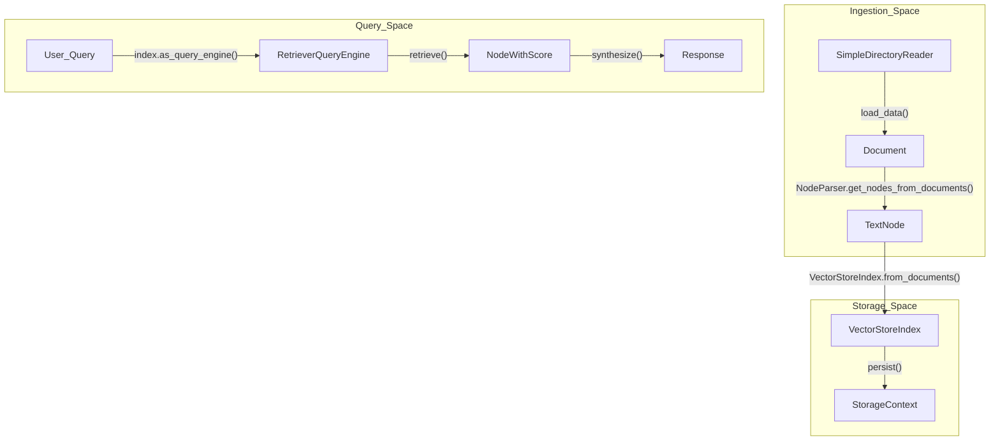
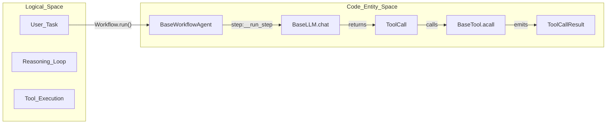

<!-- source: DeepWiki mcp.deepwiki.com · repo run-llama/llama_index · page 14 Glossary · fetched 2026-10-26 -->

# Glossary

Relevant source files

The following files were used as context for generating this wiki page:

- [.github/workflows/close_new_integration_prs.yml](.github/workflows/close_new_integration_prs.yml)
- [CHANGELOG.md](CHANGELOG.md)
- [CONTRIBUTING.md](CONTRIBUTING.md)
- [README.md](README.md)
- [docs/DOCS_README.md](docs/DOCS_README.md)
- [docs/api_reference/api_reference/llms/azure_openai.md](docs/api_reference/api_reference/llms/azure_openai.md)
- [docs/api_reference/api_reference/llms/minimax.md](docs/api_reference/api_reference/llms/minimax.md)
- [docs/api_reference/api_reference/llms/openai_like.md](docs/api_reference/api_reference/llms/openai_like.md)
- [docs/api_reference/api_reference/llms/sarvam.md](docs/api_reference/api_reference/llms/sarvam.md)
- [docs/api_reference/api_reference/memory/bedrock_agentcore.md](docs/api_reference/api_reference/memory/bedrock_agentcore.md)
- [docs/api_reference/api_reference/postprocessor/google_rerank.md](docs/api_reference/api_reference/postprocessor/google_rerank.md)
- [docs/api_reference/api_reference/storage/vector_store/solr.md](docs/api_reference/api_reference/storage/vector_store/solr.md)
- [docs/api_reference/api_reference/tools/aws_bedrock_agentcore.md](docs/api_reference/api_reference/tools/aws_bedrock_agentcore.md)
- [docs/api_reference/mkdocs.yml](docs/api_reference/mkdocs.yml)
- [docs/src/content/docs/framework/CHANGELOG.md](docs/src/content/docs/framework/CHANGELOG.md)
- [docs/src/content/docs/framework/CONTRIBUTING.md](docs/src/content/docs/framework/CONTRIBUTING.md)
- [llama-index-core/llama_index/core/__init__.py](llama-index-core/llama_index/core/__init__.py)
- [llama-index-core/llama_index/core/bridge/pydantic.py](llama-index-core/llama_index/core/bridge/pydantic.py)
- [llama-index-core/llama_index/core/img_utils.py](llama-index-core/llama_index/core/img_utils.py)
- [llama-index-core/llama_index/core/indices/base.py](llama-index-core/llama_index/core/indices/base.py)
- [llama-index-core/llama_index/core/indices/vector_store/base.py](llama-index-core/llama_index/core/indices/vector_store/base.py)
- [llama-index-core/llama_index/core/multi_modal_llms/base.py](llama-index-core/llama_index/core/multi_modal_llms/base.py)
- [llama-index-core/llama_index/core/multi_modal_llms/generic_utils.py](llama-index-core/llama_index/core/multi_modal_llms/generic_utils.py)
- [llama-index-core/llama_index/core/node_parser/node_utils.py](llama-index-core/llama_index/core/node_parser/node_utils.py)
- [llama-index-core/llama_index/core/node_parser/text/code.py](llama-index-core/llama_index/core/node_parser/text/code.py)
- [llama-index-core/llama_index/core/node_parser/text/semantic_double_merging_splitter.py](llama-index-core/llama_index/core/node_parser/text/semantic_double_merging_splitter.py)
- [llama-index-core/llama_index/core/node_parser/text/utils.py](llama-index-core/llama_index/core/node_parser/text/utils.py)
- [llama-index-core/llama_index/core/postprocessor/optimizer.py](llama-index-core/llama_index/core/postprocessor/optimizer.py)
- [llama-index-core/llama_index/core/prompts/__init__.py](llama-index-core/llama_index/core/prompts/__init__.py)
- [llama-index-core/llama_index/core/response/notebook_utils.py](llama-index-core/llama_index/core/response/notebook_utils.py)
- [llama-index-core/llama_index/core/schema.py](llama-index-core/llama_index/core/schema.py)
- [llama-index-core/llama_index/core/storage/index_store/keyval_index_store.py](llama-index-core/llama_index/core/storage/index_store/keyval_index_store.py)
- [llama-index-core/llama_index/core/storage/index_store/types.py](llama-index-core/llama_index/core/storage/index_store/types.py)
- [llama-index-core/pyproject.toml](llama-index-core/pyproject.toml)
- [llama-index-core/tests/indices/list/test_index.py](llama-index-core/tests/indices/list/test_index.py)
- [llama-index-core/tests/indices/vector_store/test_simple.py](llama-index-core/tests/indices/vector_store/test_simple.py)
- [llama-index-core/tests/indices/vector_store/test_simple_async.py](llama-index-core/tests/indices/vector_store/test_simple_async.py)
- [llama-index-core/tests/multi_modal_llms/test_base_multi_modal_llm_metadata.py](llama-index-core/tests/multi_modal_llms/test_base_multi_modal_llm_metadata.py)
- [llama-index-core/tests/multi_modal_llms/test_generic_utils.py](llama-index-core/tests/multi_modal_llms/test_generic_utils.py)
- [llama-index-core/tests/node_parser/test_semantic_double_merging_splitter.py](llama-index-core/tests/node_parser/test_semantic_double_merging_splitter.py)
- [llama-index-core/tests/schema/test_image_document.py](llama-index-core/tests/schema/test_image_document.py)
- [llama-index-core/tests/schema/test_media_resource.py](llama-index-core/tests/schema/test_media_resource.py)
- [llama-index-core/tests/schema/test_node.py](llama-index-core/tests/schema/test_node.py)
- [llama-index-core/tests/schema/test_schema.py](llama-index-core/tests/schema/test_schema.py)
- [llama-index-core/tests/text_splitter/test_code_splitter.py](llama-index-core/tests/text_splitter/test_code_splitter.py)
- [llama-index-core/uv.lock](llama-index-core/uv.lock)
- [llama-index-integrations/readers/llama-index-readers-kibela/llama_index/readers/kibela/base.py](llama-index-integrations/readers/llama-index-readers-kibela/llama_index/readers/kibela/base.py)
- [llama-index-integrations/storage/index_store/llama-index-storage-index-store-dynamodb/llama_index/storage/index_store/dynamodb/base.py](llama-index-integrations/storage/index_store/llama-index-storage-index-store-dynamodb/llama_index/storage/index_store/dynamodb/base.py)
- [llama-index-integrations/storage/index_store/llama-index-storage-index-store-elasticsearch/llama_index/storage/index_store/elasticsearch/base.py](llama-index-integrations/storage/index_store/llama-index-storage-index-store-elasticsearch/llama_index/storage/index_store/elasticsearch/base.py)
- [llama-index-integrations/storage/index_store/llama-index-storage-index-store-elasticsearch/pyproject.toml](llama-index-integrations/storage/index_store/llama-index-storage-index-store-elasticsearch/pyproject.toml)
- [llama-index-integrations/storage/index_store/llama-index-storage-index-store-firestore/llama_index/storage/index_store/firestore/base.py](llama-index-integrations/storage/index_store/llama-index-storage-index-store-firestore/llama_index/storage/index_store/firestore/base.py)
- [llama-index-integrations/storage/index_store/llama-index-storage-index-store-mongodb/llama_index/storage/index_store/mongodb/base.py](llama-index-integrations/storage/index_store/llama-index-storage-index-store-mongodb/llama_index/storage/index_store/mongodb/base.py)
- [llama-index-integrations/storage/index_store/llama-index-storage-index-store-postgres/llama_index/storage/index_store/postgres/base.py](llama-index-integrations/storage/index_store/llama-index-storage-index-store-postgres/llama_index/storage/index_store/postgres/base.py)
- [llama-index-integrations/storage/index_store/llama-index-storage-index-store-redis/llama_index/storage/index_store/redis/base.py](llama-index-integrations/storage/index_store/llama-index-storage-index-store-redis/llama_index/storage/index_store/redis/base.py)
- [pyproject.toml](pyproject.toml)
- [uv.lock](uv.lock)

This glossary defines the core concepts, technical terms, and codebase-specific abstractions used within LlamaIndex. It serves as a reference for onboarding engineers to navigate the relationship between domain concepts (like RAG) and their implementation in the code.

## Core Data Abstractions

The foundation of LlamaIndex lies in how data is represented and transformed before being consumed by an LLM.

### Document
The primary container for data entering the system. A `Document` can contain text, images, or structured data, along with a dictionary of metadata.
*   **Implementation:** `Document` represents a full data source (e.g., a single PDF file) and inherits from `TextNode`.
*   **Code Pointer:** [llama-index-core/llama_index/core/schema.py:71-71]()

### Node
The fundamental unit of data in LlamaIndex. A `Document` is typically broken down into smaller `Node` objects via a `NodeParser`. Nodes contain "chunks" of the source document and retain metadata and relationship information.
*   **Key Types:** `TextNode`, `ImageNode`, `IndexNode`.
*   **Relationships:** Nodes track their lineage via `NodeRelationship` (e.g., `SOURCE`, `PREVIOUS`, `NEXT`, `PARENT`, `CHILD`).
*   **Code Pointer:** [llama-index-core/llama_index/core/schema.py:207-223]()

### Index
A data structure that allows for efficient querying of `Node` objects. Indices handle the logic of how nodes are organized and retrieved.
*   **VectorStoreIndex:** Stores nodes as embeddings in a vector database for semantic search. [llama-index-core/llama_index/core/__init__.py:44-44]()
*   **SummaryIndex:** (Formerly `ListIndex`) Stores nodes as a sequential list. [llama-index-core/llama_index/core/__init__.py:42-42]()
*   **PropertyGraphIndex:** Stores data as a labeled property graph (LPG) with entities and relations. [llama-index-core/llama_index/core/__init__.py:39-39]()
*   **KnowledgeGraphIndex:** Builds a graph-based index using triplets extracted from text. [llama-index-core/llama_index/core/__init__.py:37-37]()

### RAG (Retrieval-Augmented Generation)
The architectural pattern of providing an LLM with specific, retrieved context from an external knowledge base to answer a prompt.

**Data Flow from Natural Language to Code Entities:**

| Natural Language Concept | Code Entity / Class | Purpose |
| :--- | :--- | :--- |
| "A PDF File" | `Document` | Raw data container with metadata. |
| "A Chunk of Text" | `TextNode` | Atomic unit for embedding and retrieval. |
| "Semantic Search" | `VectorStoreIndex` | The engine mapping queries to vector space. |
| "Knowledge Base" | `StorageContext` | Manages `DocStore`, `IndexStore`, and `VectorStore`. |

### RAG Pipeline Logic
Title: Data Transformation Flow

**Sources:** [llama-index-core/llama_index/core/__init__.py:26-81](), [llama-index-core/llama_index/core/schema.py:191-204](), [llama-index-core/llama_index/core/indices/vector_store/base.py:45-70]()

---

## Workflow & Agentic Terms

LlamaIndex uses event-driven architectures for complex LLM applications.

### Workflow
A stateful, event-driven orchestration engine. Workflows consist of "steps" that communicate by emitting and subscribing to "events."
*   **Implementation:** The `Workflow` class manages step execution and event dispatching. [llama-index-core/llama_index/core/workflow/workflow.py:1]()
*   **Context:** The `Context` object maintains state across steps in a workflow run. [llama-index-core/llama_index/core/workflow/context.py:1]()

### Step
A Python function decorated with `@step`. It accepts an `Event` and returns either another `Event`, a `StopEvent`, or `None`.
*   **Code Pointer:** [llama-index-core/llama_index/core/workflow/decorators.py:10]()

### Event
A message passed between steps in a `Workflow`. Events are typed and can carry arbitrary data payloads.
*   **Code Pointer:** [llama-index-core/llama_index/core/workflow/events.py:1-8]()

### Agent
An autonomous entity that uses an LLM to decide which "tools" to call to complete a task. In LlamaIndex, agents are implemented as specialized `Workflows`.
*   **Base Class:** `BaseWorkflowAgent`. [llama-index-core/llama_index/core/agent/workflow/base_agent.py:23-28]()
*   **Multi-Agent Orchestration:** `AgentWorkflow` manages multiple agents with handoff mechanisms. [llama-index-core/llama_index/core/agent/workflow/multi_agent_workflow.py:99-117]()
*   **Handoff:** The process where one agent transfers control to another agent within an `AgentWorkflow`. [llama-index-core/llama_index/core/agent/workflow/multi_agent_workflow.py:73-92]()

**Mapping Agent Concepts to Code Entities:**

Title: Agent Execution Architecture

**Sources:** [llama-index-core/llama_index/core/agent/workflow/base_agent.py:23-50](), [llama-index-core/llama_index/core/agent/workflow/workflow_events.py:38-46](), [llama-index-core/llama_index/core/workflow/workflow.py:1]()

---

## LLM & Content Modeling

### Content Block
A structured representation of a message component. Modern LLMs are multimodal, so a single message can contain multiple blocks.
*   **Key Blocks:** `TextBlock`, `ImageBlock`, `AudioBlock`, `VideoBlock`, `DocumentBlock`, `ThinkingBlock`, `ToolCallBlock`.
*   **Code Pointer:** [llama-index-core/llama_index/core/agent/workflow/workflow_events.py:38-46](), [CHANGELOG.md:28-30]()

### Message Role
The persona assigned to a message in a chat conversation.
*   **SYSTEM / DEVELOPER:** High-level instructions for the model.
*   **USER:** The human input.
*   **ASSISTANT:** The model's response.
*   **TOOL:** The output from a tool execution.
*   **Code Pointer:** [llama-index-core/llama_index/core/agent/workflow/multi_agent_workflow.py:47-47]()

### Embedding
A numerical (vector) representation of text or images. Used to calculate semantic similarity between a query and a `Node`.
*   **Base Class:** `BaseEmbedding`.
*   **Mock Implementation:** `MockEmbedding` used for testing. [llama-index-core/llama_index/core/__init__.py:22-22]()

---

## System Infrastructure

### Integration
A plugin that connects LlamaIndex to external services (LLM providers, Vector Databases, Data Loaders).
*   **Naming Convention:** `llama-index-<type>-<provider>` (e.g., `llama-index-vector-stores-qdrant`). [pyproject.toml:43-44]()
*   **Structure:** Managed as a monorepo where integrations reside in `llama-index-integrations/`. [CONTRIBUTING.md:93-99]()
*   **Qdrant Example:** `QdrantVectorStore` provides integration with the Qdrant vector database, supporting hybrid search and fastembed. [docs/api_reference/mkdocs.yml:51-51]()

### Settings
A global configuration object used to set default LLMs, embedding models, and tokenizers across the entire framework.
*   **Code Pointer:** [llama-index-core/llama_index/core/settings.py:78-78]()

### StorageContext
A container for various storage backends including the document store, index store, and vector store.
*   **Code Pointer:** [llama-index-core/llama_index/core/storage/storage_context.py:81-81]()

### LlamaHub
The community registry for data connectors (loaders), tools, and LlamaPacks.
*   **Reference:** [README.md:24-27](), [README.md:72-73]()

**Sources:**
* [llama-index-core/llama_index/core/schema.py:1-223]()
* [llama-index-core/llama_index/core/__init__.py:1-150]()
* [llama-index-core/llama_index/core/agent/workflow/multi_agent_workflow.py:1-186]()
* [docs/api_reference/mkdocs.yml:51-51]()
* [README.md:1-80]()
* [CONTRIBUTING.md:1-157]()
* [CHANGELOG.md:28-30]()
* [pyproject.toml:43-44]()