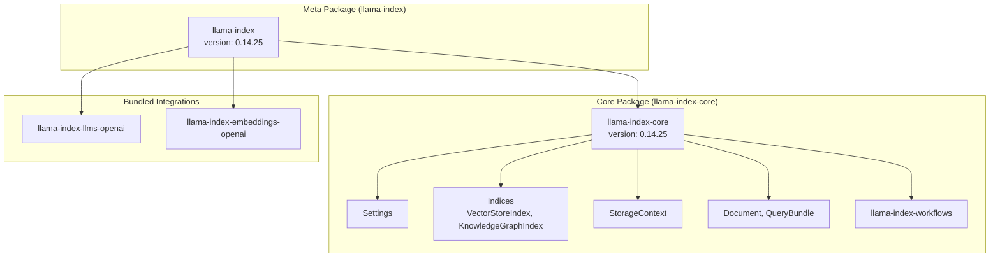
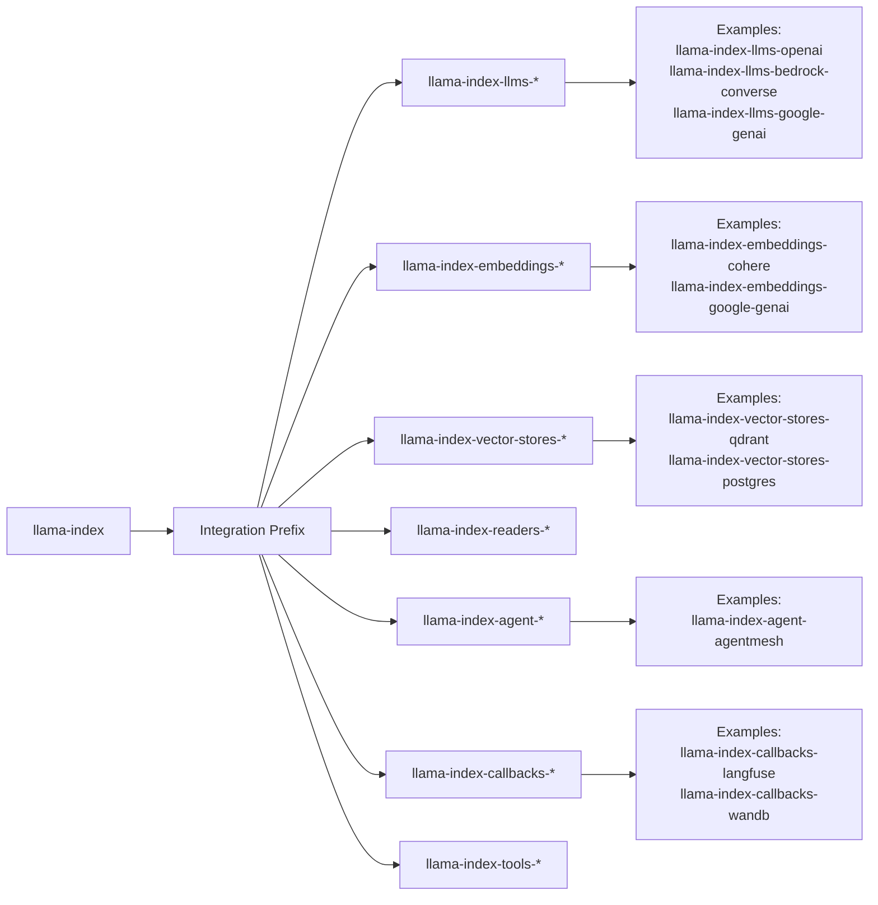
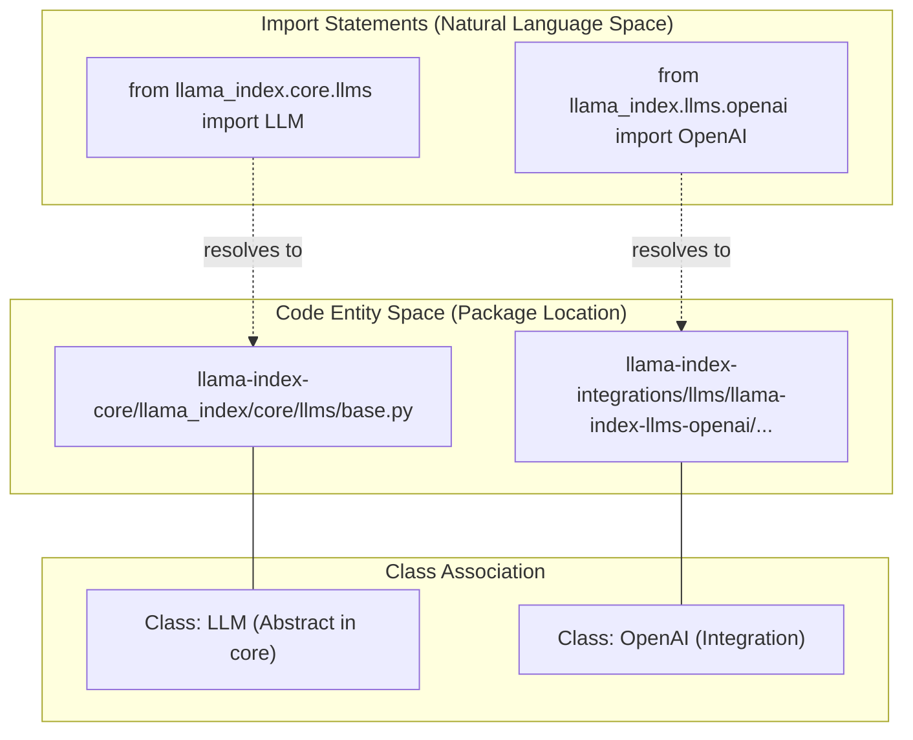
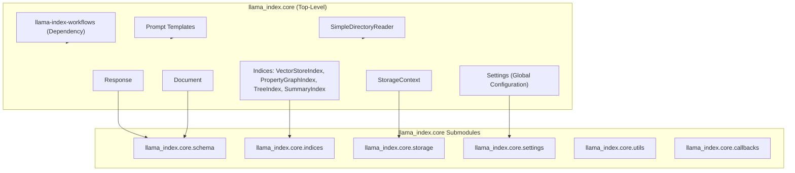
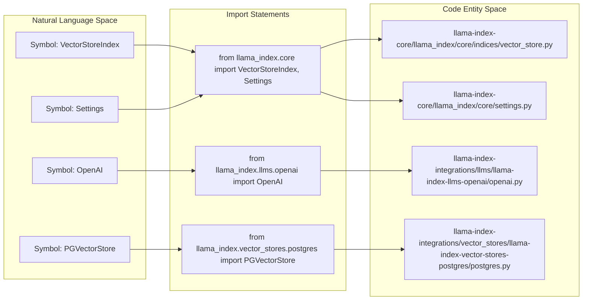
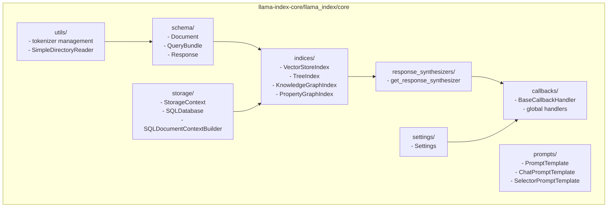

<!-- source: DeepWiki mcp.deepwiki.com · repo run-llama/llama_index · page 2.1 Package Structure · fetched 2026-10-26 -->

# Package Structure

<details>
<summary>Relevant source files</summary>

The following files were used as context for generating this wiki page:

- [.gitignore](.gitignore)
- [.pre-commit-config.yaml](.pre-commit-config.yaml)
- [CHANGELOG.md](CHANGELOG.md)
- [Makefile](Makefile)
- [docs/api_reference/api_reference/llms/azure_openai.md](docs/api_reference/api_reference/llms/azure_openai.md)
- [docs/api_reference/api_reference/llms/minimax.md](docs/api_reference/api_reference/llms/minimax.md)
- [docs/api_reference/api_reference/llms/openai_like.md](docs/api_reference/api_reference/llms/openai_like.md)
- [docs/api_reference/api_reference/llms/sarvam.md](docs/api_reference/api_reference/llms/sarvam.md)
- [docs/api_reference/api_reference/memory/bedrock_agentcore.md](docs/api_reference/api_reference/memory/bedrock_agentcore.md)
- [docs/api_reference/api_reference/postprocessor/google_rerank.md](docs/api_reference/api_reference/postprocessor/google_rerank.md)
- [docs/api_reference/api_reference/storage/vector_store/solr.md](docs/api_reference/api_reference/storage/vector_store/solr.md)
- [docs/api_reference/api_reference/tools/aws_bedrock_agentcore.md](docs/api_reference/api_reference/tools/aws_bedrock_agentcore.md)
- [docs/api_reference/mkdocs.yml](docs/api_reference/mkdocs.yml)
- [docs/src/content/docs/framework/CHANGELOG.md](docs/src/content/docs/framework/CHANGELOG.md)
- [docs/src/content/docs/framework/CONTRIBUTING.md](docs/src/content/docs/framework/CONTRIBUTING.md)
- [llama-index-core/.gitignore](llama-index-core/.gitignore)
- [llama-index-core/llama_index/core/__init__.py](llama-index-core/llama_index/core/__init__.py)
- [llama-index-core/pyproject.toml](llama-index-core/pyproject.toml)
- [llama-index-core/uv.lock](llama-index-core/uv.lock)
- [llama-index-integrations/vector_stores/llama-index-vector-stores-wordlift/.gitignore](llama-index-integrations/vector_stores/llama-index-vector-stores-wordlift/.gitignore)
- [llama-index-integrations/vector_stores/llama-index-vector-stores-wordlift/Makefile](llama-index-integrations/vector_stores/llama-index-vector-stores-wordlift/Makefile)
- [llama-index-integrations/vector_stores/llama-index-vector-stores-wordlift/README.md](llama-index-integrations/vector_stores/llama-index-vector-stores-wordlift/README.md)
- [llama-index-integrations/vector_stores/llama-index-vector-stores-wordlift/llama_index/vector_stores/wordlift/__init__.py](llama-index-integrations/vector_stores/llama-index-vector-stores-wordlift/llama_index/vector_stores/wordlift/__init__.py)
- [pyproject.toml](pyproject.toml)
- [uv.lock](uv.lock)

</details>


This document describes the LlamaIndex package architecture, including the meta package, core framework, and integration ecosystem. It covers package naming conventions, dependency relationships, import patterns, and internal structure relevant for developers and integrators.

## Overview

LlamaIndex is distributed as multiple Python packages organized into three primary layers:

1. **Meta Package** (`llama-index`): A starter bundle that includes the core framework plus some common integration packages for a smooth out-of-the-box experience.
2. **Core Package** (`llama-index-core`): The foundational framework containing base abstractions, essential core components, and orchestration systems.
3. **Integration Packages** (300+): Individually versioned packages implementing integrations for LLM providers, embedding models, vector stores, data readers, tools, and more.

Each layer has its distinct role and dependency management, allowing flexible installation and independent updates of core and integrations.

Sources: [pyproject.toml:34-46](), [llama-index-core/pyproject.toml:35-38]()

## Meta Package vs Core Package

The `llama-index` meta package provides a convenient entry point that bundles `llama-index-core` and select integration packages like OpenAI embeddings and OpenAI LLMs. This design enables users to quickly get started without managing many dependencies manually.



**Key points:**

- The meta package `llama-index` depends on:
  - `llama-index-core` (core abstractions and base framework)
  - `llama-index-llms-openai` (OpenAI LLM integration)
  - `llama-index-embeddings-openai` (OpenAI embeddings integration)

- The core package `llama-index-core` includes foundational concepts like indices, storage, settings, and query engines.

- The workflow engine `llama-index-workflows` is a dependency used by core components for orchestration.

This architecture cleanly separates stable core functionality from rapidly evolving integrations.

Sources: [pyproject.toml:41-46](), [llama-index-core/pyproject.toml:57-87](), [CHANGELOG.md:55-65]()

## Package Naming Convention

LlamaIndex organizes integrations with a consistent naming scheme to ease discovery and maintenance. The base prefix is always `llama-index`. Integration categories determine the next segment, followed by the provider or specific integration name.



| Category       | Naming Pattern                  | Example Packages                                  |
| -------------- | -------------------------------| ------------------------------------------------|
| LLMs           | `llama-index-llms-{provider}`  | `openai`, `bedrock-converse`, `google-genai`   |
| Embeddings     | `llama-index-embeddings-{provider}` | `openai`, `cohere`, `google-genai`          |
| Vector Stores  | `llama-index-vector-stores-{provider}` | `qdrant`, `postgres`, `milvus`              |
| Readers        | `llama-index-readers-{source}` | `file`, `google-drive`, `notion`                 |
| Agents         | `llama-index-agent-{type}`      | `agentmesh`                                       |
| Callbacks      | `llama-index-callbacks-{service}` | `langfuse`, `wandb`, `argilla`                |
| Tools          | `llama-index-tools-{toolname}` | `shopify`, `openapi`, `chatgpt-plugin`           |

This consistent naming scheme helps automate dependency discovery and usage patterns across the ecosystem.

Sources: [CHANGELOG.md:7-130](), [docs/api_reference/mkdocs.yml:50-116]()

## Import Path Convention

LlamaIndex uses an explicit namespace pattern to distinguish core framework imports from integration package imports.



- **Core imports** contain `.core.` in the path, referencing abstract base classes and shared logic inside `llama-index-core`:
  ```python
  from llama_index.core.llms import LLM
  from llama_index.core import VectorStoreIndex
  from llama_index.core.settings import Settings
  ```

- **Integration imports** exclude `.core.` and come directly from integration packages:
  ```python
  from llama_index.llms.openai import OpenAI
  from llama_index.vector_stores.postgres import PGVectorStore
  ```

This namespace division enables flexible extension of the framework with third-party integrations while preserving a clear core API boundary.

Sources: [llama-index-core/llama_index/core/__init__.py:17-87]()

## Core Package Structure

The core package `llama-index-core` exposes its fundamental abstractions and components centrally through the module `llama_index.core`. This facilitates imports and promotes modular design.



Notable exports include:

| Category          | Key Symbols                                              | Module Path/Note                             |
| ----------------- | --------------------------------------------------------| --------------------------------------------|
| Schema            | `Document`, `QueryBundle`, `Response`                   | `llama_index.core.schema` [core/__init__.py:17, 71]() |
| Indices           | `VectorStoreIndex`, `TreeIndex`, `KnowledgeGraphIndex`, `PropertyGraphIndex`, `SummaryIndex` | `llama_index.core.indices` [core/__init__.py:26-48]() |
| Storage           | `StorageContext`, `load_index_from_storage`, `SQLDatabase`| `llama_index.core.storage` + sql wrapper    |
| Settings          | `Settings`                                              | Global configuration object [core/__init__.py:78]()      |
| Utilities & Readers| `SimpleDirectoryReader`, `get_tokenizer`, `MockEmbedding` | Various core utils and classes               |
| Callbacks         | `set_global_handler`                                    | Core callback global eval handler            |
| Prompts           | `PromptTemplate`, `ChatPromptTemplate`, etc.           | Core prompt template abstractions            |

The core package also manages global mutable state such as a global tokenizer and global eval handler, supporting extensible workflows and evaluation control.

Sources: [llama-index-core/llama_index/core/__init__.py:1-140]()

## Dependency Management

LlamaIndex uses modern Python packaging tools for building and dependency resolution:

- **Build system**: `hatchling` is configured as the build backend for both the meta package and core package [pyproject.toml:2](), [llama-index-core/pyproject.toml:3]().
- **Package workspace management and lockfiles**: The monorepo uses `uv` tool with its `uv.lock` lockfile for dependency management and reproducibility [uv.lock:1-15](), [llama-index-core/uv.lock:1-12]().
- **Core dependencies**: `llama-index-core` depends on libraries like:
  - `pydantic` (>=2.8.0) for data validation,
  - `SQLAlchemy[asyncio]` for async ORM and persistence,
  - `aiohttp` for async HTTP client functionality,
  - `tiktoken` for tokenization,
  - `llama-index-workflows` for orchestration,
  - plus NLP utilities such as `nltk`, `networkx`, and more [llama-index-core/pyproject.toml:57-87]().

To facilitate offline usage, the core package bundles static assets like NLTK stopwords and punkt tokenizers, as well as tiktoken caches inside its distribution wheel [llama-index-core/pyproject.toml:111-115]().

Sources: [pyproject.toml:1-46](), [llama-index-core/pyproject.toml:1-87](), [uv.lock:1-15]()

## Release and Versioning

LlamaIndex maintains synchronized versioning for the meta package and core package, allowing consistency across releases:

- The meta package (`llama-index`) version matches the core package (`llama-index-core`), e.g., both at `0.14.25` currently [pyproject.toml:69](), [llama-index-core/pyproject.toml:37]().
- Integration packages generally have independent version numbers aligned to their own development cycle, following standard semantic versioning.
- A central `CHANGELOG.md` tracks individual package updates and summarizes important fixes and features collectively across core, integrations, embeddings, and LLMs [CHANGELOG.md:1-60]().

This approach balances stable API surface management for the core framework with agile release iteration in integrations.

Sources: [CHANGELOG.md:1-60](), [pyproject.toml:66-69](), [llama-index-core/pyproject.toml:36-37]()

---

The above package structure clarifies how LlamaIndex organizes code, dependencies, and versioning to provide a scalable framework and comprehensive integration ecosystem.

# Additional Diagram: Bridging Natural Language Space to Code Entity Space (Meta vs Core)



# Additional Diagram: Core Package Structure Detailed View



Sources: [llama-index-core/llama_index/core/__init__.py:1-140]()

---

This concludes the technical overview of LlamaIndex's package structure, detailing its meta and core packages alongside integration naming and import conventions to guide developers and integrators working within and extending the codebase.

---

