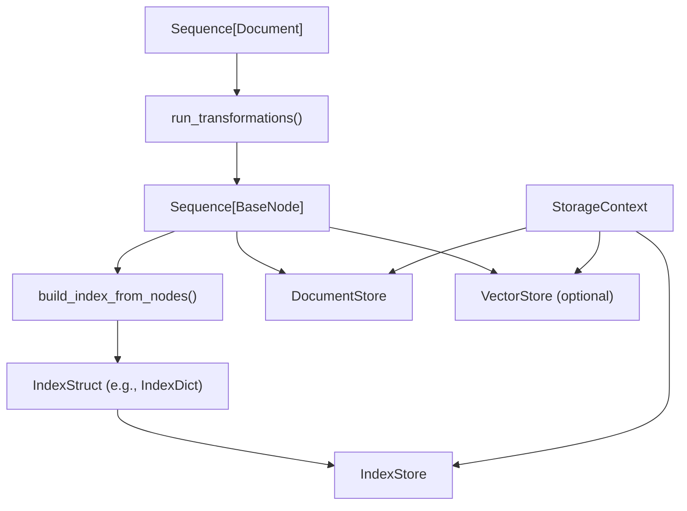
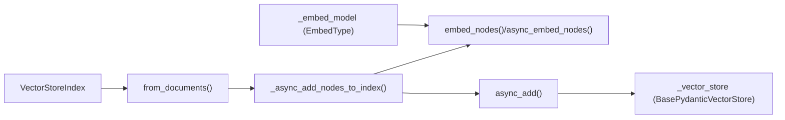
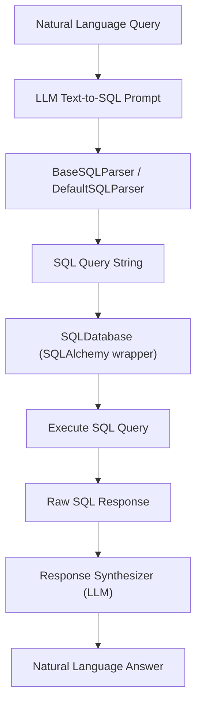
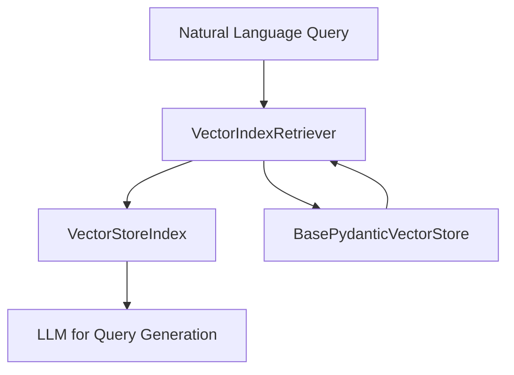
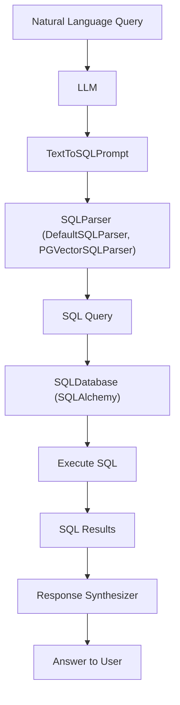

<!-- source: DeepWiki mcp.deepwiki.com · repo run-llama/llama_index · page 3.1 Indices and Query Engines · fetched 2026-10-26 -->

# Indices and Query Engines

Relevant source files

The following files were used as context for generating this wiki page:

- [.github/workflows/close_new_integration_prs.yml](.github/workflows/close_new_integration_prs.yml)
- [CONTRIBUTING.md](CONTRIBUTING.md)
- [README.md](README.md)
- [docs/DOCS_README.md](docs/DOCS_README.md)
- [docs/examples/agent/openai_agent_query_cookbook.ipynb](docs/examples/agent/openai_agent_query_cookbook.ipynb)
- [docs/examples/data_connectors/DatabaseReaderDemo.ipynb](docs/examples/data_connectors/DatabaseReaderDemo.ipynb)
- [docs/examples/index_structs/struct_indices/SQLIndexDemo.ipynb](docs/examples/index_structs/struct_indices/SQLIndexDemo.ipynb)
- [docs/examples/index_structs/struct_indices/duckdb_sql_query.ipynb](docs/examples/index_structs/struct_indices/duckdb_sql_query.ipynb)
- [docs/examples/query_engine/SQLAutoVectorQueryEngine.ipynb](docs/examples/query_engine/SQLAutoVectorQueryEngine.ipynb)
- [docs/examples/query_engine/SQLJoinQueryEngine.ipynb](docs/examples/query_engine/SQLJoinQueryEngine.ipynb)
- [docs/examples/query_engine/SQLRouterQueryEngine.ipynb](docs/examples/query_engine/SQLRouterQueryEngine.ipynb)
- [llama-index-core/llama_index/core/base/base_selector.py](llama-index-core/llama_index/core/base/base_selector.py)
- [llama-index-core/llama_index/core/image_retriever.py](llama-index-core/llama_index/core/image_retriever.py)
- [llama-index-core/llama_index/core/indices/base.py](llama-index-core/llama_index/core/indices/base.py)
- [llama-index-core/llama_index/core/indices/query/query_transform/base.py](llama-index-core/llama_index/core/indices/query/query_transform/base.py)
- [llama-index-core/llama_index/core/indices/struct_store/sql_query.py](llama-index-core/llama_index/core/indices/struct_store/sql_query.py)
- [llama-index-core/llama_index/core/indices/struct_store/sql_retriever.py](llama-index-core/llama_index/core/indices/struct_store/sql_retriever.py)
- [llama-index-core/llama_index/core/indices/vector_store/base.py](llama-index-core/llama_index/core/indices/vector_store/base.py)
- [llama-index-core/llama_index/core/storage/index_store/keyval_index_store.py](llama-index-core/llama_index/core/storage/index_store/keyval_index_store.py)
- [llama-index-core/llama_index/core/storage/index_store/types.py](llama-index-core/llama_index/core/storage/index_store/types.py)
- [llama-index-core/llama_index/core/utilities/sql_wrapper.py](llama-index-core/llama_index/core/utilities/sql_wrapper.py)
- [llama-index-core/tests/indices/list/test_index.py](llama-index-core/tests/indices/list/test_index.py)
- [llama-index-core/tests/indices/struct_store/test_sql_query.py](llama-index-core/tests/indices/struct_store/test_sql_query.py)
- [llama-index-core/tests/indices/vector_store/test_simple.py](llama-index-core/tests/indices/vector_store/test_simple.py)
- [llama-index-core/tests/indices/vector_store/test_simple_async.py](llama-index-core/tests/indices/vector_store/test_simple_async.py)
- [llama-index-core/tests/utilities/test_sql_wrapper.py](llama-index-core/tests/utilities/test_sql_wrapper.py)
- [llama-index-integrations/storage/index_store/llama-index-storage-index-store-dynamodb/llama_index/storage/index_store/dynamodb/base.py](llama-index-integrations/storage/index_store/llama-index-storage-index-store-dynamodb/llama_index/storage/index_store/dynamodb/base.py)
- [llama-index-integrations/storage/index_store/llama-index-storage-index-store-elasticsearch/llama_index/storage/index_store/elasticsearch/base.py](llama-index-integrations/storage/index_store/llama-index-storage-index-store-elasticsearch/llama_index/storage/index_store/elasticsearch/base.py)
- [llama-index-integrations/storage/index_store/llama-index-storage-index-store-elasticsearch/pyproject.toml](llama-index-integrations/storage/index_store/llama-index-storage-index-store-elasticsearch/pyproject.toml)
- [llama-index-integrations/storage/index_store/llama-index-storage-index-store-firestore/llama_index/storage/index_store/firestore/base.py](llama-index-integrations/storage/index_store/llama-index-storage-index-store-firestore/llama_index/storage/index_store/firestore/base.py)
- [llama-index-integrations/storage/index_store/llama-index-storage-index-store-mongodb/llama_index/storage/index_store/mongodb/base.py](llama-index-integrations/storage/index_store/llama-index-storage-index-store-mongodb/llama_index/storage/index_store/mongodb/base.py)
- [llama-index-integrations/storage/index_store/llama-index-storage-index-store-postgres/llama_index/storage/index_store/postgres/base.py](llama-index-integrations/storage/index_store/llama-index-storage-index-store-postgres/llama_index/storage/index_store/postgres/base.py)
- [llama-index-integrations/storage/index_store/llama-index-storage-index-store-redis/llama_index/storage/index_store/redis/base.py](llama-index-integrations/storage/index_store/llama-index-storage-index-store-redis/llama_index/storage/index_store/redis/base.py)

## Purpose and Scope

This page provides a comprehensive technical overview of various index classes and associated query engines in the `llama-index-core` package, which serve to structure, retrieve, and synthesize information from data to power LLM-based applications. We explain the implementation, data flow, and key classes of:

- **VectorStoreIndex** — dense vector embedding-based indices integrated with vector stores
- **KnowledgeGraphIndex** (deprecated) — graph-structured indices based on knowledge triplets
- **ListIndex** and **TreeIndex** — sequential and hierarchical indices for document structure
- **SQL Struct Store indices** — SQL-backed structured indices and their query engines

We also cover key flow diagrams illustrating how natural language queries interact with these underlying implementations. This is a LEAF page (no child pages).

Sources: [llama-index-core/llama_index/core/indices/base.py:1-178](), [llama-index-core/llama_index/core/indices/vector_store/base.py:1-200](), [llama-index-core/llama_index/core/indices/struct_store/sql_query.py:1-176](), [llama-index-core/llama_index/core/indices/struct_store/sql_retriever.py:1-189]()

---

## Index Architecture and Data Flow

All index classes inherit from the abstract base class `BaseIndex` [llama-index-core/llama_index/core/indices/base.py:25-178](). The main responsibilities of `BaseIndex` include:

- Managing storage context and document stores
- Coordinating transformation pipelines from raw documents to nodes
- Holding and persisting the internal `IndexStruct` metadata
- Exposing methods to query the index

### Index Construction Pipeline

When creating an index, such as via `from_documents()`, a series of transformations occurs:

- Documents are first converted into nodes by applying configured transformations.
- Nodes are stored in a document store and optionally passed to vector stores.
- The index implementation builds an internal data structure (`IndexStruct`) from the nodes.
- This structure is persisted in the index store within the storage context.

This modular structure allows consistent ingestion and storage regardless of index type.

Sources: [llama-index-core/llama_index/core/indices/base.py:88-129](), [llama-index-core/llama_index/core/indices/base.py:184-189]()

---

## VectorStoreIndex

`VectorStoreIndex` is the principal index type leveraging dense vector embeddings stored in an external vector store backend. It efficiently supports semantic similarity retrieval.

Defined in `llama-index-core/llama_index/core/indices/vector_store/base.py` [36-175](), this class extends `BaseIndex[IndexDict]` with the following key features:

- **Embedding Model**: Configurable embedding model resolved via `resolve_embed_model()` [llama-index-core/llama_index/core/indices/vector_store/base.py:70-72]().

- **Batch Embedding**: Nodes are batched and embedded asynchronously or synchronously (`embed_nodes` or `async_embed_nodes`) [llama-index-core/llama_index/core/indices/vector_store/base.py:131-174]().

- **Vector Store Integration**: Nodes with embeddings are inserted into the vector store via `async_add()` [llama-index-core/llama_index/core/indices/vector_store/base.py:185-193]().

- **Node Storage Logic**: If vector store does not store text, nodes are also added to `DocumentStore` and tracked in the index struct to prevent data loss [llama-index-core/llama_index/core/indices/vector_store/base.py:195-204]().

- **Retriever Interface**: Returns a `VectorIndexRetriever` adapter via `as_retriever()` for semantic search queries [llama-index-core/llama_index/core/indices/vector_store/base.py:112-124]().

### Data Flow for Insertion and Querying

- Newly added documents are split into nodes and embedded.
- Embeddings and nodes are asynchronously written into the vector store and document store respectively.
- Queries use the retriever to perform vector similarity search and retrieve top matching nodes.

Sources: [llama-index-core/llama_index/core/indices/vector_store/base.py:36-124](), [llama-index-core/llama_index/core/indices/vector_store/base.py:176-210]()

---

## KnowledgeGraphIndex (Deprecated)

`KnowledgeGraphIndex` builds a graph-based index by extracting semantic triplets from text nodes:

- Uses LLM prompt `DEFAULT_KG_TRIPLET_EXTRACT_PROMPT` to generate (subject, relation, object) triplets, creating a property graph structure [llama-index-core/llama_index/core/indices/knowledge_graph/base.py:33-108]().

- Stores graph nodes and edges in a `GraphStore` from the storage context [llama-index-core/llama_index/core/indices/knowledge_graph/base.py:120-122]().

- Supports various retrieval modes (`KEYWORD`, `EMBEDDING`, `HYBRID`) via the `KGTableRetriever` class [llama-index-core/llama_index/core/indices/knowledge_graph/retrievers.py:41-59]().

This index is deprecated; users should prefer `PropertyGraphIndex` with modern graph integrations.

Sources: [llama-index-core/llama_index/core/indices/knowledge_graph/base.py:33-108](), [llama-index-core/llama_index/core/indices/knowledge_graph/retrievers.py:41-59]()

---

## ListIndex and TreeIndex

Although less detailed in the provided sources, `ListIndex` and `TreeIndex` are other core index types:

- **ListIndex** organizes nodes in a flat sequential list, suitable for simple document collections.

- **TreeIndex** uses a hierarchical tree structure, enabling recursive summarization and complex query synthesis.

These indices focus more on node structure and hierarchical summarization for document sets rather than embedding-based retrieval.

(For specifics, see the broader codebase under `llama-index-core/llama_index/core/indices/`.)

---

## SQL Struct Store Indices and Query Engines

LlamaIndex supports specialized indices over relational databases via SQL:

- **SQLStructStoreIndex** maintains a SQL database abstraction over a structured database schema, allowing ingestion and retrieval of structured tabular data [llama-index-core/llama_index/core/indices/struct_store/sql.py]().

- Query Engines complement this index to provide direct SQL or natural language querying capabilities.

### Core Query Engines

| Class                        | Description                                                                                                         | Deprecation Status              |
|------------------------------|---------------------------------------------------------------------------------------------------------------------|--------------------------------|
| SQLStructStoreQueryEngine     | Executes raw SQL queries directly on the SQL database index. Returns raw SQL responses without LLM calls.          | Deprecated                     |
| NLStructStoreQueryEngine      | Converts natural language queries into SQL using prompts, executes SQL, optionally synthesizes responses.          | Deprecated                     |
| NLSQLTableQueryEngine         | Similar to NLStructStoreQueryEngine but works on the SQL database schema level.                                    | Current preferred in some cases|

### SQLStructStoreQueryEngine Implementation Highlights

- Accepts SQL queries as input, executes via `SQLDatabase.run_sql()` method [llama-index-core/llama_index/core/indices/struct_store/sql_query.py:73-127]().

- Supports a `sql_only` mode which returns the query string instead of executing.

- Uses prompt templates to synthesize natural language responses when enabled [llama-index-core/llama_index/core/indices/struct_store/sql_query.py:60-70]().

### NLStructStoreQueryEngine Details

- Uses LLMs to translate natural language into SQL queries guided by a `text_to_sql_prompt` [llama-index-core/llama_index/core/indices/struct_store/sql_query.py:133-166]().

- Parses LLM output to extract valid SQL with `BaseSQLParser` implementations (e.g., `DefaultSQLParser`, `PGVectorSQLParser`) [llama-index-core/llama_index/core/indices/struct_store/sql_retriever.py:125-178]().

- Executes the extracted SQL on the database via `SQLDatabase` and synthesizes the response with LLM or returns raw results.

### SQLDatabase Wrapper

- The `SQLDatabase` class is a wrapper over SQLAlchemy providing schema introspection, executing SQL, and table info retrieval. It manages table inclusion/exclusion and reflection [llama-index-core/llama_index/core/utilities/sql_wrapper.py:11-167]().

### Diagram: SQL Query Engine Query Flow

### Retriever for SQL Indices

- `SQLRetriever` performs raw SQL queries directly and returns structured nodes with metadata [llama-index-core/llama_index/core/indices/struct_store/sql_retriever.py:32-116]().

Sources: [llama-index-core/llama_index/core/indices/struct_store/sql_query.py:1-176](), [llama-index-core/llama_index/core/indices/struct_store/sql_retriever.py:1-189](), [llama-index-core/llama_index/core/utilities/sql_wrapper.py:1-167]()

---

## Bridging Natural Language to Code Entities Through Query Engines

### 1. Natural Language Query to VectorStoreIndex Retrieval

- Here, the retriever converts the query into an embedding or parameters to query the vector store.
- The vector store returns embeddings matching nodes.
- Then nodes are synthesized via an LLM-driven response synthesizer.

### 2. Natural Language Query to SQL Query Engine

- The LLM is prompted to translate natural queries into SQL.
- The SQL is parsed to extract valid commands.
- Results are fetched from the database via SQLAlchemy.
- Optionally, an LLM synthesizes a fluent answer from results.

Sources: [llama-index-core/llama_index/core/indices/vector_store/base.py:36-124](), [llama-index-core/llama_index/core/indices/struct_store/sql_query.py:73-166](), [llama-index-core/llama_index/core/indices/struct_store/sql_retriever.py:125-178]()

---

## Summary

LlamaIndex structuring and retrieval capabilities center on modular index classes paired with dedicated query engines that abstract over data stores:

| Index Type              | Key Characteristics                                   | Query Engine(s)                             | Backing Store                     |
|-------------------------|-------------------------------------------------------|---------------------------------------------|----------------------------------|
| VectorStoreIndex        | Semantic retrieval using embeddings                    | VectorIndexRetriever                         | Vector store + Document store    |
| KnowledgeGraphIndex (deprecated) | Graph of triplets extracted via LLM                 | KGTableRetriever                             | Graph store + Document store     |
| ListIndex / TreeIndex   | Sequential or hierarchical document organization        | Various custom query engines                  | In-memory or persisted structures|
| SQL Struct Store Indices | Structured data represented as tables                   | SQLStructStoreQueryEngine, NLStructStoreQueryEngine | SQLAlchemy-backed databases       |

These classes embody the "data framework" that enables augmentation of LLMs with private, structured, or semi-structured knowledge sources for retrieval-augmented generation approaches.

---

## References (Selected Files)

- Base index class abstractions and lifecycle: [llama-index-core/llama_index/core/indices/base.py:1-178]()
- VectorStoreIndex implementation and embedding flow: [llama-index-core/llama_index/core/indices/vector_store/base.py:36-200]()
- SQL struct store query engines (deprecated and new versions): [llama-index-core/llama_index/core/indices/struct_store/sql_query.py:1-176]()
- SQL retriever implementations and SQL parsing: [llama-index-core/llama_index/core/indices/struct_store/sql_retriever.py:1-189]()
- SQLDatabase wrapper over SQLAlchemy: [llama-index-core/llama_index/core/utilities/sql_wrapper.py:1-167]()
- KnowledgeGraphIndex (deprecated) and retrievers: [llama-index-core/llama_index/core/indices/knowledge_graph/base.py:33-108](), [llama-index-core/llama_index/core/indices/knowledge_graph/retrievers.py:41-59]()

---

This concludes the detailed technical explanation of key indices and their corresponding query engines in the LlamaIndex codebase.

---

