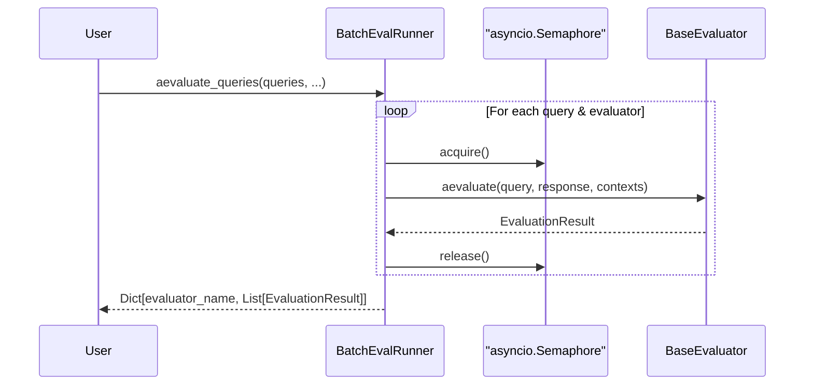

<!-- source: DeepWiki mcp.deepwiki.com · repo run-llama/llama_index · page 3.4 Finetuning System · fetched 2026-10-26 -->

# Finetuning System

<details>
<summary>Relevant source files</summary>

The following files were used as context for generating this wiki page:

- [docs/examples/retrievers/composable_retrievers.ipynb](docs/examples/retrievers/composable_retrievers.ipynb)
- [llama-index-core/llama_index/core/agent/react/prompts.py](llama-index-core/llama_index/core/agent/react/prompts.py)
- [llama-index-core/llama_index/core/agent/react/templates/system_header_template.md](llama-index-core/llama_index/core/agent/react/templates/system_header_template.md)
- [llama-index-core/llama_index/core/command_line/upgrade.py](llama-index-core/llama_index/core/command_line/upgrade.py)
- [llama-index-core/llama_index/core/embeddings/utils.py](llama-index-core/llama_index/core/embeddings/utils.py)
- [llama-index-core/llama_index/core/evaluation/batch_runner.py](llama-index-core/llama_index/core/evaluation/batch_runner.py)
- [llama-index-core/llama_index/core/evaluation/dataset_generation.py](llama-index-core/llama_index/core/evaluation/dataset_generation.py)
- [llama-index-core/llama_index/core/evaluation/eval_utils.py](llama-index-core/llama_index/core/evaluation/eval_utils.py)
- [llama-index-core/llama_index/core/ingestion/api_utils.py](llama-index-core/llama_index/core/ingestion/api_utils.py)
- [llama-index-core/llama_index/core/question_gen/llm_generators.py](llama-index-core/llama_index/core/question_gen/llm_generators.py)
- [llama-index-core/tests/embeddings/test_utils.py](llama-index-core/tests/embeddings/test_utils.py)
- [llama-index-core/tests/evaluation/test_batch_runner.py](llama-index-core/tests/evaluation/test_batch_runner.py)
- [llama-index-core/tests/evaluation/test_dataset_generation.py](llama-index-core/tests/evaluation/test_dataset_generation.py)
- [llama-index-core/tests/question_gen/test_llm_generators.py](llama-index-core/tests/question_gen/test_llm_generators.py)
- [llama-index-integrations/callbacks/llama-index-callbacks-wandb/llama_index/callbacks/wandb/base.py](llama-index-integrations/callbacks/llama-index-callbacks-wandb/llama_index/callbacks/wandb/base.py)
- [llama-index-integrations/callbacks/llama-index-callbacks-wandb/pyproject.toml](llama-index-integrations/callbacks/llama-index-callbacks-wandb/pyproject.toml)
- [llama-index-integrations/callbacks/llama-index-callbacks-wandb/tests/test_wandb_callback.py](llama-index-integrations/callbacks/llama-index-callbacks-wandb/tests/test_wandb_callback.py)
- [llama-index-integrations/indices/llama-index-indices-managed-llama-cloud/README.md](llama-index-integrations/indices/llama-index-indices-managed-llama-cloud/README.md)
- [llama-index-integrations/indices/llama-index-indices-managed-llama-cloud/pyproject.toml](llama-index-integrations/indices/llama-index-indices-managed-llama-cloud/pyproject.toml)
- [llama-index-integrations/indices/llama-index-indices-managed-llama-cloud/uv.lock](llama-index-integrations/indices/llama-index-indices-managed-llama-cloud/uv.lock)
- [llama-index-integrations/readers/llama-index-readers-llama-parse/README.md](llama-index-integrations/readers/llama-index-readers-llama-parse/README.md)
- [llama-index-integrations/readers/llama-index-readers-llama-parse/pyproject.toml](llama-index-integrations/readers/llama-index-readers-llama-parse/pyproject.toml)

</details>


The Finetuning System provides tools for customizing LLM and embedding model behavior through supervised fine-tuning workflows. It supports dataset generation from documents, training of embedding and language models, and evaluation of fine-tuned models leveraging metrics and batch runners. This system enables distilling knowledge from large instruction-tuned or high-capability models into optimized smaller or specialized models suitable for RAG applications.

For using LLMs or embeddings without fine-tuning, please refer to [LLM Integrations]() and [Embedding Integrations](). For components involved in retrieval-augmented generation workflows, see [Data Flow Pipeline]().

---

## Architecture Overview

The finetuning system is organized into three major subsystems:

- **Dataset Generation**: Produces training datasets by generating QA pairs or augmented data from documents and nodes using LLMs and prompt templates.
- **Finetuning Engines**: Components that perform model fine-tuning either locally (e.g., with SentenceTransformers, Adapter techniques) or via hosted APIs (e.g., OpenAI fine-tuning).
- **Evaluation Framework**: Provides mechanisms and metrics to evaluate retrieval quality and model outputs, often integrated with the `ragas` evaluation library.

### Mapping Key Concepts to Code Entities

```mermaid
graph TB
    subgraph "Dataset Generation Space"
        DOCS["Documents"] -->|Input| DatasetGen["DatasetGenerator"]
        DatasetGen -->|Generates| LabeledDS["LabelledQuestionDatasetDTO"]
        QA_EMB_FUNC["generate_qa_embedding_pairs()"] -->|Creates| EmbeddingDS["EmbeddingQAFinetuneDataset"]
        OpenAITunerCB["OpenAIFineTuningHandler"] -->|Logs JSONL| OpenAIData["OpenAI Fine-Tuning Examples"]
    end

    subgraph "Finetuning Engine Space"
        STE["SentenceTransformersFinetuneEngine"]
        ADE["EmbeddingAdapterFinetuneEngine"]
        OAE["OpenAIFinetuneEngine"]
    end

    subgraph "Evaluation Framework & Code"
        BaseEval["BaseEvaluator"]
        BaseEmbed["BaseEmbedding"]
        RetrieverEval["RetrieverEvaluator"]
        MetricBase["BaseRetrievalMetric"]
        MetricSpec["HitRate, MRR, NDCG"]
    end

    EmbeddingDS --> STE
    OpenAIData --> OAE

    STE --> BaseEmbed
    ADE --> BaseEmbed

    RetrieverEval --> MetricBase
    MetricBase <|-- MetricSpec
    BaseEval -. Evaluates .-> OAE
```

This diagram clarifies how high-level finetuning system parts correspond to specific classes and functions in the codebase.

**Sources:**  
[llama-index-core/llama_index/core/evaluation/retrieval/metrics.py:16-172](),  
[llama-index-core/llama_index/core/evaluation/retrieval/metrics_base.py:1-10]()

---

## Dataset Generation

Dataset generation creates training data from documents or nodes by synthesizing question-answer pairs or function-call demonstrations. This stage is essential for both LLM and embedding finetuning.

### QA Pair Generation for Embeddings

The function `generate_qa_embedding_pairs()` produces embedding training datasets by generating questions associated with each text node in a corpus.

- **Inputs:**  
  - `llm`: The language model instance used to generate questions.  
  - `nodes`: List of text nodes (chunks).  
  - `output_path` (optional): File path to write the generated dataset in JSON.  

- **Output:**  
  An `EmbeddingQAFinetuneDataset` object containing:
  - `queries`: synthetic questions generated per node.  
  - `corpus`: source text chunks corresponding to nodes.  
  - Mapping between queries and relevant corpus IDs.

These datasets can be saved and reloaded to facilitate embedding model fine-tuning workflows.

### DatasetGenerator for LLM Finetuning

The `DatasetGenerator` class creates labeled question datasets suitable for language model fine-tuning. It accepts a list of nodes or documents and uses an LLM to generate question-answer pairs governed by customizable prompts and query templates.

Example usage for generating questions from a list of documents:

```python
from llama_index.core.evaluation.dataset_generation import DatasetGenerator

dataset_generator = DatasetGenerator.from_documents(
    documents,
    llm=llm_model,
)

questions = dataset_generator.generate_questions_from_nodes(num=40)
```

- Supports:  
  - Specifying number of questions per chunk.  
  - Custom question generation prompts.  
  - Filtering via required or excluded keywords.  
- Internally performs transformations and filtering through node postprocessors.

### OpenAIFineTuningHandler Callback

`OpenAIFineTuningHandler` is a callback handler designed to log LLM message exchanges in a format directly compatible with OpenAI's supervised fine-tuning API. It captures system and user messages as well as assistant responses during query execution and serializes this data as JSON Lines files.

This enables automatic dataset collection for training from live RAG system interactions.

---

## Finetuning Engines

The system includes engines tailored for different fine-tuning paradigms:

- **SentenceTransformersFinetuneEngine**: For fine-tuning embedding models locally using sentence transformers.
- **EmbeddingAdapterFinetuneEngine**: For adapter-style embedding model fine-tuning.  
- **OpenAIFinetuneEngine**: For OpenAI API-based fine-tuning tasks, consuming logged data in OpenAI's format.

These engines consume datasets generated from the previous stage and perform training steps, either by adjusting model weights or using cloud-hosted fine-tuning APIs.

---

## Evaluation Framework

Evaluation is critical to understand model improvements and retrieval quality after finetuning.

### Retrieval Metrics

The `llama_index.core.evaluation.retrieval.metrics` module implements various retrieval metrics commonly used in RAG systems:

| Metric Class  | Metric Name            | Description                                                                                                      |
|---------------|-----------------------|------------------------------------------------------------------------------------------------------------------|
| `HitRate`     | `hit_rate`             | Determines if any retrieved documents match the relevant set; supports granular hit rate for partial matches.    |
| `MRR`         | `mrr`                  | Mean Reciprocal Rank of first relevant retrieved document; supports granular MRR calculation.                    |
| `Precision`   | `precision`            | Fraction of retrieved documents which are relevant (Precision@K).                                               |
| `Recall`      | `recall`               | Fraction of relevant documents that were retrieved.                                                             |
| `NDCG`        | `ndcg`                 | Normalized Discounted Cumulative Gain measuring rank position relevance.                                        |

These metrics are subclasses of `BaseRetrievalMetric` and utilized by `RetrieverEvaluator` for comprehensive retrieval assessment.

### Batch Evaluation with `BatchEvalRunner`

`BatchEvalRunner` enables parallelized evaluation of multiple queries across multiple evaluators with concurrency control and retry capabilities.

It processes queries and their results asynchronously, orchestrated via semaphores and uses the `tenacity` library for retrying on transient failures.

#### Data Flow Diagram for BatchEvalRunner



**Key functions/classes**:
- `eval_worker()`: Executes individual evaluation calls guarded by semaphore [llama-index-core/llama_index/core/evaluation/batch_runner.py:40-57]().
- `response_worker()`: Fetches responses from query engines asynchronously [llama-index-core/llama_index/core/evaluation/batch_runner.py:65-72]().
- `BatchEvalRunner` class: Manages batch evaluation lifecycle, input validation, concurrency, and result formatting [llama-index-core/llama_index/core/evaluation/batch_runner.py:75-110]().

---

## Evaluation with Ragas Integration

The system integrates with the `ragas` evaluation framework for RAG-style metric computation and pipeline benchmarking.

### Supported Evaluation Metrics

- **Faithfulness**: How well the answer is grounded in the retrieved context without hallucination.
- **Answer Relevancy**: Degree to which the generated answer addresses the user query.
- **Context Relevancy**: Measures noise vs. signal ratio of retrieved documents contributing to the answer.

### Helper Utilities in `eval_utils.py`

- `aget_responses()` / `get_responses()`: Async and sync utilities to query an LLM/QueryEngine with a batch of questions and gather answers [llama-index-core/llama_index/core/evaluation/eval_utils.py:18-39]().

- `get_results_df()`: Converts a list of evaluation results into a Pandas dataframe for easier analysis and aggregation [llama-index-core/llama_index/core/evaluation/eval_utils.py:42-74]().

- `default_parser()`: Parses evaluation output strings into numerical scores and textual reasoning assuming a newline-separated format [llama-index-core/llama_index/core/evaluation/eval_utils.py:77-100]().

These utilities simplify integration between LlamaIndex and `ragas` evaluation pipelines.

---

## Managed Ingestion and Finetuning Support

For enterprise and production use cases, LlamaIndex integrates with **LlamaCloud**, a managed service for ingestion, parsing, and retrieval, which improves the quality and scalability of training dataset generation.

- **LlamaParse**: Provides API-based parsing of PDFs and other documents into structured markdown/text formats that feed into LlamaIndex documents and nodes for higher quality retrieval [llama-index-integrations/readers/llama-index-readers-llama-parse/README.md:1-52]().

- **LlamaCloudIndex**: A managed index that supports optimized retrieval strategies and embedding models on the cloud with simplified API access [llama-index-integrations/indices/llama-index-indices-managed-llama-cloud/README.md:1-70]().

These services complement local finetuning workflows by centralizing data pipelines and allowing better reuse of large datasets for supervised model training.

---

# Summary Table of Main Finetuning Classes and Functions

| Component                       | Role                                                                                         | Location                             |
|--------------------------------|----------------------------------------------------------------------------------------------|------------------------------------|
| `DatasetGenerator`             | Generates question datasets from documents/nodes for LLM fine-tuning                        | core/evaluation/dataset_generation.py [117-192]() |
| `generate_qa_embedding_pairs`  | Generates QA pairs for embedding finetuning datasets                                        | (Function inferred from docs)       |
| `OpenAIFineTuningHandler`      | Callback handler to log interactions in OpenAI fine-tuning format                           | (Referenced in doc and code)       |
| `BatchEvalRunner`              | Runs batch evaluation tasks asynchronously with parallelism and retries                     | core/evaluation/batch_runner.py [75-201]()           |
| Retrieval Metrics (`HitRate`, `MRR`, `NDCG`, etc.) | Implement standard information retrieval metrics                                           | core/evaluation/retrieval/metrics.py [16-363]() |
| `aget_responses` / `get_responses` | Utilities to get model responses for questions asynchronously or synchronously            | core/evaluation/eval_utils.py [18-39]()              |
| `default_parser`               | Parses evaluation output strings into numeric and textual results                           | core/evaluation/eval_utils.py [77-100]()             |
| `LlamaCloudIndex`              | Managed index for cloud-based ingestion and retrieval with API integration                  | indices/managed/llama_cloud/README.md [1-70]()       |
| `LlamaParse`                   | Managed document parser API for higher quality input document ingestion                     | readers/llama_parse/README.md [1-52]()               |

---

# References and Sources

- Dataset generation and DatasetGenerator class: [llama-index-core/llama_index/core/evaluation/dataset_generation.py:117-192]()
- Batch evaluation and BatchEvalRunner: [llama-index-core/llama_index/core/evaluation/batch_runner.py:11-201]()
- Evaluation utility functions: [llama-index-core/llama_index/core/evaluation/eval_utils.py:1-100]()
- Retrieval metrics implementations: [llama-index-core/llama_index/core/evaluation/retrieval/metrics.py:16-363](), [llama-index-core/llama_index/core/evaluation/retrieval/metrics_base.py:1-10]()
- Managed ingestion and retrieval using LlamaCloud and LlamaParse:  
  [llama-index-integrations/readers/llama-index-readers-llama-parse/README.md:1-52](),  
  [llama-index-integrations/indices/llama-index-indices-managed-llama-cloud/README.md:1-70]()

---

This documentation page covers the full technical details of the finetuning system in LlamaIndex, enabling users to generate datasets, run fine-tuning engines, and evaluate models at scale.

---

