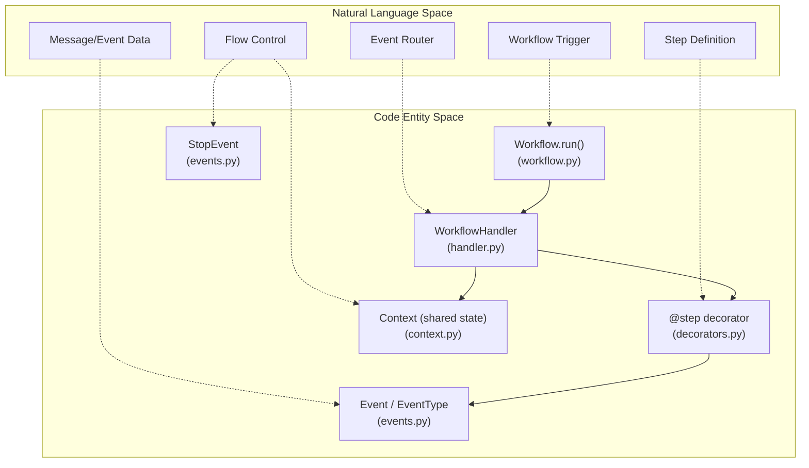
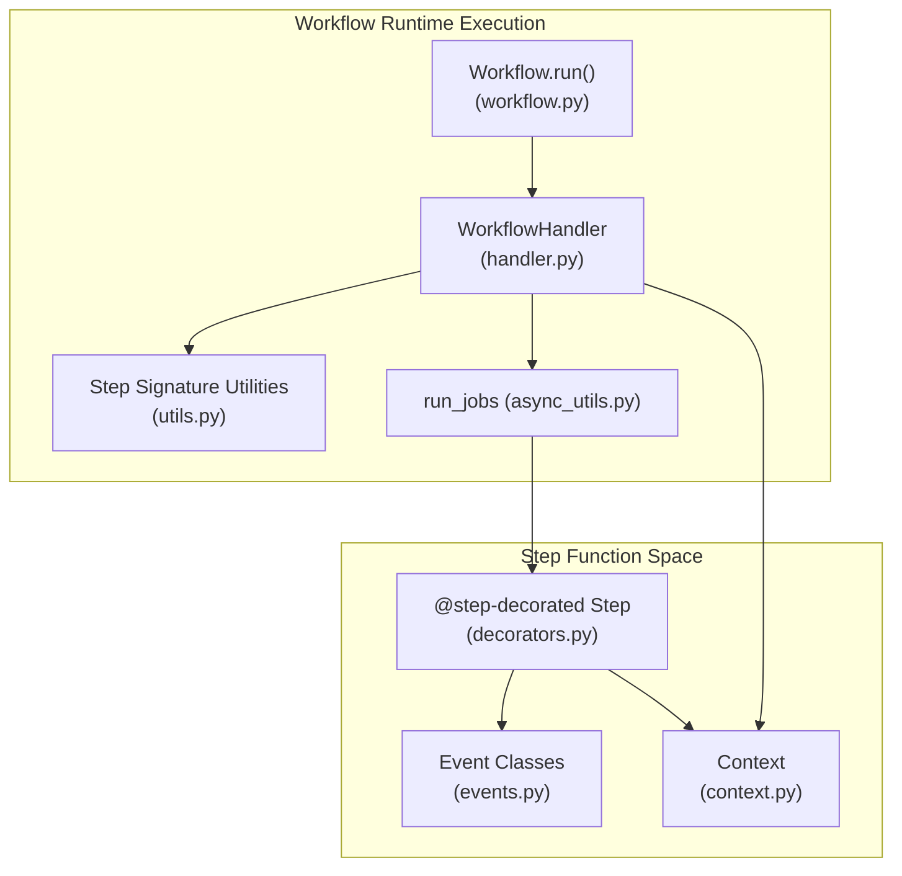
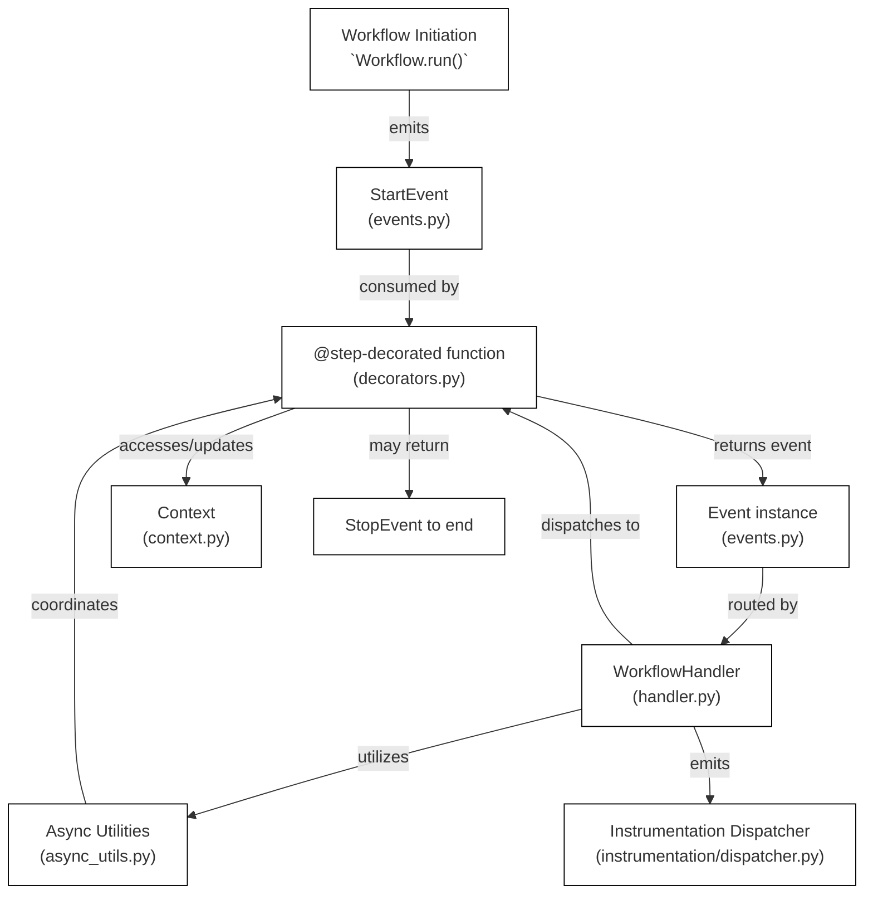

<!-- source: DeepWiki mcp.deepwiki.com · repo run-llama/llama_index · page 4.2 Event-Driven Architecture · fetched 2026-10-26 -->

# Event-Driven Architecture

<details>
<summary>Relevant source files</summary>

The following files were used as context for generating this wiki page:

- [llama-index-core/llama_index/core/workflow/__init__.py](llama-index-core/llama_index/core/workflow/__init__.py)
- [llama-index-core/llama_index/core/workflow/context.py](llama-index-core/llama_index/core/workflow/context.py)
- [llama-index-core/llama_index/core/workflow/decorators.py](llama-index-core/llama_index/core/workflow/decorators.py)
- [llama-index-core/llama_index/core/workflow/errors.py](llama-index-core/llama_index/core/workflow/errors.py)
- [llama-index-core/llama_index/core/workflow/events.py](llama-index-core/llama_index/core/workflow/events.py)
- [llama-index-core/llama_index/core/workflow/handler.py](llama-index-core/llama_index/core/workflow/handler.py)
- [llama-index-core/llama_index/core/workflow/retry_policy.py](llama-index-core/llama_index/core/workflow/retry_policy.py)
- [llama-index-core/llama_index/core/workflow/service.py](llama-index-core/llama_index/core/workflow/service.py)
- [llama-index-core/llama_index/core/workflow/utils.py](llama-index-core/llama_index/core/workflow/utils.py)
- [llama-index-core/llama_index/core/workflow/workflow.py](llama-index-core/llama_index/core/workflow/workflow.py)

</details>


## Purpose and Scope

This document details the **event-driven architecture** that powers the LlamaIndex workflow system. It covers the core event types, the `WorkflowHandler` class responsible for event routing and step execution, event emission and collection mechanics, and flow control strategies used to orchestrate complex multi-step workflows asynchronously.

For foundational concepts about workflows and the `@step` decorator, see [Workflow Fundamentals](#4.1). For more advanced workflow management features such as retry policies and streaming, see [Advanced Workflow Features](#4.3).

---

## Event System Overview

LlamaIndex implements its workflow system using an **event-driven architecture**—workflow logic is decomposed into steps that communicate via typed events asynchronously. This architecture enables flexible, loosely coupled workflows with controlled concurrency.

### Core Concepts

- **Events**: Instances of subclasses of the `Event` base class represent messages passed between workflow steps. Event types encode the kind of data carried and expected by each step [llama-index-core/llama_index/core/workflow/events.py:1-8]().

- **Steps**: Workflow logic units annotated with the `@step` decorator consume and emit events. Step input/output types are defined by event classes, and the framework routes events automatically [llama-index-core/llama_index/core/workflow/decorators.py:7-10]().

- **Event Routing**: The `WorkflowHandler` inspects the event type emitted, discovers steps that accept that event, and schedules their execution asynchronously [llama-index-core/llama_index/core/workflow/handler.py:1]().

- **Context**: A shared mutable state container passed implicitly facilitates cross-step data sharing without direct event routing [llama-index-core/llama_index/core/workflow/context.py:1]().

### Architecture Mapping: Natural Language to Code Entities

The following diagram maps conceptual components in an event-driven workflow to the concrete code entities implementing them in LlamaIndex.

**Diagram: Mapping Event-Driven Workflow Concepts to Code Entities**



Sources: [llama-index-core/llama_index/core/workflow/workflow.py:1](), [llama-index-core/llama_index/core/workflow/decorators.py:7-10](), [llama-index-core/llama_index/core/workflow/events.py:1-8](), [llama-index-core/llama_index/core/workflow/handler.py:1](), [llama-index-core/llama_index/core/workflow/context.py:1]()

---

## Core Event Types

LlamaIndex includes several predefined event classes facilitating common workflow control scenarios and allows users to define custom event subtypes for specific data payloads.

### Built-in Event Types

| Event Type           | Purpose                                            | Usage Context                                      |
|----------------------|--------------------------------------------------|---------------------------------------------------|
| `StartEvent`         | Signals workflow execution start                  | Automatically emitted when `Workflow.run()` begins [llama-index-core/llama_index/core/workflow/events.py:6]() |
| `StopEvent`          | Signals workflow termination                      | Returning or emitting this event ends workflow [llama-index-core/llama_index/core/workflow/events.py:7]() |
| `InputRequiredEvent` | Requests external input (manual/human step)      | Pausing workflow to wait for input [llama-index-core/llama_index/core/workflow/events.py:5]() |
| `HumanResponseEvent` | Supplies response to input request                | Carries data provided for `InputRequiredEvent` [llama-index-core/llama_index/core/workflow/events.py:4]() |

### StartEvent

- **Role**: Entry point event emitted internally by workflow runtime on `Workflow.run()` invocation.
- **Characteristics**: May carry arbitrary initialization data for workflow steps.
- **Usage**: Typically only one step consumes `StartEvent` as the logical starting point.

### StopEvent

- **Role**: Terminates workflow execution when returned/emitted by a step.
- **Characteristics**: Contains `result` attribute holding final output from workflow.
- **Effect**: Stops further event processing and step execution.

### InputRequiredEvent and HumanResponseEvent

These event types enable integration of human-in-the-loop workflows by allowing steps to pause and wait for input, then resume execution once data arrives.

Sources: [llama-index-core/llama_index/core/workflow/events.py:1-8](), [llama-index-core/llama_index/core/workflow/errors.py:1-10]()

---

## Event Flow and Routing

The workflow runtime routes events asynchronously to steps using introspection and type matching.

### Step Signature Inspection and Registration

The framework uses several key utilities to analyze the expected input and output event types of each workflow step:

- `inspect_signature`: Analyzes function signatures for parameter and return types [llama-index-core/llama_index/core/workflow/utils.py:10]().
- `validate_step_signature`: Ensures conformity of step signatures to the expected pattern [llama-index-core/llama_index/core/workflow/utils.py:12]().
- `get_steps_from_class` / `get_steps_from_instance`: Extracts all decorated step functions defined on a workflow class or instance [llama-index-core/llama_index/core/workflow/utils.py:8-9]().
- `_get_param_types` / `_get_return_types`: Extracts parameter and return type annotations for steps [llama-index-core/llama_index/core/workflow/utils.py:13-14]().

Steps are registered by their input event types, enabling the `WorkflowHandler` to look up candidate handlers when an event is emitted.

### WorkflowHandler: Event Dispatch and Execution

`WorkflowHandler` is the core class that:

- Receives events emitted by steps.
- Matches events to registered step functions based on input event type.
- Concurrently schedules matching steps using an asynchronous worker pool.
- Manages lifecycle of events and handles workflow termination.

Execution supports concurrency via Python asyncio and includes logic to spawn threads if an event loop is already running, improving integration flexibility [llama-index-core/llama_index/core/workflow/handler.py:1](), [llama-index-core/llama_index/core/async_utils.py:37-175]().

### Concurrency and Async Utilities

The system uses these async utilities:

- `asyncio_run`: Runs coroutines in event loops, with safe-thread fallback.
- `run_jobs`: Executes batches of async tasks with semaphore limits (default 4 parallel workers) [llama-index-core/llama_index/core/async_utils.py:133-175]().

This concurrency model avoids resource exhaustion and allows multiple steps to react to the same event in parallel.

### Diagram: Event Flow and Step Execution



Sources: [llama-index-core/llama_index/core/workflow/handler.py:1](), [llama-index-core/llama_index/core/workflow/utils.py:1-15](), [llama-index-core/llama_index/core/async_utils.py:37-175](), [llama-index-core/llama_index/core/workflow/decorators.py:7-10](), [llama-index-core/llama_index/core/workflow/events.py:1-8](), [llama-index-core/llama_index/core/workflow/context.py:1]()

---

## Event Emission and Collection Pattern

Workflow steps emit events as their return values. The emitted events become input to subsequent steps that handle the event type.

Example:

```python
@step
def process_data(event: StartEvent) -> DataProcessedEvent:
    # ...process...
    return DataProcessedEvent(data=processed_data)
```

The framework collects all emitted events and dispatches them as new triggers. This facilitates chaining and branching without manual wiring.

The concept of **Context** supports passing additional shared state which is useful for coordination beyond event payloads.

Sources: [llama-index-core/llama_index/core/workflow/decorators.py:7-10](), [llama-index-core/llama_index/core/workflow/context.py:1]()

---

## Flow Control Mechanisms

### Termination and Stopping

Returning or emitting a `StopEvent` signals the end of the workflow. The runtime then completes execution and returns the payload contained in the `StopEvent` as the workflow result.

### Waiting and Busy Polling

Some workflows may pause waiting for external input or events. The system uses a configurable constant delay (`BUSY_WAIT_DELAY`) to implement efficient busy-wait loops instead of tight CPU-consuming spins [llama-index-core/llama_index/core/workflow/utils.py:6]().

### Context Management

The `Context` object provides a shared mutable dictionary accessible to all steps within a workflow invocation. This supports complex coordination, branching, and merging logic without direct event passing.

### Step-Level Configuration

The `StepConfig` class (defined in decorators) allows tuning behavior of individual steps with metadata such as timeouts or retry policies [llama-index-core/llama_index/core/workflow/decorators.py:1-10]().

### Workflow Errors

The system has custom error types for precise control over failures and validation:

| Error Class                    | Description                                  |
|-------------------------------|----------------------------------------------|
| `WorkflowRuntimeError`         | General execution failure in a workflow step [llama-index-core/llama_index/core/workflow/errors.py:6]() |
| `WorkflowTimeoutError`         | Workflow execution exceeded permitted time [llama-index-core/llama_index/core/workflow/errors.py:8]() |
| `WorkflowValidationError`      | Incorrect workflow or step configuration [llama-index-core/llama_index/core/workflow/errors.py:9]() |
| `WorkflowCancelledByUser`      | Workflow stopped manually by user request [llama-index-core/llama_index/core/workflow/errors.py:3]() |
| `WorkflowStepDoesNotExistError`| Step routing failed due to missing step [llama-index-core/llama_index/core/workflow/errors.py:7]() |

Sources: [llama-index-core/llama_index/core/workflow/errors.py:1-10](), [llama-index-core/llama_index/core/workflow/utils.py:1-15](), [llama-index-core/llama_index/core/workflow/context.py:1](), [llama-index-core/llama_index/core/workflow/decorators.py:1-10]()

---

## Integration with Instrumentation and Observability

The event-driven architecture is tightly integrated with the LlamaIndex instrumentation framework. This enables tracing, observability, and monitoring of workflow execution steps and events.

- **Dispatcher** (`llama_index.core.instrumentation.dispatcher.Dispatcher`) emits instrumentation spans and events corresponding to workflow events for monitoring [llama-index-core/llama_index/core/instrumentation/dispatcher.py:1-8]().

- Key async functions such as `run_jobs` are decorated with instrumentation spans to measure execution times and concurrency patterns [llama-index-core/llama_index/core/async_utils.py:138]().

- The instrumentation layer provides handlers such as `BaseEventHandler`, `BaseSpanHandler`, and `SimpleSpanHandler` to consume and visualize instrumentation data [llama-index-core/llama_index/core/instrumentation/span_handlers/base.py:1](), [llama-index-core/llama_index/core/instrumentation/event_handlers/base.py:1]().

This observability integration aids in debugging, performance tuning, and auditing workflow executions.

Sources: [llama-index-core/llama_index/core/instrumentation/dispatcher.py:1-8](), [llama-index-core/llama_index/core/instrumentation/events/base.py:1](), [llama-index-core/llama_index/core/instrumentation/span_handlers/base.py:1](), [llama-index-core/llama_index/core/async_utils.py:130-140]()

---

## Summary Diagram: Event-Driven Workflow System Components

This final diagram summarizes the main components and their interactions in the event-driven workflow system, bridging natural workflow concepts with their key code entities.



---

This event-driven foundation enables LlamaIndex workflows to be flexible, extensible, and robust for building complex multi-step LLM application pipelines.

# References and Sources

- [llama-index-core/llama_index/core/workflow/events.py:1-8]()
- [llama-index-core/llama_index/core/workflow/handler.py:1]()
- [llama-index-core/llama_index/core/workflow/utils.py:1-15]()
- [llama-index-core/llama_index/core/workflow/decorators.py:7-10]()
- [llama-index-core/llama_index/core/workflow/context.py:1]()
- [llama-index-core/llama_index/core/workflow/errors.py:1-10]()
- [llama-index-core/llama_index/core/async_utils.py:37-175]()
- [llama-index-core/llama_index/core/instrumentation/dispatcher.py:1-8]()
- [llama-index-core/llama_index/core/instrumentation/span_handlers/base.py:1]()
- [llama-index-core/llama_index/core/instrumentation/event_handlers/base.py:1]()

---

