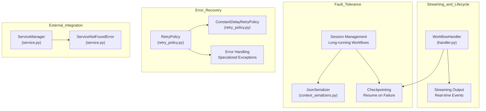
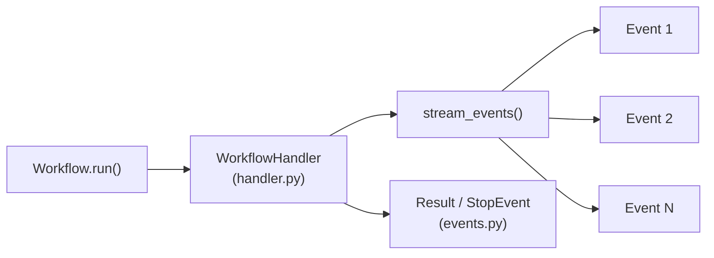
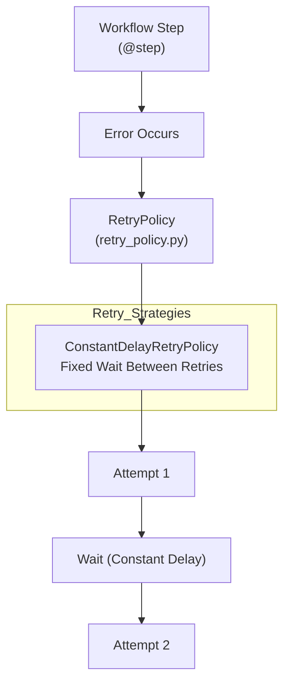
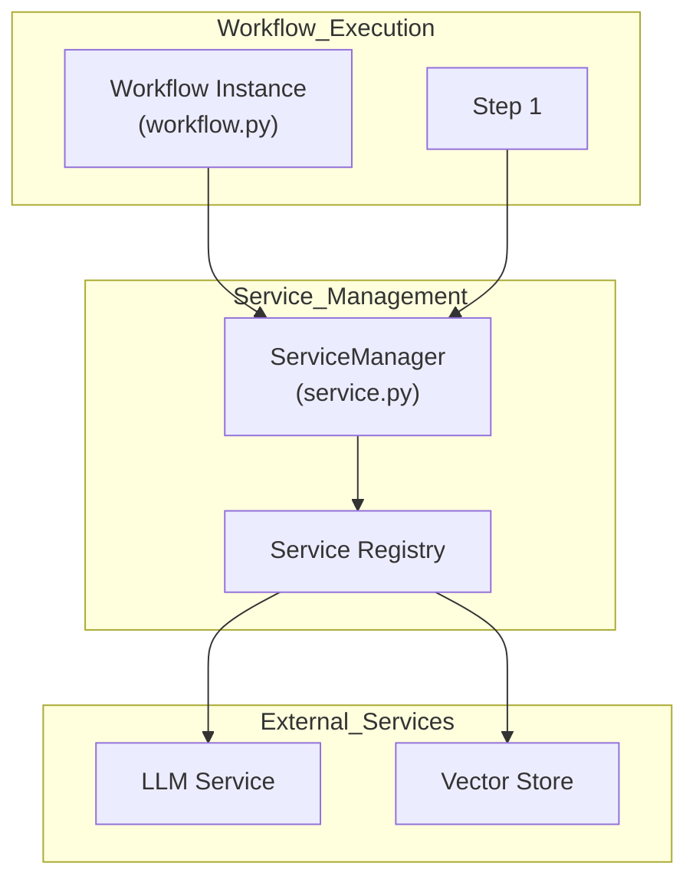

<!-- source: DeepWiki mcp.deepwiki.com · repo run-llama/llama_index · page 4.3 Advanced Workflow Features · fetched 2026-10-26 -->

# Advanced Workflow Features

<details>
<summary>Relevant source files</summary>

The following files were used as context for generating this wiki page:

- [llama-index-core/llama_index/core/async_utils.py](llama-index-core/llama_index/core/async_utils.py)
- [llama-index-core/llama_index/core/instrumentation/__init__.py](llama-index-core/llama_index/core/instrumentation/__init__.py)
- [llama-index-core/llama_index/core/instrumentation/base_handler.py](llama-index-core/llama_index/core/instrumentation/base_handler.py)
- [llama-index-core/llama_index/core/instrumentation/dispatcher.py](llama-index-core/llama_index/core/instrumentation/dispatcher.py)
- [llama-index-core/llama_index/core/instrumentation/event_handlers/__init__.py](llama-index-core/llama_index/core/instrumentation/event_handlers/__init__.py)
- [llama-index-core/llama_index/core/instrumentation/event_handlers/base.py](llama-index-core/llama_index/core/instrumentation/event_handlers/base.py)
- [llama-index-core/llama_index/core/instrumentation/event_handlers/null.py](llama-index-core/llama_index/core/instrumentation/event_handlers/null.py)
- [llama-index-core/llama_index/core/instrumentation/events/base.py](llama-index-core/llama_index/core/instrumentation/events/base.py)
- [llama-index-core/llama_index/core/instrumentation/events/span.py](llama-index-core/llama_index/core/instrumentation/events/span.py)
- [llama-index-core/llama_index/core/instrumentation/span/__init__.py](llama-index-core/llama_index/core/instrumentation/span/__init__.py)
- [llama-index-core/llama_index/core/instrumentation/span/base.py](llama-index-core/llama_index/core/instrumentation/span/base.py)
- [llama-index-core/llama_index/core/instrumentation/span/simple.py](llama-index-core/llama_index/core/instrumentation/span/simple.py)
- [llama-index-core/llama_index/core/instrumentation/span_handlers/__init__.py](llama-index-core/llama_index/core/instrumentation/span_handlers/__init__.py)
- [llama-index-core/llama_index/core/instrumentation/span_handlers/base.py](llama-index-core/llama_index/core/instrumentation/span_handlers/base.py)
- [llama-index-core/llama_index/core/instrumentation/span_handlers/null.py](llama-index-core/llama_index/core/instrumentation/span_handlers/null.py)
- [llama-index-core/llama_index/core/instrumentation/span_handlers/simple.py](llama-index-core/llama_index/core/instrumentation/span_handlers/simple.py)
- [llama-index-core/llama_index/core/workflow/__init__.py](llama-index-core/llama_index/core/workflow/__init__.py)
- [llama-index-core/llama_index/core/workflow/context.py](llama-index-core/llama_index/core/workflow/context.py)
- [llama-index-core/llama_index/core/workflow/decorators.py](llama-index-core/llama_index/core/workflow/decorators.py)
- [llama-index-core/llama_index/core/workflow/errors.py](llama-index-core/llama_index/core/workflow/errors.py)
- [llama-index-core/llama_index/core/workflow/events.py](llama-index-core/llama_index/core/workflow/events.py)
- [llama-index-core/llama_index/core/workflow/handler.py](llama-index-core/llama_index/core/workflow/handler.py)
- [llama-index-core/llama_index/core/workflow/retry_policy.py](llama-index-core/llama_index/core/workflow/retry_policy.py)
- [llama-index-core/llama_index/core/workflow/service.py](llama-index-core/llama_index/core/workflow/service.py)
- [llama-index-core/llama_index/core/workflow/utils.py](llama-index-core/llama_index/core/workflow/utils.py)
- [llama-index-core/llama_index/core/workflow/workflow.py](llama-index-core/llama_index/core/workflow/workflow.py)
- [llama-index-core/tests/test_async_utils.py](llama-index-core/tests/test_async_utils.py)

</details>


## Purpose and Scope

This document covers advanced capabilities of the workflow system beyond basic step orchestration. These features enable production-grade workflow applications with fault tolerance, external service integration, and complex execution patterns.

For fundamental workflow concepts including the `Workflow` class, `@step` decorator, `Context`, and event system, see [Workflow Fundamentals](#4.1). This page assumes familiarity with those concepts.

The advanced features documented here include:

- **Streaming Support**: Real-time output from long-running workflows via `WorkflowHandler`.
- **Checkpointing and Session Management**: Fault tolerance and workflow resumption using context serializers.
- **Retry Policies**: Automatic error recovery with configurable strategies like `ConstantDelayRetryPolicy`.
- **Service Management**: Integration with external services and resources via `ServiceManager`.
- **Context Serialization**: Persistence and transmission of workflow state.
- **Error Handling**: Specialized exceptions for workflow-specific failure modes.

Sources:
- [llama-index-core/llama_index/core/workflow/workflow.py:1]()
- [llama-index-core/llama_index/core/workflow/context.py:1]()

---

## Advanced Feature Overview

The following diagram maps the advanced workflow features to their corresponding code entities in the workflow system, bridging natural language concepts to concrete codebase symbols:

Title: Advanced Workflow Feature Mapping


Sources: 
- [llama-index-core/llama_index/core/workflow/handler.py:1-1]()
- [llama-index-core/llama_index/core/workflow/retry_policy.py:1-1]()
- [llama-index-core/llama_index/core/workflow/service.py:1-1]()

---

## Streaming Support

Workflows can produce output incrementally rather than waiting for completion. This is critical for user-facing applications where long-running LLM operations need provide feedback.

### WorkflowHandler

The `WorkflowHandler` class manages the lifecycle of a workflow execution and provides access to streaming events. When a workflow is started via `Workflow.run()`, it returns a handler that can be used to monitor progress and retrieve results [llama-index-core/llama_index/core/workflow/handler.py:1]().

Title: Workflow Streaming Data Flow


The handler enables:
- Non-blocking workflow execution.
- Real-time event streaming for progress updates.
- Cancellation and timeout management.
- Access to final results via `StopEvent` [llama-index-core/llama_index/core/workflow/events.py:1]().

Sources:
- [llama-index-core/llama_index/core/workflow/handler.py:1-1]()
- [llama-index-core/llama_index/core/workflow/events.py:1-8]()
- [llama-index-core/llama_index/core/workflow/workflow.py:1]()

---

## Checkpointing and Session Management

Long-running workflows benefit from checkpointing to enable fault tolerance and resumption after failures. The workflow system provides session management and context serialization to support this.

### Context Serialization

The workflow `Context` can be serialized for persistence or transmission [llama-index-core/llama_index/core/workflow/context.py:1](). 

Title: Context Persistence Lifecycle
```mermaid
graph TB
    Context["Context<br/>(context.py)"]
    
    subgraph "Serialization"
        JsonSerializer["JsonSerializer<br/>(context_serializers.py)"]
    end
    
    subgraph "Storage"
        JSON["JSON Format<br/>Portable"]
        Storage["Persistent Storage<br/>Database, File System"]
    end
    
    subgraph "Recovery"
        Deserialize["Deserialize Context"]
        Resume["Resume Workflow"]
    end
    
    Context --> JsonSerializer
    JsonSerializer --> JSON
    JSON --> Storage
    Storage --> Deserialize
    Deserialize --> Resume
```

**Key Considerations:**
- `JsonSerializer` requires all context data to be JSON-serializable.
- Context serialization errors raise `ContextSerdeError` [llama-index-core/llama_index/core/workflow/errors.py:1]().

Sources:
- [llama-index-core/llama_index/core/workflow/context.py:1]()
- [llama-index-core/llama_index/core/workflow/errors.py:1-10]()

---

## Retry Policies

Workflows often interact with external services that may experience transient failures. Retry policies automate error recovery.

### RetryPolicy and ConstantDelayRetryPolicy

The `RetryPolicy` abstract base class defines the interface for retry strategies. The `ConstantDelayRetryPolicy` implements a simple retry strategy with fixed delays between attempts [llama-index-core/llama_index/core/workflow/retry_policy.py:1]().

Title: Step Execution Retry Logic


Sources:
- [llama-index-core/llama_index/core/workflow/retry_policy.py:1-1]()
- [llama-index-core/llama_index/core/workflow/decorators.py:7-10]()

---

## Service Management

The `ServiceManager` provides a centralized mechanism for managing external services (LLMs, Databases, etc.) that workflows depend on [llama-index-core/llama_index/core/workflow/service.py:1]().

Title: Workflow Service Resolution


If a requested service is not found, the system raises a `ServiceNotFoundError` [llama-index-core/llama_index/core/workflow/service.py:1]().

Sources:
- [llama-index-core/llama_index/core/workflow/service.py:1-1]()
- [llama-index-core/llama_index/core/workflow/workflow.py:1]()

---

## Error Handling

The workflow system defines specialized exception types in `llama_index.core.workflow.errors` for different failure scenarios.

| Exception | Purpose |
|-----------|---------|
| `WorkflowRuntimeError` | General workflow execution failures [llama-index-core/llama_index/core/workflow/errors.py:6](). |
| `WorkflowTimeoutError` | Execution time limits exceeded [llama-index-core/llama_index/core/workflow/errors.py:8](). |
| `WorkflowValidationError` | Invalid workflow definition (e.g., signature mismatch) [llama-index-core/llama_index/core/workflow/errors.py:9](). |
| `WorkflowConfigurationError` | Configuration errors during setup [llama-index-core/llama_index/core/workflow/errors.py:4](). |
| `WorkflowStepDoesNotExistError` | Attempting to call a step that isn't defined [llama-index-core/llama_index/core/workflow/errors.py:7](). |
| `ContextSerdeError` | Failures during context serialization/deserialization [llama-index-core/llama_index/core/workflow/errors.py:2](). |
| `WorkflowCancelledByUser` | Manual cancellation of the workflow [llama-index-core/llama_index/core/workflow/errors.py:3](). |
| `WorkflowDone` | Signal that the workflow has successfully completed [llama-index-core/llama_index/core/workflow/errors.py:5](). |

Sources:
- [llama-index-core/llama_index/core/workflow/errors.py:1-10]()

---

## Step Utilities and Introspection

The workflow system uses utility functions in `llama_index.core.workflow.utils` to manage step registration and validation.

- `get_steps_from_class` / `get_steps_from_instance`: Used to discover methods decorated with `@step` [llama-index-core/llama_index/core/workflow/utils.py:8-9]().
- `validate_step_signature`: Ensures that step functions have the correct parameters [llama-index-core/llama_index/core/workflow/utils.py:12]().
- `StepSignatureSpec`: A data structure representing the requirements and outputs of a step [llama-index-core/llama_index/core/workflow/utils.py:7]().
- `inspect_signature`: Performs reflection on step functions to determine input and output event types [llama-index-core/llama_index/core/workflow/utils.py:10]().

Sources:
- [llama-index-core/llama_index/core/workflow/utils.py:1-15]()
- [llama-index-core/llama_index/core/workflow/decorators.py:1-10]()

---

