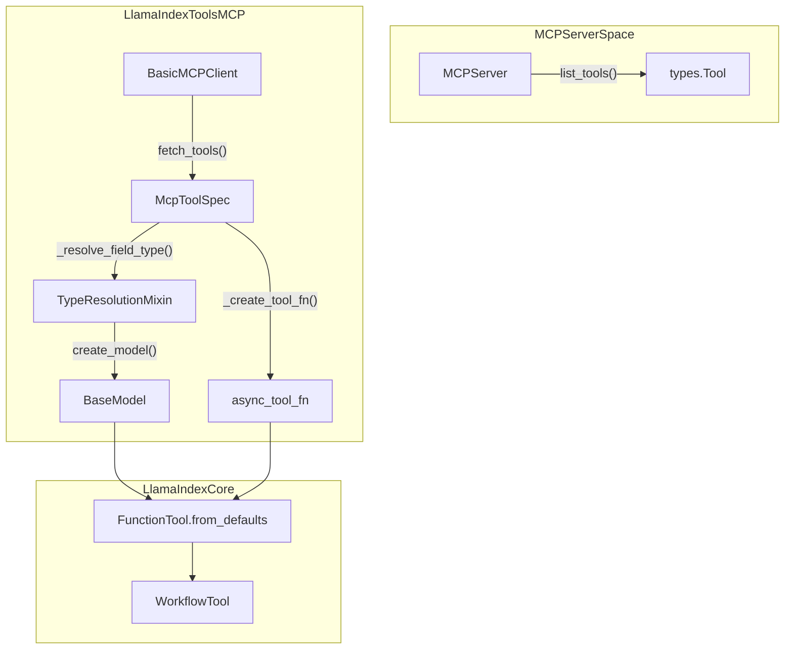
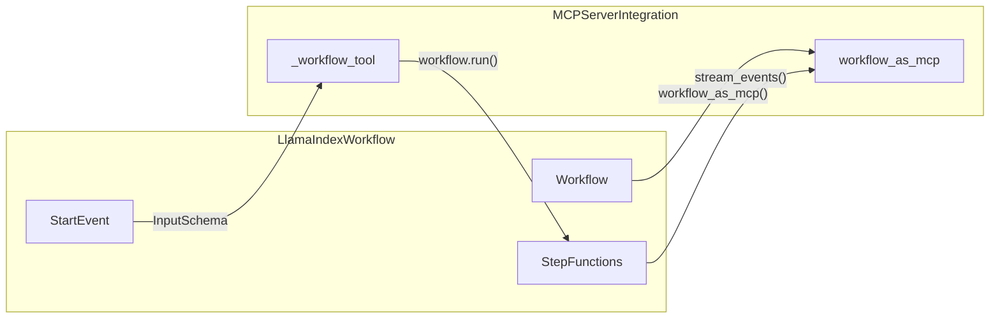
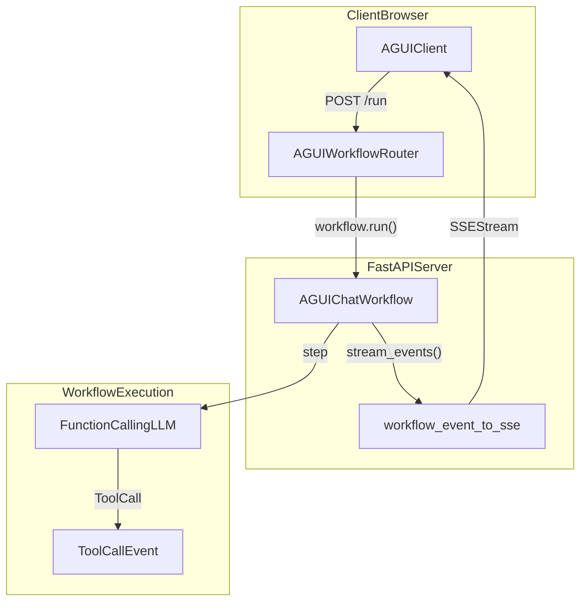

<!-- source: DeepWiki mcp.deepwiki.com · repo run-llama/llama_index · page 4.4 MCP and Protocol Integrations · fetched 2026-10-26 -->

# MCP and Protocol Integrations

Relevant source files

The following files were used as context for generating this wiki page:

- [llama-index-integrations/protocols/llama-index-protocols-ag-ui/LICENSE](llama-index-integrations/protocols/llama-index-protocols-ag-ui/LICENSE)
- [llama-index-integrations/protocols/llama-index-protocols-ag-ui/Makefile](llama-index-integrations/protocols/llama-index-protocols-ag-ui/Makefile)
- [llama-index-integrations/protocols/llama-index-protocols-ag-ui/README.md](llama-index-integrations/protocols/llama-index-protocols-ag-ui/README.md)
- [llama-index-integrations/protocols/llama-index-protocols-ag-ui/llama_index/protocols/ag_ui/__init__.py](llama-index-integrations/protocols/llama-index-protocols-ag-ui/llama_index/protocols/ag_ui/__init__.py)
- [llama-index-integrations/protocols/llama-index-protocols-ag-ui/llama_index/protocols/ag_ui/agent.py](llama-index-integrations/protocols/llama-index-protocols-ag-ui/llama_index/protocols/ag_ui/agent.py)
- [llama-index-integrations/protocols/llama-index-protocols-ag-ui/llama_index/protocols/ag_ui/events.py](llama-index-integrations/protocols/llama-index-protocols-ag-ui/llama_index/protocols/ag_ui/events.py)
- [llama-index-integrations/protocols/llama-index-protocols-ag-ui/llama_index/protocols/ag_ui/router.py](llama-index-integrations/protocols/llama-index-protocols-ag-ui/llama_index/protocols/ag_ui/router.py)
- [llama-index-integrations/protocols/llama-index-protocols-ag-ui/llama_index/protocols/ag_ui/utils.py](llama-index-integrations/protocols/llama-index-protocols-ag-ui/llama_index/protocols/ag_ui/utils.py)
- [llama-index-integrations/protocols/llama-index-protocols-ag-ui/pyproject.toml](llama-index-integrations/protocols/llama-index-protocols-ag-ui/pyproject.toml)
- [llama-index-integrations/protocols/llama-index-protocols-ag-ui/tests/test_frontend_tool_messages.py](llama-index-integrations/protocols/llama-index-protocols-ag-ui/tests/test_frontend_tool_messages.py)
- [llama-index-integrations/protocols/llama-index-protocols-ag-ui/tests/test_initial_state.py](llama-index-integrations/protocols/llama-index-protocols-ag-ui/tests/test_initial_state.py)
- [llama-index-integrations/protocols/llama-index-protocols-ag-ui/tests/test_multimodal_input.py](llama-index-integrations/protocols/llama-index-protocols-ag-ui/tests/test_multimodal_input.py)
- [llama-index-integrations/protocols/llama-index-protocols-ag-ui/tests/test_state_prompt_multimodal.py](llama-index-integrations/protocols/llama-index-protocols-ag-ui/tests/test_state_prompt_multimodal.py)
- [llama-index-integrations/protocols/llama-index-protocols-ag-ui/uv.lock](llama-index-integrations/protocols/llama-index-protocols-ag-ui/uv.lock)
- [llama-index-integrations/tools/llama-index-tools-mcp/.gitignore](llama-index-integrations/tools/llama-index-tools-mcp/.gitignore)
- [llama-index-integrations/tools/llama-index-tools-mcp/CHANGELOG.md](llama-index-integrations/tools/llama-index-tools-mcp/CHANGELOG.md)
- [llama-index-integrations/tools/llama-index-tools-mcp/Makefile](llama-index-integrations/tools/llama-index-tools-mcp/Makefile)
- [llama-index-integrations/tools/llama-index-tools-mcp/README.md](llama-index-integrations/tools/llama-index-tools-mcp/README.md)
- [llama-index-integrations/tools/llama-index-tools-mcp/examples/.env.example](llama-index-integrations/tools/llama-index-tools-mcp/examples/.env.example)
- [llama-index-integrations/tools/llama-index-tools-mcp/examples/mcp.ipynb](llama-index-integrations/tools/llama-index-tools-mcp/examples/mcp.ipynb)
- [llama-index-integrations/tools/llama-index-tools-mcp/examples/mcp_server.py](llama-index-integrations/tools/llama-index-tools-mcp/examples/mcp_server.py)
- [llama-index-integrations/tools/llama-index-tools-mcp/llama_index/tools/mcp/__init__.py](llama-index-integrations/tools/llama-index-tools-mcp/llama_index/tools/mcp/__init__.py)
- [llama-index-integrations/tools/llama-index-tools-mcp/llama_index/tools/mcp/base.py](llama-index-integrations/tools/llama-index-tools-mcp/llama_index/tools/mcp/base.py)
- [llama-index-integrations/tools/llama-index-tools-mcp/llama_index/tools/mcp/client.py](llama-index-integrations/tools/llama-index-tools-mcp/llama_index/tools/mcp/client.py)
- [llama-index-integrations/tools/llama-index-tools-mcp/llama_index/tools/mcp/tool_spec_mixins.py](llama-index-integrations/tools/llama-index-tools-mcp/llama_index/tools/mcp/tool_spec_mixins.py)
- [llama-index-integrations/tools/llama-index-tools-mcp/llama_index/tools/mcp/utils.py](llama-index-integrations/tools/llama-index-tools-mcp/llama_index/tools/mcp/utils.py)
- [llama-index-integrations/tools/llama-index-tools-mcp/pyproject.toml](llama-index-integrations/tools/llama-index-tools-mcp/pyproject.toml)
- [llama-index-integrations/tools/llama-index-tools-mcp/tests/schemas.py](llama-index-integrations/tools/llama-index-tools-mcp/tests/schemas.py)
- [llama-index-integrations/tools/llama-index-tools-mcp/tests/server.py](llama-index-integrations/tools/llama-index-tools-mcp/tests/server.py)
- [llama-index-integrations/tools/llama-index-tools-mcp/tests/test_client.py](llama-index-integrations/tools/llama-index-tools-mcp/tests/test_client.py)
- [llama-index-integrations/tools/llama-index-tools-mcp/tests/test_tools_mcp.py](llama-index-integrations/tools/llama-index-tools-mcp/tests/test_tools_mcp.py)
- [llama-index-integrations/tools/llama-index-tools-mcp/uv.lock](llama-index-integrations/tools/llama-index-tools-mcp/uv.lock)

## Purpose and Scope
This page documents LlamaIndex's support for the **Model Context Protocol (MCP)** and the **AG-UI protocol**. These integrations allow LlamaIndex applications to act as both an MCP client (consuming external tools and resources from MCP servers) and an MCP server (exposing LlamaIndex `Workflow` objects as tools). Additionally, LlamaIndex supports the **AG-UI protocol** via the `llama-index-protocols-ag-ui` package for building stateful, interactive agentic user interfaces with Server-Sent Events (SSE) streaming.

Sources: `[llama-index-integrations/tools/llama-index-tools-mcp/pyproject.toml:30-47](), [llama-index-integrations/protocols/llama-index-protocols-ag-ui/pyproject.toml:29-42]()`

---

## MCP Client Integration

The MCP client integration enables LlamaIndex workflows and agents to dynamically discover and execute tools hosted on arbitrary MCP servers. This capability is delivered via the `llama-index-tools-mcp` integration package.

### BasicMCPClient
The `BasicMCPClient` class establishes and manages connections to MCP servers, supporting multiple transport mechanisms including Standard Input/Output (stdio) for local subprocesses and Server-Sent Events (SSE) for remote HTTP communication `[llama-index-integrations/tools/llama-index-tools-mcp/llama_index/tools/mcp/client.py:99-135]()`.

Key features include:
* **Transport Routing**: Inspects command strings or URLs to automatically configure `stdio_client`, `sse_client`, or `streamable_http_client` `[llama-index-integrations/tools/llama-index-tools-mcp/llama_index/tools/mcp/client.py:54-66]()`.
* **OAuth Authentication**: Provides `with_oauth()` for secure authorization workflows, utilizing `DefaultInMemoryTokenStorage` by default `[llama-index-integrations/tools/llama-index-tools-mcp/llama_index/tools/mcp/client.py:69-97, 156-171]()`.
* **Session Lifecycles**: Subclasses `mcp.client.session.ClientSession` to expose protocol methods such as `list_tools`, `call_tool`, `list_resources`, and `read_resource` `[llama-index-integrations/tools/llama-index-tools-mcp/llama_index/tools/mcp/client.py:98]()`.

Sources: `[llama-index-integrations/tools/llama-index-tools-mcp/llama_index/tools/mcp/client.py:54-171]()`

### McpToolSpec
`McpToolSpec` bridges MCP tool/resource definitions and LlamaIndex `FunctionTool` objects. It mixes in type resolution, type creation, and field extraction traits to translate complex JSON Schema structures into valid Pydantic models `[llama-index-integrations/tools/llama-index-tools-mcp/llama_index/tools/mcp/base.py:19-36]()`.

| Method | Description |
| :--- | :--- |
| `fetch_tools()` | Queries the MCP server via `client.list_tools()` and applies `allowed_tools` filtering `[llama-index-integrations/tools/llama-index-tools-mcp/llama_index/tools/mcp/base.py:53-75]()`. |
| `fetch_resources()` | Gathers static resources and dynamic resource templates from `list_resources()` and `list_resource_templates()` `[llama-index-integrations/tools/llama-index-tools-mcp/llama_index/tools/mcp/base.py:76-104]()`. |
| `to_tool_list_async()` | Transforms fetched schemas into `FunctionTool` instances equipped with async execution wrappers `[llama-index-integrations/tools/llama-index-tools-mcp/llama_index/tools/mcp/base.py:126-172]()`. |

Sources: `[llama-index-integrations/tools/llama-index-tools-mcp/llama_index/tools/mcp/base.py:19-172]()`

### Data Flow: MCP Server to LlamaIndex Tool
The following diagram illustrates how an MCP server's tool definition is fetched and converted into a LlamaIndex `FunctionTool`.

Sources: `[llama-index-integrations/tools/llama-index-tools-mcp/llama_index/tools/mcp/base.py:53-172]()`, `[llama-index-integrations/tools/llama-index-tools-mcp/llama_index/tools/mcp/client.py:98-135]()`

---

## Exposing Workflows as MCP Servers

LlamaIndex provides utility functions to wrap any `Workflow` inside an `MCPServer` instance, allowing external MCP clients (such as Claude Desktop) to trigger complex LlamaIndex pipelines as native tools `[llama-index-integrations/tools/llama-index-tools-mcp/llama_index/tools/mcp/utils.py:77-107]()`.

### workflow_as_mcp
The `workflow_as_mcp()` function inspects a workflow's start event model and registers an MCP tool handler `[llama-index-integrations/tools/llama-index-tools-mcp/llama_index/tools/mcp/utils.py:77-107]()`.

1. **Schema Derivation**: Resolves the start event model from `workflow._start_event_class` or an explicit `start_event_model` parameter `[llama-index-integrations/tools/llama-index-tools-mcp/llama_index/tools/mcp/utils.py:109-114]()`.
2. **Execution Handling**: Converts inbound payloads into events or dictionaries, invoking `workflow.run()` accordingly `[llama-index-integrations/tools/llama-index-tools-mcp/llama_index/tools/mcp/utils.py:125-133]()`.
3. **Event Streaming**: Streams intermediary workflow events back to the client as log messages using `context.log()` `[llama-index-integrations/tools/llama-index-tools-mcp/llama_index/tools/mcp/utils.py:135-139]()`.

Sources: `[llama-index-integrations/tools/llama-index-tools-mcp/llama_index/tools/mcp/utils.py:77-141]()`

---

## AG-UI Protocol Support

The `llama-index-protocols-ag-ui` integration bridges LlamaIndex workflows with agentic user interface protocols, facilitating state synchronization, streaming chunk events, and frontend tool execution `[llama-index-integrations/protocols/llama-index-protocols-ag-ui/llama_index/protocols/ag_ui/agent.py:150-160]()`.

### AGUIChatWorkflow
`AGUIChatWorkflow` is a specialized workflow designed for chat interfaces `[llama-index-integrations/protocols/llama-index-protocols-ag-ui/llama_index/protocols/ag_ui/agent.py:150-160]()`:
* **Frontend vs Backend Tools**: Separates `frontend_tools` (executed by client UIs) from `backend_tools` (executed server-side) `[llama-index-integrations/protocols/llama-index-protocols-ag-ui/llama_index/protocols/ag_ui/agent.py:175-180]()`.
* **State Injection**: Injects conversational state blocks into user messages via `_apply_state_prompt()` `[llama-index-integrations/protocols/llama-index-protocols-ag-ui/llama_index/protocols/ag_ui/agent.py:94-127]()`.

### AGUIWorkflowRouter
`AGUIWorkflowRouter` exposes workflows via FastAPI, converting emitted workflow events into Server-Sent Events (SSE) `[llama-index-integrations/protocols/llama-index-protocols-ag-ui/llama_index/protocols/ag_ui/router.py:48-52]()`.

Sources: `[llama-index-integrations/protocols/llama-index-protocols-ag-ui/llama_index/protocols/ag_ui/router.py:48-96](), [llama-index-integrations/protocols/llama-index-protocols-ag-ui/llama_index/protocols/ag_ui/agent.py:150-204]()`

---

## Type Mapping and Schema Resolution

Both MCP and AG-UI integrations rely heavily on translating data contracts between external wire formats and internal Pydantic types.

* **Union Resolution**: `_resolve_union_option` and `_resolve_union_type` map complex `anyOf` and `enum` JSON schemas into native Python `Literal` or `Union` types `[llama-index-integrations/tools/llama-index-tools-mcp/tests/test_tools_mcp.py:146-168]()`.
* **Multimodal Conversion**: `agui_content_to_blocks` transforms binary, audio, image, video, and document payloads from AG-UI messages into core LlamaIndex `ContentBlock` subclasses (`AudioBlock`, `ImageBlock`, `VideoBlock`, `DocumentBlock`) `[llama-index-integrations/protocols/llama-index-protocols-ag-ui/llama_index/protocols/ag_ui/utils.py:98-154]()`.

Sources: `[llama-index-integrations/tools/llama-index-tools-mcp/tests/test_tools_mcp.py:146-207](), [llama-index-integrations/protocols/llama-index-protocols-ag-ui/llama_index/protocols/ag_ui/utils.py:43-154]()`

---

