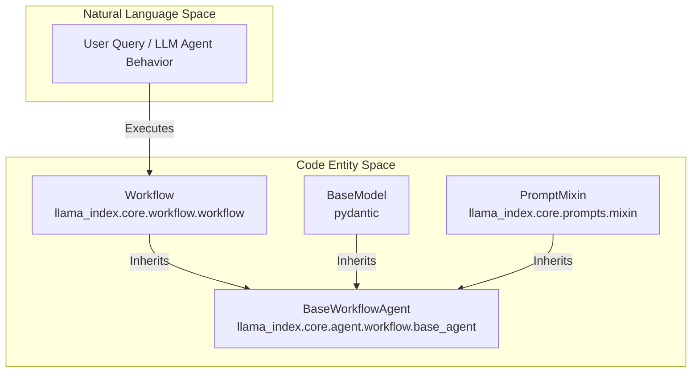
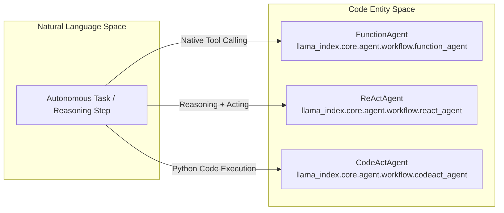
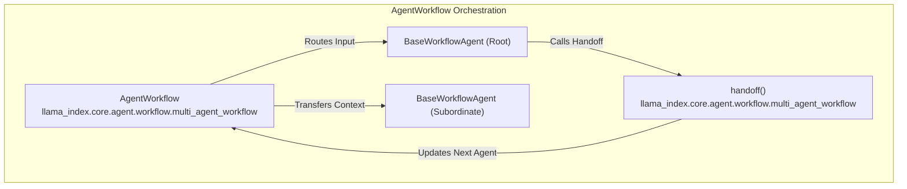
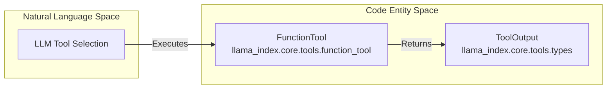

<!-- source: DeepWiki mcp.deepwiki.com · repo run-llama/llama_index · page 5 Agent System · fetched 2026-10-26 -->

# Agent System

Relevant source files

The following files were used as context for generating this wiki page:

- [llama-index-core/llama_index/core/agent/utils.py](llama-index-core/llama_index/core/agent/utils.py)
- [llama-index-core/llama_index/core/agent/workflow/__init__.py](llama-index-core/llama_index/core/agent/workflow/__init__.py)
- [llama-index-core/llama_index/core/agent/workflow/base_agent.py](llama-index-core/llama_index/core/agent/workflow/base_agent.py)
- [llama-index-core/llama_index/core/agent/workflow/codeact_agent.py](llama-index-core/llama_index/core/agent/workflow/codeact_agent.py)
- [llama-index-core/llama_index/core/agent/workflow/function_agent.py](llama-index-core/llama_index/core/agent/workflow/function_agent.py)
- [llama-index-core/llama_index/core/agent/workflow/multi_agent_workflow.py](llama-index-core/llama_index/core/agent/workflow/multi_agent_workflow.py)
- [llama-index-core/llama_index/core/agent/workflow/prompts.py](llama-index-core/llama_index/core/agent/workflow/prompts.py)
- [llama-index-core/llama_index/core/agent/workflow/react_agent.py](llama-index-core/llama_index/core/agent/workflow/react_agent.py)
- [llama-index-core/llama_index/core/agent/workflow/workflow_events.py](llama-index-core/llama_index/core/agent/workflow/workflow_events.py)
- [llama-index-core/llama_index/core/llms/__init__.py](llama-index-core/llama_index/core/llms/__init__.py)
- [llama-index-core/llama_index/core/llms/mock.py](llama-index-core/llama_index/core/llms/mock.py)
- [llama-index-core/tests/agent/react/test_prompt_customization.py](llama-index-core/tests/agent/react/test_prompt_customization.py)
- [llama-index-core/tests/agent/utils/test_agent_utils.py](llama-index-core/tests/agent/utils/test_agent_utils.py)
- [llama-index-core/tests/agent/workflow/test_agent_with_structured_output.py](llama-index-core/tests/agent/workflow/test_agent_with_structured_output.py)
- [llama-index-core/tests/agent/workflow/test_code_act_agent.py](llama-index-core/tests/agent/workflow/test_code_act_agent.py)
- [llama-index-core/tests/agent/workflow/test_events.py](llama-index-core/tests/agent/workflow/test_events.py)
- [llama-index-core/tests/agent/workflow/test_multi_agent_workflow.py](llama-index-core/tests/agent/workflow/test_multi_agent_workflow.py)
- [llama-index-core/tests/agent/workflow/test_single_agent_workflow.py](llama-index-core/tests/agent/workflow/test_single_agent_workflow.py)
- [llama-index-core/tests/agent/workflow/test_thinking_delta.py](llama-index-core/tests/agent/workflow/test_thinking_delta.py)
- [llama-index-core/tests/llms/test_mock.py](llama-index-core/tests/llms/test_mock.py)

The Agent System provides workflow-based agents for building autonomous LLM applications. Agents can use tools, maintain conversation memory, manage state, and orchestrate complex multi-agent interactions. All agents inherit from `BaseWorkflowAgent` and are built on the workflow engine (see [Workflow System](#4) for workflow fundamentals).

For detailed technical guides, explore the child pages:
- [Agent Architecture](#5.1) — Explain `BaseWorkflowAgent`, step execution, memory management, and tool integration
- [Agent Types](#5.2) — Document `FunctionAgent`, `ReActAgent`, and `CodeActAgent` implementations and use cases
- [Multi-Agent Orchestration](#5.3) — Explain `AgentWorkflow`, handoff mechanisms, and coordinating multiple agents
- [Memory and State Management](#5.4) — Document `ChatMemoryBuffer`, `VectorMemory`, `Mem0Memory` integration, and memory blocks
- [Tools and Tool Specs](#5.5) — Document `FunctionTool`, `QueryEngineTool`, `RetrieverTool`, and `ToolSpec` base classes

---

## Agent Architecture

The agent system uses an event-driven architecture where agents extend the `Workflow` class and implement a standardized interface for tool execution and state management. `BaseWorkflowAgent` combines Pydantic model configuration with workflow execution logic [llama-index-core/llama_index/core/agent/workflow/base_agent.py:87-89]().

Title: Agent Architecture Mapping

Sources: [llama-index-core/llama_index/core/agent/workflow/base_agent.py:87-89]()

For deep technical details on step execution, event loops, and error handling, see [Agent Architecture](#5.1).

---

## Agent Types

LlamaIndex provides specialized agent implementations tailored for different reasoning paradigms. All extend `BaseWorkflowAgent` and support streaming and event emission [llama-index-core/llama_index/core/agent/workflow/base_agent.py:87-89]().

Title: Agent Types Mapping

Sources: [llama-index-core/llama_index/core/agent/workflow/function_agent.py:19-20](), [llama-index-core/llama_index/core/agent/workflow/react_agent.py:38-39](), [llama-index-core/llama_index/core/agent/workflow/codeact_agent.py:63-65]()

For implementation details, configuration options, and use cases, see [Agent Types](#5.2).

---

## Multi-Agent Orchestration

`AgentWorkflow` manages multiple agents with handoff capabilities. It routes tasks between agents using context stores and the `handoff` utility function [llama-index-core/llama_index/core/agent/workflow/multi_agent_workflow.py:73-92]().

Sources: [llama-index-core/llama_index/core/agent/workflow/multi_agent_workflow.py:73-92](), [llama-index-core/llama_index/core/agent/workflow/multi_agent_workflow.py:99-106]()

For details on handoff mechanisms and coordinating multiple agents, see [Multi-Agent Orchestration](#5.3).

---

## Memory and State Management

Agents maintain conversation history through `BaseMemory` implementations and workflow-specific state via the workflow `Context` store (`ctx.store`) [llama-index-core/llama_index/core/agent/workflow/base_agent.py:115-123](). State can be automatically formatted into prompts using `state_prompt` templates [llama-index-core/llama_index/core/agent/workflow/base_agent.py:119-123]().

For documentation on `ChatMemoryBuffer`, `VectorMemory`, `Mem0Memory` integration, and memory blocks, see [Memory and State Management](#5.4).

Sources: [llama-index-core/llama_index/core/agent/workflow/base_agent.py:115-123]()

---

## Tools and Tool Specs

Agents interact with external systems using `BaseTool` abstractions, primarily `FunctionTool` [llama-index-core/llama_index/core/agent/workflow/base_agent.py:49-56](). Tools wrap Python functions with JSON schema generation for LLM consumption.

Sources: [llama-index-core/llama_index/core/agent/workflow/base_agent.py:49-56](), [llama-index-core/llama_index/core/agent/workflow/workflow_events.py:106-114]()

For documentation on `FunctionTool`, `QueryEngineTool`, `RetrieverTool`, `ToolSpec` base classes, and third-party tool integrations, see [Tools and Tool Specs](#5.5).

---

