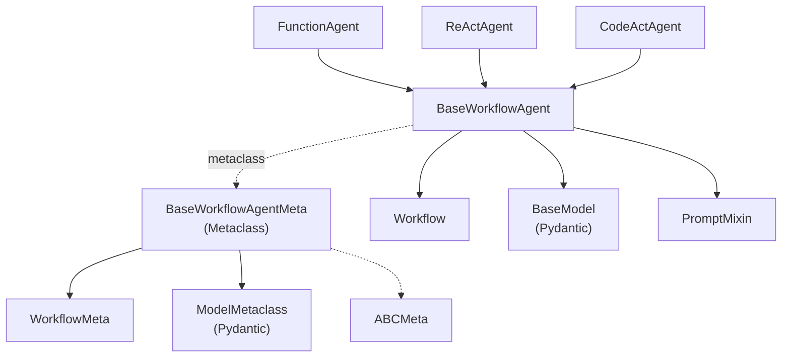
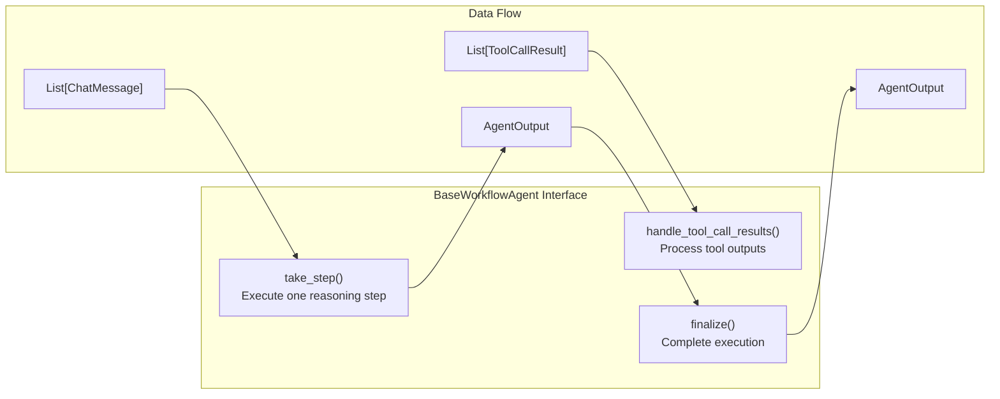
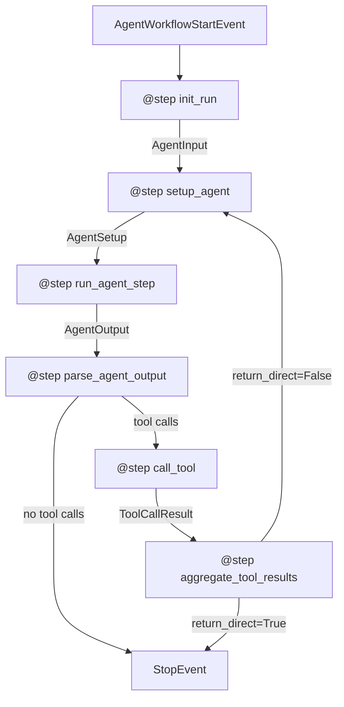
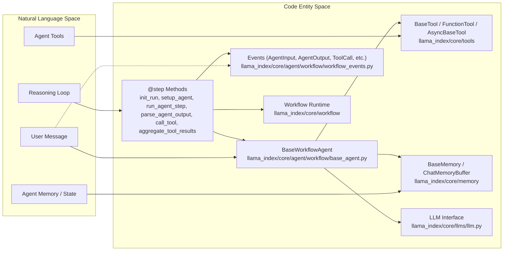

<!-- source: DeepWiki mcp.deepwiki.com · repo run-llama/llama_index · page 5.1 Agent Architecture · fetched 2026-10-26 -->

# Agent Architecture

<details>
<summary>Relevant source files</summary>

The following files were used as context for generating this wiki page:

- [llama-index-core/llama_index/core/agent/utils.py](llama-index-core/llama_index/core/agent/utils.py)
- [llama-index-core/llama_index/core/agent/workflow/__init__.py](llama-index-core/llama_index/core/agent/workflow/__init__.py)
- [llama-index-core/llama_index/core/agent/workflow/base_agent.py](llama-index-core/llama_index/core/agent/workflow/base_agent.py)
- [llama-index-core/llama_index/core/agent/workflow/codeact_agent.py](llama-index-core/llama_index/core/agent/workflow/codeact_agent.py)
- [llama-index-core/llama_index/core/agent/workflow/function_agent.py](llama-index-core/llama_index/core/agent/workflow/function_agent.py)
- [llama-index-core/llama_index/core/agent/workflow/multi_agent_workflow.py](llama-index-core/llama_index/core/agent/workflow/multi_agent_workflow.py)
- [llama-index-core/llama_index/core/agent/workflow/prompts.py](llama-index-core/llama_index/core/agent/workflow/prompts.py)
- [llama-index-core/llama_index/core/agent/workflow/react_agent.py](llama-index-core/llama_index/core/agent/workflow/react_agent.py)
- [llama-index-core/llama_index/core/agent/workflow/workflow_events.py](llama-index-core/llama_index/core/agent/workflow/workflow_events.py)
- [llama-index-core/llama_index/core/llms/__init__.py](llama-index-core/llama_index/core/llms/__init__.py)
- [llama-index-core/llama_index/core/llms/mock.py](llama-index-core/llama_index/core/llms/mock.py)
- [llama-index-core/tests/agent/react/test_prompt_customization.py](llama-index-core/tests/agent/react/test_prompt_customization.py)
- [llama-index-core/tests/agent/utils/test_agent_utils.py](llama-index-core/tests/agent/utils/test_agent_utils.py)
- [llama-index-core/tests/agent/workflow/test_agent_with_structured_output.py](llama-index-core/tests/agent/workflow/test_agent_with_structured_output.py)
- [llama-index-core/tests/agent/workflow/test_code_act_agent.py](llama-index-core/tests/agent/workflow/test_code_act_agent.py)
- [llama-index-core/tests/agent/workflow/test_events.py](llama-index-core/tests/agent/workflow/test_events.py)
- [llama-index-core/tests/agent/workflow/test_multi_agent_workflow.py](llama-index-core/tests/agent/workflow/test_multi_agent_workflow.py)
- [llama-index-core/tests/agent/workflow/test_single_agent_workflow.py](llama-index-core/tests/agent/workflow/test_single_agent_workflow.py)
- [llama-index-core/tests/agent/workflow/test_thinking_delta.py](llama-index-core/tests/agent/workflow/test_thinking_delta.py)
- [llama-index-core/tests/llms/test_mock.py](llama-index-core/tests/llms/test_mock.py)

</details>


## Purpose and Scope

This page documents the foundational architecture of workflow-based agents in LlamaIndex. It explains the key class `BaseWorkflowAgent`, the agent execution lifecycle, memory and state management, and integration with tools. This covers the base abstractions and core workflow steps that enable agent behavior. For detailed documentation on agent implementations (`FunctionAgent`, `ReActAgent`, `CodeActAgent`), see [Agent Types](#5.2). For orchestrating multiple agents, see [Multi-Agent Orchestration](#5.3).

---

## Base Agent Class Structure

The base class for all agents is `BaseWorkflowAgent`. It combines three capabilities—workflow orchestration, configuration management, and prompting—using multiple inheritance and a composite metaclass:



- `WorkflowMeta` enables the workflow system features like `@step` decorators and event handling.
- `ModelMetaclass` (from Pydantic) provides validation and serialization.
- `ABCMeta` supports abstract base classes for enforcing method overrides.

[Source: llama-index-core/llama_index/core/agent/workflow/base_agent.py:83-89](), [llama-index-core/llama_index/core/agent/workflow/multi_agent_workflow.py:95-95]()

---

### Agent Configuration Fields

`BaseWorkflowAgent` exposes a set of configurable fields to define the agent's identity, prompt, tools, and internal behavior:

| Field               | Type                                             | Default                                  | Description                                                                                         |
|---------------------|--------------------------------------------------|------------------------------------------|-----------------------------------------------------------------------------------------------------|
| `name`              | `str`                                            | `"Agent"`                                | Agent's unique name identifier. [base_agent.py:94]()                                                |
| `description`       | `str`                                            | `"An agent that can perform a task"`     | Brief description of the agent's role. [base_agent.py:95-98]()                                      |
| `system_prompt`     | `Optional[str]`                                  | `None`                                   | System-level instructions prepended to user input. [base_agent.py:99-101]()                         |
| `tools`             | `Optional[List[Union[BaseTool, Callable]]]`      | `None`                                   | Explicit tools the agent can invoke. [base_agent.py:102-104]()                                      |
| `tool_retriever`    | `Optional[ObjectRetriever]`                      | `None`                                   | Dynamic retrieval of relevant tools per query. [base_agent.py:105-108]()                            |
| `can_handoff_to`    | `Optional[List[str]]`                            | `None`                                   | Names of agents this agent can hand off control to. [base_agent.py:109-111]()                       |
| `llm`               | `LLM`                                            | `Settings.llm` (global default)          | Language model instance used for generation. [base_agent.py:112-114]()                              |
| `initial_state`     | `Dict[str, Any]`                                 | `{}`                                     | Initial internal state accessible via context. [base_agent.py:115-118]()                            |
| `state_prompt`      | `Union[str, BasePromptTemplate]`                 | `DEFAULT_STATE_PROMPT`                    | Prompt template used to format and inject state into each step. [base_agent.py:119-123]()           |
| `output_cls`        | `Optional[Type[BaseModel]]`                       | `None`                                   | Pydantic model class for structured output schema. [base_agent.py:124-128]()                        |
| `structured_output_fn` | `Optional[Callable[[List[ChatMessage]], Dict[str, Any]]]` | `None`                         | Custom output parser function (ignored if `output_cls` set). [base_agent.py:129-134]()              |
| `streaming`         | `bool`                                           | `True`                                   | Whether to stream LLM responses during execution. [base_agent.py:135-138]()                         |
| `early_stopping_method` | `Literal["force", "generate"]`                 | `"force"`                                | How to handle max iterations: raise error or final generate. [base_agent.py:139-141]()             |

[Source: llama-index-core/llama_index/core/agent/workflow/base_agent.py:93-142]()

---

## Agent Interface: Abstract Methods

`BaseWorkflowAgent` defines a minimal interface that all agents must implement to operate in the workflow:



- `take_step`: Given the current prompt messages and tools, invoke the LLM to perform a reasoning iteration, returning an `AgentOutput` that may contain tool call requests.  
- `handle_tool_call_results`: Given a list of results from tool executions, update internal agent scratchpad or state accordingly.  
- `finalize`: Final processing after all steps complete, typically persisting memory and applying structured output logic.

These methods encapsulate the agent’s reasoning loop and manage tool interaction.

[Source: llama-index-core/llama_index/core/agent/workflow/base_agent.py:220-234](), [llama-index-core/llama_index/core/agent/workflow/function_agent.py:101-146](), [llama-index-core/llama_index/core/agent/workflow/react_agent.py:121-180]()

---

## Agent Lifecycle: Workflow Steps

Agents leverage the `@step` decorator from the workflow system to orchestrate execution as a sequence of asynchronous steps producing and consuming events:



Each step is responsible for part of the agent lifecycle:

1. **`init_run`**: Initialize or load memory (defaults to `ChatMemoryBuffer`), add the user message as the start of the conversation.  
2. **`setup_agent`**: Compose the prompt by prepending the system prompt and injecting state via the `state_prompt`.  
3. **`run_agent_step`**: Acquire tools to use (from internal `tools` list and dynamically via `tool_retriever`), and call the agent’s `take_step()` method.  
4. **`parse_agent_output`**: Examine LLM output to detect whether tool calls are needed or the agent is done. Enforce iteration limits with `DEFAULT_MAX_ITERATIONS` (default 20), supporting two early stopping methods: `"force"` (error) or `"generate"` (one last generation).  
5. **`call_tool`**: Execute requested tools concurrently if multiple calls exist. `FunctionTool`s requiring workflow `Context` get context automatically injected.  
6. **`aggregate_tool_results`**: Collect results from tool executions, invoke `handle_tool_call_results()`. If any result requests direct return, finalize immediately; else loop back to `setup_agent` for next iteration.  
7. **`finalize`**: Persist conversation and scratchpad messages to memory, optionally generate structured output, and prepare final response.

This event-driven orchestration allows for flexible asynchronous reasoning with multi-step tool invocation and retries.

[Source: llama-index-core/llama_index/core/agent/workflow/base_agent.py:280-617]()

---

## State and Memory Management

Agents manage conversation state and memory via two primary mechanisms:

### Memory Buffer

- `BaseMemory` instance (typically `ChatMemoryBuffer`) holds chat history and intermediate reasoning messages (e.g., scratchpad).
- This memory is stored and retrieved across steps via the workflow `Context.store` under the `"memory"` key.
- The `finalize` step ensures accumulated chat messages are persisted in memory via `memory.aput_messages()`.
- Agents like `FunctionAgent` append LLM replies and tool results to the scratchpad stored in the context.

### Context Store State

- Transient state information is stored in `ctx.store` under keys like `"state"`.
- The agent uses a user-supplied `state_prompt` template to format this state and inject it into the prompt at each reasoning step.
- This enables maintaining persistent yet mutable state variables throughout conversation turns.

[Source: llama-index-core/llama_index/core/agent/workflow/base_agent.py:263-284](), [llama-index-core/llama_index/core/agent/workflow/base_agent.py:386-396](), [llama-index-core/llama_index/core/agent/workflow/function_agent.py:188-191]()

---

## Tool Integration

Agents can invoke various tools during execution, represented by subclasses of `BaseTool` or `AsyncBaseTool`.

- **FunctionTool**: Wraps Python callable functions and supports detection of context arguments (`ctx: Context`) by introspection to inject the workflow `Context` on call. This enables the function to read/write persistent state or emit events dynamically.  
- **Tool Retriever**: If the agent has a `tool_retriever`, it dynamically fetches contextually relevant tools per reasoning step, enriching static declared tools.  
- **Parallel Calls**: Agents like `FunctionAgent` support calling multiple tools in parallel, controlled by flags such as `allow_parallel_tool_calls`.

During the `call_tool` step, if a tool requires `Context`, it's passed automatically by the system, otherwise called normally. Results are wrapped as `ToolCallResult` and dispatched back for aggregation.

**Example tool detection logic:**

```python
if isinstance(tool, FunctionTool) and tool.requires_context:
    # Inject context when calling the tool function
    result = await tool.real_fn(**tool_kwargs, ctx=ctx)
else:
    result = await tool.real_fn(**tool_kwargs)
```

[Source: llama-index-core/llama_index/core/agent/workflow/base_agent.py:516-551](), [llama-index-core/llama_index/core/tools/function_tool.py:71-121](), [llama-index-core/llama_index/core/agent/workflow/base_agent.py:252-261]()

---

## Summary Diagram: Natural Language to Code Entity Mapping

This diagram contextualizes the agent architecture within the LlamaIndex codebase, bridging the conceptual agent model to the code entities detailed above.



---

## Summary

- `BaseWorkflowAgent` is the core class unifying workflow, configuration, and prompting layers for all agents.
- Agents implement `take_step`, `handle_tool_call_results`, and `finalize` as the reasoning interface.
- Agent execution is modularly driven by workflow `@step` functions consuming and generating event objects.
- Memory is managed through a combination of `BaseMemory` objects and transient state in the workflow context store.
- Tools integrate seamlessly with the agent’s reasoning loop, supporting both synchronous and asynchronous operations with context injection.
- The workflow-event architecture enables flexible multi-step, multi-tool, and streaming agent experiences.

This foundation supports various specialized agents and multi-agent orchestrations developed on top of this base.

---

**Sources:**

- `llama-index-core/llama_index/core/agent/workflow/base_agent.py:1-180, 220-617`  
- `llama-index-core/llama_index/core/agent/workflow/multi_agent_workflow.py:1-180`  
- `llama-index-core/llama_index/core/agent/workflow/workflow_events.py:1-147`  
- `llama-index-core/llama_index/core/agent/workflow/function_agent.py:1-185`  
- `llama-index-core/llama_index/core/agent/workflow/react_agent.py:1-162`  
- `llama-index-core/llama_index/core/tools/function_tool.py:71-121`  
- `llama-index-core/llama_index/core/agent/utils.py`

---

