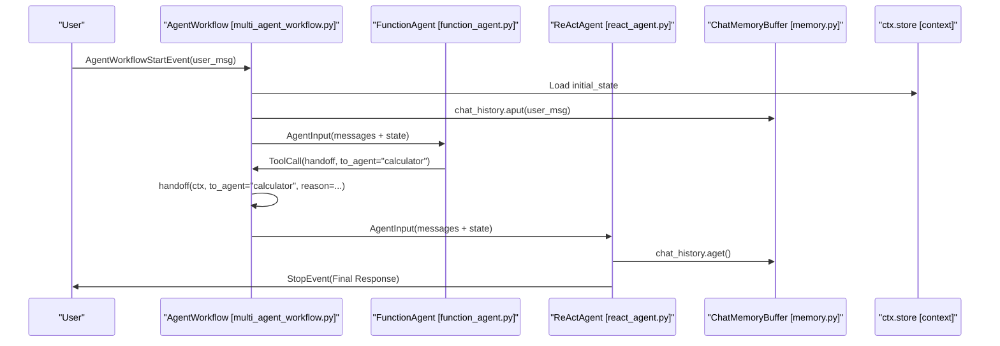

<!-- source: DeepWiki mcp.deepwiki.com · repo run-llama/llama_index · page 5.3 Multi-Agent Orchestration · fetched 2026-10-26 -->

# Multi-Agent Orchestration

<details>
<summary>Relevant source files</summary>

The following files were used as context for generating this wiki page:

- [llama-index-core/llama_index/core/agent/utils.py](llama-index-core/llama_index/core/agent/utils.py)
- [llama-index-core/llama_index/core/agent/workflow/__init__.py](llama-index-core/llama_index/core/agent/workflow/__init__.py)
- [llama-index-core/llama_index/core/agent/workflow/base_agent.py](llama-index-core/llama_index/core/agent/workflow/base_agent.py)
- [llama-index-core/llama_index/core/agent/workflow/codeact_agent.py](llama-index-core/llama_index/core/agent/workflow/codeact_agent.py)
- [llama-index-core/llama_index/core/agent/workflow/function_agent.py](llama-index-core/llama_index/core/agent/workflow/function_agent.py)
- [llama-index-core/llama_index/core/agent/workflow/multi_agent_workflow.py](llama-index-core/llama_index/core/agent/workflow/multi_agent_workflow.py)
- [llama-index-core/llama_index/core/agent/workflow/prompts.py](llama-index-core/llama_index/core/agent/workflow/prompts.py)
- [llama-index-core/llama_index/core/agent/workflow/react_agent.py](llama-index-core/llama_index/core/agent/workflow/react_agent.py)
- [llama-index-core/llama_index/core/agent/workflow/workflow_events.py](llama-index-core/llama_index/core/agent/workflow/workflow_events.py)
- [llama-index-core/llama_index/core/llms/__init__.py](llama-index-core/llama_index/core/llms/__init__.py)
- [llama-index-core/llama_index/core/llms/mock.py](llama-index-core/llama_index/core/llms/mock.py)
- [llama-index-core/tests/agent/react/test_prompt_customization.py](llama-index-core/tests/agent/react/test_prompt_customization.py)
- [llama-index-core/tests/agent/utils/test_agent_utils.py](llama-index-core/tests/agent/utils/test_agent_utils.py)
- [llama-index-core/tests/agent/workflow/test_agent_with_structured_output.py](llama-index-core/tests/agent/workflow/test_agent_with_structured_output.py)
- [llama-index-core/tests/agent/workflow/test_code_act_agent.py](llama-index-core/tests/agent/workflow/test_code_act_agent.py)
- [llama-index-core/tests/agent/workflow/test_events.py](llama-index-core/tests/agent/workflow/test_events.py)
- [llama-index-core/tests/agent/workflow/test_multi_agent_workflow.py](llama-index-core/tests/agent/workflow/test_multi_agent_workflow.py)
- [llama-index-core/tests/agent/workflow/test_single_agent_workflow.py](llama-index-core/tests/agent/workflow/test_single_agent_workflow.py)
- [llama-index-core/tests/agent/workflow/test_thinking_delta.py](llama-index-core/tests/agent/workflow/test_thinking_delta.py)
- [llama-index-core/tests/llms/test_mock.py](llama-index-core/tests/llms/test_mock.py)

</details>


Multi-agent orchestration enables complex task solving by dividing responsibilities among specialized agents. The `AgentWorkflow` class manages routing, handoffs, shared state, unified memory, and structured outputs across multiple agents.

## Purpose and Scope

Multi-agent orchestration coordinates multiple specialized agents (`BaseWorkflowAgent` subclasses) within a single event-driven workflow. The `AgentWorkflow` class manages:
- **Routing**: Directing user queries to the appropriate initial agent (`root_agent`) [llama-index-core/llama_index/core/agent/workflow/multi_agent_workflow.py:144-152]().
- **Handoffs**: Formal mechanisms via the `handoff()` function for agents to transfer control [llama-index-core/llama_index/core/agent/workflow/multi_agent_workflow.py:73-92]().
- **Shared State**: A global state store accessible to all agents in the workflow (`ctx.store`) [llama-index-core/llama_index/core/agent/workflow/multi_agent_workflow.py:75-77]().
- **Unified Memory**: A single conversation history (`BaseMemory`) shared across agent transitions [llama-index-core/llama_index/core/agent/workflow/base_agent.py:46]().
- **Structured Output**: Coordinating final responses into validated Pydantic models [llama-index-core/llama_index/core/agent/workflow/multi_agent_workflow.py:111]().

Sources: [llama-index-core/llama_index/core/agent/workflow/multi_agent_workflow.py:73-152](), [llama-index-core/llama_index/core/agent/workflow/base_agent.py:46]()

---

## Architecture Overview

The multi-agent system is implemented as a LlamaIndex `Workflow`. It uses a state-machine approach where transitions are triggered by specific events like `AgentInput`, `ToolCall`, and `ToolCallResult`.

### Natural Language to Code Entity Space

The following diagrams map high-level multi-agent concepts to the specific classes and functions in the codebase.

**Diagram: Multi-Agent System Mapping**
```mermaid
graph TB
    subgraph "Orchestration Layer"
        AWF["AgentWorkflow [multi_agent_workflow.py]"]
        HFN["handoff [multi_agent_workflow.py]"]
    end
    
    subgraph "Agent Registry"
        BWA["BaseWorkflowAgent [base_agent.py]"]
        FA["FunctionAgent [function_agent.py]"]
        RA["ReActAgent [react_agent.py]"]
        CA["CodeActAgent [codeact_agent.py]"]
    end
    
    subgraph "Execution Context"
        CTX["Context [workflow]"]
        STORE["ctx.store [workflow]"]
        MEM["BaseMemory [memory.py]"]
    end

    AWF -- "manages" --> BWA
    BWA <|-- FA
    BWA <|-- RA
    BWA <|-- CA
    
    AWF -- "uses" --> HFN
    AWF -- "stores state in" --> STORE
    AWF -- "shares" --> MEM
    STORE -- "tracks" --> CURR_AGENT["current_agent_name"]
```
Sources: [llama-index-core/llama_index/core/agent/workflow/multi_agent_workflow.py:73-100](), [llama-index-core/llama_index/core/agent/workflow/base_agent.py:87-89](), [llama-index-core/llama_index/core/agent/workflow/function_agent.py:19]()

---

## AgentWorkflow Configuration

The `AgentWorkflow` class is the primary entry point for multi-agent orchestration.

### Core Attributes
| Attribute | Type | Description |
|-----------|------|-------------|
| `agents` | `Dict[str, BaseWorkflowAgent]` | A registry of agents keyed by their `name` [llama-index-core/llama_index/core/agent/workflow/multi_agent_workflow.py:141](). |
| `root_agent` | `str` | The name of the agent that receives the initial `StartEvent` [llama-index-core/llama_index/core/agent/workflow/multi_agent_workflow.py:144-152](). |
| `initial_state` | `Dict[str, Any]` | Data available to all agents via `ctx.store` [llama-index-core/llama_index/core/agent/workflow/multi_agent_workflow.py:153](). |
| `output_cls` | `Type[BaseModel]` | Optional Pydantic model for structured final output [llama-index-core/llama_index/core/agent/workflow/multi_agent_workflow.py:111](). |

### Validation Rules
During initialization, `AgentWorkflow` enforces several constraints to ensure reliable orchestration:
1. **Naming**: If more than one agent is provided, every agent must have a unique `name` and `description` [llama-index-core/llama_index/core/agent/workflow/multi_agent_workflow.py:124-134]().
2. **Root Agent**: Exactly one `root_agent` must be specified if multiple agents are present [llama-index-core/llama_index/core/agent/workflow/multi_agent_workflow.py:144-147]().
3. **State**: Agents cannot define their own `initial_state`; all state must be passed to the `AgentWorkflow` constructor [llama-index-core/llama_index/core/agent/workflow/multi_agent_workflow.py:136-139]().

Sources: [llama-index-core/llama_index/core/agent/workflow/multi_agent_workflow.py:102-188]()

---

## The Handoff Mechanism

Handoffs are implemented as a specialized tool that agents can "call" to transfer control.

### The handoff() Function
The `handoff()` function is a reserved tool injected into agents [llama-index-core/llama_index/core/agent/workflow/multi_agent_workflow.py:73-92](). It performs the following logic:
1. **Validation**: Checks if the target agent exists in the registry [llama-index-core/llama_index/core/agent/workflow/multi_agent_workflow.py:78-80]().
2. **Permissions**: Checks the current agent's `can_handoff_to` list to see if the transition is allowed [llama-index-core/llama_index/core/agent/workflow/multi_agent_workflow.py:82-85]().
3. **State Transition**: Sets the `"next_agent"` key in `ctx.store` [llama-index-core/llama_index/core/agent/workflow/multi_agent_workflow.py:87]().
4. **Prompting**: Returns a formatted message to the system (using `handoff_output_prompt`) indicating the reason for the transfer [llama-index-core/llama_index/core/agent/workflow/multi_agent_workflow.py:88-92]().

### Dynamic Tool Injection
When the workflow prepares tools for an agent, it checks the agent's `can_handoff_to` property. If valid targets exist, it creates a `FunctionTool` wrapping the `handoff` function and adds it to the agent's available tools [llama-index-core/llama_index/core/agent/workflow/multi_agent_workflow.py:199-250]().

Sources: [llama-index-core/llama_index/core/agent/workflow/multi_agent_workflow.py:73-92](), [llama-index-core/llama_index/core/agent/workflow/multi_agent_workflow.py:199-250]()

---

## State and Memory Management

### Shared State Store
The `AgentWorkflow` maintains a global state dictionary in `ctx.store`. This state is automatically injected into messages before sending to the LLM [llama-index-core/llama_index/core/agent/workflow/multi_agent_workflow.py:390-400]().

### Unified Memory
All agents share a single `BaseMemory` instance (typically `ChatMemoryBuffer`). This allows conversation history to persist across agent transitions [llama-index-core/llama_index/core/agent/workflow/base_agent.py:46]().

**Diagram: State Persistence and Execution Flow**

Sources: [llama-index-core/llama_index/core/agent/workflow/multi_agent_workflow.py:335-375](), [llama-index-core/llama_index/core/agent/workflow/function_agent.py:19](), [llama-index-core/llama_index/core/agent/workflow/react_agent.py:38]()

---

## Workflow Execution Steps

The `AgentWorkflow` implementation consists of several `@step` decorated methods that manage the agent lifecycle.

1. **Initialization (`init_run`)**: Sets up `ctx.store` with agent registries, permissions, and initial memory [llama-index-core/llama_index/core/agent/workflow/multi_agent_workflow.py:322-375]().
2. **Agent Setup (`setup_agent`)**: Prepares LLM input by adding system prompts and shared state [llama-index-core/llama_index/core/agent/workflow/multi_agent_workflow.py:377-405]().
3. **Step Execution (`run_agent_step`)**: Triggers `take_step()` on the active agent [llama-index-core/llama_index/core/agent/workflow/multi_agent_workflow.py:407-423]().
4. **Output Parsing (`parse_agent_output`)**: Analyzes `AgentOutput` for tool calls or final responses [llama-index-core/llama_index/core/agent/workflow/multi_agent_workflow.py:425-521]().
5. **Tool Aggregation (`aggregate_tool_results`)**: Collects `ToolCallResult` events and updates `"current_agent_name"` on handoff [llama-index-core/llama_index/core/agent/workflow/multi_agent_workflow.py:561-639]().

Sources: [llama-index-core/llama_index/core/agent/workflow/multi_agent_workflow.py:322-639]()

---

## Event Reference

Orchestration relies on specialized event classes defined in `workflow_events.py`.

| Event Class | Role | Key Data |
|-------------|------|----------|
| `AgentWorkflowStartEvent` | Triggers the workflow | `user_msg`, `chat_history`, `max_iterations` [llama-index-core/llama_index/core/agent/workflow/workflow_events.py:116-146]() |
| `AgentInput` | Carries messages to an agent | `input: list[ChatMessage]`, `current_agent_name` [llama-index-core/llama_index/core/agent/workflow/workflow_events.py:24-29]() |
| `AgentOutput` | Result of an agent's LLM call | `response: ChatMessage`, `tool_calls: list[ToolSelection]` [llama-index-core/llama_index/core/agent/workflow/workflow_events.py:71-80]() |
| `ToolCall` | Request to execute a tool | `tool_name`, `tool_kwargs`, `tool_id` [llama-index-core/llama_index/core/agent/workflow/workflow_events.py:98-104]() |
| `ToolCallResult` | Result of a tool execution | `tool_output: ToolOutput`, `return_direct: bool` [llama-index-core/llama_index/core/agent/workflow/workflow_events.py:106-114]() |

Sources: [llama-index-core/llama_index/core/agent/workflow/workflow_events.py:24-146]()

---

## Structured Responses

If an `output_cls` is provided to `AgentWorkflow`, the workflow attempts to convert the final conversation into a structured object using `generate_structured_response()` [llama-index-core/llama_index/core/agent/utils.py:12-42](). This formats chat history and uses structured LLM capabilities to produce a validated Pydantic model instance [llama-index-core/llama_index/core/agent/workflow/multi_agent_workflow.py:472-506]().

Sources: [llama-index-core/llama_index/core/agent/workflow/multi_agent_workflow.py:472-506](), [llama-index-core/llama_index/core/agent/utils.py:12-42]()

---

