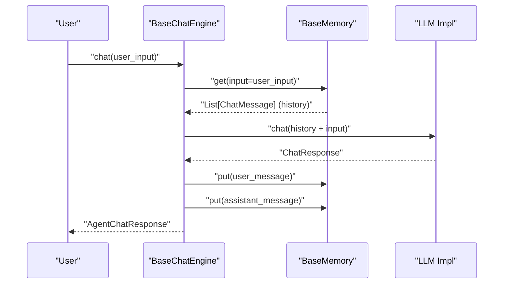
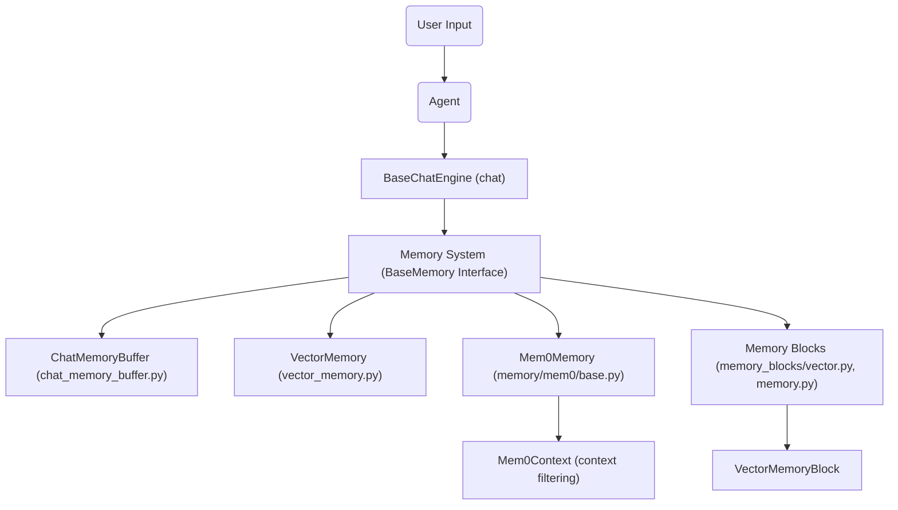
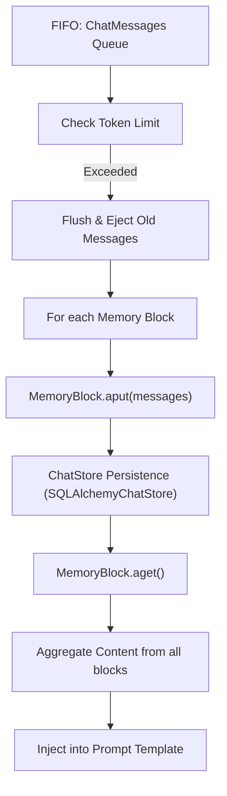

<!-- source: DeepWiki mcp.deepwiki.com · repo run-llama/llama_index · page 5.4 Memory and State Management · fetched 2026-10-26 -->

# Memory and State Management

<details>
<summary>Relevant source files</summary>

The following files were used as context for generating this wiki page:

- [docs/src/content/docs/framework/module_guides/deploying/agents/memory.mdx](docs/src/content/docs/framework/module_guides/deploying/agents/memory.mdx)
- [llama-index-core/llama_index/core/base/llms/types.py](llama-index-core/llama_index/core/base/llms/types.py)
- [llama-index-core/llama_index/core/indices/vector_store/retrievers/retriever.py](llama-index-core/llama_index/core/indices/vector_store/retrievers/retriever.py)
- [llama-index-core/llama_index/core/memory/__init__.py](llama-index-core/llama_index/core/memory/__init__.py)
- [llama-index-core/llama_index/core/memory/chat_memory_buffer.py](llama-index-core/llama_index/core/memory/chat_memory_buffer.py)
- [llama-index-core/llama_index/core/memory/chat_summary_memory_buffer.py](llama-index-core/llama_index/core/memory/chat_summary_memory_buffer.py)
- [llama-index-core/llama_index/core/memory/memory.py](llama-index-core/llama_index/core/memory/memory.py)
- [llama-index-core/llama_index/core/memory/memory_blocks/vector.py](llama-index-core/llama_index/core/memory/memory_blocks/vector.py)
- [llama-index-core/llama_index/core/memory/simple_composable_memory.py](llama-index-core/llama_index/core/memory/simple_composable_memory.py)
- [llama-index-core/llama_index/core/memory/types.py](llama-index-core/llama_index/core/memory/types.py)
- [llama-index-core/llama_index/core/memory/vector_memory.py](llama-index-core/llama_index/core/memory/vector_memory.py)
- [llama-index-core/llama_index/core/postprocessor/types.py](llama-index-core/llama_index/core/postprocessor/types.py)
- [llama-index-core/llama_index/core/storage/chat_store/base.py](llama-index-core/llama_index/core/storage/chat_store/base.py)
- [llama-index-core/llama_index/core/storage/docstore/simple_docstore.py](llama-index-core/llama_index/core/storage/docstore/simple_docstore.py)
- [llama-index-core/llama_index/core/storage/docstore/types.py](llama-index-core/llama_index/core/storage/docstore/types.py)
- [llama-index-core/llama_index/core/utils.py](llama-index-core/llama_index/core/utils.py)
- [llama-index-core/tests/agent/memory/test_simple_composable.py](llama-index-core/tests/agent/memory/test_simple_composable.py)
- [llama-index-core/tests/base/llms/test_types.py](llama-index-core/tests/base/llms/test_types.py)
- [llama-index-core/tests/indices/vector_store/test_retrievers.py](llama-index-core/tests/indices/vector_store/test_retrievers.py)
- [llama-index-core/tests/memory/blocks/test_vector.py](llama-index-core/tests/memory/blocks/test_vector.py)
- [llama-index-core/tests/memory/test_chat_memory_buffer.py](llama-index-core/tests/memory/test_chat_memory_buffer.py)
- [llama-index-core/tests/memory/test_chat_summary_memory_buffer.py](llama-index-core/tests/memory/test_chat_summary_memory_buffer.py)
- [llama-index-core/tests/memory/test_memory_base.py](llama-index-core/tests/memory/test_memory_base.py)
- [llama-index-core/tests/memory/test_memory_blocks_base.py](llama-index-core/tests/memory/test_memory_blocks_base.py)
- [llama-index-core/tests/memory/test_memory_custom_chat_store.py](llama-index-core/tests/memory/test_memory_custom_chat_store.py)
- [llama-index-core/tests/test_utils.py](llama-index-core/tests/test_utils.py)
- [llama-index-integrations/memory/llama-index-memory-mem0/.gitignore](llama-index-integrations/memory/llama-index-memory-mem0/.gitignore)
- [llama-index-integrations/memory/llama-index-memory-mem0/Makefile](llama-index-integrations/memory/llama-index-memory-mem0/Makefile)
- [llama-index-integrations/memory/llama-index-memory-mem0/README.md](llama-index-integrations/memory/llama-index-memory-mem0/README.md)
- [llama-index-integrations/memory/llama-index-memory-mem0/llama_index/memory/mem0/__init__.py](llama-index-integrations/memory/llama-index-memory-mem0/llama_index/memory/mem0/__init__.py)
- [llama-index-integrations/memory/llama-index-memory-mem0/llama_index/memory/mem0/base.py](llama-index-integrations/memory/llama-index-memory-mem0/llama_index/memory/mem0/base.py)
- [llama-index-integrations/memory/llama-index-memory-mem0/llama_index/memory/mem0/utils.py](llama-index-integrations/memory/llama-index-memory-mem0/llama_index/memory/mem0/utils.py)
- [llama-index-integrations/memory/llama-index-memory-mem0/pyproject.toml](llama-index-integrations/memory/llama-index-memory-mem0/pyproject.toml)
- [llama-index-integrations/memory/llama-index-memory-mem0/tests/test_mem0.py](llama-index-integrations/memory/llama-index-memory-mem0/tests/test_mem0.py)
- [llama-index-integrations/memory/llama-index-memory-mem0/uv.lock](llama-index-integrations/memory/llama-index-memory-mem0/uv.lock)
- [llama-index-integrations/readers/llama-index-readers-genius/README.md](llama-index-integrations/readers/llama-index-readers-genius/README.md)
- [llama-index-integrations/readers/llama-index-readers-memos/README.md](llama-index-integrations/readers/llama-index-readers-memos/README.md)
- [llama-index-integrations/readers/llama-index-readers-microsoft-onedrive/README.md](llama-index-integrations/readers/llama-index-readers-microsoft-onedrive/README.md)
- [llama-index-integrations/readers/llama-index-readers-papers/README.md](llama-index-integrations/readers/llama-index-readers-papers/README.md)
- [llama-index-integrations/readers/llama-index-readers-reddit/README.md](llama-index-integrations/readers/llama-index-readers-reddit/README.md)
- [llama-index-integrations/readers/llama-index-readers-whatsapp/README.md](llama-index-integrations/readers/llama-index-readers-whatsapp/README.md)

</details>


Memory in LlamaIndex enables agents and chat engines to maintain conversation history and state across multiple interaction turns. It bridges the gap between stateless LLM API calls and rich user experiences by managing `ChatMessage` lifecycles, enforcing token limits with truncation, and integrating long-term or retrieval-augmented memory layers.

---

## Core Abstractions

The memory system revolves around the abstract `BaseMemory` interface, defining how chat histories are fetched and updated, with subclasses implementing different storage and retrieval strategies.

### BaseMemory Interface
All concrete memory classes implement key methods:

- `get(**kwargs)`: Retrieve relevant chat history or memory content.
- `put(messages)`: Add new messages or state updates.
- `reset()`: Clear stored state.

This interface is defined in `llama_index.core.memory.types.BaseMemory` and forms the contract for all memory implementations [llama-index-core/llama_index/core/memory/memory.py:188-212]().

### ChatMessage and ContentBlocks

The fundamental unit is the `ChatMessage` class representing user, assistant, system, or other roles. Messages can contain multiple content blocks to support multimodal data:

- `TextBlock`: Plain text messages.
- `ImageBlock`, `AudioBlock`, `VideoBlock`: For multimedia content.
- `DocumentBlock`, `ThinkingBlock`, `ToolCallBlock`: Additional specialized blocks.

These are implemented as subclasses of `BaseContentBlock` [llama-index-core/llama_index/core/base/llms/types.py:21-165](), [llama-index-core/llama_index/core/base/llms/types.py:382-410]().

### Data Flow: Chat Engine and Memory Interaction

During a chat turn, a chat engine interfaces with memory to compose the prompt context and update memory afterward:



This decouples the ephemeral LLM calls from persistent chat or state retention layers.

Sources:  
- `BaseMemory`: [llama-index-core/llama_index/core/memory/memory.py:188-212]()  
- `ChatMessage` and blocks: [llama-index-core/llama_index/core/base/llms/types.py:53-410]()  

---

## Memory Implementations

### ChatMemoryBuffer

`ChatMemoryBuffer` is a simple FIFO history buffer that stores recent chat messages up to a token limit. It is considered legacy, superseded by the more flexible `Memory` class.

- Maintains a rolling queue of `ChatMessage` objects.
- Prunes oldest messages when token limit is exceeded, ensuring context window compliance.
- Uses a tokenizer function (`get_tokenizer()`) to estimate token counts dynamically.

It supports serialization/deserialization to/from dict or string and hooks into `BaseChatStore` for persistence. This buffer focuses on short-term conversation retention [llama-index-core/llama_index/core/memory/chat_memory_buffer.py:19-168]().

---

### VectorMemory

`VectorMemory` provides retrieval-augmented memory by storing user-assistant interactions as nodes in a vector index.

- Batches messages by user turn, optionally including all agent responses, creating coherent `TextNode` entries.
- Uses `VectorIndexRetriever` to retrieve semantically similar past conversations matching the current input.
- Integrates tightly with a `VectorStoreIndex` to combine memory with fast vector search retrieval.

This design allows the agent to recall relevant conversation context beyond a simple token window [llama-index-core/llama_index/core/memory/vector_memory.py:48-73]().

---

### Mem0Memory Integration

`Mem0Memory` supports advanced state management via the third-party Mem0 system, enabling persistent user/entity facts and personalized memory over long spans.

- Wraps a short-term `primary_memory` (e.g., `Memory` or `ChatMemoryBuffer`).
- Uses `MemoryClient` or `Memory` objects from the Mem0 client SDK for long-term, fact-based memory.
- Context filtering via `user_id`, `agent_id`, and `run_id` in `Mem0Context`.
- Provides hybrid short-term and retrieval-based long-term memory integration.
- Supports serialization and deserialization from both config and Mem0 client instances.

This integration enables agents to maintain more structured persistent state across sessions [llama-index-integrations/memory/llama-index-memory-mem0/llama_index/memory/mem0/base.py:34-201]().

---

## Memory Blocks and Waterfall Architecture

The modern `Memory` class employs a "waterfall" model: messages flow through a short-term FIFO queue, and when token pressure arises, oldest messages are flushed into one or more `BaseMemoryBlock` instances.

### BaseMemoryBlock

`BaseMemoryBlock` is a typed memory block container representing a logical chunk of memory state (e.g., text snippet, vector index segment).

- Core async methods: `_aget()` to retrieve block content; `_aput()` to add messages.
- Supports optional `atruncate()` for token-based truncation or summarization.
- Configurable priority for truncation or retention (0 = no truncate) and can accept messages ejected from short-term memory.
- Blocks are composable, allowing for multi-source memory aggregation.

Concrete subclasses can range from simple text stores to vector-based blocks or external persistent memories [llama-index-core/llama_index/core/memory/memory.py:103-186]().

### Memory Waterfall Logic

The main `Memory` implementation manages:

- A FIFO queue of recent `ChatMessage`s.
- A set of prioritized `memory_blocks`.
- Token limits controlling flushing of messages to memory blocks.
- When the queue exceeds the `token_limit`, messages are ejected (up to a `token_flush_size`) and "put" into each memory block.
- When retrieving memory, memory blocks are pulled in priority order, and their content injected into templates or prompt contexts.

This chain effectively summarizes and manages context lifecycle for multi-turn conversation [llama-index-core/llama_index/core/memory/memory.py:188-219]().

---

### Diagram: Memory Waterfall and Blocks

```mermaid
graph TD
    MB[Memory (Memory class)]
    FIFO[FIFO ChatMessage Queue]
    BMB[BaseMemoryBlock Instances]
    VMB[VectorMemoryBlock (a block subclass)]
    PM[Primary Memory (e.g., ChatMemoryBuffer)]
    STORE[ChatStore (e.g., SQLAlchemyChatStore)]
    TEMPLATE[RichPromptTemplate]

    MB --> FIFO
    MB --> BMB
    MB --> PM
    PM --> STORE
    BMB --> STORE
    BMB -->|may be| VMB
    MB -->|get| TEMPLATE
    TEMPLATE -->|inject to prompt| SYSTEM["System Message"]
```

---

## State Persistence: Chat Stores and SQL Backend

LlamaIndex supports durable chat history storage via `BaseChatStore` abstractions.

### SQLAlchemyChatStore

- Implements persistent chat message storage on SQL databases.
- Uses async SQL sessions (`AsyncEngine`) for non-blocking IO.
- Maintains message status flags (`MessageStatus.ACTIVE`, `ARCHIVED`) for efficient loading and archiving.
- Supports retrieval of chat messages for memory blocks and agents.

This backend supports both short-term memory buffers and memory blocks needing persistent storage [llama-index-core/llama_index/core/storage/chat_store/sql.py:18-56]().

---

## Summary

| Memory Type            | Description                                                    | Key Classes                           | Use Case                                     |
|------------------------|----------------------------------------------------------------|-------------------------------------|----------------------------------------------|
| `ChatMemoryBuffer`     | Simple rolling message buffer with token limits               | `ChatMemoryBuffer`                   | Legacy, short-term chat history buffer       |
| `VectorMemory`         | Retrieval-augmented memory via vector store indexing          | `VectorMemory` / `VectorMemoryBlock`| Conversation semantic recall over large data |
| `Mem0Memory`           | Persistent fact-based memory via Mem0 client integration      | `Mem0Memory`, `Mem0Context`          | Long-term personalized memory with filters   |
| `Memory` with Blocks   | Waterfall orchestration over memory blocks with truncation    | `Memory`, `BaseMemoryBlock`          | Modular, flexible memory management           |

---

## Additional References

- `llama_index.core.memory.memory.Memory`: Orchestrates memory blocks, handles flushing and retrieval.  
- `llama_index.core.memory.memory_blocks.vector.VectorMemoryBlock`: Vector store-backed memory block.  
- `llama_index.memory.mem0.base.Mem0Memory`: Mem0 integration with context filtering and client wrapping.

---

# Diagram: Natural Language to Code Entities Overview



# Diagram: Detailed Memory Block Interaction and Persistence Flow



---

# Sources

- Memory system and blocks: `llama-index-core/llama_index/core/memory/memory.py:93-219`  
- ChatMemoryBuffer: `llama-index-core/llama_index/core/memory/chat_memory_buffer.py:19-169`  
- VectorMemory: `llama-index-core/llama_index/core/memory/vector_memory.py:48-73`  
- Mem0Memory integration: `llama-index-integrations/memory/llama-index-memory-mem0/llama_index/memory/mem0/base.py:34-201`  
- ChatMessage and content blocks: `llama-index-core/llama_index/core/base/llms/types.py:53-410`  
- SQLAlchemyChatStore: `llama-index-core/llama_index/core/storage/chat_store/sql.py:18-56`  
- Memory blocks vector example: `llama-index-core/llama_index/core/memory/memory_blocks/vector.py:29-65`

---

