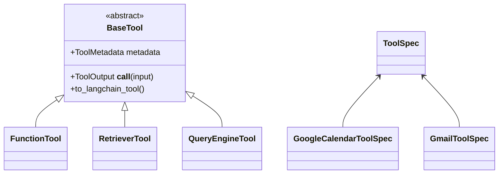
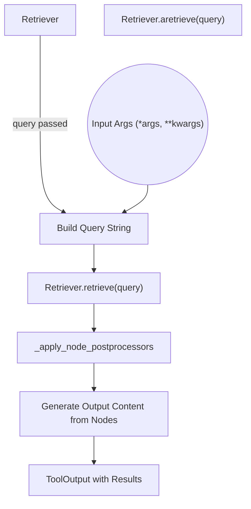
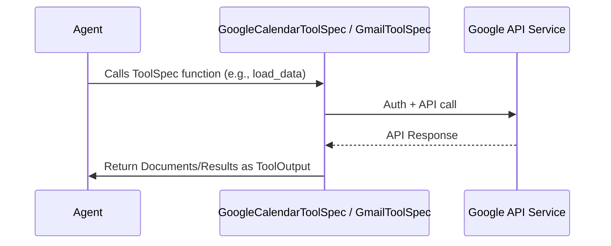

<!-- source: DeepWiki mcp.deepwiki.com · repo run-llama/llama_index · page 5.5 Tools and Tool Specs · fetched 2026-10-26 -->

# Tools and Tool Specs

<details>
<summary>Relevant source files</summary>

The following files were used as context for generating this wiki page:

- [llama-index-core/llama_index/core/tools/calling.py](llama-index-core/llama_index/core/tools/calling.py)
- [llama-index-core/llama_index/core/tools/function_tool.py](llama-index-core/llama_index/core/tools/function_tool.py)
- [llama-index-core/llama_index/core/tools/ondemand_loader_tool.py](llama-index-core/llama_index/core/tools/ondemand_loader_tool.py)
- [llama-index-core/llama_index/core/tools/query_engine.py](llama-index-core/llama_index/core/tools/query_engine.py)
- [llama-index-core/llama_index/core/tools/retriever_tool.py](llama-index-core/llama_index/core/tools/retriever_tool.py)
- [llama-index-core/llama_index/core/tools/types.py](llama-index-core/llama_index/core/tools/types.py)
- [llama-index-core/llama_index/core/tools/utils.py](llama-index-core/llama_index/core/tools/utils.py)
- [llama-index-core/tests/tools/test_base.py](llama-index-core/tests/tools/test_base.py)
- [llama-index-core/tests/tools/test_calling.py](llama-index-core/tests/tools/test_calling.py)
- [llama-index-core/tests/tools/test_retriever_tool.py](llama-index-core/tests/tools/test_retriever_tool.py)
- [llama-index-core/tests/tools/test_types.py](llama-index-core/tests/tools/test_types.py)
- [llama-index-core/tests/tools/test_utils.py](llama-index-core/tests/tools/test_utils.py)
- [llama-index-integrations/readers/llama-index-readers-box/llama_index/readers/box/BoxAPI/box_api.py](llama-index-integrations/readers/llama-index-readers-box/llama_index/readers/box/BoxAPI/box_api.py)
- [llama-index-integrations/readers/llama-index-readers-box/llama_index/readers/box/BoxAPI/box_llama_adaptors.py](llama-index-integrations/readers/llama-index-readers-box/llama_index/readers/box/BoxAPI/box_llama_adaptors.py)
- [llama-index-integrations/readers/llama-index-readers-box/llama_index/readers/box/BoxReader/base.py](llama-index-integrations/readers/llama-index-readers-box/llama_index/readers/box/BoxReader/base.py)
- [llama-index-integrations/readers/llama-index-readers-box/llama_index/readers/box/BoxReaderAIExtraction/base.py](llama-index-integrations/readers/llama-index-readers-box/llama_index/readers/box/BoxReaderAIExtraction/base.py)
- [llama-index-integrations/readers/llama-index-readers-box/llama_index/readers/box/BoxReaderAIPrompt/base.py](llama-index-integrations/readers/llama-index-readers-box/llama_index/readers/box/BoxReaderAIPrompt/base.py)
- [llama-index-integrations/readers/llama-index-readers-box/llama_index/readers/box/BoxReaderTextExtraction/base.py](llama-index-integrations/readers/llama-index-readers-box/llama_index/readers/box/BoxReaderTextExtraction/base.py)
- [llama-index-integrations/readers/llama-index-readers-box/pyproject.toml](llama-index-integrations/readers/llama-index-readers-box/pyproject.toml)
- [llama-index-integrations/readers/llama-index-readers-box/tests/test_readers_box_ai_extract.py](llama-index-integrations/readers/llama-index-readers-box/tests/test_readers_box_ai_extract.py)
- [llama-index-integrations/readers/llama-index-readers-box/tests/test_readers_box_ai_prompt.py](llama-index-integrations/readers/llama-index-readers-box/tests/test_readers_box_ai_prompt.py)
- [llama-index-integrations/readers/llama-index-readers-box/tests/test_readers_box_reader.py](llama-index-integrations/readers/llama-index-readers-box/tests/test_readers_box_reader.py)
- [llama-index-integrations/readers/llama-index-readers-box/tests/test_readers_box_text_extraction.py](llama-index-integrations/readers/llama-index-readers-box/tests/test_readers_box_text_extraction.py)
- [llama-index-integrations/readers/llama-index-readers-box/uv.lock](llama-index-integrations/readers/llama-index-readers-box/uv.lock)
- [llama-index-integrations/tools/llama-index-tools-box/llama_index/tools/box/ai_extract/base.py](llama-index-integrations/tools/llama-index-tools-box/llama_index/tools/box/ai_extract/base.py)
- [llama-index-integrations/tools/llama-index-tools-box/llama_index/tools/box/ai_prompt/base.py](llama-index-integrations/tools/llama-index-tools-box/llama_index/tools/box/ai_prompt/base.py)
- [llama-index-integrations/tools/llama-index-tools-box/llama_index/tools/box/search/base.py](llama-index-integrations/tools/llama-index-tools-box/llama_index/tools/box/search/base.py)
- [llama-index-integrations/tools/llama-index-tools-box/llama_index/tools/box/search_by_metadata/base.py](llama-index-integrations/tools/llama-index-tools-box/llama_index/tools/box/search_by_metadata/base.py)
- [llama-index-integrations/tools/llama-index-tools-box/llama_index/tools/box/text_extract/base.py](llama-index-integrations/tools/llama-index-tools-box/llama_index/tools/box/text_extract/base.py)
- [llama-index-integrations/tools/llama-index-tools-box/pyproject.toml](llama-index-integrations/tools/llama-index-tools-box/pyproject.toml)
- [llama-index-integrations/tools/llama-index-tools-box/tests/test_tools_box_ai_extract.py](llama-index-integrations/tools/llama-index-tools-box/tests/test_tools_box_ai_extract.py)
- [llama-index-integrations/tools/llama-index-tools-box/tests/test_tools_box_ai_prompt.py](llama-index-integrations/tools/llama-index-tools-box/tests/test_tools_box_ai_prompt.py)
- [llama-index-integrations/tools/llama-index-tools-box/tests/test_tools_box_search.py](llama-index-integrations/tools/llama-index-tools-box/tests/test_tools_box_search.py)
- [llama-index-integrations/tools/llama-index-tools-google/llama_index/tools/google/calendar/base.py](llama-index-integrations/tools/llama-index-tools-google/llama_index/tools/google/calendar/base.py)
- [llama-index-integrations/tools/llama-index-tools-google/llama_index/tools/google/gmail/base.py](llama-index-integrations/tools/llama-index-tools-google/llama_index/tools/google/gmail/base.py)
- [llama-index-integrations/tools/llama-index-tools-google/llama_index/tools/google/search/base.py](llama-index-integrations/tools/llama-index-tools-google/llama_index/tools/google/search/base.py)
- [llama-index-integrations/tools/llama-index-tools-google/pyproject.toml](llama-index-integrations/tools/llama-index-tools-google/pyproject.toml)
- [llama-index-integrations/tools/llama-index-tools-google/tests/test_tools_google.py](llama-index-integrations/tools/llama-index-tools-google/tests/test_tools_google.py)
- [llama-index-integrations/tools/llama-index-tools-google/uv.lock](llama-index-integrations/tools/llama-index-tools-google/uv.lock)

</details>


This page documents the key abstractions and implementations of tools within the `llama_index` codebase, focusing on the classes used to expose functions, query engines, and retrievers as callable tools for agents. We also cover base classes for tool specifications and the integrations provided for popular third-party services such as Google and Box.

---

## Overview

Tools in LlamaIndex serve as callable interfaces that agents or workflows can invoke to fulfill specific tasks. They wrap Python functions, retrievers, or query engines and provide metadata and typed schemas describing their interfaces.

The base abstraction is `BaseTool` which defines the common interface. The main specialized tool classes include:

- `FunctionTool`: Wraps a Python callable (sync or async) with rich signature and callback support.
- `RetrieverTool`: Wraps a retriever to perform document retrieval as a tool.
- `QueryEngineTool`: Wraps a generic query engine to expose query capabilities.
- `ToolSpec`: Abstract base for formal tool specifications that define multiple functions, often for third-party service integrations.

This page details these classes' implementations, their data flow, and some prominent integration specs for Google Workspace and Box.

Sources:  
- `llama-index-core/llama_index/core/tools/function_tool.py:1-194()`  
- `llama-index-core/llama_index/core/tools/retriever_tool.py:1-145()`  
- `llama-index-core/llama_index/core/tools/types.py:1-210()`  
- `llama-index-core/llama_index/core/tools/calling.py:1-132()`  
- `llama-index-integrations/tools/llama-index-tools-google/llama_index/tools/google/calendar/base.py:1-187()`  
- `llama-index-integrations/tools/llama-index-tools-google/llama_index/tools/google/gmail/base.py:1-197()`  
- Tests from core and integrations for examples  

---

## 1. Base Classes: ToolSpec & BaseTool

### ToolSpec (BaseToolSpec)

`ToolSpec` is a base class for defining a specification of tools that represents a service or subsystem, often wrapping multiple related functions. It is from the path: `llama_index.core.tools.tool_spec.base` (not fully shown in excerpts but inferred from Google and Gmail specs import).

- Typical ToolSpecs group functions (e.g., `load_data`, `create_event`) that represent capabilities of an external service.
- ToolSpecs manage API credentials, authentication, and service initialization.
- Each method represents a callable function exposed to the agent as a tool.

### BaseTool

The abstract class `BaseTool` defines an interface for all tools in the system:

- Requires a `metadata` property of type `ToolMetadata`, which includes the tool name, description, and function schema.
- Mandates implementation of a `__call__(input: Any) -> ToolOutput` method.
- Supports conversion to LangChain tools for interoperability.
- Provides instrumentation hooks.

This is declared in `llama_index.core.tools.types` [llama-index-core/llama_index/core/tools/types.py:168-210]().



---

## 2. FunctionTool: Wrapping Callable Functions

The `FunctionTool` wraps any Python callable (sync or async) and exposes it with the rich metadata schema derived from the function's signature.

### Key Features:

- Accepts either a synchronous function `fn` or an asynchronous function `async_fn`. Supports both by internally wrapping one into the other.
- Detects if the function requires a `Context` parameter (workflow context) by inspecting the function signature.
- Accepts optional callbacks (`callback` for sync, `async_callback` for async) that can override the returned result or content.
- Extracts Pydantic-compatible schemas from the function signature for input validation and descriptive metadata.
- Supports partial parameter binding via `partial_params`.
- Can convert itself to LangChain `Tool` wrappers for agent usage.
 
### Data Flow in Execution:

When the tool is called (sync or async):

1. If the function requires context, that is injected.
2. The function is called with any bound or passed parameters.
3. If a callback is provided, after the call, it is executed, allowing the final output to be overridden.
4. Returns a `ToolOutput` wrapping the function output with associated metadata and blocks.

### Construction:

- Typically instantiated via `FunctionTool.from_defaults(...)` which automates metadata extraction (name, description, schema) by introspecting the function.
- Metadata is required for the tool; otherwise, construction fails.

This is implemented in `llama_index.core.tools.function_tool` [llama-index-core/llama_index/core/tools/function_tool.py:1-194]() and tested extensively in the `tests/tools/test_base.py`.

### Example Usage:

```python
def add_numbers(x: int, y: int) -> str:
    return str(x + y)

func_tool = FunctionTool.from_defaults(fn=add_numbers, name="add", description="Add two numbers")
output = func_tool(x=1, y=2)  # ToolOutput with content "3"
```

---

## 3. RetrieverTool: Wrapping BaseRetriever

`RetrieverTool` wraps a `BaseRetriever` instance to enable natural language querying for document retrieval through the tool interface.

### Features:

- Accepts a retriever (`BaseRetriever` subclass) and optional postprocessors (`BaseNodePostprocessor` list) that postprocess nodes after retrieval.
- Metadata includes tool name, description, and function schema typically set to default unless overridden.
- On call, converts positional and keyword arguments into a combined query string.
- Uses the retriever's `retrieve` (sync) or `aretrieve` (async) methods to get relevant nodes/documents.
- Applies postprocessors to the retrieved nodes.
- Converts the nodes into a textual content output suitable for language models with metadata included if configured.
- Returns `ToolOutput` containing aggregated content from nodes.

### Data Flow:



### Construction:

- Usually created via the `from_defaults()` classmethod which sets reasonable default metadata.
- Supports synchronous call `call` and asynchronous `acall`.

This class is defined in `llama_index.core.tools.retriever_tool` [llama-index-core/llama_index/core/tools/retriever_tool.py:1-144]() and has dedicated tests in `tests/tools/test_retriever_tool.py`.

---

## 4. QueryEngineTool (Not fully shown but referenced)

`QueryEngineTool` similarly wraps a `QueryEngine` in a tool interface, enabling agents to call query engines directly.

- It encapsulates query functionality beyond simple retrieval.
- Its interface likely mirrors the `RetrieverTool` offering `call` and `acall` methods to execute natural language queries.

---

## 5. Utility: ToolMetadata and ToolOutput

### ToolMetadata

- Holds descriptive data about the tool: name, description, JSON schema of input parameters, and a flag whether to `return_direct`.
- Provides methods to serialize as OpenAI-compatible function descriptors.
- Performs sanitization of tool names to conform with OpenAI function requirements.
- Defined as a dataclass in `llama_index.core.tools.types` [llama-index-core/llama_index/core/tools/types.py:23-104]().

### ToolOutput

- Standard output container from tool calls.
- Contains content blocks (e.g., text, document blocks), tool name, raw input/output data, and an error flag.
- Supports content property getter/setter and stores any exceptions encountered.
- Supports string conversion for convenience.
- Also defined in `llama_index.core.tools.types`.

---

## 6. Third-Party Tool Integrations

LlamaIndex includes integration packages with tools to interface with popular platforms, providing ready-to-use `ToolSpec` classes that implement the relevant service API calls and expose them as callable tools.

### 6.1 Google Tools Integration

Located in `llama-index-integrations/tools/llama-index-tools-google/llama_index/tools/google/`

- **GmailToolSpec**

  - Wraps Gmail API functionalities like loading emails, searching messages, creating/updating drafts, and sending drafts.
  - Handles OAuth2 credentials, token caching, and service creation.
  - Methods like `load_data`, `search_messages`, and `get_message_data` convert API results into `Document` objects.
  - Auth scopes: `https://www.googleapis.com/auth/gmail.compose`, `.../readonly`
  - Defined at `llama-index-integrations/tools/llama-index-tools-google/llama_index/tools/google/gmail/base.py` [1-197]().

- **GoogleCalendarToolSpec**

  - Allows loading calendar events, creating events, and querying dates.
  - Supports token management, service account keys, and user OAuth flow.
  - Returns events as `Document` instances for indexing or querying.
  - Auth scope: `https://www.googleapis.com/auth/calendar`
  - Defined at `llama-index-integrations/tools/llama-index-tools-google/llama_index/tools/google/calendar/base.py` [1-187]().

- **GoogleSearchToolSpec**

  - Provides programmatic Google search tool capability (not detailed here but referenced).

#### Data Flow From Agent To Google Tool



---

### 6.2 Box Integration

Found in `llama-index-integrations/readers/llama-index-readers-box/` and related tool specs under:

- `llama-index-integrations/tools/llama-index-tools-box/llama_index/tools/box/`

- Provides tools to search and extract content from Box files via Box API.
- Supports text extraction, metadata search, AI-powered prompt and extraction tools.
- Authenticates via Box SDK.
- Example tool specs are `BoxReaderAIExtraction`, `BoxReaderAIPrompt`, `BoxReaderTextExtraction`, etc.

These provide bridges to Box’s storage as queryable tools for agents.

---

## 7. Calling Tools

The `llama_index.core.tools.calling` module provides helpers to invoke tools synchronously or asynchronously, including an adapter to call tools by name with argument dictionaries.

- Rules handle whether the tool accepts a single positional argument or kwargs, fallback calls.
- Exception handling wraps errors in a `ToolOutput` with error flags.
  
Source: `llama-index-core/llama_index/core/tools/calling.py:1-132()`

---

## Summary Mermaid Diagram: Natural Language Space to Code Entity Space

```mermaid
graph TD
    NL_Nodes["Natural Language Agent/Workflow"]
    TL_FunctionTool[FunctionTool (llama_index.core.tools.function_tool.FunctionTool)]
    TL_RetrieverTool[RetrieverTool (llama_index.core.tools.retriever_tool.RetrieverTool)]
    TL_QueryEngineTool[QueryEngineTool (llama_index.core.tools.query_engine.QueryEngineTool)]
    TS_BaseToolSpec[ToolSpec Base Classes (llama_index.core.tools.tool_spec.base.BaseToolSpec)]
    TS_GoogleCalendar[GoogleCalendarToolSpec (llama_index.tools.google.calendar.base.GoogleCalendarToolSpec)]
    TS_Gmail[GmailToolSpec (llama_index.tools.google.gmail.base.GmailToolSpec)]
    TS_BoxReaders[Box Tool Specs (llama_index.tools.box.*)]

    NL_Nodes --> TL_FunctionTool
    NL_Nodes --> TL_RetrieverTool
    NL_Nodes --> TL_QueryEngineTool
    NL_Nodes --> TS_GoogleCalendar
    NL_Nodes --> TS_Gmail
    NL_Nodes --> TS_BoxReaders
```

---

## Detailed Technical Notes and Tips

- `FunctionTool` introspects Python function signatures using `inspect`, extracting parameter types and default values including handling Pydantic `FieldInfo` for rich schema creation. This ensures tightly typed interaction.
- `FunctionTool` bridges synchronous and asynchronous by wrapping functions with utility functions `sync_to_async` and `async_to_sync`.
- `RetrieverTool` processes both `*args` and `**kwargs` for query building, combining them into a single string query followed by retrieval. Postprocessors allow modifying retrieved nodes before output.
- `ToolMetadata` plays a crucial role in defining the tool interface, especially for LLM function calling and OpenAI-compatible function definitions.
- Google integrations rely on standard OAuth2 flows and Google API client libraries, properly managing credentials and token refresh, exposing tool-specific API calls wrapped as methods.
- The `call_tool` and `acall_tool` functions in the calling module unify tool invocation regardless of sync or async nature.

---

## Example Table: Common Tool Classes and Their Purpose

| Class Name      | Purpose                                                          | Input Type                        | Output Type        | Location                                         |
|-----------------|------------------------------------------------------------------|---------------------------------|--------------------|--------------------------------------------------|
| FunctionTool    | Wraps a Python function (sync or async) as a tool                | Function args (typed by schema) | `ToolOutput`       | `core.tools.function_tool`                        |
| RetrieverTool   | Wraps a Retriever to enable knowledge base document retrieval    | Query string or args/kwargs      | `ToolOutput`       | `core.tools.retriever_tool`                       |
| QueryEngineTool | Wraps a QueryEngine to process natural language queries          | Query string/kwargs              | `ToolOutput`       | `core.tools.query_engine` (not fully shown)      |
| ToolSpec        | Abstract base class for multiple function/tool specs for services| Varies by implementation        | Returns list/docs   | `core.tools.tool_spec.base` (referenced)         |
| GoogleCalendarToolSpec | Integrates Google Calendar APIs as tools                  | API parameters                  | `Document` list    | `tools.google.calendar.base`                      |
| GmailToolSpec   | Integrates Gmail email APIs                                      | API parameters                  | `Document` list    | `tools.google.gmail.base`                          |
| Box Tool Specs  | Integrate Box APIs for document storage and search               | API parameters                  | `Document` list    | `tools.box.*` (various files)                      |

---

# Appendix: See Also

- See page 5.1–5.4 for agent architecture and tool integration patterns.
- See 6.5 for detailed LLM integration patterns relevant to tool calling.
- Core framework and schema definitions for documents and nodes involved in retrieval.

---

Sources:  
- `llama-index-core/llama_index/core/tools/function_tool.py:1-194()`  
- `llama-index-core/llama_index/core/tools/retriever_tool.py:1-145()`  
- `llama-index-core/llama_index/core/tools/types.py:1-210()`  
- `llama-index-core/llama_index/core/tools/calling.py:1-132()`  
- `llama-index-integrations/tools/llama-index-tools-google/llama_index/tools/google/calendar/base.py:1-187()`  
- `llama-index-integrations/tools/llama-index-tools-google/llama_index/tools/google/gmail/base.py:1-197()`  
- `llama-index-core/tests/tools/test_base.py:29-161()`  
- `llama-index-core/tests/tools/test_retriever_tool.py:1-141()`

---

