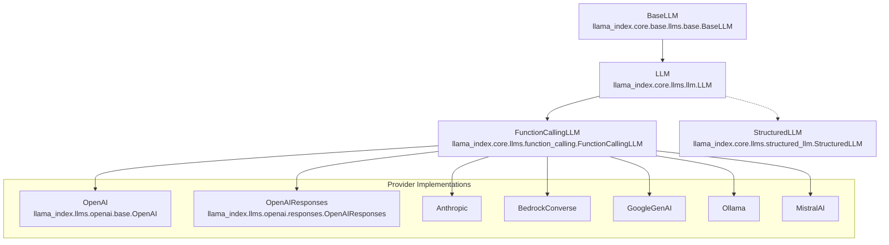
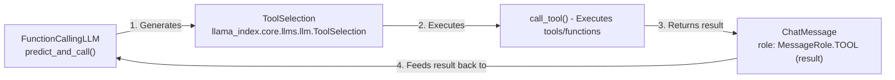
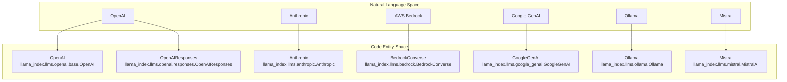
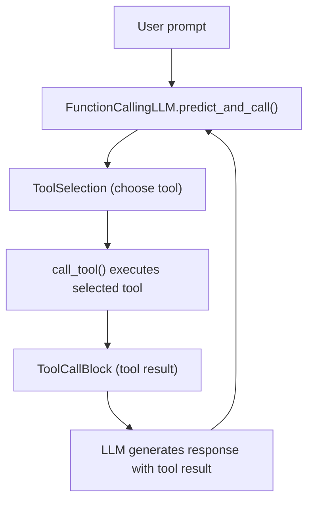

<!-- source: DeepWiki mcp.deepwiki.com · repo run-llama/llama_index · page 6 LLM Integrations · fetched 2026-10-26 -->

# LLM Integrations

<details>
<summary>Relevant source files</summary>

The following files were used as context for generating this wiki page:

- [llama-index-integrations/embeddings/llama-index-embeddings-azure-openai/llama_index/embeddings/azure_openai/base.py](llama-index-integrations/embeddings/llama-index-embeddings-azure-openai/llama_index/embeddings/azure_openai/base.py)
- [llama-index-integrations/embeddings/llama-index-embeddings-azure-openai/pyproject.toml](llama-index-integrations/embeddings/llama-index-embeddings-azure-openai/pyproject.toml)
- [llama-index-integrations/embeddings/llama-index-embeddings-openai/llama_index/embeddings/openai/base.py](llama-index-integrations/embeddings/llama-index-embeddings-openai/llama_index/embeddings/openai/base.py)
- [llama-index-integrations/embeddings/llama-index-embeddings-openai/llama_index/embeddings/openai/utils.py](llama-index-integrations/embeddings/llama-index-embeddings-openai/llama_index/embeddings/openai/utils.py)
- [llama-index-integrations/embeddings/llama-index-embeddings-openai/pyproject.toml](llama-index-integrations/embeddings/llama-index-embeddings-openai/pyproject.toml)
- [llama-index-integrations/embeddings/llama-index-embeddings-openai/tests/test_embeddings_openai.py](llama-index-integrations/embeddings/llama-index-embeddings-openai/tests/test_embeddings_openai.py)
- [llama-index-integrations/embeddings/llama-index-embeddings-openai/tests/test_retry_after.py](llama-index-integrations/embeddings/llama-index-embeddings-openai/tests/test_retry_after.py)
- [llama-index-integrations/embeddings/llama-index-embeddings-openai/tests/test_utils.py](llama-index-integrations/embeddings/llama-index-embeddings-openai/tests/test_utils.py)
- [llama-index-integrations/embeddings/llama-index-embeddings-upstage/llama_index/embeddings/upstage/utils.py](llama-index-integrations/embeddings/llama-index-embeddings-upstage/llama_index/embeddings/upstage/utils.py)
- [llama-index-integrations/llms/llama-index-llms-azure-openai/llama_index/llms/azure_openai/__init__.py](llama-index-integrations/llms/llama-index-llms-azure-openai/llama_index/llms/azure_openai/__init__.py)
- [llama-index-integrations/llms/llama-index-llms-azure-openai/llama_index/llms/azure_openai/base.py](llama-index-integrations/llms/llama-index-llms-azure-openai/llama_index/llms/azure_openai/base.py)
- [llama-index-integrations/llms/llama-index-llms-azure-openai/llama_index/llms/azure_openai/responses.py](llama-index-integrations/llms/llama-index-llms-azure-openai/llama_index/llms/azure_openai/responses.py)
- [llama-index-integrations/llms/llama-index-llms-azure-openai/pyproject.toml](llama-index-integrations/llms/llama-index-llms-azure-openai/pyproject.toml)
- [llama-index-integrations/llms/llama-index-llms-azure-openai/tests/test_azure_openai.py](llama-index-integrations/llms/llama-index-llms-azure-openai/tests/test_azure_openai.py)
- [llama-index-integrations/llms/llama-index-llms-azure-openai/uv.lock](llama-index-integrations/llms/llama-index-llms-azure-openai/uv.lock)
- [llama-index-integrations/llms/llama-index-llms-openai/llama_index/llms/openai/base.py](llama-index-integrations/llms/llama-index-llms-openai/llama_index/llms/openai/base.py)
- [llama-index-integrations/llms/llama-index-llms-openai/llama_index/llms/openai/responses.py](llama-index-integrations/llms/llama-index-llms-openai/llama_index/llms/openai/responses.py)
- [llama-index-integrations/llms/llama-index-llms-openai/llama_index/llms/openai/utils.py](llama-index-integrations/llms/llama-index-llms-openai/llama_index/llms/openai/utils.py)
- [llama-index-integrations/llms/llama-index-llms-openai/pyproject.toml](llama-index-integrations/llms/llama-index-llms-openai/pyproject.toml)
- [llama-index-integrations/llms/llama-index-llms-openai/tests/test_llms_openai.py](llama-index-integrations/llms/llama-index-llms-openai/tests/test_llms_openai.py)
- [llama-index-integrations/llms/llama-index-llms-openai/tests/test_openai.py](llama-index-integrations/llms/llama-index-llms-openai/tests/test_openai.py)
- [llama-index-integrations/llms/llama-index-llms-openai/tests/test_openai_responses.py](llama-index-integrations/llms/llama-index-llms-openai/tests/test_openai_responses.py)
- [llama-index-integrations/llms/llama-index-llms-openai/tests/test_openai_utils.py](llama-index-integrations/llms/llama-index-llms-openai/tests/test_openai_utils.py)
- [llama-index-integrations/llms/llama-index-llms-openai/tests/test_retry_after.py](llama-index-integrations/llms/llama-index-llms-openai/tests/test_retry_after.py)
- [llama-index-integrations/llms/llama-index-llms-openai/uv.lock](llama-index-integrations/llms/llama-index-llms-openai/uv.lock)

</details>


This document provides an overview of Large Language Model (LLM) provider integrations within the LlamaIndex framework. It covers the core abstraction layers, major provider implementations, and their capabilities for chat, completion, function calling, and streaming operations.

For detailed information about specific providers, see [LLM Integration Architecture](#6.1), [OpenAI Integration](#6.2), [Anthropic Integration](#6.3), [AWS Bedrock Integration](#6.4), [Google GenAI Integration](#6.5), [Ollama Integration](#6.6), and [Additional LLM Integrations](#6.9).

## Core LLM Architecture

The LlamaIndex LLM integration system is built on a hierarchical class structure that provides consistent interfaces across all providers while allowing for provider-specific features. The `LLM` class extends `BaseLLM` to add support for prompt templates, output parsers, and structured prediction modes.

### LLM Architecture Overview



The diagram highlights that the core base class `BaseLLM` defines the fundamental LLM interface, extended by `LLM` for richer capabilities, and by `FunctionCallingLLM` to support tool/function calling. Provider-specific classes like `OpenAI` and `OpenAIResponses` (which supports the OpenAI Responses API with audio) inherit from `FunctionCallingLLM` to support structure and tools. Many other providers plug into this interface hierarchy.

Sources: [llama-index-core/llama_index/core/base/llms/base.py:20-130](), [llama-index-core/llama_index/core/llms/llm.py:130-180](), [llama-index-core/llama_index/core/llms/function_calling.py:20-60](), [llama-index-integrations/llms/llama-index-llms-openai/llama_index/llms/openai/base.py:140-218](), [llama-index-integrations/llms/llama-index-llms-openai/llama_index/llms/openai/responses.py:140-220]()

### Core Interface Methods

The `BaseLLM` class defines the fundamental contract for all LLMs, including metadata access via the `metadata` property and primary interaction methods.

| Method           | Description                                     | Return Type          |
|------------------|------------------------------------------------|----------------------|
| `chat()`         | Synchronous chat completion                    | `ChatResponse`       |
| `achat()`        | Asynchronous chat completion                   | `ChatResponse`       |
| `stream_chat()`  | Streaming chat completion                       | `ChatResponseGen`    |
| `astream_chat()` | Async streaming chat completion                 | `ChatResponseAsyncGen` |
| `complete()`     | Text completion (usually transformed to chat) | `CompletionResponse` |

These consistent method signatures enable the same calling pattern across providers, with support for sync/async and streaming variants.

Sources: [llama-index-core/llama_index/core/base/llms/base.py:48-56](), [llama-index-core/llama_index/core/base/llms/base.py:89-224](), [llama-index-core/llama_index/core/base/llms/types.py:14-21]()

---

## Provider Integrations

### OpenAI Integration

The OpenAI integration is one of the foundational LLM providers in LlamaIndex. It supports:

- Standard GPT models including GPT-3.5 Turbo and GPT-4 variants
- Reasoning models such as the O1 and O3 families, which provide configurable reasoning options with effort levels and summarization styles
- The OpenAI Responses API enabling multimodal output including audio generation
- Support for function calling, structured JSON output validation, and streaming tokens
- Token counting optimized for OpenAI models

The primary classes for this integration are `OpenAI` for classic chat/completions and `OpenAIResponses` for the structured streaming & multimodal "Responses" API.

For full details, see [OpenAI Integration](#6.2).

Sources: [llama-index-integrations/llms/llama-index-llms-openai/llama_index/llms/openai/base.py:140-218](), [llama-index-integrations/llms/llama-index-llms-openai/llama_index/llms/openai/responses.py:140-220](), [llama-index-integrations/llms/llama-index-llms-openai/llama_index/llms/openai/utils.py:45-230]()

### Anthropic Integration

This integration supports the Claude model series (Claude 3, Claude Instant, and Claude 3.5). Features include:

- Prompt caching to reduce token usage and latency
- Integration of `ThinkingBlock` content blocks to facilitate reasoning workflows
- Citations and provenance for responses

For more information, see [Anthropic Integration](#6.3).

Sources: (Not fully shown here; see child page for details.)

### AWS Bedrock Integration

The Bedrock integration provides the `BedrockConverse` class to interface with models hosted on AWS Bedrock. Features include:

- Support for multiple Bedrock models
- AWS Guardrails integration for safer model use
- Application-specific inference profiles for fine-tuned interactive behaviors
- Reasoning and tool usage capabilities aligned with the LlamaIndex abstractions

For full usage, see [AWS Bedrock Integration](#6.4).

Sources: (Not fully shown here; see child page for details.)

### Google GenAI Integration

The integration offers access to Google Gemini models via the `GoogleGenAI` class, including:

- Native multimodal capabilities handling images, audio, video, and text
- Real-time voice agent support through `GeminiLive`
- Vertex AI back-end model management

More details in [Google GenAI Integration](#6.5).

Sources: (Not fully shown here; see child page for details.)

### Ollama Integration

Ollama integration enables hosting local LLM models. It supports:

- Structured output for controlled interactions
- Function calling and tool invocation akin to cloud-based providers

See [Ollama Integration](#6.6) for in-depth documentation.

Sources: (Not fully shown here; see child page for details.)

### Additional LLM Integrations

LlamaIndex has broad LLM support including:

- Mistral AI
- NVIDIA NIM
- Cohere
- HuggingFace transformers
- IBM WatsonX
- LiteLLM
- Perplexity AI
- Fireworks
- OCI GenAI
- Upstage AI

These often reuse the `FunctionCallingLLM` pattern for tool integration. Refer to [Additional LLM Integrations](#6.9) for a comprehensive list.

Sources: (Not fully shown here; see child page for details.)

---

## Content Blocks and Messages

LlamaIndex employs a unified `ChatMessage` abstraction representing chat inputs and outputs. Each message can contain a list of diverse `BaseContentBlock` objects enabling rich multimodal usage.

### ChatMessage and Content Blocks

```mermaid
graph TD
    ChatMessage["ChatMessage<br/>llama_index.core.base.llms.types.ChatMessage"]
    
    subgraph "Content Blocks"
        TextBlock["TextBlock<br/>llama_index.core.base.llms.types.TextBlock"]
        ImageBlock["ImageBlock<br/>llama_index.core.base.llms.types.ImageBlock"]
        AudioBlock["AudioBlock<br/>llama_index.core.base.llms.types.AudioBlock"]
        VideoBlock["VideoBlock<br/>llama_index.core.base.llms.types.VideoBlock"]
        DocumentBlock["DocumentBlock<br/>llama_index.core.base.llms.types.DocumentBlock"]
        ThinkingBlock["ThinkingBlock<br/>llama_index.core.base.llms.types.ThinkingBlock"]
        ToolCallBlock["ToolCallBlock<br/>llama_index.core.base.llms.types.ToolCallBlock"]
    end
    
    ChatMessage -->|blocks: List[BaseContentBlock]| TextBlock
    ChatMessage --> ImageBlock
    ChatMessage --> AudioBlock
    ChatMessage --> VideoBlock
    ChatMessage --> DocumentBlock
    ChatMessage --> ThinkingBlock
    ChatMessage --> ToolCallBlock
```

This design allows a single message to consist of text, images, audio, video, documents, reasoning steps, and tool call requests or responses, enabling flexible agents and workflows.

Sources: [llama-index-core/llama_index/core/base/llms/types.py:20-28,66](), [llama-index-core/llama_index/core/memory/memory.py:20-33]()

---

## Tool Calling Patterns

Tool or function calling is facilitated by the `FunctionCallingLLM` interface. This interface supports generating `ToolCallBlock`s representing function/tool calls with arguments. It also automates:

- Selecting a tool to invoke (`ToolSelection`)
- Executing the tool and getting the result
- Feeding the result back to the LLM in an iterative prediction-execution loop (`predict_and_call`)

### Tool Calling Workflow



This pattern is key to enabling LlamaIndex agents to interact with third-party APIs and databases within conversational workflows.

Sources: [llama-index-core/llama_index/core/base/llms/types.py:61](), [llama-index-core/llama_index/core/llms/function_calling.py:159-170]()

---

## Observability and Instrumentation

LLM calls are instrumented with a rich event-based tracing system using the `Dispatcher` from `llama_index.core.instrumentation`. Events are emitted at key lifecycle points for calls such as:

| Event Type               | Description                             | File Reference                                               |
|--------------------------|---------------------------------------|--------------------------------------------------------------|
| `LLMChatStartEvent`      | Emitted when a chat interaction starts | [llama-index-core/llama_index/core/instrumentation/events/llm.py:187-206]()  |
| `LLMChatEndEvent`        | Emitted when a chat interaction ends   | [llama-index-core/llama_index/core/instrumentation/events/llm.py:239-266]()  |
| `LLMCompletionStartEvent`| Emitted when a completion starts       | [llama-index-core/llama_index/core/instrumentation/events/llm.py:105-125]()  |
| `LLMCompletionEndEvent`  | Emitted when a completion completes    | [llama-index-core/llama_index/core/instrumentation/events/llm.py:157-185]()  |

These events are managed via `llm_chat_callback` and `llm_completion_callback` decorators to wrap LLM method calls and provide telemetry, useful for debugging, analytics, and performance monitoring.

Sources: [llama-index-core/llama_index/core/llms/callbacks.py:36-65](), [llama-index-core/llama_index/core/instrumentation/events/llm.py:12-266]()

---

# Bridging Natural Language Space to Code Entity Space

To aid understanding, below are two diagrams associating natural language concepts (like providers and functions) to code entities and classes within the codebase.

### Diagram 1: LLM Providers and Corresponding Classes



### Diagram 2: Function Calling Workflow across Providers



This cycle enables agents and applications to interactively call external APIs or functions during a conversation.

---

This page provides a broad high-level view of the LLM integrations in LlamaIndex. For technical details and usage, please consult the child pages covering architecture, specific providers, content blocks, tool patterns, and extended integrations.

Sources:  
- [llama-index-integrations/llms/llama-index-llms-openai/llama_index/llms/openai/base.py:140-218]()  
- [llama-index-integrations/llms/llama-index-llms-openai/llama_index/llms/openai/responses.py:140-220]()  
- [llama-index-integrations/llms/llama-index-llms-openai/llama_index/llms/openai/utils.py:45-230]()  
- [llama-index-core/llama_index/core/base/llms/base.py:20-130]()  
- [llama-index-core/llama_index/core/llms/llm.py:130-180]()  
- [llama-index-core/llama_index/core/llms/function_calling.py:20-60,159-170]()  
- [llama-index-core/llama_index/core/base/llms/types.py:14-21,61]()  
- [llama-index-core/llama_index/core/base/llms/types.py:20-28,66]()  
- [llama-index-core/llama_index/core/memory/memory.py:20-33]()  
- [llama-index-core/llama_index/core/llms/callbacks.py:36-65]()  
- [llama-index-core/llama_index/core/instrumentation/events/llm.py:12-266]()

---

