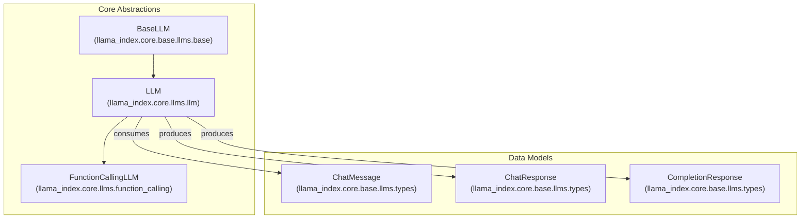
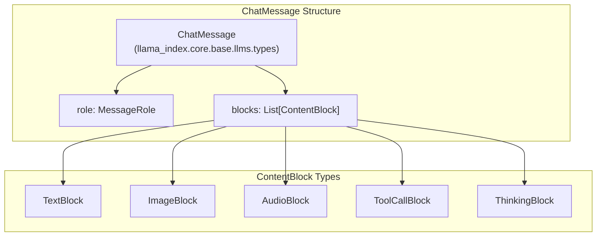
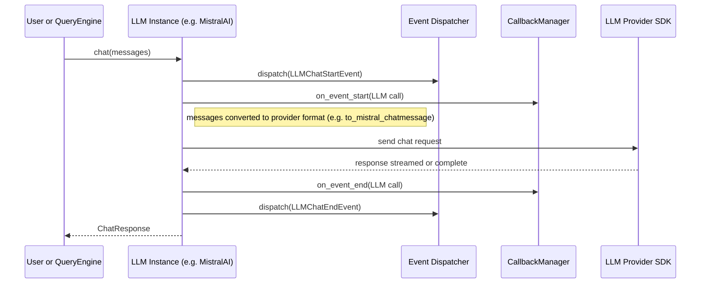
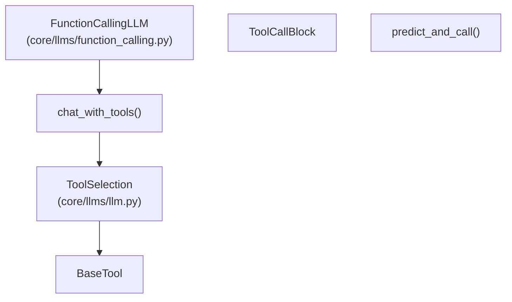
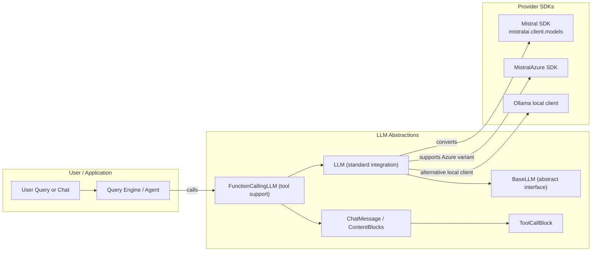

<!-- source: DeepWiki mcp.deepwiki.com · repo run-llama/llama_index · page 6.1 LLM Integration Architecture · fetched 2026-10-26 -->

# LLM Integration Architecture

Relevant source files

The following files were used as context for generating this wiki page:

- [llama-index-core/llama_index/core/base/embeddings/base.py](llama-index-core/llama_index/core/base/embeddings/base.py)
- [llama-index-core/llama_index/core/base/embeddings/base_sparse.py](llama-index-core/llama_index/core/base/embeddings/base_sparse.py)
- [llama-index-core/llama_index/core/base/llms/base.py](llama-index-core/llama_index/core/base/llms/base.py)
- [llama-index-core/llama_index/core/embeddings/multi_modal_base.py](llama-index-core/llama_index/core/embeddings/multi_modal_base.py)
- [llama-index-core/llama_index/core/instrumentation/events/embedding.py](llama-index-core/llama_index/core/instrumentation/events/embedding.py)
- [llama-index-core/llama_index/core/instrumentation/events/exception.py](llama-index-core/llama_index/core/instrumentation/events/exception.py)
- [llama-index-core/llama_index/core/instrumentation/events/llm.py](llama-index-core/llama_index/core/instrumentation/events/llm.py)
- [llama-index-core/llama_index/core/llms/callbacks.py](llama-index-core/llama_index/core/llms/callbacks.py)
- [llama-index-core/llama_index/core/llms/function_calling.py](llama-index-core/llama_index/core/llms/function_calling.py)
- [llama-index-core/llama_index/core/llms/llm.py](llama-index-core/llama_index/core/llms/llm.py)
- [llama-index-core/llama_index/core/rate_limiter.py](llama-index-core/llama_index/core/rate_limiter.py)
- [llama-index-core/llama_index/core/sparse_embeddings/__init__.py](llama-index-core/llama_index/core/sparse_embeddings/__init__.py)
- [llama-index-core/llama_index/core/sparse_embeddings/mock_sparse_embedding.py](llama-index-core/llama_index/core/sparse_embeddings/mock_sparse_embedding.py)
- [llama-index-core/tests/embeddings/test_base.py](llama-index-core/tests/embeddings/test_base.py)
- [llama-index-core/tests/embeddings/test_with_cache.py](llama-index-core/tests/embeddings/test_with_cache.py)
- [llama-index-core/tests/llms/test_callbacks.py](llama-index-core/tests/llms/test_callbacks.py)
- [llama-index-core/tests/llms/test_function_calling.py](llama-index-core/tests/llms/test_function_calling.py)
- [llama-index-core/tests/sparse_embeddings/__init__.py](llama-index-core/tests/sparse_embeddings/__init__.py)
- [llama-index-core/tests/sparse_embeddings/test_mock_sparse_embeddings.py](llama-index-core/tests/sparse_embeddings/test_mock_sparse_embeddings.py)
- [llama-index-core/tests/test_rate_limiter.py](llama-index-core/tests/test_rate_limiter.py)
- [llama-index-integrations/embeddings/llama-index-embeddings-mistralai/llama_index/embeddings/mistralai/base.py](llama-index-integrations/embeddings/llama-index-embeddings-mistralai/llama_index/embeddings/mistralai/base.py)
- [llama-index-integrations/embeddings/llama-index-embeddings-mistralai/pyproject.toml](llama-index-integrations/embeddings/llama-index-embeddings-mistralai/pyproject.toml)
- [llama-index-integrations/embeddings/llama-index-embeddings-mistralai/uv.lock](llama-index-integrations/embeddings/llama-index-embeddings-mistralai/uv.lock)
- [llama-index-integrations/llms/llama-index-llms-mistralai/README.md](llama-index-integrations/llms/llama-index-llms-mistralai/README.md)
- [llama-index-integrations/llms/llama-index-llms-mistralai/llama_index/llms/mistralai/base.py](llama-index-integrations/llms/llama-index-llms-mistralai/llama_index/llms/mistralai/base.py)
- [llama-index-integrations/llms/llama-index-llms-mistralai/llama_index/llms/mistralai/utils.py](llama-index-integrations/llms/llama-index-llms-mistralai/llama_index/llms/mistralai/utils.py)
- [llama-index-integrations/llms/llama-index-llms-mistralai/pyproject.toml](llama-index-integrations/llms/llama-index-llms-mistralai/pyproject.toml)
- [llama-index-integrations/llms/llama-index-llms-mistralai/uv.lock](llama-index-integrations/llms/llama-index-llms-mistralai/uv.lock)
- [llama-index-integrations/sparse_embeddings/llama-index-sparse-embeddings-fastembed/Makefile](llama-index-integrations/sparse_embeddings/llama-index-sparse-embeddings-fastembed/Makefile)
- [llama-index-integrations/sparse_embeddings/llama-index-sparse-embeddings-fastembed/README.md](llama-index-integrations/sparse_embeddings/llama-index-sparse-embeddings-fastembed/README.md)

## Purpose and Scope

This document details the LLM integration architecture within LlamaIndex, emphasizing the standardized interfaces that enable consistent interaction across multiple LLM providers. It covers the core abstractions (`BaseLLM`, `FunctionCallingLLM`), callback and instrumentation mechanisms, the structured content block message system, and common integration patterns including structured outputs and tool/function calling. Additionally, the document highlights the design pattern for provider-specific integrations exemplified by the MistralAI implementation.

---

## BaseLLM and LLM Interfaces

The foundation of LLM integration is established by the abstract class `BaseLLM` residing in the core codebase. It defines the essential interface for chat and completion methods, both synchronous and asynchronous, along with streaming capabilities.

The main LLM class used by standard providers is `LLM`, a subclass of `BaseLLM` based on Pydantic models. `LLM` enhances flexibility with attributes such as `messages_to_prompt` and `completion_to_prompt` that enable prompt template conversions and customizations.

`FunctionCallingLLM` further extends `LLM` to support function calling capabilities, allowing LLMs to interact with external tools via structured calls.

### Key Classes and Their Roles

| Class | Location | Role |
|-------|----------|------|
| `BaseLLM` | [core/base/llms/base.py:27-89]() | Abstract base class defining essential LLM interface methods like `chat()`, `complete()`, streaming and async variants. Ensures instrumentation and callback support. |
| `LLM` | [core/llms/llm.py:163-223]() | Concrete Pydantic-based LLM class providing prompt conversion hooks and integration scaffolding for typical LLM operations. |
| `FunctionCallingLLM` | [core/llms/function_calling.py:24-90]() | Extends `LLM` with function calling and tool interaction methods such as `chat_with_tools()` and `predict_and_call()`. Supports validation of tool calls in responses. |

**Sources:**
- [llama-index-core/llama_index/core/base/llms/base.py:27-89]()
- [llama-index-core/llama_index/core/llms/llm.py:163-223]()
- [llama-index-core/llama_index/core/llms/function_calling.py:24-90]()

---

## Message and Content Block System

LlamaIndex models chat messages as collections of typed content blocks rather than flat text strings. This block-based message system supports multimodal content (e.g., text, images, tool calls).

### ContentBlock Subclasses and Their Usage

| Block Type    | Class Name     | Purpose and Features                                                                    |
|---------------|----------------|----------------------------------------------------------------------------------------|
| Text          | `TextBlock`    | Represents textual content blocks in messages, the primary mode for most interactions. |
| Image         | `ImageBlock`   | Encodes visual data via bytes, URL, or filepaths supporting multimodal inputs.         |
| Audio         | `AudioBlock`   | Supports audio content for voice-enabled LLMs or other audio modalities.               |
| Tool Call     | `ToolCallBlock`| Represents LLM decisions to invoke external tools or functions with parameters.        |
| Thinking      | `ThinkingBlock`| Internal reasoning or "thinking" annotation blocks used in advanced models like O1.    |

These blocks allow LLM integrations to handle and produce complex chat content compatible with evolving multimodal and function calling capabilities.

**Sources:**
- [llama-index-core/llama_index/core/base/llms/types.py:22-37]()
- [llama-index-core/llama_index/core/base/llms/types.py:534-970]()

---

## LLM Interaction Flow and Callbacks

The process for sending a chat to an LLM involves callback and instrumentation hooks to track start, in-progress, and end events, handling rate limiting and exceptions transparently.

The decorator `llm_chat_callback()` wraps asynchronous and synchronous methods to enforce this pattern, handling exceptions and progress events. Rate limiters are acquired before issuing provider calls.

The callbacks integrate with the instrumentation event system emitting start, in-progress, and end events like `LLMChatStartEvent`, `LLMChatInProgressEvent`, and `LLMChatEndEvent` for observability.

**Sources:**
- [llama-index-core/llama_index/core/llms/callbacks.py:39-148]()
- [llama-index-core/llama_index/core/llms/llm.py:164-223]()

---

## Function Calling and Structured Output Support

`FunctionCallingLLM` extends normal LLM interfaces to support invoking external tools represented as structured functions. This provides a powerful integration pattern enabling LLMs to perform actions in addition to text generation.

### Core Components

- `ToolSelection` encapsulates chosen tool id, name, and keyword args passed during function call [core/llms/llm.py:70-75]().
- `chat_with_tools()` and related methods prepare chat input extended with tool metadata and validate tool call responses [core/llms/function_calling.py:35-112]().
- `predict_and_call()` patterns combine LLM prompt generation, tool execution, and structured parsing of outputs for tightly integrated workflows.

These patterns enable advanced use cases like agents calling APIs, reasoning with code, and interactive tool usage within chat sessions.

**Sources:**
- [llama-index-core/llama_index/core/llms/llm.py:70-75]()
- [llama-index-core/llama_index/core/llms/function_calling.py:24-90]()
- [llama-index-core/llama_index/core/program/function_program.py:37-207]()

---

## Provider Integration Architecture

Provider integrations map the core LLM abstractions and data types to provider-specific SDKs and models.

### Case Study: MistralAI Integration

The MistralAI integration demonstrates the architecture pattern:

- **Metadata and Model Config:** Defines supported models and capabilities like function calling, context size, streaming [llama-index-integrations/llms/llama-index-llms-mistralai/llama_index/llms/mistralai/base.py:80-100]().

- **Message Conversion:** Converts `ChatMessage` and block types to MistralAI SDK message types (e.g., `UserMessage`, `AssistantMessage`, `ToolCall`) via `to_mistral_chatmessage()` and `to_mistral_chunks()` [llama-index-integrations/llms/llama-index-llms-mistralai/llama_index/llms/mistralai/base.py:98-194]().

- **Client Selection:** Supports either the public Mistral API client or the Azure SDK client depending on configuration [llama-index-integrations/llms/llama-index-llms-mistralai/llama_index/llms/mistralai/base.py:56-62]().

The integration inherits from `FunctionCallingLLM` and implements chat/completion calls by wrapping Mistral SDK's `chat()`.

---

### Case Study: Ollama Integration (Overview)

Ollama integration exemplifies local model usage with structured output and function calling support.

- Inherits from `FunctionCallingLLM`.
- Configurable with `base_url` and keep-alive HTTP client settings.
- Provides helper to ensure responses contain a single tool call for downstream simplicity.

**Sources:**
- [llama-index-integrations/llms/llama-index-llms-mistralai/llama_index/llms/mistralai/base.py:1-252]()
- [llama-index-integrations/llms/llama-index-llms-ollama/llama_index/llms/ollama/base.py:63-134]()

---

## Summary Diagram: Natural Language Space to Code Entity Space

---

## Integration Patterns Summary

- **BaseLLM Interface**: Provides chat/completion signature with instrumentation and callback hooks.
- **FunctionCallingLLM**: Adds high-level patterns to enable structured tool calling and response validation.
- **Message Blocks**: Enable multimodal and structured interaction through typed content blocks.
- **Callbacks/Instrumentation**: Events output start, progress, and completion states, enable observability and retry policies.
- **Provider Mapping**: Implementations must convert & map internal message types to provider SDK data structures and back.
- **Async and Streaming Support**: All levels provide synchronous, asynchronous, and streaming APIs for flexible usage.

---

## References to Code for Further Exploration

| Topic                         | File Path and Lines                                   |
|-------------------------------|------------------------------------------------------|
| BaseLLM, LLM, FunctionCalling | [core/base/llms/base.py:27-89]()                      |
|                               | [core/llms/llm.py:163-223]()                          |
|                               | [core/llms/function_calling.py:24-90]()              |
| ChatMessage and ContentBlocks | [core/base/llms/types.py:22-37]()                     |
|                               | [core/base/llms/types.py:530-970]()                   |
| Callbacks and Instrumentation | [core/llms/callbacks.py:39-148]()                     |
| MistralAI LLM Integration     | [llama-index-llms-mistralai/llama_index/llms/mistralai/base.py:1-252]() |
| Ollama Integration Overview   | [llama-index-llms-ollama/llama_index/llms/ollama/base.py:63-134]()      |

---

# End of 6.1 LLM Integration Architecture

---

