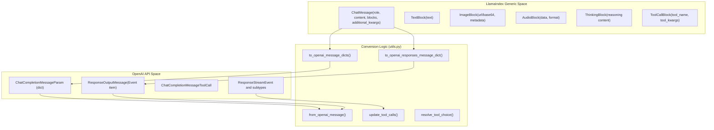
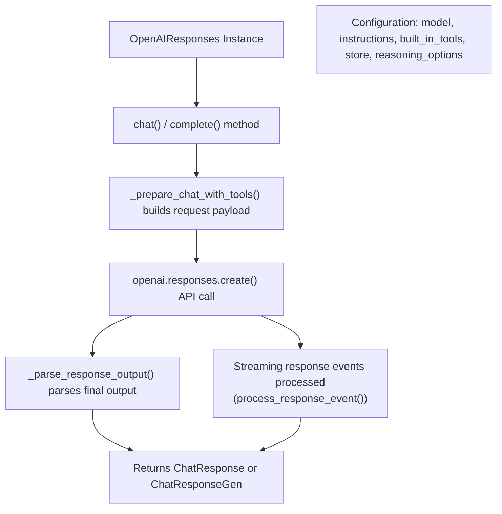
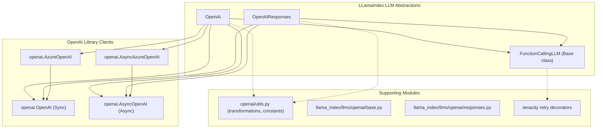

<!-- source: DeepWiki mcp.deepwiki.com · repo run-llama/llama_index · page 6.2 OpenAI Integration · fetched 2026-10-26 -->

# OpenAI Integration

<details>
<summary>Relevant source files</summary>

The following files were used as context for generating this wiki page:

- [llama-index-integrations/embeddings/llama-index-embeddings-azure-openai/llama_index/embeddings/azure_openai/base.py](llama-index-integrations/embeddings/llama-index-embeddings-azure-openai/llama_index/embeddings/azure_openai/base.py)
- [llama-index-integrations/embeddings/llama-index-embeddings-azure-openai/pyproject.toml](llama-index-integrations/embeddings/llama-index-embeddings-azure-openai/pyproject.toml)
- [llama-index-integrations/embeddings/llama-index-embeddings-openai/llama_index/embeddings/openai/base.py](llama-index-integrations/embeddings/llama-index-embeddings-openai/llama_index/embeddings/openai/base.py)
- [llama-index-integrations/embeddings/llama-index-embeddings-openai/llama_index/embeddings/openai/utils.py](llama-index-integrations/embeddings/llama-index-embeddings-openai/llama_index/embeddings/openai/utils.py)
- [llama-index-integrations/embeddings/llama-index-embeddings-openai/pyproject.toml](llama-index-integrations/embeddings/llama-index-embeddings-openai/pyproject.toml)
- [llama-index-integrations/embeddings/llama-index-embeddings-openai/tests/test_embeddings_openai.py](llama-index-integrations/embeddings/llama-index-embeddings-openai/tests/test_embeddings_openai.py)
- [llama-index-integrations/embeddings/llama-index-embeddings-openai/tests/test_retry_after.py](llama-index-integrations/embeddings/llama-index-embeddings-openai/tests/test_retry_after.py)
- [llama-index-integrations/embeddings/llama-index-embeddings-openai/tests/test_utils.py](llama-index-integrations/embeddings/llama-index-embeddings-openai/tests/test_utils.py)
- [llama-index-integrations/embeddings/llama-index-embeddings-upstage/llama_index/embeddings/upstage/utils.py](llama-index-integrations/embeddings/llama-index-embeddings-upstage/llama_index/embeddings/upstage/utils.py)
- [llama-index-integrations/llms/llama-index-llms-anthropic/llama_index/llms/anthropic/py.typed](llama-index-integrations/llms/llama-index-llms-anthropic/llama_index/llms/anthropic/py.typed)
- [llama-index-integrations/llms/llama-index-llms-azure-openai/llama_index/llms/azure_openai/__init__.py](llama-index-integrations/llms/llama-index-llms-azure-openai/llama_index/llms/azure_openai/__init__.py)
- [llama-index-integrations/llms/llama-index-llms-azure-openai/llama_index/llms/azure_openai/base.py](llama-index-integrations/llms/llama-index-llms-azure-openai/llama_index/llms/azure_openai/base.py)
- [llama-index-integrations/llms/llama-index-llms-azure-openai/llama_index/llms/azure_openai/responses.py](llama-index-integrations/llms/llama-index-llms-azure-openai/llama_index/llms/azure_openai/responses.py)
- [llama-index-integrations/llms/llama-index-llms-azure-openai/pyproject.toml](llama-index-integrations/llms/llama-index-llms-azure-openai/pyproject.toml)
- [llama-index-integrations/llms/llama-index-llms-azure-openai/tests/test_azure_openai.py](llama-index-integrations/llms/llama-index-llms-azure-openai/tests/test_azure_openai.py)
- [llama-index-integrations/llms/llama-index-llms-azure-openai/uv.lock](llama-index-integrations/llms/llama-index-llms-azure-openai/uv.lock)
- [llama-index-integrations/llms/llama-index-llms-openai-like/llama_index/llms/openai_like/__init__.py](llama-index-integrations/llms/llama-index-llms-openai-like/llama_index/llms/openai_like/__init__.py)
- [llama-index-integrations/llms/llama-index-llms-openai-like/llama_index/llms/openai_like/base.py](llama-index-integrations/llms/llama-index-llms-openai-like/llama_index/llms/openai_like/base.py)
- [llama-index-integrations/llms/llama-index-llms-openai-like/llama_index/llms/openai_like/responses.py](llama-index-integrations/llms/llama-index-llms-openai-like/llama_index/llms/openai_like/responses.py)
- [llama-index-integrations/llms/llama-index-llms-openai-like/pyproject.toml](llama-index-integrations/llms/llama-index-llms-openai-like/pyproject.toml)
- [llama-index-integrations/llms/llama-index-llms-openai-like/tests/test_openai_like_grok.py](llama-index-integrations/llms/llama-index-llms-openai-like/tests/test_openai_like_grok.py)
- [llama-index-integrations/llms/llama-index-llms-openai-like/tests/test_openai_like_responses.py](llama-index-integrations/llms/llama-index-llms-openai-like/tests/test_openai_like_responses.py)
- [llama-index-integrations/llms/llama-index-llms-openai-like/uv.lock](llama-index-integrations/llms/llama-index-llms-openai-like/uv.lock)
- [llama-index-integrations/llms/llama-index-llms-openai/llama_index/llms/openai/base.py](llama-index-integrations/llms/llama-index-llms-openai/llama_index/llms/openai/base.py)
- [llama-index-integrations/llms/llama-index-llms-openai/llama_index/llms/openai/responses.py](llama-index-integrations/llms/llama-index-llms-openai/llama_index/llms/openai/responses.py)
- [llama-index-integrations/llms/llama-index-llms-openai/llama_index/llms/openai/utils.py](llama-index-integrations/llms/llama-index-llms-openai/llama_index/llms/openai/utils.py)
- [llama-index-integrations/llms/llama-index-llms-openai/pyproject.toml](llama-index-integrations/llms/llama-index-llms-openai/pyproject.toml)
- [llama-index-integrations/llms/llama-index-llms-openai/tests/test_llms_openai.py](llama-index-integrations/llms/llama-index-llms-openai/tests/test_llms_openai.py)
- [llama-index-integrations/llms/llama-index-llms-openai/tests/test_openai.py](llama-index-integrations/llms/llama-index-llms-openai/tests/test_openai.py)
- [llama-index-integrations/llms/llama-index-llms-openai/tests/test_openai_responses.py](llama-index-integrations/llms/llama-index-llms-openai/tests/test_openai_responses.py)
- [llama-index-integrations/llms/llama-index-llms-openai/tests/test_openai_utils.py](llama-index-integrations/llms/llama-index-llms-openai/tests/test_openai_utils.py)
- [llama-index-integrations/llms/llama-index-llms-openai/tests/test_retry_after.py](llama-index-integrations/llms/llama-index-llms-openai/tests/test_retry_after.py)
- [llama-index-integrations/llms/llama-index-llms-openai/uv.lock](llama-index-integrations/llms/llama-index-llms-openai/uv.lock)
- [llama-index-integrations/llms/llama-index-llms-openrouter/README.md](llama-index-integrations/llms/llama-index-llms-openrouter/README.md)
- [llama-index-integrations/llms/llama-index-llms-openrouter/llama_index/llms/openrouter/base.py](llama-index-integrations/llms/llama-index-llms-openrouter/llama_index/llms/openrouter/base.py)
- [llama-index-integrations/llms/llama-index-llms-openrouter/llama_index/llms/openrouter/py.typed](llama-index-integrations/llms/llama-index-llms-openrouter/llama_index/llms/openrouter/py.typed)
- [llama-index-integrations/llms/llama-index-llms-openrouter/pyproject.toml](llama-index-integrations/llms/llama-index-llms-openrouter/pyproject.toml)
- [llama-index-integrations/llms/llama-index-llms-openrouter/tests/test_llms_openrouter.py](llama-index-integrations/llms/llama-index-llms-openrouter/tests/test_llms_openrouter.py)
- [llama-index-integrations/llms/llama-index-llms-openrouter/uv.lock](llama-index-integrations/llms/llama-index-llms-openrouter/uv.lock)

</details>


This page documents the OpenAI LLM integration in LlamaIndex version 0.8.2, covering the `OpenAI` and `OpenAIResponses` classes, Azure OpenAI adaptations, structured output support, audio capabilities, and the latest O1/O3/O4 reasoning models. The integration provides deep support for OpenAI's Chat, Completions, and the new Responses API with built-in tool calling and multi-modal message blocks.

## Overview

The OpenAI integration provides two primary classes for interacting with the OpenAI APIs within LlamaIndex:

| Class | Purpose | Primary API Endpoint |
|-------|---------|----------------------|
| `OpenAI` | Standard LLM interface for chat and completion calls with support for tool calling and audio modes | `/v1/chat/completions`, `/v1/completions` |
| `OpenAIResponses` | Stateful, tool-centric interface using the newer Responses API, designed for complex, multimodal interactions and fine-grained event streaming | `/v1/responses` |

Both classes extend from the core `FunctionCallingLLM` interface, aligning with LlamaIndex's function/tool invocation design pattern. They provide native support for multi-block chat messages, streaming responses, structured output validation, and reasoning models like O1/O3.

The integration also includes Azure OpenAI compatibility in the Azure-specific subpackage, supporting token refresh workflows, custom API base URLs, and specialized client instantiation patterns.

**Sources:**  
- [llama-index-integrations/llms/llama-index-llms-openai/pyproject.toml:28-36]()  
- [llama-index-integrations/llms/llama-index-llms-openai/llama_index/llms/openai/base.py:141-180]()  
- [llama-index-integrations/llms/llama-index-llms-openai/llama_index/llms/openai/responses.py:147-187]()  
- [llama-index-integrations/llms/llama-index-llms-azure-openai/pyproject.toml:28-41]()  
- [llama-index-integrations/embeddings/llama-index-embeddings-azure-openai/llama_index/embeddings/azure_openai/base.py:1-185]()

---

## Architecture and Data Flow

The integration establishes a mapping layer between LlamaIndex's generic chat message and block abstractions and the OpenAI API's tailored message and event structures. It handles message conversion to OpenAI's format, streaming event parsing, tokenization, and multi-modal content management.

### System Mapping: Natural Language & Abstract Message Space to OpenAI API Entity Space



- **Message Conversion**:  
  The main conversion functions translate between LlamaIndex's normalized `ChatMessage` objects (which contain various `ContentBlock` types) and the OpenAI API chat message dictionary or responses event objects. This allows transparent mapping for standard chat, tool calls, structured output, audio, and images.  
- **Streaming Support**:  
  Streaming completion events from OpenAI are parsed incrementally using `update_tool_calls` and other helpers to assemble partial JSON fields, tool call arguments, reasoning notes, and content deltas.  
- **Tool Calling**:  
  The tool calling semantics are encoded in special fields (`function_call`, `tool_calls`) that both classes parse and emit to integrate with LlamaIndex tools transparently.

**Sources:**  
- [llama-index-integrations/llms/llama-index-llms-openai/llama_index/llms/openai/utils.py:446-502]()  
- [llama-index-integrations/llms/llama-index-llms-openai/llama_index/llms/openai/utils.py:711-742]()  
- [llama-index-integrations/llms/llama-index-llms-openai/llama_index/llms/openai/utils.py:908-979]()

---

## OpenAI Class

This class represents the core OpenAI LLM interface, suitable for chat completions and text completions with full support for tool calling, streaming, audio modalities, and structured output validation.

### Key Implementation Details

- **Model Metadata and Context Lengths**  
  The `utils.py` file maintains dictionaries (`O1_MODELS`, `GPT4_MODELS`, `TURBO_MODELS`, etc.) for mapping model names to context window sizes (token limits), including support for specialized reasoning models like O1 and O3 variants. The `OpenAI` class uses these to validate and manage token limits.  
- **Retry Logic**  
  Employs the `llm_retry_decorator` wrapping API calls with retry strategies using the `tenacity` library. It catches `RateLimitError`, `APITimeoutError`, and `InternalServerError` and retries with randomized exponential backoff.  
- **Tokenization**  
  Uses the `tiktoken` package to dynamically load and cache the tokenizer encoding for models, including parsing names of fine-tuned variants to resolve the base model tokenizer. This allows accurate token count calculations.  
- **Structured Output and JSON Schema Support**  
  Supports structured output parsing with JSON schema validation for models that support such feature (e.g., GPT-4o, o1, o3-mini). The function `is_json_schema_supported(model_name)` checks model capabilities dynamically.  
- **Audio Input and Output Support**  
  Supports audio blocks both as inputs and outputs. The OpenAI SDK's modalities features are exposed with `modalities` and `audio_config` args allowing the LLM to send and receive audio messages.  
- **Function Calling Tooling**  
  Supports function/tool calling through the OpenAI function calling API, integrating LlamaIndex tool invocation semantics and streaming partial tool call arguments.

### Typical Usage Example

```python
from llama_index.llms.openai import OpenAI

llm = OpenAI(model="gpt-3.5-turbo", temperature=0.2)
response = llm.complete("Write a poem about cats.")
print(response.text)
```

**Sources:**  
- [llama-index-integrations/llms/llama-index-llms-openai/llama_index/llms/openai/base.py:141-228]()  
- [llama-index-integrations/llms/llama-index-llms-openai/llama_index/llms/openai/utils.py:45-208]()  
- [llama-index-integrations/llms/llama-index-llms-openai/llama_index/llms/openai/utils.py:247-253]()  

---

## OpenAIResponses Class

The `OpenAIResponses` class uses the newer OpenAI Responses API, which is designed for rich, stateful dialog and multi-turn interactions enhanced by built-in tool plugins and fine-grained reasoning options.

### Execution Flow Diagram



### Features

- **Stateful Tracking**  
  Optionally tracks previous responses and conversation state if `track_previous_responses=True` is enabled, allowing long-running, coherent conversations.  
- **Built-in Tool Integration**  
  Supports built-in tools such as `file_search`, `web_search`, `code_interpreter`, and more, configurable via the `built_in_tools` parameter. These tools empower the model to request auxiliary functionality during completion.  
- **Reasoning Configuration**  
  Supports `reasoning_options` (a dict) that configures the effort and summary style of reasoning for O1 models (e.g., `{"effort": "low", "summary": "concise"}`).  
- **Event Stream Parsing**  
  Processes event types such as `ResponseTextDeltaEvent`, `ResponseFunctionCallArgumentsDeltaEvent`, and `ResponseReasoningItem` to construct the multi-block `ChatResponse`.  
- **Multi-block and Tool Call Support**  
  Supports multiple block types (text, image, tool call, reasoning), carefully assembling streaming data into final responses.

### Typical Usage Example

```python
from llama_index.llms.openai.responses import OpenAIResponses

llm = OpenAIResponses(model="gpt-4o-mini", api_key="sk-...")
response = llm.complete("Explain quantum computing in simple terms.")
print(response.text)
```

**Sources:**  
- [llama-index-integrations/llms/llama-index-llms-openai/llama_index/llms/openai/responses.py:147-202]()  
- [llama-index-integrations/llms/llama-index-llms-openai/llama_index/llms/openai/responses.py:441-470]()  

---

## Reasoning Models (O1, O3, and O4)

LlamaIndex's OpenAI integration provides special support for OpenAI's reasoning-focused models, such as `o1`, `o3-mini`, and `o4-mini`. These models emphasize deliberate, explainable reasoning steps for complex tasks.

### Reasoning Model Logic

1. **Temperature Handling**  
   For reasoning models, the `temperature` parameter is often internally controlled or disabled. LLM classes typically force or omit this parameter to prevent conflicts; for example, `temperature` is forced to 1.0 or ignored with reasoning effort options.  
2. **Role Name Mapping**  
   Reasoning models use the `"developer"` role instead of `"system"` in system messages. The conversion utility `to_openai_message_dicts()` maps `MessageRole.SYSTEM` to `"developer"` for O1/O3-like models automatically.  
3. **Reasoning Effort and Options**  
   The `OpenAI` class supports a `reasoning_effort` property controlling the depth of reasoning. The `OpenAIResponses` class supports a more extensive `reasoning_options` dict for controlling effort and summary verbosity.  
4. **Tool Calling Limitations**  
   Specific models like `o1-preview` do not support function calling; these are enumerated in `O1_MODELS_WITHOUT_FUNCTION_CALLING` to avoid sending incompatible calls.  
5. **Context Window and Limits**  
   These models are documented with their higher context window sizes, supporting very large context lengths (up to >200k tokens for some variants).

### Example Snippet for O1 Model Usage

```python
llm = OpenAI(model="o3-mini", reasoning_effort="medium")
response = llm.complete("Analyze the following legal text thoroughly...")
print(response.text)
```

**Sources:**  
- [llama-index-integrations/llms/llama-index-llms-openai/llama_index/llms/openai/utils.py:45-91]()  
- [llama-index-integrations/llms/llama-index-llms-openai/llama_index/llms/openai/utils.py:478-485]()  
- [llama-index-integrations/llms/llama-index-llms-openai/llama_index/llms/openai/base.py:241-248]()

---

## Azure OpenAI Support

The integration supports Azure's OpenAI endpoints with specialized configuration in the Azure subpackage.

### Highlights

- Uses `AzureOpenAI` and `AsyncAzureOpenAI` clients from the OpenAI library adapted for Azure.  
- Supports Azure-specific parameters such as `azure_endpoint`, `azure_deployment`, and `api_version`.  
- Supports authentication mechanisms including Azure Active Directory tokens via `azure_ad_token_provider`.  
- Client reuse is configurable to ensure stability in high-volume async calls.  
- Raises validation errors if required Azure environment variables or parameters are missing.  

### Azure Client Instantiation

The class internally caches clients and regenerates them if the reuse flag is disabled, ensuring correct token authentication and endpoint targeting.

**Sources:**  
- [llama-index-integrations/llms/llama-index-llms-azure-openai/llama_index/llms/azure_openai/base.py:1-185]()  
- [llama-index-integrations/embeddings/llama-index-embeddings-azure-openai/llama_index/embeddings/azure_openai/base.py:1-185]()  

---

## Utility Functions and Helpers

The OpenAI integration includes a comprehensive set of utility functions in `utils.py` for conversions, token counting, retry policies, and model metadata.

| Function / Feature       | Description                                                   |
|-------------------------|---------------------------------------------------------------|
| `to_openai_message_dicts` | Converts generic `ChatMessage` to OpenAI API message dicts; handles multi-modal blocks, roles, and function calls. |
| `from_openai_message`   | Converts OpenAI API message dicts back to `ChatMessage`; parses text, tool calls, and audio. |
| `update_tool_calls`     | Streaming helper to accumulate streaming tool call argument chunks into valid function calls. |
| `resolve_tool_choice`   | Maps LlamaIndex tool choice enums to OpenAI tool call specifiers. |
| `create_retry_decorator`| Creates decorators for retry policies with exponential backoff. |
| Model Metadata Dicts    | Dictionaries mapping model names (e.g., `o1`, `gpt-4o-mini`) to context sizes. |
| `is_json_schema_supported` | Indicates if the model supports strict JSON schema validation. |
| `is_chat_model`         | Predicate for chat-only models. |
| Tokenization functions  | Use `tiktoken` with caching and fine-tuned model parsing. |

**Sources:**  
- [llama-index-integrations/llms/llama-index-llms-openai/llama_index/llms/openai/utils.py:420-500]()  
- [llama-index-integrations/llms/llama-index-llms-openai/llama_index/llms/openai/utils.py:900-960]()  

---

# Summary Diagram: OpenAI Integration Overview in Code



---

# Summary

The OpenAI integration in LlamaIndex supports both the standard chat/completion interface (`OpenAI`) and the advanced Responses API interface (`OpenAIResponses`). It includes robust handling for tool calling, streaming, multi-modal content blocks (text, image, audio), structured outputs with JSON schema validation, and the latest reasoning models (O1, O3, O4). Azure OpenAI deployments are supported with dedicated configuration and client classes.

These features enable rich LLM-powered workflows with introspection, tool integration, and extensible multi-turn conversations aligned with modern OpenAI API capabilities.

---

**All citations are to files under `llama-index-integrations/llms/llama-index-llms-openai/` and related Azure and Embeddings packages as noted inline.**

---

