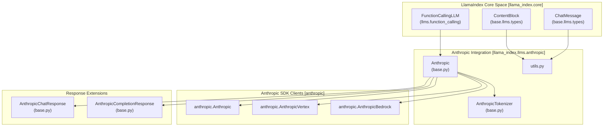
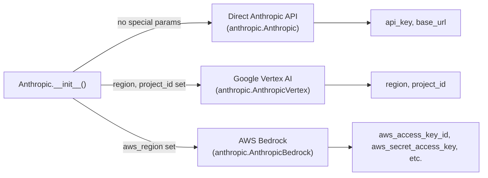
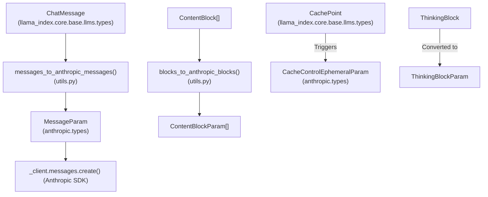
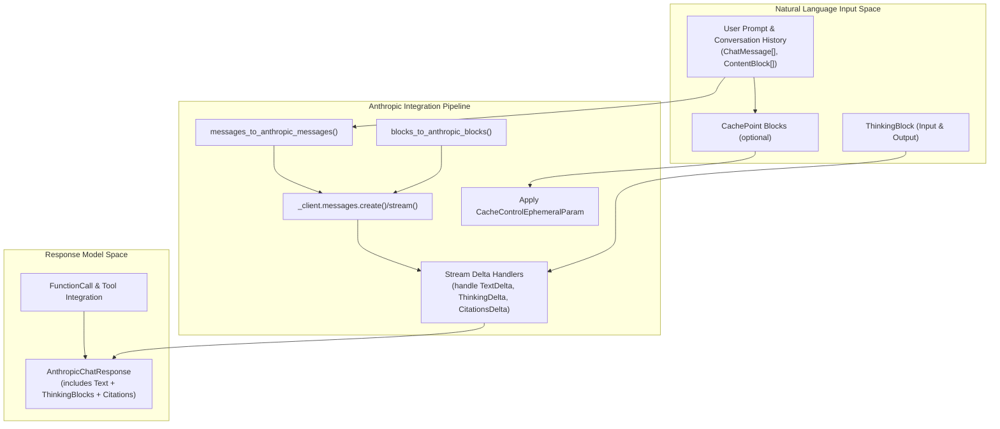

<!-- source: DeepWiki mcp.deepwiki.com · repo run-llama/llama_index · page 6.3 Anthropic Integration · fetched 2026-10-26 -->

# Anthropic Integration

<details>
<summary>Relevant source files</summary>

The following files were used as context for generating this wiki page:

- [docs/examples/llm/anthropic.ipynb](docs/examples/llm/anthropic.ipynb)
- [llama-index-core/llama_index/core/extractors/document_context.py](llama-index-core/llama_index/core/extractors/document_context.py)
- [llama-index-integrations/llms/llama-index-llms-anthropic/llama_index/llms/anthropic/base.py](llama-index-integrations/llms/llama-index-llms-anthropic/llama_index/llms/anthropic/base.py)
- [llama-index-integrations/llms/llama-index-llms-anthropic/llama_index/llms/anthropic/utils.py](llama-index-integrations/llms/llama-index-llms-anthropic/llama_index/llms/anthropic/utils.py)
- [llama-index-integrations/llms/llama-index-llms-anthropic/pyproject.toml](llama-index-integrations/llms/llama-index-llms-anthropic/pyproject.toml)
- [llama-index-integrations/llms/llama-index-llms-anthropic/tests/test_anthropic_utils.py](llama-index-integrations/llms/llama-index-llms-anthropic/tests/test_anthropic_utils.py)
- [llama-index-integrations/llms/llama-index-llms-anthropic/tests/test_llms_anthropic.py](llama-index-integrations/llms/llama-index-llms-anthropic/tests/test_llms_anthropic.py)
- [llama-index-integrations/llms/llama-index-llms-anthropic/uv.lock](llama-index-integrations/llms/llama-index-llms-anthropic/uv.lock)
- [llama-index-integrations/llms/llama-index-llms-bedrock-converse/.gitignore](llama-index-integrations/llms/llama-index-llms-bedrock-converse/.gitignore)
- [llama-index-integrations/llms/llama-index-llms-bedrock-converse/Makefile](llama-index-integrations/llms/llama-index-llms-bedrock-converse/Makefile)
- [llama-index-integrations/llms/llama-index-llms-bedrock-converse/README.md](llama-index-integrations/llms/llama-index-llms-bedrock-converse/README.md)
- [llama-index-integrations/llms/llama-index-llms-bedrock-converse/llama_index/llms/bedrock_converse/__init__.py](llama-index-integrations/llms/llama-index-llms-bedrock-converse/llama_index/llms/bedrock_converse/__init__.py)
- [llama-index-integrations/llms/llama-index-llms-bedrock-converse/llama_index/llms/bedrock_converse/base.py](llama-index-integrations/llms/llama-index-llms-bedrock-converse/llama_index/llms/bedrock_converse/base.py)
- [llama-index-integrations/llms/llama-index-llms-bedrock-converse/llama_index/llms/bedrock_converse/utils.py](llama-index-integrations/llms/llama-index-llms-bedrock-converse/llama_index/llms/bedrock_converse/utils.py)
- [llama-index-integrations/llms/llama-index-llms-bedrock-converse/pyproject.toml](llama-index-integrations/llms/llama-index-llms-bedrock-converse/pyproject.toml)
- [llama-index-integrations/llms/llama-index-llms-bedrock-converse/tests/test_bedrock_converse_utils.py](llama-index-integrations/llms/llama-index-llms-bedrock-converse/tests/test_bedrock_converse_utils.py)
- [llama-index-integrations/llms/llama-index-llms-bedrock-converse/tests/test_llms_bedrock_converse.py](llama-index-integrations/llms/llama-index-llms-bedrock-converse/tests/test_llms_bedrock_converse.py)
- [llama-index-integrations/llms/llama-index-llms-bedrock-converse/tests/test_thinking_delta.py](llama-index-integrations/llms/llama-index-llms-bedrock-converse/tests/test_thinking_delta.py)
- [llama-index-integrations/llms/llama-index-llms-bedrock-converse/uv.lock](llama-index-integrations/llms/llama-index-llms-bedrock-converse/uv.lock)
- [llama-index-integrations/llms/llama-index-llms-bedrock/CHANGELOG.md](llama-index-integrations/llms/llama-index-llms-bedrock/CHANGELOG.md)
- [llama-index-integrations/llms/llama-index-llms-bedrock/llama_index/llms/bedrock/__init__.py](llama-index-integrations/llms/llama-index-llms-bedrock/llama_index/llms/bedrock/__init__.py)
- [llama-index-integrations/llms/llama-index-llms-bedrock/llama_index/llms/bedrock/base.py](llama-index-integrations/llms/llama-index-llms-bedrock/llama_index/llms/bedrock/base.py)
- [llama-index-integrations/llms/llama-index-llms-bedrock/llama_index/llms/bedrock/utils.py](llama-index-integrations/llms/llama-index-llms-bedrock/llama_index/llms/bedrock/utils.py)
- [llama-index-integrations/llms/llama-index-llms-bedrock/pyproject.toml](llama-index-integrations/llms/llama-index-llms-bedrock/pyproject.toml)
- [llama-index-integrations/llms/llama-index-llms-bedrock/tests/test_bedrock.py](llama-index-integrations/llms/llama-index-llms-bedrock/tests/test_bedrock.py)
- [llama-index-integrations/llms/llama-index-llms-bedrock/tests/test_utils.py](llama-index-integrations/llms/llama-index-llms-bedrock/tests/test_utils.py)

</details>


The Anthropic integration provides robust support for Anthropic's Claude family of models within LlamaIndex. It facilitates advanced natural language generation, chat completions, function calling, multi-modal content handling, prompt caching, reasoning through thinking blocks, and citation tracking. The integration supports multiple deployment platforms, including direct Anthropic API, Google Vertex AI, and AWS Bedrock.

This page details the implementation, core classes, data flow, and auxiliary utilities constituting the Anthropic integration.

## Architecture Overview

The integration extends LlamaIndex's LLM interface and function-calling architecture by implementing the `Anthropic` class, which internally wraps the official Anthropic Python SDK clients targeting different deployment environments.



* The `Anthropic` class is the main entry point, extending core LLM function-calling features.
* Utility functions handle conversion between LlamaIndex content/message types and Anthropic SDK types.
* Support for three SDK clients enables deployment on Anthropic's official API, Google Vertex AI, and AWS Bedrock.
* Response classes augment base response models to include citations and reasoning blocks.

Sources: [llama-index-integrations/llms/llama-index-llms-anthropic/llama_index/llms/anthropic/base.py:136-216](), [llama-index-integrations/llms/llama-index-llms-anthropic/llama_index/llms/anthropic/utils.py:7-20]()

---

## Core Components

### The `Anthropic` Class

The `Anthropic` class wraps Anthropic SDK clients and provides a configurable interface for Claude models supporting:

- Text completion and streaming outputs.
- Chat completion with message history handling.
- Function calling capability for tool integration.
- Prompt caching support to optimize token usage.
- Thinking (reasoning) mode for extended deliberation blocks.
- Citations handling linking model output to source documents.
- Model Context Protocol (MCP) support for advanced tool servers.

#### Key Parameters

| Parameter       | Type               | Description                                                       |
|-----------------|--------------------|-------------------------------------------------------------------|
| `model`         | `str`              | Anthropic Claude model name (e.g., `claude-3-7-sonnet-20250219`) |
| `temperature`   | `float`            | Sampling temperature [0.0-1.0]                                   |
| `max_tokens`    | `int`              | Maximum tokens to generate                                        |
| `cache_idx`     | `Optional[int]`    | Cache-control index, -1 caches all, None disables caching        |
| `thinking_dict` | `Optional[dict]`   | Configures thinking/reasoning budget (e.g., `{"budget_tokens":16000}`) |
| `tools`         | `Optional[List]`   | List of tools to expose to Claude for function-calls             |
| `mcp_servers`   | `Optional[List]`   | List of MCP servers for protocol-driven model-tool interactions   |
| `base_url`      | `Optional[str]`    | Base URL for non-default Anthropic API endpoints                  |
| `timeout`       | `Optional[float]`  | Request timeout in seconds                                        |
| `max_retries`   | `int`              | Number of retries for API calls                                   |

#### Client Initialization

The `Anthropic` class initializes one of three internal clients based on parameters indicating the deployment environment:



This flexible design abstracts different Anthropic deployment platforms behind a consistent API in LlamaIndex.

Sources: [llama-index-integrations/llms/llama-index-llms-anthropic/llama_index/llms/anthropic/base.py:154-207]()

---

### Message Processing and Content Conversion

Input messages in LlamaIndex are composed of `ChatMessage` and various `ContentBlock` subclasses (e.g., `TextBlock`, `ImageBlock`, `ThinkingBlock`). These need conversion to Anthropic SDK's `MessageParam` and `ContentBlockParam` types for API consumption.

- `messages_to_anthropic_messages`: Converts sequences of `ChatMessage` to Anthropic `MessageParam` objects.
- `blocks_to_anthropic_blocks`: Converts LlamaIndex content blocks to Anthropic content blocks, handling text, images (base64 encoded for Claude), PDFs, tool calls, thinking blocks, and citations.

Prompt caching is implemented by inserting `CachePoint` blocks that apply `CacheControlEphemeralParam` in the Anthropic message format.



This pipeline ensures tight integration to Anthropic's content model, enabling advanced usage patterns.

Sources: [llama-index-integrations/llms/llama-index-llms-anthropic/llama_index/llms/anthropic/utils.py:204-270]()

---

## Claude Model Support and Capabilities

### Model Catalog and Context Sizes

The integration supports a broad set of Claude model identifiers consolidated across providers:

| Source           | Model Dictionary                   | Context Window (Tokens) |
|------------------|----------------------------------|------------------------|
| Anthropic API    | `ANTHROPIC_MODELS`                | 200,000 - 1,000,000    |
| AWS Bedrock      | `BEDROCK_INFERENCE_PROFILE_CLAUDE_MODELS` | 200,000 - 1,000,000    |
| Google Vertex AI | `VERTEX_CLAUDE_MODELS`            | 200,000 - 1,000,000    |

The master dictionary `CLAUDE_MODELS` merges all providers for internal usage.

- Reasoning/thinking support is model-dependent and detected via utility functions.
- Models with `-3`, `-4`, or `-5` in their names support function/tool calling.
- Some models disable temperature modification (`ANTHROPIC_NO_TEMP_MODELS`).

### Utility Functions for Model Features

- `anthropic_modelname_to_contextsize(modelname: str) -> int`: Returns model's max context window.
- `is_function_calling_model(modelname: str) -> bool`: Detects if the model supports function calls.
- `is_anthropic_structured_output_supported(modelname: str) -> bool`: Checks support for structured outputs like thinking blocks.
- `is_anthropic_prompt_caching_supported_model(modelname: str) -> bool`: Determines if prompt caching is implemented for a model.

Sources: [llama-index-integrations/llms/llama-index-llms-anthropic/llama_index/llms/anthropic/utils.py:54-130](), [llama-index-integrations/llms/llama-index-llms-anthropic/llama_index/llms/anthropic/utils.py:150-152]()

---

## Advanced Features

### Prompt Caching

The integration supports Anthropic's prompt caching mechanism through content blocks of type `CachePoint` which trigger ephemeral cache controls on message blocks up to a configured index.

- Users configure caching via the `cache_idx` property on the `Anthropic` instance.
- During message conversions, cache control flags are added to eligible messages.
- This reduces token cost by caching fixed prompt parts on the Anthropic server side.

### Thinking Mode (Reasoning Blocks)

Claude 3+ models support "thinking mode" where the model emits intermediate reasoning blocks before final answers.

- The `Anthropic` class accepts a `thinking_dict` configuration to enable and specify budget tokens.
- Streaming chat/completions handle `ThinkingDelta` events, accumulating reasoning content in specialized `ThinkingBlock` objects.
- The final `ChatResponse` or stream includes these thinking blocks alongside answer text for transparent reasoning exposition.

### Multi-Modal and Document Support

The integration provides conversions for multi-modal document blocks:

- `ImageBlock` is converted to base64-encoded images since Claude currently rejects URLs.
- `DocumentBlock` supports PDF content encoded as base64 with appropriate metadata wrapper (`Base64PDFSourceParam`).
- Tools for function calls are wrapped in Anthropic `ToolUseBlockParam` or `ToolResultBlockParam`.

### Citations Support

When Claude is used with retrieval-augmented generation, the integration captures citations pointing back to supporting documents.

- `AnthropicChatResponse` extends the base response to include a `citations: List[Dict]`.
- Citations are parsed from API delta events such as `TextCitation` and `CitationsDelta`.
- This is instrumental in grounding model outputs with source traceability.

Sources:  
- Prompt Caching: [llama-index-integrations/llms/llama-index-llms-anthropic/llama_index/llms/anthropic/utils.py:254-260](), [llama-index-integrations/llms/llama-index-llms-anthropic/llama_index/llms/anthropic/base.py:179-186]()  
- Thinking Mode: [llama-index-integrations/llms/llama-index-llms-anthropic/llama_index/llms/anthropic/base.py:187-193](), [llama-index-integrations/llms/llama-index-llms-anthropic/llama_index/llms/anthropic/base.py:615-625]()  
- Multi-Modal: [llama-index-integrations/llms/llama-index-llms-anthropic/llama_index/llms/anthropic/utils.py:200-225]()  
- Citations: [llama-index-integrations/llms/llama-index-llms-anthropic/llama_index/llms/anthropic/base.py:124-129](), [llama-index-integrations/llms/llama-index-llms-anthropic/llama_index/llms/anthropic/base.py:650-680]()  

---

## Data Flow Summary

Below is a high-level flow diagram illustrating the data transformation from LlamaIndex's internal natural language and content abstractions to Anthropic SDK API calls and back to response objects with thinking blocks and citations:



This flow shows how input prompts and content are converted into Anthropic API messages, cached, streamed with delta events processed, and returned with rich metadata for clients.

Sources: [llama-index-integrations/llms/llama-index-llms-anthropic/llama_index/llms/anthropic/base.py:500-700](), [llama-index-integrations/llms/llama-index-llms-anthropic/llama_index/llms/anthropic/utils.py:220-343]()

---

## Package and Dependency Management

The Anthropic integration is packaged as `llama-index-llms-anthropic` and depends on the official `anthropic` Python SDK (version >= 0.75.0) with optional extras for AWS Bedrock and Google Vertex AI.

Installation Example:

```bash
pip install llama-index-llms-anthropic
```

or with optional dependencies for Bedrock/Vertex AI deployment:

```bash
pip install "llama-index-llms-anthropic[bedrock,vertex]"
```

The `pyproject.toml` specifies dependency versions, testing frameworks, and package metadata.

Sources: [llama-index-integrations/llms/llama-index-llms-anthropic/pyproject.toml:29-39]()

---

# Summary

The Anthropic integration for LlamaIndex provides a fully featured, flexible adapter to Anthropic's Claude models, empowering users to build LLM-powered applications with:

- Multi-platform support: direct API, Google Vertex AI, AWS Bedrock.
- Advanced LLM features: function calling, prompt caching, multi-modal support.
- Reasoning via thinking blocks and traceability via citations.
- Tight conversion utilities bridging LlamaIndex data types to Anthropic SDK types.
- Stream and batch completion support with detailed event parsing.

This integration exemplifies LlamaIndex's extensible architecture allowing sophisticated AI providers and tooling ecosystems to be seamlessly utilized in data-centric LLM workflows.

---

# References

- `Anthropic` Class and Response Extensions: [llama-index-integrations/llms/llama-index-llms-anthropic/llama_index/llms/anthropic/base.py:136-300,600-700]()  
- Conversion Utilities: [llama-index-integrations/llms/llama-index-llms-anthropic/llama_index/llms/anthropic/utils.py:180-343]()  
- Model and Capability Dictionaries: [llama-index-integrations/llms/llama-index-llms-anthropic/llama_index/llms/anthropic/utils.py:50-130]()  
- Prompt Caching & Thinking Blocks: [llama-index-integrations/llms/llama-index-llms-anthropic/llama_index/llms/anthropic/base.py:170-190,600-650]()  
- Package Metadata: [llama-index-integrations/llms/llama-index-llms-anthropic/pyproject.toml:29-39]()

---

