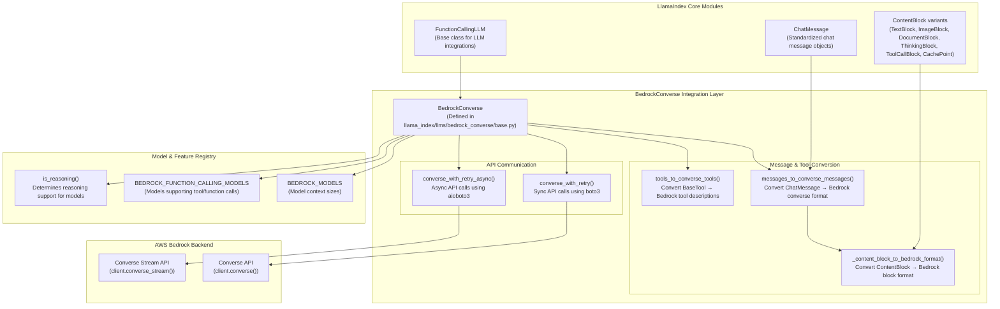
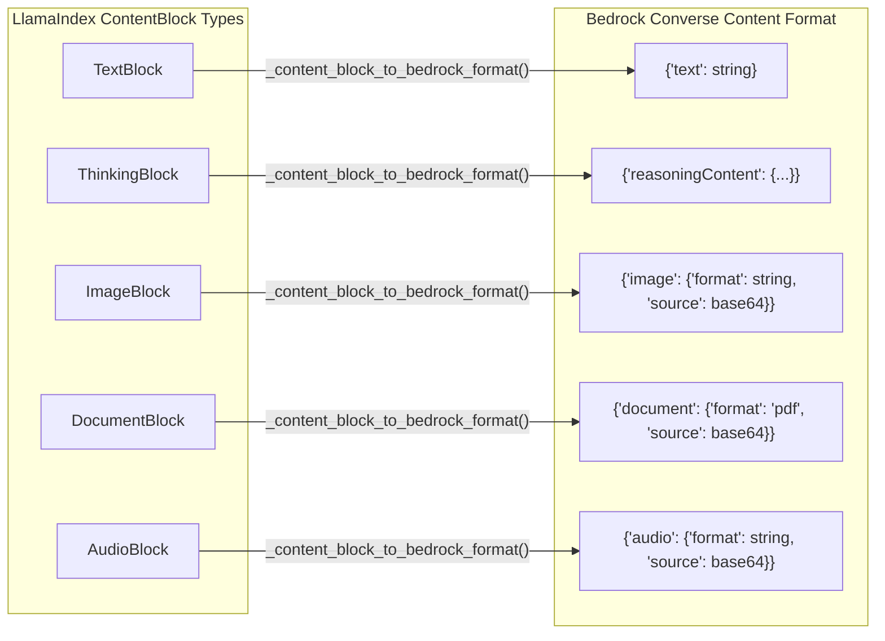

<!-- source: DeepWiki mcp.deepwiki.com · repo run-llama/llama_index · page 6.4 AWS Bedrock Integration · fetched 2026-10-26 -->

# AWS Bedrock Integration

<details>
<summary>Relevant source files</summary>

The following files were used as context for generating this wiki page:

- [docs/examples/embeddings/bedrock.ipynb](docs/examples/embeddings/bedrock.ipynb)
- [docs/examples/llm/anthropic.ipynb](docs/examples/llm/anthropic.ipynb)
- [docs/examples/llm/bedrock.ipynb](docs/examples/llm/bedrock.ipynb)
- [llama-index-core/llama_index/core/extractors/document_context.py](llama-index-core/llama_index/core/extractors/document_context.py)
- [llama-index-integrations/embeddings/llama-index-embeddings-bedrock/README.md](llama-index-integrations/embeddings/llama-index-embeddings-bedrock/README.md)
- [llama-index-integrations/embeddings/llama-index-embeddings-bedrock/llama_index/embeddings/bedrock/base.py](llama-index-integrations/embeddings/llama-index-embeddings-bedrock/llama_index/embeddings/bedrock/base.py)
- [llama-index-integrations/embeddings/llama-index-embeddings-bedrock/pyproject.toml](llama-index-integrations/embeddings/llama-index-embeddings-bedrock/pyproject.toml)
- [llama-index-integrations/embeddings/llama-index-embeddings-bedrock/tests/test_bedrock.py](llama-index-integrations/embeddings/llama-index-embeddings-bedrock/tests/test_bedrock.py)
- [llama-index-integrations/embeddings/llama-index-embeddings-bedrock/tests/test_bedrock_async.py](llama-index-integrations/embeddings/llama-index-embeddings-bedrock/tests/test_bedrock_async.py)
- [llama-index-integrations/embeddings/llama-index-embeddings-bedrock/tests/test_bedrock_embedding.py](llama-index-integrations/embeddings/llama-index-embeddings-bedrock/tests/test_bedrock_embedding.py)
- [llama-index-integrations/embeddings/llama-index-embeddings-bedrock/uv.lock](llama-index-integrations/embeddings/llama-index-embeddings-bedrock/uv.lock)
- [llama-index-integrations/llms/llama-index-llms-anthropic/llama_index/llms/anthropic/base.py](llama-index-integrations/llms/llama-index-llms-anthropic/llama_index/llms/anthropic/base.py)
- [llama-index-integrations/llms/llama-index-llms-anthropic/llama_index/llms/anthropic/utils.py](llama-index-integrations/llms/llama-index-llms-anthropic/llama_index/llms/anthropic/utils.py)
- [llama-index-integrations/llms/llama-index-llms-anthropic/pyproject.toml](llama-index-integrations/llms/llama-index-llms-anthropic/pyproject.toml)
- [llama-index-integrations/llms/llama-index-llms-anthropic/tests/test_anthropic_utils.py](llama-index-integrations/llms/llama-index-llms-anthropic/tests/test_anthropic_utils.py)
- [llama-index-integrations/llms/llama-index-llms-anthropic/tests/test_llms_anthropic.py](llama-index-integrations/llms/llama-index-llms-anthropic/tests/test_llms_anthropic.py)
- [llama-index-integrations/llms/llama-index-llms-anthropic/uv.lock](llama-index-integrations/llms/llama-index-llms-anthropic/uv.lock)
- [llama-index-integrations/llms/llama-index-llms-bedrock-converse/.gitignore](llama-index-integrations/llms/llama-index-llms-bedrock-converse/.gitignore)
- [llama-index-integrations/llms/llama-index-llms-bedrock-converse/Makefile](llama-index-integrations/llms/llama-index-llms-bedrock-converse/Makefile)
- [llama-index-integrations/llms/llama-index-llms-bedrock-converse/README.md](llama-index-integrations/llms/llama-index-llms-bedrock-converse/README.md)
- [llama-index-integrations/llms/llama-index-llms-bedrock-converse/llama_index/llms/bedrock_converse/__init__.py](llama-index-integrations/llms/llama-index-llms-bedrock-converse/llama_index/llms/bedrock_converse/__init__.py)
- [llama-index-integrations/llms/llama-index-llms-bedrock-converse/llama_index/llms/bedrock_converse/base.py](llama-index-integrations/llms/llama-index-llms-bedrock-converse/llama_index/llms/bedrock_converse/base.py)
- [llama-index-integrations/llms/llama-index-llms-bedrock-converse/llama_index/llms/bedrock_converse/utils.py](llama-index-integrations/llms/llama-index-llms-bedrock-converse/llama_index/llms/bedrock_converse/utils.py)
- [llama-index-integrations/llms/llama-index-llms-bedrock-converse/pyproject.toml](llama-index-integrations/llms/llama-index-llms-bedrock-converse/pyproject.toml)
- [llama-index-integrations/llms/llama-index-llms-bedrock-converse/tests/test_bedrock_converse_utils.py](llama-index-integrations/llms/llama-index-llms-bedrock-converse/tests/test_bedrock_converse_utils.py)
- [llama-index-integrations/llms/llama-index-llms-bedrock-converse/tests/test_llms_bedrock_converse.py](llama-index-integrations/llms/llama-index-llms-bedrock-converse/tests/test_llms_bedrock_converse.py)
- [llama-index-integrations/llms/llama-index-llms-bedrock-converse/tests/test_thinking_delta.py](llama-index-integrations/llms/llama-index-llms-bedrock-converse/tests/test_thinking_delta.py)
- [llama-index-integrations/llms/llama-index-llms-bedrock-converse/uv.lock](llama-index-integrations/llms/llama-index-llms-bedrock-converse/uv.lock)
- [llama-index-integrations/llms/llama-index-llms-bedrock/CHANGELOG.md](llama-index-integrations/llms/llama-index-llms-bedrock/CHANGELOG.md)
- [llama-index-integrations/llms/llama-index-llms-bedrock/llama_index/llms/bedrock/__init__.py](llama-index-integrations/llms/llama-index-llms-bedrock/llama_index/llms/bedrock/__init__.py)
- [llama-index-integrations/llms/llama-index-llms-bedrock/llama_index/llms/bedrock/base.py](llama-index-integrations/llms/llama-index-llms-bedrock/llama_index/llms/bedrock/base.py)
- [llama-index-integrations/llms/llama-index-llms-bedrock/llama_index/llms/bedrock/utils.py](llama-index-integrations/llms/llama-index-llms-bedrock/llama_index/llms/bedrock/utils.py)
- [llama-index-integrations/llms/llama-index-llms-bedrock/pyproject.toml](llama-index-integrations/llms/llama-index-llms-bedrock/pyproject.toml)
- [llama-index-integrations/llms/llama-index-llms-bedrock/tests/test_bedrock.py](llama-index-integrations/llms/llama-index-llms-bedrock/tests/test_bedrock.py)
- [llama-index-integrations/llms/llama-index-llms-bedrock/tests/test_utils.py](llama-index-integrations/llms/llama-index-llms-bedrock/tests/test_utils.py)

</details>


## Purpose and Scope

This document details the AWS Bedrock integration within LlamaIndex, focusing on the `BedrockConverse` class that enables interaction with AWS Bedrock's Converse API. This integration provides:

- Chat and completion support for various AWS Bedrock foundation models.
- Function/tool calling capabilities for supported models directly through Bedrock Converse.
- Integration with Bedrock Guardrails for content safety and compliance.
- Support for invoking Bedrock Application Inference Profiles for advanced routing.
- Optimizations including prompt caching and tool definition caching.
- Extended reasoning/thinking features for complex models such as Claude 3.X, Amazon Nova, and DeepSeek models.
- Multimodal content support including text, images, documents, and audio.

This integration is distinct from the legacy Bedrock LLM implementation that uses the `invoke_model` API but is the recommended approach for robust and future-proof Bedrock usage.

For a complementary AWS integration, see the Anthropic LLM integration ([6.3]()) which also supports Anthropic models on AWS Bedrock via the Anthropic SDK.

**Sources:**  
[llama-index-integrations/llms/llama-index-llms-bedrock-converse/README.md:1-14](),  
[llama-index-integrations/llms/llama-index-llms-bedrock-converse/pyproject.toml:31-42]()

---

## Architecture Overview

The Bedrock Converse integration is structured into several layered components that bridge LlamaIndex core abstractions to AWS Bedrock’s Converse API endpoints using both synchronous and asynchronous patterns.



This architecture enables robust communication with the Converse API, supporting advanced features like function calling, guardrails, caching, and multimodal data representation.

**Sources:**  
[llama-index-integrations/llms/llama-index-llms-bedrock-converse/llama_index/llms/bedrock_converse/base.py:82-104](),  
[llama-index-integrations/llms/llama-index-llms-bedrock-converse/llama_index/llms/bedrock_converse/utils.py:52-120](),  
[llama-index-integrations/llms/llama-index-llms-bedrock-converse/llama_index/llms/bedrock_converse/utils.py:122-164]()

---

## BedrockConverse Class

### Core Configuration

The `BedrockConverse` class, located in `llama_index/llms/bedrock_converse/base.py` (lines 82-336), implements the `FunctionCallingLLM` interface and governs all interactions with Bedrock Converse models.

| Parameter                        | Type                 | Description                                                                                                       |
|---------------------------------|----------------------|-------------------------------------------------------------------------------------------------------------------|
| `model`                         | `str`                | The Bedrock model ID to use, e.g. `"anthropic.claude-3-haiku-20240307-v1:0"`                                      |
| `temperature`                   | `float`              | Sampling temperature for generation (range 0.0 to 1.0)                                                           |
| `max_tokens`                    | `int`                | Maximum number of tokens to generate                                                                              |
| `system_prompt_caching`         | `bool`               | Enable prompt caching for system messages                                                                         |
| `tool_caching`                  | `bool`               | Enable caching for tool metadata                                                                                   |
| `guardrail_identifier`          | `Optional[str]`      | Unique identifier of the guardrail (content safety filter) to apply                                               |
| `guardrail_version`             | `Optional[str]`      | Version of the guardrail; e.g., `"DRAFT"`                                                                          |
| `guardrail_stream_processing_mode` | `Optional[Literal["sync", "async"]]` | Streaming processing mode when guardrail is enabled                                                               |
| `application_inference_profile_arn` | `Optional[str]`      | ARN for an AWS Bedrock application inference profile, enabling model routing and cross-region inference           |
| `thinking`                     | `Optional[ThinkingDict]` | Dict to configure extended reasoning/thinking features for supported models                                       |
| `aws_access_key_id`             | `Optional[str]`      | AWS Access Key (optional, uses env/profile if not provided)                                                       |
| `aws_secret_access_key`         | `Optional[str]`      | AWS Secret Key                                                                                                    |
| `aws_session_token`             | `Optional[str]`      | AWS Security Token                                                                                                |
| `region_name`                  | `Optional[str]`      | AWS Region (e.g., `us-east-1`)                                                                                    |
| `max_retries`                   | `int`                | Maximum API retry attempts                                                                                         |
| `timeout`                      | `float`              | Timeout in seconds for the API request                                                                             |

These parameters allow full control over model selection, security, advanced processing (guardrails, reasoning), and communication parameters.

**Sources:**  
[llama-index-integrations/llms/llama-index-llms-bedrock-converse/llama_index/llms/bedrock_converse/base.py:82-198]()

### Authentication and AWS Session

Authentication with AWS Bedrock is managed through `boto3` sessions. The class allows explicit AWS credentials or utilizes the default AWS CLI/profile environment.

Example usage snippet:

```python
from llama_index.llms.bedrock_converse import BedrockConverse

llm = BedrockConverse(
    model="anthropic.claude-3-haiku-20240307-v1:0",
    profile_name="my-aws-profile",
    region_name="us-east-1",
    aws_access_key_id="YOUR_ACCESS_KEY",
    aws_secret_access_key="YOUR_SECRET_KEY",
)
```

This flexible approach supports deployment in diverse AWS environments.

**Sources:**  
[llama-index-integrations/llms/llama-index-llms-bedrock-converse/llama_index/llms/bedrock_converse/base.py:114-129]()

---

## Message and Content Handling

### Content Block Conversion

LlamaIndex's internal content blocks are converted into AWS Bedrock Converse API's expected JSON block structures with `_content_block_to_bedrock_format()` in `utils.py`.



- **TextBlock**: Sent as simple text strings.
- **ThinkingBlock**: Rendered into reasoningContent objects to support model internal thought processes.
- **ImageBlock**: Converted to base64-encoded images with detected image format (`jpeg`, `png`, `gif`, or `webp`); unsupported mimetypes default to `png` with a warning.
- **DocumentBlock**: Supports PDF documents, encoded as base64 pdf data.
- **AudioBlock**: Supports audio data with format and base64 source.

This conversion is instrumental to ensuring LlamaIndex content integrates properly with Bedrock's multimodal model expectations.

**Sources:**  
[llama-index-integrations/llms/llama-index-llms-bedrock-converse/llama_index/llms/bedrock_converse/utils.py:226-326](),  
[llama-index-integrations/llms/llama-index-llms-bedrock-converse/tests/test_bedrock_converse_utils.py:220-225]()

---

### Multimodal Content Support Detail

- **Image Formats Supported:** JPEG, PNG, GIF, WEBP. Unknown mime types fallback to PNG with a logged warning.  
- **Document Support:** PDFs are supported for document blocks enabling document embeddings or reasoning.  
- **Audio Support:** Audio blocks are supported in requests to models that accept audio inputs.  
- **Thinking/Reasoning Blocks:** Assistant role thinking content can be returned in structured form for downstream reasoning usage.

This multimodal capacity is vital for interacting with Bedrock models designed for rich input types.

**Sources:**  
[llama-index-integrations/llms/llama-index-llms-bedrock-converse/llama_index/llms/bedrock_converse/utils.py:17-35]()

---

## Advanced Features

### Extended Thinking / Reasoning Support

Many Bedrock models, such as Claude 3.7, Amazon Nova premier/pro, and DeepSeek R1, have internal "thinking" or reasoning modes where the model produces intermediate reasoning content.

The integration exposes this via the optional `thinking` parameter, expected as a dictionary (e.g., `{"type": "enabled", "budget_tokens": 16000}`), to configure the reasoning budget and behavior.

Models supporting reasoning can be determined by `is_reasoning(model_id)` utility, which checks the model identifier against a registry.

Example:

```python
llm = BedrockConverse(
    model="anthropic.claude-3-7-sonnet-20250219-v1:0",
    thinking={"type": "enabled", "budget_tokens": 10000}
)
```

This feature enables advanced LLM applications requiring interpretable chain of thought or decision-making transparency.

**Sources:**  
[llama-index-integrations/llms/llama-index-llms-bedrock-converse/llama_index/llms/bedrock_converse/utils.py:25-32](),  
[llama-index-integrations/llms/llama-index-llms-bedrock-converse/llama_index/llms/bedrock_converse/base.py:33-35]()

---

### Guardrails Integration

Bedrock Guardrails provide a mechanism to enforce safety, content guidelines, and moderation.

The `BedrockConverse` class supports guardrails via the parameters:

- `guardrail_identifier`: to specify the guardrail to apply.
- `guardrail_version`: version or `DRAFT`.
- `guardrail_stream_processing_mode`: either `"sync"` or `"async"`, controlling how streaming requests handle guardrail processing.

These guardrails apply content moderation and compliance filters transparently during model interaction.

**Sources:**  
[llama-index-integrations/llms/llama-index-llms-bedrock-converse/llama_index/llms/bedrock_converse/base.py:176-188]()

---

### Application Inference Profiles

Bedrock supports application inference profiles which allow advanced model routing, multi-region deployment, and runtime overrides.

The integration supports specifying `application_inference_profile_arn`. When provided, this ARN is used to call the Bedrock model instead of the raw `model` ID.

This feature facilitates enterprise-grade deployments leveraging Bedrock's application inference routing.

**Sources:**  
[llama-index-integrations/llms/llama-index-llms-bedrock-converse/llama_index/llms/bedrock_converse/base.py:189-191]()

---

### Prompt and Tool Caching

To optimize performance, developers can enable caching:

- `system_prompt_caching`: Caches the system prompt sent to the model.
- `tool_caching`: Caches tool inventories and definitions.

This can reduce latency and redundant calls, particularly when using tool-enabled models.

**Sources:**  
[llama-index-integrations/llms/llama-index-llms-bedrock-converse/llama_index/llms/bedrock_converse/base.py:168-175]()

---

## Model Support Registry

The integration maintains a comprehensive registry of supported Bedrock models including their context window sizes, features like function calling and reasoning.

Key model series and features:

| Model Series                 | Context Window (tokens) | Features                      |
|-----------------------------|------------------------|-------------------------------|
| Amazon Nova (Premier/Pro/Lite) | 300,000 to 1,000,000   | Function calling, caching, reasoning, adaptive thinking |
| Anthropic Claude 3.X series | 200,000                 | Function calling, caching, reasoning                        |
| Meta Llama 3.1, 3.2, 3.3    | 2,048 to 131,000        | Function calling, inference profile support                |
| Mistral (Large/Small)        | 32,000                  | Function calling                                           |
| DeepSeek R1 / V3             | 128,000                 | Function calling, reasoning                               |

The registry is defined as the `BEDROCK_MODELS`, `BEDROCK_FUNCTION_CALLING_MODELS`, and other constants in `utils.py`.

### Inference Profile Model Name Translation

Bedrock model identifiers may include regional prefixes like `us.`, `eu.`, `ca.`, `apac.`, `global.`. The utility function `get_model_name()` strips these prefixes for consistent capability checking and API calls.

**Sources:**  
[llama-index-integrations/llms/llama-index-llms-bedrock-converse/llama_index/llms/bedrock_converse/utils.py:52-120](),  
[llama-index-integrations/llms/llama-index-llms-bedrock-converse/llama_index/llms/bedrock_converse/utils.py:81-118](),  
[llama-index-integrations/llms/llama-index-llms-bedrock-converse/tests/test_bedrock_converse_utils.py:20-40,81-147]()

---

## Comparison with Legacy Bedrock Integration

LlamaIndex provides two primary AWS Bedrock LLM implementations:

| Feature/Aspect             | BedrockConverse Integration                                | Legacy Bedrock Integration                             |
|----------------------------|-----------------------------------------------------------|-------------------------------------------------------|
| API Endpoint               | Converse API (`client.converse()`)                         | `invoke_model` API                                     |
| Model Support              | Comprehensive, unified across all Bedrock models          | Provider-specific, fragmentary                        |
| Function/Tool Calling      | Native support on function calling models                  | Manual prompt formatting and response parsing        |
| Guardrails Support         | Built-in guardrails support with streaming modes           | Not natively supported                                |
| Application Profiles       | Supports Benetworking with Application Inference Profiles | No support                                            |
| Prompt & Tool Caching      | Supported                                                 | Not supported                                         |
| Async Support              | Supports async with aioboto3                                | Limited                                              |

The `BedrockConverse` is the recommended integration for modern Bedrock usage, providing a more consistent and feature-rich experience.

**Sources:**  
[llama-index-integrations/llms/llama-index-llms-bedrock-converse/README.md:1-15](),  
[llama-index-integrations/llms/llama-index-llms-bedrock/pyproject.toml:28-39]()

---

# Summary

The AWS Bedrock Converse integration encapsulated in the `BedrockConverse` class empowers LlamaIndex users to leverage the full capabilities of AWS Bedrock foundation models with advanced features like function calling, guardrails, application inference profiles, prompt/tool caching, and multimodal input handling. Its architecture and utilities provide robust, streamlined access to the Bedrock Converse API in both synchronous and asynchronous modes. This integration supersedes the legacy Bedrock approach, making it the preferred option for building LLM applications on AWS Bedrock within the LlamaIndex ecosystem.

---

**References**  
- `BedrockConverse` class implementation: `llama-index-integrations/llms/llama-index-llms-bedrock-converse/llama_index/llms/bedrock_converse/base.py` [82-336]()  
- Utilities and model registries: `llama-index-integrations/llms/llama-index-llms-bedrock-converse/llama_index/llms/bedrock_converse/utils.py` [1-194]()  
- Tests for utilities: `llama-index-integrations/llms/llama-index-llms-bedrock-converse/tests/test_bedrock_converse_utils.py` [1-232]()  
- Legacy Bedrock integration comparison: `llama-index-integrations/llms/llama-index-llms-bedrock/llama_index/llms/bedrock/base.py` [130-190]()  
- Package manifest and description: `llama-index-integrations/llms/llama-index-llms-bedrock-converse/pyproject.toml` [31-42]()

---

