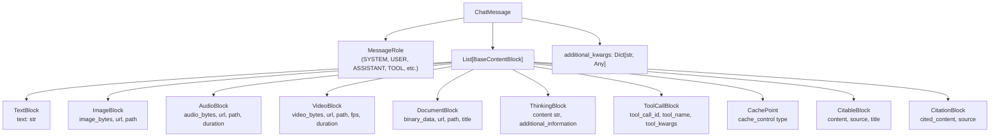
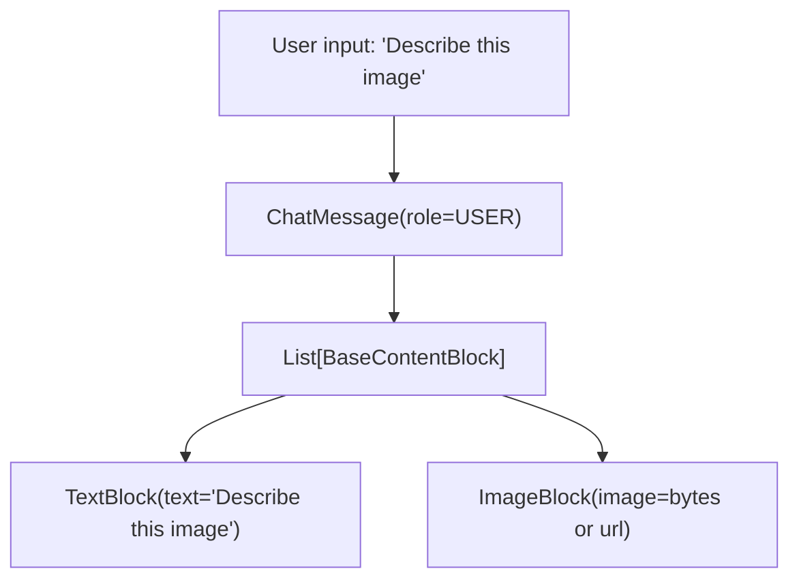
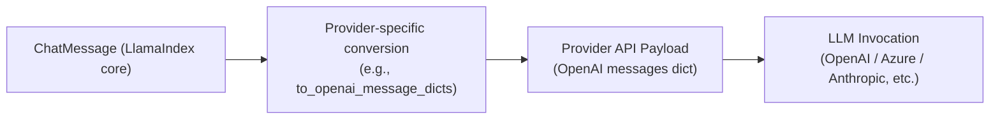

<!-- source: DeepWiki mcp.deepwiki.com · repo run-llama/llama_index · page 6.7 Content Blocks and Messages · fetched 2026-10-26 -->

# Content Blocks and Messages

Relevant source files

The following files were used as context for generating this wiki page:

- [docs/src/content/docs/framework/module_guides/deploying/agents/memory.mdx](docs/src/content/docs/framework/module_guides/deploying/agents/memory.mdx)
- [llama-index-core/llama_index/core/base/llms/types.py](llama-index-core/llama_index/core/base/llms/types.py)
- [llama-index-core/llama_index/core/bridge/pydantic.py](llama-index-core/llama_index/core/bridge/pydantic.py)
- [llama-index-core/llama_index/core/img_utils.py](llama-index-core/llama_index/core/img_utils.py)
- [llama-index-core/llama_index/core/indices/vector_store/retrievers/retriever.py](llama-index-core/llama_index/core/indices/vector_store/retrievers/retriever.py)
- [llama-index-core/llama_index/core/memory/memory.py](llama-index-core/llama_index/core/memory/memory.py)
- [llama-index-core/llama_index/core/memory/memory_blocks/vector.py](llama-index-core/llama_index/core/memory/memory_blocks/vector.py)
- [llama-index-core/llama_index/core/multi_modal_llms/base.py](llama-index-core/llama_index/core/multi_modal_llms/base.py)
- [llama-index-core/llama_index/core/multi_modal_llms/generic_utils.py](llama-index-core/llama_index/core/multi_modal_llms/generic_utils.py)
- [llama-index-core/llama_index/core/node_parser/node_utils.py](llama-index-core/llama_index/core/node_parser/node_utils.py)
- [llama-index-core/llama_index/core/node_parser/text/code.py](llama-index-core/llama_index/core/node_parser/text/code.py)
- [llama-index-core/llama_index/core/node_parser/text/semantic_double_merging_splitter.py](llama-index-core/llama_index/core/node_parser/text/semantic_double_merging_splitter.py)
- [llama-index-core/llama_index/core/node_parser/text/utils.py](llama-index-core/llama_index/core/node_parser/text/utils.py)
- [llama-index-core/llama_index/core/postprocessor/optimizer.py](llama-index-core/llama_index/core/postprocessor/optimizer.py)
- [llama-index-core/llama_index/core/prompts/__init__.py](llama-index-core/llama_index/core/prompts/__init__.py)
- [llama-index-core/llama_index/core/response/notebook_utils.py](llama-index-core/llama_index/core/response/notebook_utils.py)
- [llama-index-core/llama_index/core/schema.py](llama-index-core/llama_index/core/schema.py)
- [llama-index-core/llama_index/core/storage/docstore/simple_docstore.py](llama-index-core/llama_index/core/storage/docstore/simple_docstore.py)
- [llama-index-core/llama_index/core/storage/docstore/types.py](llama-index-core/llama_index/core/storage/docstore/types.py)
- [llama-index-core/llama_index/core/utils.py](llama-index-core/llama_index/core/utils.py)
- [llama-index-core/tests/base/llms/test_types.py](llama-index-core/tests/base/llms/test_types.py)
- [llama-index-core/tests/indices/vector_store/test_retrievers.py](llama-index-core/tests/indices/vector_store/test_retrievers.py)
- [llama-index-core/tests/memory/blocks/test_vector.py](llama-index-core/tests/memory/blocks/test_vector.py)
- [llama-index-core/tests/memory/test_memory_base.py](llama-index-core/tests/memory/test_memory_base.py)
- [llama-index-core/tests/memory/test_memory_blocks_base.py](llama-index-core/tests/memory/test_memory_blocks_base.py)
- [llama-index-core/tests/memory/test_memory_custom_chat_store.py](llama-index-core/tests/memory/test_memory_custom_chat_store.py)
- [llama-index-core/tests/multi_modal_llms/test_base_multi_modal_llm_metadata.py](llama-index-core/tests/multi_modal_llms/test_base_multi_modal_llm_metadata.py)
- [llama-index-core/tests/multi_modal_llms/test_generic_utils.py](llama-index-core/tests/multi_modal_llms/test_generic_utils.py)
- [llama-index-core/tests/node_parser/test_semantic_double_merging_splitter.py](llama-index-core/tests/node_parser/test_semantic_double_merging_splitter.py)
- [llama-index-core/tests/schema/test_image_document.py](llama-index-core/tests/schema/test_image_document.py)
- [llama-index-core/tests/schema/test_media_resource.py](llama-index-core/tests/schema/test_media_resource.py)
- [llama-index-core/tests/schema/test_node.py](llama-index-core/tests/schema/test_node.py)
- [llama-index-core/tests/schema/test_schema.py](llama-index-core/tests/schema/test_schema.py)
- [llama-index-core/tests/test_utils.py](llama-index-core/tests/test_utils.py)
- [llama-index-core/tests/text_splitter/test_code_splitter.py](llama-index-core/tests/text_splitter/test_code_splitter.py)
- [llama-index-integrations/readers/llama-index-readers-kibela/llama_index/readers/kibela/base.py](llama-index-integrations/readers/llama-index-readers-kibela/llama_index/readers/kibela/base.py)

## Purpose and Scope

This document details the unified content block and chat message system in LlamaIndex, designed to provide a consistent, provider-agnostic representation for interactions with large language models (LLMs). The core abstractions like `ChatMessage` and various `ContentBlock` subclasses enable multimodal content (text, images, audio, video, documents), tool calls, and reasoning traces to be structured uniformly across different LLM providers.

It serves as a bridge linking the "Natural Language Space" (user inputs and LLM-generated language) to the "Code Entity Space" (structured data models and APIs), allowing consistent ingestion, processing, and transmission of rich conversational and media content.

## Core Architecture

The content block and message system is primarily defined in `llama_index.core.base.llms.types`. It consists of two fundamental layers:

- **ChatMessage**: Represents a full message within a chat, comprising a sender role and a sequence of content blocks.
- **BaseContentBlock** and its subclasses: Encapsulate specific content types like text, images, audio, video, document files, thinking traces, and tool calls.

### Message and Block Hierarchy

**Sources**: [llama-index-core/llama_index/core/base/llms/types.py:53-516]()

## ChatMessage Structure

The `ChatMessage` is the top-level class representing a single message in a chat, addressed to or originating from an LLM or user. It contains:

- `role`: Identifies the sender or message's nature using the `MessageRole` enum (e.g., SYSTEM, USER, ASSISTANT, TOOL).
- `blocks`: An ordered list of content blocks (`BaseContentBlock` subclasses) that represent pieces of the message content.
- `additional_kwargs`: A dictionary for any extra provider-specific metadata or extensions.

### Legacy Content Access

To support backward compatibility, `ChatMessage` provides a `content` property that gets or sets text by aggregating or assigning a single `TextBlock`. This allows easier interoperability with older code expecting plain text messages while internally representing rich content as blocks.

### Message Roles

The `MessageRole` enum defines roles as strings, such as:

- `SYSTEM` – System instructions or initialization.
- `USER` – User messages.
- `ASSISTANT` – Model-generated responses.
- `TOOL` – Messages originating from tools.
- `FUNCTION` – For function calls in function-calling workflows.
- Other less common roles include `DEVELOPER`, `CHATBOT`, and `MODEL`.

These roles enable flexible interaction patterns with LLMs, including tool-augmented agents and multi-participant dialogues.

**Sources**: [llama-index-core/llama_index/core/base/llms/types.py:53-65, 590-632]()

## Content Block Types

`BaseContentBlock` is an abstract base representing a unit of message content. It includes utilities for token estimation and splitting, formatting with template variables, and content merging (mostly for text blocks).

Below are the primary concrete subclasses:

### 1. TextBlock

- Contains plain text content (`text: str`).
- Implements token count estimation using a tokenizer (default is GPT tokenizer).
- Supports splitting into smaller blocks by tokens.
- Used for typical textual conversational content.

**Key methods:**
- `aestimate_tokens()`: Async estimate of token count.
- `asplit()`: Async splitting into smaller text blocks.

**Sources**: [llama-index-core/llama_index/core/base/llms/types.py:522-557]()

### 2. ImageBlock

- Represents an image via either raw bytes, a file path, or a URL.
- Automatically base64-encodes raw bytes when serializing.
- Uses `filetype` to detect MIME type.
- Can be constructed from `ImageDocument` objects.
- Supports template variable substitution in bytes or path attributes.

**Special attributes:**
- `image`: raw bytes (base64 encoded internally).
- `url`: network URL of the image.
- `path`: local file path.

**Sources**: [llama-index-core/llama_index/core/base/llms/types.py:59-156]()

### 3. AudioBlock

- Stores audio content for multimodal inputs.
- Supports raw bytes, URLs, or paths.
- Extracts and stores metadata like duration using `TinyTag` library.
- Supports common audio formats such as MP3 and WAV.
- Used by audio-capable LLMs.

**Key features:**
- Audio duration extraction.
- Base64 encoding of raw bytes.

**Sources**: [llama-index-core/llama_index/core/base/llms/types.py:158-242]()

### 4. VideoBlock

- Represents video content with raw bytes, URL, or local path.
- Includes metadata such as frames per second (`fps`) and duration.
- Useful for integrating video-based reasoning or queries.

**Sources**: [llama-index-core/llama_index/core/base/llms/types.py:244-336]()

### 5. DocumentBlock

- Encapsulates document files, primarily PDFs but extensible.
- Accepts raw binary data, URLs, or file paths.
- Supports metadata such as the document title.
- Implements MIME typing and base64 encoding similarly to ImageBlock.

**Sources**: [llama-index-core/llama_index/core/base/llms/types.py:338-436]()

### 6. ThinkingBlock

- Captures intermediate reasoning traces or extended thinking from LLMs.
- Contains reasoning `content` and optional `additional_information`.
- Designed for models like Claude's Extended Thinking or OpenAI's O1/O3 reasoning traces.
- Supports metadata such as `signature` for provenance or validation.

**Sources**: [llama-index-core/llama_index/core/base/llms/types.py:438-449]()

### 7. ToolCallBlock

- Represents a tool or function call requested by the LLM.
- Contains a unique `tool_call_id`, the `tool_name`, and `tool_kwargs`.
- `tool_kwargs` can be a dictionary or a JSON string.
- Enables seamless integration for LLM-driven tool invocation workflows.

**Sources**: [llama-index-core/llama_index/core/base/llms/types.py:451-463]()

### 8. CachePoint

- Marks a location in a prompt or message for caching.
- Contains a `CacheControl` object specifying cache control type (e.g., ephemeral).

**Sources**: [llama-index-core/llama_index/core/base/llms/types.py:465-479]()

### 9. CitableBlock & CitationBlock

- Used for incorporating citation information in generated content.
- `CitableBlock`: wraps content with source metadata and an optional title.
- `CitationBlock`: contains citation references to source content.
- Facilitates traceability and provenance in responses.

**Sources**: [llama-index-core/llama_index/core/base/llms/types.py:481-516]()

## Token Estimation and Content Manipulation in ContentBlocks

`BaseContentBlock` provides a generic framework for token counting estimation and splitting to enable chunking and truncation. All content blocks support these interfaces asynchronously (`aestimate_tokens`, `asplit`) and synchronously via wrapper functions.

`TextBlock` implements token estimation by encoding text with a tokenizer (defaulting to GPT tokenizer).

Other content blocks can override or utilize custom token estimation logic as needed.

**Sources**: [llama-index-core/llama_index/core/base/llms/types.py:66-198](), [llama-index-core/llama_index/core/utils.py:138-182]()

## Data Flow: Natural Language Space to Code Entity Space

Here are two diagrams illustrating the relationship and flow between natural language inputs/outputs and the internal structured content blocks and messages.

### Diagram 1: Chat Message Creation from User Input

This flow shows that the user's natural language query is encapsulated in a `ChatMessage` containing content blocks, which may include both text and (multi-modal) image blocks.

### Diagram 2: Provider API Conversion of ChatMessage

This diagram shows how the internal `ChatMessage` is transformed to the format expected by the target LLM provider API calls.

**Sources**: [llama-index-core/llama_index/core/base/llms/types.py:590-632](), [llama-index-integrations/llms/llama-index-llms-openai/llama_index/llms/openai/utils.py:349-519]()

## Provider Conversions and Interactions

### OpenAI Integration

- Conversion function `to_openai_message_dicts` converts `ChatMessage` and nested `ContentBlock`s into OpenAI-compatible message dictionaries.
- ImageBlocks are translated into OpenAI's `image_url` objects.
- AudioBlocks can be converted into audio inputs for multimodal models.
- ToolCallBlocks are extracted and structured as tool call requests in the payload.
- This unified approach supports streaming, function-calling, and reasoning trace capture.

### OpenAI Responses Streaming

- `OpenAIResponses` class incrementally processes streaming events to build up `ChatMessage` content blocks such as `TextBlock`, `ToolCallBlock`, and `ThinkingBlock`.
- Events like text deltas, function call arguments, and reasoning completions update the respective blocks dynamically.

Both methods ensure that the rich multimodal and functional interaction content is maintained accurately between the internal system and the LLM provider.

**Sources**: 
- [llama-index-integrations/llms/llama-index-llms-openai/llama_index/llms/openai/utils.py:349-519]()
- [llama-index-integrations/llms/llama-index-llms-openai/llama_index/llms/openai/responses.py:172-358]()

## Memory and State Management Usage

The memory system, for example implemented in `llama_index.core.memory.memory`, uses `ChatMessage` and `ContentBlock` representations to store and manage conversational state that includes text and multimodal content. Memory blocks hold typed content and asynchronously synchronize structured messages with storage backends.

This ensures that agent memory or workflow orchestrations can maintain context that includes images, audio, documents, tool calls, and reasoning traces seamlessly.

**Sources**: [llama-index-core/llama_index/core/memory/memory.py:1-212]()

---

# Summary Table of Key Classes and Functions

| Class / Function          | Description                                         | File Reference                              |
|--------------------------|-----------------------------------------------------|---------------------------------------------|
| `ChatMessage`            | Container for chat messages with role and content blocks. | `llama_index/core/base/llms/types.py:590-634` |
| `MessageRole`            | Enum for message roles (USER, SYSTEM, ASSISTANT, etc.)    | `llama_index/core/base/llms/types.py:53-65`    |
| `BaseContentBlock`       | Abstract base for content blocks with splitting/token utils | `llama_index/core/base/llms/types.py:66-214`   |
| `TextBlock`              | Text content block with token management              | `llama_index/core/base/llms/types.py:522-557`  |
| `ImageBlock`             | Image content as bytes, url, or path                   | `llama_index/core/base/llms/types.py:59-156`   |
| `AudioBlock`             | Audio content with metadata                             | `llama_index/core/base/llms/types.py:158-242`  |
| `VideoBlock`             | Video content with fps and duration                     | `llama_index/core/base/llms/types.py:244-336`  |
| `DocumentBlock`          | Document file content (PDFs, etc.)                      | `llama_index/core/base/llms/types.py:338-436`  |
| `ThinkingBlock`          | Reasoning trace block                                   | `llama_index/core/base/llms/types.py:438-449`  |
| `ToolCallBlock`          | Tool/function call request                              | `llama_index/core/base/llms/types.py:451-463`  |
| `to_openai_message_dicts`| Convert ChatMessage to OpenAI messages dict            | `llama-index-llms-openai/llama_index/llms/openai/utils.py:349-519` |
| `OpenAIResponses`        | Streaming response handler building ChatMessage blocks | `llama-index-llms-openai/llama_index/llms/openai/responses.py:172-358` |

---

# Conclusion

The Content Blocks and Messages subsystem in LlamaIndex delivers a comprehensive abstraction for representing and managing rich conversational content that may include multiple media types, tool calls, and reasoning data. This multi-layered, provider-agnostic format enables seamless integration with various LLM providers, ensuring rich interactions remain consistent, traceable, and extensible across the entire framework.

**Sources**:  
- [llama-index-core/llama_index/core/base/llms/types.py:1-800]()  
- [llama-index-integrations/llms/llama-index-llms-openai/llama_index/llms/openai/utils.py:22-519]()  
- [llama-index-integrations/llms/llama-index-llms-openai/llama_index/llms/openai/responses.py:57-358]()  
- [llama-index-core/llama_index/core/memory/memory.py:1-212]()

---

