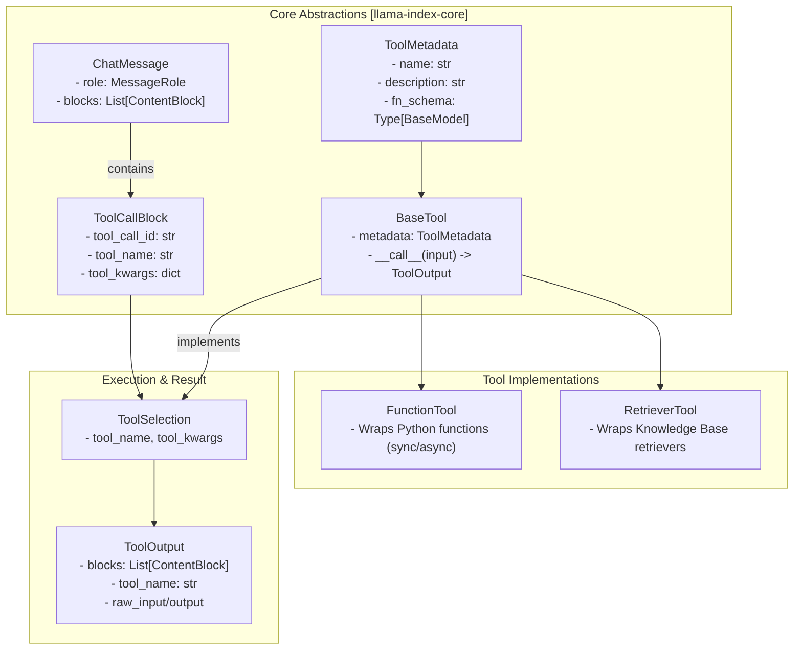
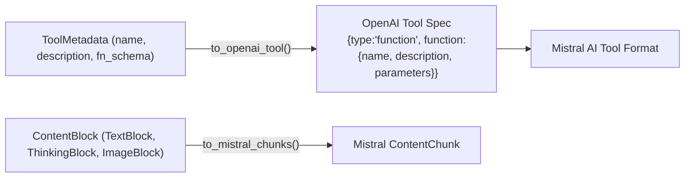
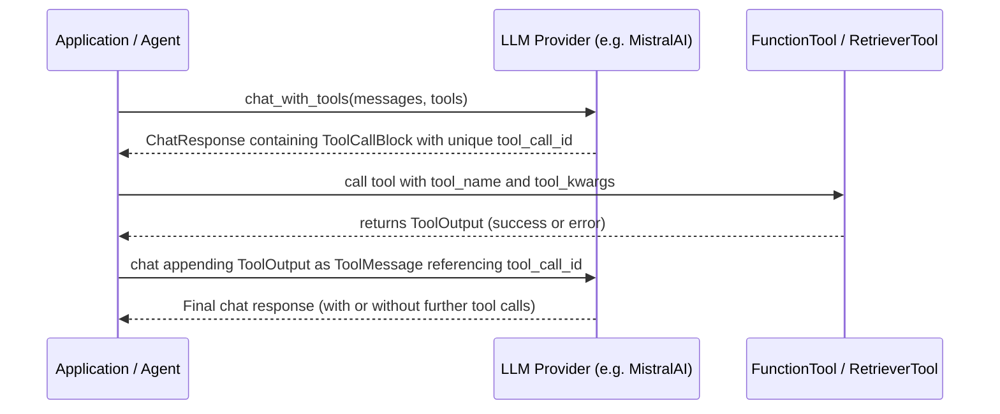
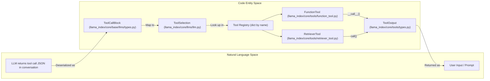
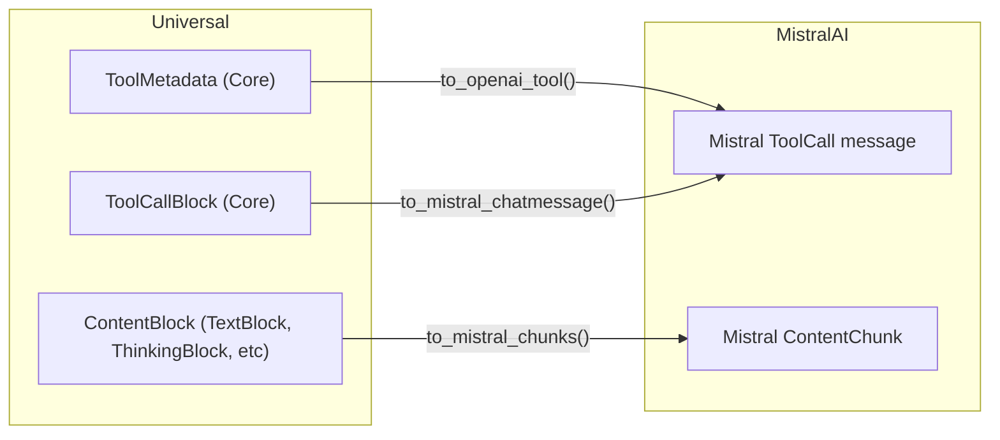

<!-- source: DeepWiki mcp.deepwiki.com · repo run-llama/llama_index · page 6.8 Tool Calling Patterns · fetched 2026-10-26 -->

# Tool Calling Patterns

Relevant source files

The following files were used as context for generating this wiki page:

- [llama-index-core/llama_index/core/llms/function_calling.py](llama-index-core/llama_index/core/llms/function_calling.py)
- [llama-index-core/llama_index/core/llms/llm.py](llama-index-core/llama_index/core/llms/llm.py)
- [llama-index-core/llama_index/core/tools/calling.py](llama-index-core/llama_index/core/tools/calling.py)
- [llama-index-core/llama_index/core/tools/function_tool.py](llama-index-core/llama_index/core/tools/function_tool.py)
- [llama-index-core/llama_index/core/tools/ondemand_loader_tool.py](llama-index-core/llama_index/core/tools/ondemand_loader_tool.py)
- [llama-index-core/llama_index/core/tools/query_engine.py](llama-index-core/llama_index/core/tools/query_engine.py)
- [llama-index-core/llama_index/core/tools/retriever_tool.py](llama-index-core/llama_index/core/tools/retriever_tool.py)
- [llama-index-core/llama_index/core/tools/types.py](llama-index-core/llama_index/core/tools/types.py)
- [llama-index-core/llama_index/core/tools/utils.py](llama-index-core/llama_index/core/tools/utils.py)
- [llama-index-core/tests/llms/test_function_calling.py](llama-index-core/tests/llms/test_function_calling.py)
- [llama-index-core/tests/tools/test_base.py](llama-index-core/tests/tools/test_base.py)
- [llama-index-core/tests/tools/test_calling.py](llama-index-core/tests/tools/test_calling.py)
- [llama-index-core/tests/tools/test_retriever_tool.py](llama-index-core/tests/tools/test_retriever_tool.py)
- [llama-index-core/tests/tools/test_types.py](llama-index-core/tests/tools/test_types.py)
- [llama-index-core/tests/tools/test_utils.py](llama-index-core/tests/tools/test_utils.py)
- [llama-index-integrations/embeddings/llama-index-embeddings-mistralai/llama_index/embeddings/mistralai/base.py](llama-index-integrations/embeddings/llama-index-embeddings-mistralai/llama_index/embeddings/mistralai/base.py)
- [llama-index-integrations/embeddings/llama-index-embeddings-mistralai/pyproject.toml](llama-index-integrations/embeddings/llama-index-embeddings-mistralai/pyproject.toml)
- [llama-index-integrations/embeddings/llama-index-embeddings-mistralai/uv.lock](llama-index-integrations/embeddings/llama-index-embeddings-mistralai/uv.lock)
- [llama-index-integrations/llms/llama-index-llms-mistralai/README.md](llama-index-integrations/llms/llama-index-llms-mistralai/README.md)
- [llama-index-integrations/llms/llama-index-llms-mistralai/llama_index/llms/mistralai/base.py](llama-index-integrations/llms/llama-index-llms-mistralai/llama_index/llms/mistralai/base.py)
- [llama-index-integrations/llms/llama-index-llms-mistralai/llama_index/llms/mistralai/utils.py](llama-index-integrations/llms/llama-index-llms-mistralai/llama_index/llms/mistralai/utils.py)
- [llama-index-integrations/llms/llama-index-llms-mistralai/pyproject.toml](llama-index-integrations/llms/llama-index-llms-mistralai/pyproject.toml)
- [llama-index-integrations/llms/llama-index-llms-mistralai/uv.lock](llama-index-integrations/llms/llama-index-llms-mistralai/uv.lock)

This document describes the tool/function calling patterns in LlamaIndex. It covers the universal content block representation for tool invocations, adaptation to provider-specific schemas, modes for tool usage control, execution flow, and result handling. The goal is to document how tools are defined, called, and the results integrated back into the system across different LLM providers and tool types.

For usage of tools within agents and autonomous task execution, see section 5.1 "Agent Architecture".

---

## Overview

LlamaIndex implements a **unified interface for tool calling** that spans multiple LLM provider integrations, allowing core applications and agents to operate without provider-specific logic. The architecture is composed of two main conceptual layers:

1. **Universal Representation Layer**:  
   - The `ToolCallBlock` content block represents tool call requests in the messaging interface.  
   - `BaseTool` abstractions wrap callable entities (functions, retrievers, or other tools).  
   - `ToolMetadata` defines interface and schema of each tool.  
   These reside in the core llama-index-core library and are provider-agnostic.

2. **Provider Adaptation Layer**:  
   Each LLM integration package implements conversion of universal representations into provider-specific function call schemas and messaging formats. For example, MistralAI-specific mappings translate `ToolCallBlock` and tool metadata into Mistral-compatible message chunks.

This architecture enables an LLM to signal a tool call via a normalized representation, and the application to execute the correct tool by name with well-typed parameters, then feed results back as structured messages.

---
## Universal Tool Representation

### Explanation

- **`ToolCallBlock`**:  
  Represents a tool call request as part of chat messages. Includes a unique `tool_call_id` (for multi-turn tracking and parallel calls), the `tool_name`, and the `tool_kwargs` as dict parameters.  
  [llama_index/core/base/llms/types.py:36]()

- **`ToolMetadata`**:  
  Describes tool identity and interface including the JSON schema for parameters (`fn_schema`), a human-readable `description`, and the `name`. This allows automatic tool function marshalling and validation.  
  [llama_index/core/tools/types.py:24-63]()

- **`BaseTool`**:  
  Abstract base interface that all tools implement. Tools are callable with a typed input, producing a `ToolOutput`.  
  [llama_index/core/tools/types.py:168-177]()

- **`FunctionTool`**:  
  Wraps Python functions (sync or async), extracts the signature, creates parameter schemas automatically, supports callbacks, and handles context injection if required.  
  [llama_index/core/tools/function_tool.py:71-121]()

- **`RetrieverTool`**:  
  Wraps a `BaseRetriever` object to enable queryable retriever behavior as a tool callable.  
  [llama_index/core/tools/retriever_tool.py:26-66]()

- **`ToolSelection`**:  
  Data model holding the actionable subset of the `ToolCallBlock`, used to dispatch the actual call to a tool by name and pass the kwargs as arguments.  
  [llama_index/core/llms/llm.py:70-76]()

- **`ToolOutput`**:  
  Encapsulates the results of tool execution, including the original input, any error flags, and optional content blocks for display or further processing.  
  [llama_index/core/tools/types.py:106-166]()

---

Sources: [llama_index/core/base/llms/types.py:36](), [llama_index/core/tools/types.py:24-77](), [llama_index/core/tools/function_tool.py:71-121](), [llama_index/core/tools/retriever_tool.py:26-66](), [llama_index/core/llms/llm.py:70-76]()

---

## Tool Schema Conversion and Provider Adaptation

Each LLM integration adapts the universal tool and tool call format to its provider-specific schema and request format. This ensures compatibility with differing function calling APIs.

### Example: Mistral AI Integration

- **Conversion of content blocks**: LlamaIndex `ContentBlock` instances (like `TextBlock`, `ThinkingBlock`, `ImageBlock`) are converted to Mistral `ContentChunk` messages.  
  [llama_index/llms/mistralai/base.py:98-137]()

- **Conversion of tool calls**: `ToolCallBlock` → Mistral `ToolCall` and nested `FunctionCall` with name and arguments.  
  [llama_index/llms/mistralai/base.py:140-194]()

- **Export tool metadata as OpenAI-compatible function schema**: The `to_openai_tool()` method in `ToolMetadata` exports the tool description and parameter JSON schema conforming to OpenAI function calling standards, which Mistral also adheres to.  
  [llama_index/core/tools/types.py:89-104]()

---

Sources: [llama_index/llms/mistralai/base.py:98-194](), [llama_index/core/tools/types.py:89-104]()

---

## Tool Choice Modes in LLMs Supporting Function Calling

LlamaIndex supports multiple modes controlling how the LLM interacts with tools via the `FunctionCallingLLM` interface [llama_index/core/llms/function_calling.py:24-187]():

| Mode | Description | Implementation Detail |
| :--- | :---------- | :-------------------- |
| `"auto"` (default) | LLM decides dynamically whether to call tools | Controlled in `chat_with_tools()` and variants. |
| `"required"` | LLM must use tools at least once; it cannot produce a plain response | Enabled by setting `tool_required=True` in calls. |
| `"none"` | No tools available; LLM responds without calling any tools | Passing empty tool list or disabling tools. |

This flexibility lets developers tune agents' behavior based on tool availability and interaction protocols.

Sources: [llama_index/core/llms/function_calling.py:35-60](), [llama_index/llms/mistralai/base.py:208]()

---

## Tool Call and Result Handling Flow

### Details:

1. The App or Agent sends a chat request to the LLM with user messages and a list of available tools.

2. The LLM responds with a `ChatResponse` that may include a `ToolCallBlock` indicating the intent to call a tool, including parameters and a unique `tool_call_id`.

3. The app executes the tool indicated by `tool_name`, passing the received `tool_kwargs`.

4. Tool execution produces a `ToolOutput` which includes any returned content or error details.

5. The App sends a continuation chat to the LLM that includes a special `ToolMessage` embedding the `ToolOutput` and referencing the original `tool_call_id` to associate the result.

6. The LLM integrates tool results and responds with human-like output or further tool calls.

---

Sources: [llama_index/core/llms/function_calling.py:35-61](), [llama_index/core/tools/calling.py:27-86](), [llama_index/core/tools/function_tool.py:71-121]()

---

## Tool Execution and Calling Utilities

### FunctionTool: Sync and Async Execution

- `FunctionTool` can wrap synchronous or asynchronous Python functions. It introspects the function signature to generate parameter schemas and enables context injection if needed.  
- It supports sync/async callbacks which can alter the output or content before returning.  
- The tool call may accept arguments as positional or keyword with schema validation.  
- Conversion utilities exist for LangChain tool compatibility.  
  [llama_index/core/tools/function_tool.py:71-150]()

### Retrievers as Tools

- `RetrieverTool` wraps any `BaseRetriever`, enabling a natural language query string to be passed and a set of relevant nodes retrieved and postprocessed.  
- The retrieved nodes' text is concatenated into tool output content that can be returned as a tool result.  
  [llama_index/core/tools/retriever_tool.py:26-124]()

### Calling Helpers

- `call_tool(tool, arguments)`: Calls a tool with the given arguments dict, trying either kwargs or single argument form depending on schema. Returns a `ToolOutput` capturing success or exceptions.  
- `acall_tool(...)`: Async variant of the same.  
- `call_tool_with_selection(tool_call: ToolSelection, tools)`: Looks up the tool by name and calls it with appropriate args.  
- `acall_tool_with_selection(...)`: Async variant.  
  [llama_index/core/tools/calling.py:13-131]()

---

Sources:  
[llama_index/core/tools/function_tool.py:71-150](),  
[llama_index/core/tools/retriever_tool.py:26-124](),  
[llama_index/core/tools/calling.py:13-131]()

---

# Summary Table of Key Classes and Functions

| Class/Function | Purpose | Location |
| - | - | - |
| `ToolCallBlock` | Canonical representation of tool call in chat messages | `llama_index/core/base/llms/types.py:36` |
| `ToolMetadata` | Holds tool name, description, parameter schema | `llama_index/core/tools/types.py:24-63` |
| `BaseTool` | Abstract tool interface for calling and metadata | `llama_index/core/tools/types.py:168-177` |
| `FunctionTool` | Wraps Python functions, sync or async, as tools | `llama_index/core/tools/function_tool.py:71-150` |
| `RetrieverTool` | Wraps retrievers so they can be called as tools | `llama_index/core/tools/retriever_tool.py:26-124` |
| `create_schema_from_function()` | Generates pydantic schemas automatically from Python functions | `llama_index/core/tools/utils.py:22-133` |
| `FunctionCallingLLM` | Interface for LLMs supporting tool/function calling natively | `llama_index/core/llms/function_calling.py:24-187` |
| `call_tool() / acall_tool()` | Helper functions to safely call tools with dict arguments | `llama_index/core/tools/calling.py:13-86` |

---

# Diagrams Bridging Natural Language Space to Code Entity Space

### Diagram 1: From Natural Language Tool Call to Code Executable

### Diagram 2: Mapping Tool and ToolCallBlock to Provider API Formats (Mistral AI example)

---

# Concluding Notes

This structured approach to tool calling enables:

- Clean separation between the representation of tool calls and their provider-specific adaptations.
- Simplified development of new LLM provider integrations by mapping existing universal types.
- Support for synchronous and asynchronous tools backed by Python functions or retrievers.
- Controlled behavior of LLMs when and how to call tools, including forced tool usage or disabling.
- Transparent error handling with detailed tool outputs capturing exceptions.

For deeper details on agent workflow integration and memory management involving tools, see section 5 "Agent System".

---

# Sources

- [llama_index/core/base/llms/types.py:36-36]()
- [llama_index/core/tools/types.py:24-77]()
- [llama_index/core/tools/function_tool.py:71-150]()
- [llama_index/core/tools/retriever_tool.py:26-124]()
- [llama_index/core/tools/calling.py:13-131]()
- [llama_index/core/tools/utils.py:22-133]()
- [llama_index/core/llms/llm.py:70-76]()
- [llama_index/core/llms/function_calling.py:24-187]()
- [llama_index/llms/mistralai/base.py:98-194]()

---

