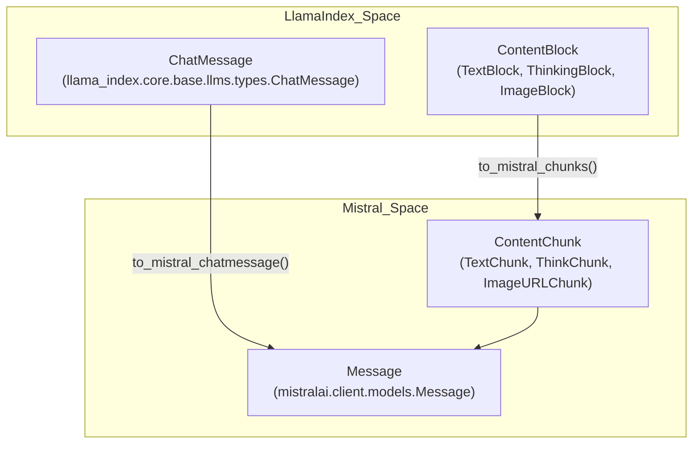
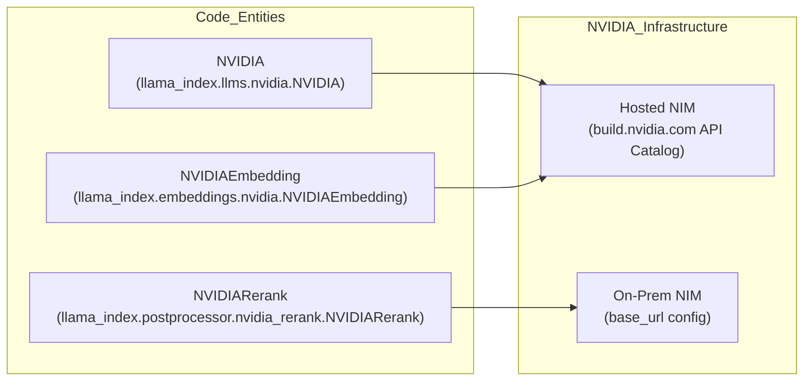
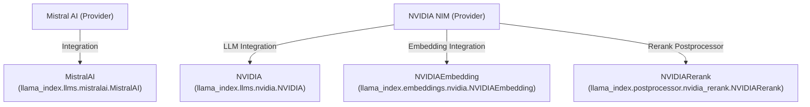
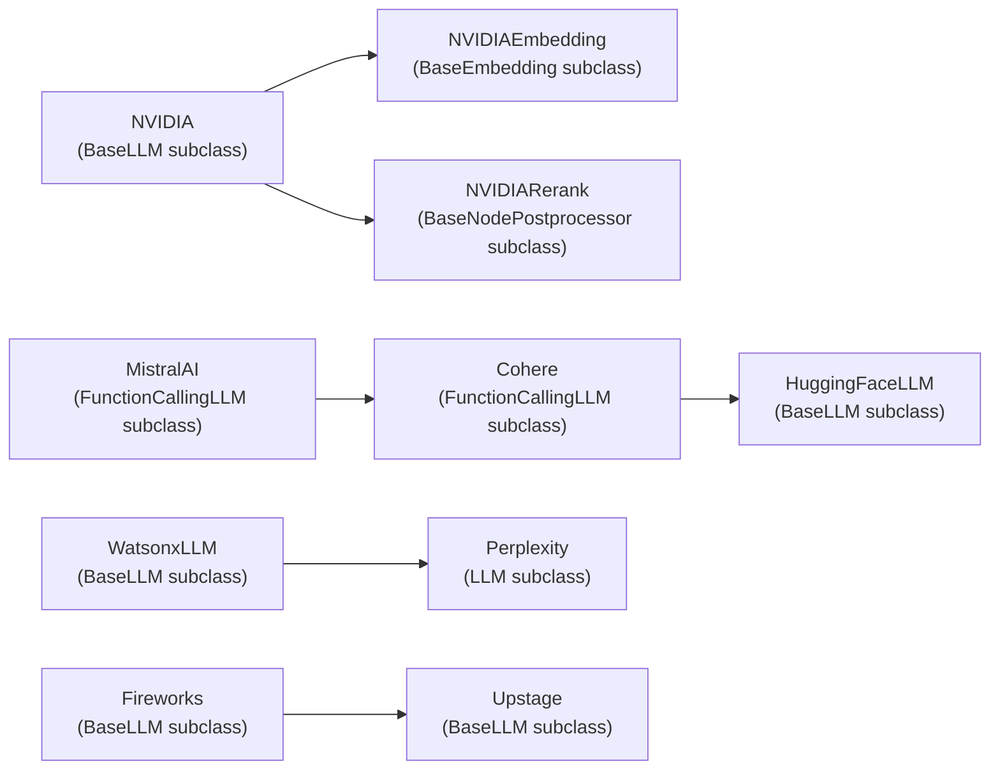

<!-- source: DeepWiki mcp.deepwiki.com · repo run-llama/llama_index · page 6.9 Additional LLM Integrations · fetched 2026-10-26 -->

# Additional LLM Integrations

Relevant source files

The following files were used as context for generating this wiki page:

- [docs/examples/embeddings/fireworks.ipynb](docs/examples/embeddings/fireworks.ipynb)
- [docs/examples/llm/fireworks.ipynb](docs/examples/llm/fireworks.ipynb)
- [docs/examples/llm/fireworks_cookbook.ipynb](docs/examples/llm/fireworks_cookbook.ipynb)
- [docs/examples/retrievers/you_retriever.ipynb](docs/examples/retrievers/you_retriever.ipynb)
- [llama-index-core/llama_index/core/prompts/default_prompt_selectors.py](llama-index-core/llama_index/core/prompts/default_prompt_selectors.py)
- [llama-index-integrations/embeddings/llama-index-embeddings-fireworks/.gitignore](llama-index-integrations/embeddings/llama-index-embeddings-fireworks/.gitignore)
- [llama-index-integrations/embeddings/llama-index-embeddings-fireworks/Makefile](llama-index-integrations/embeddings/llama-index-embeddings-fireworks/Makefile)
- [llama-index-integrations/embeddings/llama-index-embeddings-fireworks/llama_index/embeddings/fireworks/__init__.py](llama-index-integrations/embeddings/llama-index-embeddings-fireworks/llama_index/embeddings/fireworks/__init__.py)
- [llama-index-integrations/embeddings/llama-index-embeddings-ibm/README.md](llama-index-integrations/embeddings/llama-index-embeddings-ibm/README.md)
- [llama-index-integrations/embeddings/llama-index-embeddings-ibm/llama_index/embeddings/ibm/base.py](llama-index-integrations/embeddings/llama-index-embeddings-ibm/llama_index/embeddings/ibm/base.py)
- [llama-index-integrations/embeddings/llama-index-embeddings-ibm/llama_index/embeddings/ibm/utils.py](llama-index-integrations/embeddings/llama-index-embeddings-ibm/llama_index/embeddings/ibm/utils.py)
- [llama-index-integrations/embeddings/llama-index-embeddings-ibm/pyproject.toml](llama-index-integrations/embeddings/llama-index-embeddings-ibm/pyproject.toml)
- [llama-index-integrations/embeddings/llama-index-embeddings-ibm/tests/test_ibm.py](llama-index-integrations/embeddings/llama-index-embeddings-ibm/tests/test_ibm.py)
- [llama-index-integrations/embeddings/llama-index-embeddings-nvidia/llama_index/embeddings/nvidia/base.py](llama-index-integrations/embeddings/llama-index-embeddings-nvidia/llama_index/embeddings/nvidia/base.py)
- [llama-index-integrations/embeddings/llama-index-embeddings-nvidia/pyproject.toml](llama-index-integrations/embeddings/llama-index-embeddings-nvidia/pyproject.toml)
- [llama-index-integrations/embeddings/llama-index-embeddings-nvidia/tests/conftest.py](llama-index-integrations/embeddings/llama-index-embeddings-nvidia/tests/conftest.py)
- [llama-index-integrations/embeddings/llama-index-embeddings-nvidia/tests/test_api_key.py](llama-index-integrations/embeddings/llama-index-embeddings-nvidia/tests/test_api_key.py)
- [llama-index-integrations/embeddings/llama-index-embeddings-nvidia/tests/test_available_models.py](llama-index-integrations/embeddings/llama-index-embeddings-nvidia/tests/test_available_models.py)
- [llama-index-integrations/embeddings/llama-index-embeddings-nvidia/tests/test_base_url.py](llama-index-integrations/embeddings/llama-index-embeddings-nvidia/tests/test_base_url.py)
- [llama-index-integrations/embeddings/llama-index-embeddings-nvidia/tests/test_embeddings_nvidia.py](llama-index-integrations/embeddings/llama-index-embeddings-nvidia/tests/test_embeddings_nvidia.py)
- [llama-index-integrations/embeddings/llama-index-embeddings-nvidia/tests/test_integration.py](llama-index-integrations/embeddings/llama-index-embeddings-nvidia/tests/test_integration.py)
- [llama-index-integrations/embeddings/llama-index-embeddings-nvidia/tests/test_truncate.py](llama-index-integrations/embeddings/llama-index-embeddings-nvidia/tests/test_truncate.py)
- [llama-index-integrations/embeddings/llama-index-embeddings-nvidia/uv.lock](llama-index-integrations/embeddings/llama-index-embeddings-nvidia/uv.lock)
- [llama-index-integrations/embeddings/llama-index-embeddings-oci-genai/.gitignore](llama-index-integrations/embeddings/llama-index-embeddings-oci-genai/.gitignore)
- [llama-index-integrations/embeddings/llama-index-embeddings-oci-genai/Makefile](llama-index-integrations/embeddings/llama-index-embeddings-oci-genai/Makefile)
- [llama-index-integrations/embeddings/llama-index-embeddings-oci-genai/README.md](llama-index-integrations/embeddings/llama-index-embeddings-oci-genai/README.md)
- [llama-index-integrations/embeddings/llama-index-embeddings-oci-genai/llama_index/embeddings/oci_genai/__init__.py](llama-index-integrations/embeddings/llama-index-embeddings-oci-genai/llama_index/embeddings/oci_genai/__init__.py)
- [llama-index-integrations/embeddings/llama-index-embeddings-oci-genai/llama_index/embeddings/oci_genai/base.py](llama-index-integrations/embeddings/llama-index-embeddings-oci-genai/llama_index/embeddings/oci_genai/base.py)
- [llama-index-integrations/embeddings/llama-index-embeddings-oci-genai/pyproject.toml](llama-index-integrations/embeddings/llama-index-embeddings-oci-genai/pyproject.toml)
- [llama-index-integrations/embeddings/llama-index-embeddings-oci-genai/uv.lock](llama-index-integrations/embeddings/llama-index-embeddings-oci-genai/uv.lock)
- [llama-index-integrations/embeddings/llama-index-embeddings-upstage/llama_index/embeddings/upstage/base.py](llama-index-integrations/embeddings/llama-index-embeddings-upstage/llama_index/embeddings/upstage/base.py)
- [llama-index-integrations/embeddings/llama-index-embeddings-upstage/pyproject.toml](llama-index-integrations/embeddings/llama-index-embeddings-upstage/pyproject.toml)
- [llama-index-integrations/embeddings/llama-index-embeddings-upstage/tests/integration_tests/test_integrations.py](llama-index-integrations/embeddings/llama-index-embeddings-upstage/tests/integration_tests/test_integrations.py)
- [llama-index-integrations/embeddings/llama-index-embeddings-upstage/tests/unit_tests/test_embeddings_upstage.py](llama-index-integrations/embeddings/llama-index-embeddings-upstage/tests/unit_tests/test_embeddings_upstage.py)
- [llama-index-integrations/llms/llama-index-llms-cohere/README.md](llama-index-integrations/llms/llama-index-llms-cohere/README.md)
- [llama-index-integrations/llms/llama-index-llms-cohere/llama_index/llms/cohere/__init__.py](llama-index-integrations/llms/llama-index-llms-cohere/llama_index/llms/cohere/__init__.py)
- [llama-index-integrations/llms/llama-index-llms-cohere/llama_index/llms/cohere/base.py](llama-index-integrations/llms/llama-index-llms-cohere/llama_index/llms/cohere/base.py)
- [llama-index-integrations/llms/llama-index-llms-cohere/llama_index/llms/cohere/utils.py](llama-index-integrations/llms/llama-index-llms-cohere/llama_index/llms/cohere/utils.py)
- [llama-index-integrations/llms/llama-index-llms-cohere/pyproject.toml](llama-index-integrations/llms/llama-index-llms-cohere/pyproject.toml)
- [llama-index-integrations/llms/llama-index-llms-cohere/tests/test_llms_cohere.py](llama-index-integrations/llms/llama-index-llms-cohere/tests/test_llms_cohere.py)
- [llama-index-integrations/llms/llama-index-llms-cohere/tests/test_rag_inference.py](llama-index-integrations/llms/llama-index-llms-cohere/tests/test_rag_inference.py)
- [llama-index-integrations/llms/llama-index-llms-cohere/uv.lock](llama-index-integrations/llms/llama-index-llms-cohere/uv.lock)
- [llama-index-integrations/llms/llama-index-llms-dashscope/llama_index/llms/dashscope/base.py](llama-index-integrations/llms/llama-index-llms-dashscope/llama_index/llms/dashscope/base.py)
- [llama-index-integrations/llms/llama-index-llms-dashscope/llama_index/llms/dashscope/utils.py](llama-index-integrations/llms/llama-index-llms-dashscope/llama_index/llms/dashscope/utils.py)
- [llama-index-integrations/llms/llama-index-llms-dashscope/pyproject.toml](llama-index-integrations/llms/llama-index-llms-dashscope/pyproject.toml)
- [llama-index-integrations/llms/llama-index-llms-dashscope/tests/test_dashscope.py](llama-index-integrations/llms/llama-index-llms-dashscope/tests/test_dashscope.py)
- [llama-index-integrations/llms/llama-index-llms-dashscope/uv.lock](llama-index-integrations/llms/llama-index-llms-dashscope/uv.lock)
- [llama-index-integrations/llms/llama-index-llms-fireworks/README.md](llama-index-integrations/llms/llama-index-llms-fireworks/README.md)
- [llama-index-integrations/llms/llama-index-llms-fireworks/llama_index/llms/fireworks/base.py](llama-index-integrations/llms/llama-index-llms-fireworks/llama_index/llms/fireworks/base.py)
- [llama-index-integrations/llms/llama-index-llms-fireworks/llama_index/llms/fireworks/utils.py](llama-index-integrations/llms/llama-index-llms-fireworks/llama_index/llms/fireworks/utils.py)
- [llama-index-integrations/llms/llama-index-llms-fireworks/pyproject.toml](llama-index-integrations/llms/llama-index-llms-fireworks/pyproject.toml)
- [llama-index-integrations/llms/llama-index-llms-gaudi/pyproject.toml](llama-index-integrations/llms/llama-index-llms-gaudi/pyproject.toml)
- [llama-index-integrations/llms/llama-index-llms-huggingface/llama_index/llms/huggingface/__init__.py](llama-index-integrations/llms/llama-index-llms-huggingface/llama_index/llms/huggingface/__init__.py)
- [llama-index-integrations/llms/llama-index-llms-huggingface/llama_index/llms/huggingface/base.py](llama-index-integrations/llms/llama-index-llms-huggingface/llama_index/llms/huggingface/base.py)
- [llama-index-integrations/llms/llama-index-llms-huggingface/llama_index/llms/huggingface/utils.py](llama-index-integrations/llms/llama-index-llms-huggingface/llama_index/llms/huggingface/utils.py)
- [llama-index-integrations/llms/llama-index-llms-huggingface/pyproject.toml](llama-index-integrations/llms/llama-index-llms-huggingface/pyproject.toml)
- [llama-index-integrations/llms/llama-index-llms-huggingface/tests/test_llms_huggingface.py](llama-index-integrations/llms/llama-index-llms-huggingface/tests/test_llms_huggingface.py)
- [llama-index-integrations/llms/llama-index-llms-ibm/README.md](llama-index-integrations/llms/llama-index-llms-ibm/README.md)
- [llama-index-integrations/llms/llama-index-llms-ibm/llama_index/llms/ibm/base.py](llama-index-integrations/llms/llama-index-llms-ibm/llama_index/llms/ibm/base.py)
- [llama-index-integrations/llms/llama-index-llms-ibm/llama_index/llms/ibm/utils.py](llama-index-integrations/llms/llama-index-llms-ibm/llama_index/llms/ibm/utils.py)
- [llama-index-integrations/llms/llama-index-llms-ibm/pyproject.toml](llama-index-integrations/llms/llama-index-llms-ibm/pyproject.toml)
- [llama-index-integrations/llms/llama-index-llms-ibm/tests/test_ibm.py](llama-index-integrations/llms/llama-index-llms-ibm/tests/test_ibm.py)
- [llama-index-integrations/llms/llama-index-llms-ibm/uv.lock](llama-index-integrations/llms/llama-index-llms-ibm/uv.lock)
- [llama-index-integrations/llms/llama-index-llms-konko/pyproject.toml](llama-index-integrations/llms/llama-index-llms-konko/pyproject.toml)
- [llama-index-integrations/llms/llama-index-llms-langchain/llama_index/llms/langchain/base.py](llama-index-integrations/llms/llama-index-llms-langchain/llama_index/llms/langchain/base.py)
- [llama-index-integrations/llms/llama-index-llms-langchain/pyproject.toml](llama-index-integrations/llms/llama-index-llms-langchain/pyproject.toml)
- [llama-index-integrations/llms/llama-index-llms-litellm/llama_index/llms/litellm/base.py](llama-index-integrations/llms/llama-index-llms-litellm/llama_index/llms/litellm/base.py)
- [llama-index-integrations/llms/llama-index-llms-litellm/llama_index/llms/litellm/utils.py](llama-index-integrations/llms/llama-index-llms-litellm/llama_index/llms/litellm/utils.py)
- [llama-index-integrations/llms/llama-index-llms-litellm/pyproject.toml](llama-index-integrations/llms/llama-index-llms-litellm/pyproject.toml)
- [llama-index-integrations/llms/llama-index-llms-litellm/tests/conftest.py](llama-index-integrations/llms/llama-index-llms-litellm/tests/conftest.py)
- [llama-index-integrations/llms/llama-index-llms-litellm/tests/test_llms_litellm.py](llama-index-integrations/llms/llama-index-llms-litellm/tests/test_llms_litellm.py)
- [llama-index-integrations/llms/llama-index-llms-litellm/tests/test_utils.py](llama-index-integrations/llms/llama-index-llms-litellm/tests/test_utils.py)
- [llama-index-integrations/llms/llama-index-llms-litellm/uv.lock](llama-index-integrations/llms/llama-index-llms-litellm/uv.lock)
- [llama-index-integrations/llms/llama-index-llms-llamafile/pyproject.toml](llama-index-integrations/llms/llama-index-llms-llamafile/pyproject.toml)
- [llama-index-integrations/llms/llama-index-llms-nvidia/llama_index/llms/nvidia/base.py](llama-index-integrations/llms/llama-index-llms-nvidia/llama_index/llms/nvidia/base.py)
- [llama-index-integrations/llms/llama-index-llms-nvidia/llama_index/llms/nvidia/utils.py](llama-index-integrations/llms/llama-index-llms-nvidia/llama_index/llms/nvidia/utils.py)
- [llama-index-integrations/llms/llama-index-llms-nvidia/pyproject.toml](llama-index-integrations/llms/llama-index-llms-nvidia/pyproject.toml)
- [llama-index-integrations/llms/llama-index-llms-nvidia/tests/test_base_url.py](llama-index-integrations/llms/llama-index-llms-nvidia/tests/test_base_url.py)
- [llama-index-integrations/llms/llama-index-llms-nvidia/tests/test_mode_switch.py](llama-index-integrations/llms/llama-index-llms-nvidia/tests/test_mode_switch.py)
- [llama-index-integrations/llms/llama-index-llms-nvidia/tests/test_nvidia.py](llama-index-integrations/llms/llama-index-llms-nvidia/tests/test_nvidia.py)
- [llama-index-integrations/llms/llama-index-llms-nvidia/tests/test_text-completion.py](llama-index-integrations/llms/llama-index-llms-nvidia/tests/test_text-completion.py)
- [llama-index-integrations/llms/llama-index-llms-oci-genai/llama_index/llms/oci_genai/base.py](llama-index-integrations/llms/llama-index-llms-oci-genai/llama_index/llms/oci_genai/base.py)
- [llama-index-integrations/llms/llama-index-llms-oci-genai/llama_index/llms/oci_genai/utils.py](llama-index-integrations/llms/llama-index-llms-oci-genai/llama_index/llms/oci_genai/utils.py)
- [llama-index-integrations/llms/llama-index-llms-oci-genai/pyproject.toml](llama-index-integrations/llms/llama-index-llms-oci-genai/pyproject.toml)
- [llama-index-integrations/llms/llama-index-llms-oci-genai/tests/test_llms_oci_genai.py](llama-index-integrations/llms/llama-index-llms-oci-genai/tests/test_llms_oci_genai.py)
- [llama-index-integrations/llms/llama-index-llms-oci-genai/tests/test_oci_genai.py](llama-index-integrations/llms/llama-index-llms-oci-genai/tests/test_oci_genai.py)
- [llama-index-integrations/llms/llama-index-llms-oci-genai/uv.lock](llama-index-integrations/llms/llama-index-llms-oci-genai/uv.lock)
- [llama-index-integrations/llms/llama-index-llms-openai-like/tests/test_openai_like.py](llama-index-integrations/llms/llama-index-llms-openai-like/tests/test_openai_like.py)
- [llama-index-integrations/llms/llama-index-llms-openvino/.gitignore](llama-index-integrations/llms/llama-index-llms-openvino/.gitignore)
- [llama-index-integrations/llms/llama-index-llms-openvino/Makefile](llama-index-integrations/llms/llama-index-llms-openvino/Makefile)
- [llama-index-integrations/llms/llama-index-llms-openvino/README.md](llama-index-integrations/llms/llama-index-llms-openvino/README.md)
- [llama-index-integrations/llms/llama-index-llms-openvino/llama_index/llms/openvino/__init__.py](llama-index-integrations/llms/llama-index-llms-openvino/llama_index/llms/openvino/__init__.py)
- [llama-index-integrations/llms/llama-index-llms-openvino/pyproject.toml](llama-index-integrations/llms/llama-index-llms-openvino/pyproject.toml)
- [llama-index-integrations/llms/llama-index-llms-ovhcloud/pyproject.toml](llama-index-integrations/llms/llama-index-llms-ovhcloud/pyproject.toml)
- [llama-index-integrations/llms/llama-index-llms-perplexity/README.md](llama-index-integrations/llms/llama-index-llms-perplexity/README.md)
- [llama-index-integrations/llms/llama-index-llms-perplexity/llama_index/llms/perplexity/base.py](llama-index-integrations/llms/llama-index-llms-perplexity/llama_index/llms/perplexity/base.py)
- [llama-index-integrations/llms/llama-index-llms-perplexity/pyproject.toml](llama-index-integrations/llms/llama-index-llms-perplexity/pyproject.toml)
- [llama-index-integrations/llms/llama-index-llms-perplexity/tests/test_perplexity.py](llama-index-integrations/llms/llama-index-llms-perplexity/tests/test_perplexity.py)
- [llama-index-integrations/llms/llama-index-llms-perplexity/uv.lock](llama-index-integrations/llms/llama-index-llms-perplexity/uv.lock)
- [llama-index-integrations/llms/llama-index-llms-portkey/pyproject.toml](llama-index-integrations/llms/llama-index-llms-portkey/pyproject.toml)
- [llama-index-integrations/llms/llama-index-llms-upstage/llama_index/llms/upstage/base.py](llama-index-integrations/llms/llama-index-llms-upstage/llama_index/llms/upstage/base.py)
- [llama-index-integrations/llms/llama-index-llms-upstage/llama_index/llms/upstage/utils.py](llama-index-integrations/llms/llama-index-llms-upstage/llama_index/llms/upstage/utils.py)
- [llama-index-integrations/llms/llama-index-llms-upstage/pyproject.toml](llama-index-integrations/llms/llama-index-llms-upstage/pyproject.toml)
- [llama-index-integrations/llms/llama-index-llms-upstage/tests/test_llms_upstage.py](llama-index-integrations/llms/llama-index-llms-upstage/tests/test_llms_upstage.py)
- [llama-index-integrations/llms/llama-index-llms-upstage/tests/test_upstage.py](llama-index-integrations/llms/llama-index-llms-upstage/tests/test_upstage.py)
- [llama-index-integrations/llms/llama-index-llms-yi/.gitignore](llama-index-integrations/llms/llama-index-llms-yi/.gitignore)
- [llama-index-integrations/llms/llama-index-llms-yi/Makefile](llama-index-integrations/llms/llama-index-llms-yi/Makefile)
- [llama-index-integrations/llms/llama-index-llms-yi/README.md](llama-index-integrations/llms/llama-index-llms-yi/README.md)
- [llama-index-integrations/llms/llama-index-llms-yi/llama_index/llms/yi/__init__.py](llama-index-integrations/llms/llama-index-llms-yi/llama_index/llms/yi/__init__.py)
- [llama-index-integrations/llms/llama-index-llms-yi/llama_index/llms/yi/base.py](llama-index-integrations/llms/llama-index-llms-yi/llama_index/llms/yi/base.py)
- [llama-index-integrations/llms/llama-index-llms-yi/pyproject.toml](llama-index-integrations/llms/llama-index-llms-yi/pyproject.toml)
- [llama-index-integrations/llms/llama-index-llms-yi/tests/__init__.py](llama-index-integrations/llms/llama-index-llms-yi/tests/__init__.py)
- [llama-index-integrations/postprocessor/llama-index-postprocessor-ibm/llama_index/postprocessor/ibm/base.py](llama-index-integrations/postprocessor/llama-index-postprocessor-ibm/llama_index/postprocessor/ibm/base.py)
- [llama-index-integrations/postprocessor/llama-index-postprocessor-ibm/llama_index/postprocessor/ibm/utils.py](llama-index-integrations/postprocessor/llama-index-postprocessor-ibm/llama_index/postprocessor/ibm/utils.py)
- [llama-index-integrations/postprocessor/llama-index-postprocessor-ibm/pyproject.toml](llama-index-integrations/postprocessor/llama-index-postprocessor-ibm/pyproject.toml)
- [llama-index-integrations/postprocessor/llama-index-postprocessor-ibm/tests/test_ibm.py](llama-index-integrations/postprocessor/llama-index-postprocessor-ibm/tests/test_ibm.py)
- [llama-index-integrations/postprocessor/llama-index-postprocessor-nvidia-rerank/README.md](llama-index-integrations/postprocessor/llama-index-postprocessor-nvidia-rerank/README.md)
- [llama-index-integrations/postprocessor/llama-index-postprocessor-nvidia-rerank/llama_index/postprocessor/nvidia_rerank/base.py](llama-index-integrations/postprocessor/llama-index-postprocessor-nvidia-rerank/llama_index/postprocessor/nvidia_rerank/base.py)
- [llama-index-integrations/postprocessor/llama-index-postprocessor-nvidia-rerank/pyproject.toml](llama-index-integrations/postprocessor/llama-index-postprocessor-nvidia-rerank/pyproject.toml)
- [llama-index-integrations/postprocessor/llama-index-postprocessor-nvidia-rerank/tests/conftest.py](llama-index-integrations/postprocessor/llama-index-postprocessor-nvidia-rerank/tests/conftest.py)
- [llama-index-integrations/postprocessor/llama-index-postprocessor-nvidia-rerank/tests/test_api_key.py](llama-index-integrations/postprocessor/llama-index-postprocessor-nvidia-rerank/tests/test_api_key.py)
- [llama-index-integrations/postprocessor/llama-index-postprocessor-nvidia-rerank/tests/test_available_models.py](llama-index-integrations/postprocessor/llama-index-postprocessor-nvidia-rerank/tests/test_available_models.py)
- [llama-index-integrations/postprocessor/llama-index-postprocessor-nvidia-rerank/tests/test_base_url.py](llama-index-integrations/postprocessor/llama-index-postprocessor-nvidia-rerank/tests/test_base_url.py)
- [llama-index-integrations/postprocessor/llama-index-postprocessor-nvidia-rerank/tests/test_postprocessor_nvidia_rerank.py](llama-index-integrations/postprocessor/llama-index-postprocessor-nvidia-rerank/tests/test_postprocessor_nvidia_rerank.py)
- [llama-index-integrations/postprocessor/llama-index-postprocessor-nvidia-rerank/tests/test_truncate.py](llama-index-integrations/postprocessor/llama-index-postprocessor-nvidia-rerank/tests/test_truncate.py)
- [llama-index-integrations/postprocessor/llama-index-postprocessor-nvidia-rerank/uv.lock](llama-index-integrations/postprocessor/llama-index-postprocessor-nvidia-rerank/uv.lock)
- [llama-index-integrations/readers/llama-index-readers-patentsview/README.md](llama-index-integrations/readers/llama-index-readers-patentsview/README.md)
- [llama-index-integrations/readers/llama-index-readers-patentsview/llama_index/readers/patentsview/base.py](llama-index-integrations/readers/llama-index-readers-patentsview/llama_index/readers/patentsview/base.py)
- [llama-index-integrations/readers/llama-index-readers-patentsview/pyproject.toml](llama-index-integrations/readers/llama-index-readers-patentsview/pyproject.toml)
- [llama-index-integrations/readers/llama-index-readers-patentsview/tests/test_readers_patentsview.py](llama-index-integrations/readers/llama-index-readers-patentsview/tests/test_readers_patentsview.py)
- [llama-index-integrations/readers/llama-index-readers-patentsview/uv.lock](llama-index-integrations/readers/llama-index-readers-patentsview/uv.lock)
- [llama-index-integrations/readers/llama-index-readers-upstage/README.md](llama-index-integrations/readers/llama-index-readers-upstage/README.md)
- [llama-index-integrations/readers/llama-index-readers-upstage/examples/UpstageDocumentParseReader.ipynb](llama-index-integrations/readers/llama-index-readers-upstage/examples/UpstageDocumentParseReader.ipynb)
- [llama-index-integrations/readers/llama-index-readers-upstage/examples/UpstageLayoutAnalysisReader.ipynb](llama-index-integrations/readers/llama-index-readers-upstage/examples/UpstageLayoutAnalysisReader.ipynb)
- [llama-index-integrations/readers/llama-index-readers-upstage/llama_index/readers/upstage/__init__.py](llama-index-integrations/readers/llama-index-readers-upstage/llama_index/readers/upstage/__init__.py)
- [llama-index-integrations/readers/llama-index-readers-upstage/llama_index/readers/upstage/document_parse.py](llama-index-integrations/readers/llama-index-readers-upstage/llama_index/readers/upstage/document_parse.py)
- [llama-index-integrations/readers/llama-index-readers-upstage/pyproject.toml](llama-index-integrations/readers/llama-index-readers-upstage/pyproject.toml)
- [llama-index-integrations/readers/llama-index-readers-upstage/tests/test_readers_upstage.py](llama-index-integrations/readers/llama-index-readers-upstage/tests/test_readers_upstage.py)
- [llama-index-integrations/retrievers/llama-index-retrievers-you/README.md](llama-index-integrations/retrievers/llama-index-retrievers-you/README.md)
- [llama-index-integrations/retrievers/llama-index-retrievers-you/llama_index/retrievers/you/base.py](llama-index-integrations/retrievers/llama-index-retrievers-you/llama_index/retrievers/you/base.py)
- [llama-index-integrations/retrievers/llama-index-retrievers-you/pyproject.toml](llama-index-integrations/retrievers/llama-index-retrievers-you/pyproject.toml)
- [llama-index-integrations/retrievers/llama-index-retrievers-you/tests/test_retrievers_you_retriever.py](llama-index-integrations/retrievers/llama-index-retrievers-you/tests/test_retrievers_you_retriever.py)
- [llama-index-integrations/retrievers/llama-index-retrievers-you/uv.lock](llama-index-integrations/retrievers/llama-index-retrievers-you/uv.lock)
- [llama-index-integrations/vector_stores/llama-index-vector-stores-oceanbase/uv.lock](llama-index-integrations/vector_stores/llama-index-vector-stores-oceanbase/uv.lock)

This page documents the integration of various Large Language Model (LLM) providers within the LlamaIndex ecosystem. These integrations extend the core abstractions of `BaseLLM` and `FunctionCallingLLM` [llama-index-core/llama_index/core/llms/llm.py:163]() [llama-index-core/llama_index/core/llms/function_calling.py:17]() to support diverse model capabilities, including reasoning, function calling, and multimodal inputs.

---

## Mistral AI

The Mistral AI integration is packaged as `llama-index-llms-mistralai` [llama-index-integrations/llms/llama-index-llms-mistralai/pyproject.toml:28-38](). It implements the `MistralAI` class, inheriting from `FunctionCallingLLM` to support advanced features such as reasoning and function calling [llama-index-integrations/llms/llama-index-llms-mistralai/llama_index/llms/mistralai/base.py:208]().

### Implementation Details

- Mistral messages conversion involves mapping LlamaIndex `ChatMessage` and content blocks to Mistral-specific message chunks. The helper function `to_mistral_chunks` converts blocks like `TextBlock`, `ThinkingBlock`, and `ImageBlock` to appropriate chunk types [llama-index-integrations/llms/llama-index-llms-mistralai/llama_index/llms/mistralai/base.py:98-137]().
- Reasoning models are identified explicitly (e.g., `"magistral-medium-2506"`) allowing the integration to adjust behavior accordingly [llama-index-integrations/llms/llama-index-llms-mistralai/llama_index/llms/mistralai/utils.py:64-69]().
- Thinking blocks are supported through regex extraction of content enclosed in `<think>` tags [llama-index-integrations/llms/llama-index-llms-mistralai/llama_index/llms/mistralai/utils.py:73-74]().
- Function calling is automatically enabled for models that support it, detected via `is_mistralai_function_calling_model` [llama-index-integrations/llms/llama-index-llms-mistralai/llama_index/llms/mistralai/utils.py:91-92]().

### Data Flow: Mistral Message Conversion

Sources: [llama-index-integrations/llms/llama-index-llms-mistralai/llama_index/llms/mistralai/base.py:98-193](), [llama-index-integrations/llms/llama-index-llms-mistralai/llama_index/llms/mistralai/utils.py:63-74](), [llama-index-integrations/llms/llama-index-llms-mistralai/llama_index/llms/mistralai/utils.py:89-92]()

---

## NVIDIA NIM

NVIDIA integration supports inference via NVIDIA API Catalog and NIM (NVIDIA Inference Microservices). It includes LLM, embeddings, and reranking components designed for hosted and on-prem deployments [llama-index-integrations/llms/llama-index-llms-nvidia/pyproject.toml:43-45]().

### Components

- **LLM:** The `NVIDIA` LLM class uses the OpenAI-like interface to communicate with NVIDIA NIM endpoints.
- **Embeddings:** `NVIDIAEmbedding` class offers text embedding support with model selection, truncation options, batch size limits, and HTTP client customization [llama-index-integrations/embeddings/llama-index-embeddings-nvidia/llama_index/embeddings/nvidia/base.py:27-185]().
- **Reranker:** `NVIDIARerank` implements a postprocessor for reranking retrieved nodes, supporting batch sizes and text truncation modes (`NONE` or `END`) [llama-index-integrations/postprocessor/llama-index-postprocessor-nvidia-rerank/llama_index/postprocessor/nvidia_rerank/base.py:36-146]().

### Data Flow

The NVIDIA integration interacts either with the hosted API Catalog (build.nvidia.com) or an on-premises NIM server specified by `base_url`. 

### NVIDIA Integration Architecture

Sources: [llama-index-integrations/postprocessor/llama-index-postprocessor-nvidia-rerank/llama_index/postprocessor/nvidia_rerank/base.py:36-146](), [llama-index-integrations/embeddings/llama-index-embeddings-nvidia/llama_index/embeddings/nvidia/base.py:27-185]()

---

## Cohere

Cohere integration enables use of Cohere's Command models and supports advanced capabilities such as tool/function calling and structured outputs [llama-index-integrations/llms/llama-index-llms-cohere/pyproject.toml:28-38](). It provides a `Cohere` class that inherits from `FunctionCallingLLM` [llama-index-integrations/llms/llama-index-llms-cohere/llama_index/llms/cohere/base.py:40-65]() (not shown fully here), leveraging the official Cohere Python SDK.

---

## HuggingFace

The HuggingFace integration enables local execution of open-source transformer models using the `transformers` library. The `HuggingFaceLLM` class supports configuration of model name, tokenizer, device mapping (CPU, GPU), and additional model kwargs for fine control [llama-index-integrations/llms/llama-index-llms-huggingface/pyproject.toml:29-40]() [llama-index-integrations/llms/llama-index-llms-huggingface/llama_index/llms/huggingface/base.py:30-65]().

---

## IBM WatsonX

The IBM WatsonX integration allows leveraging IBM's `watsonx.ai` large language models for inference and embedding tasks [llama-index-integrations/llms/llama-index-llms-ibm/pyproject.toml:28-40](). 

- The `WatsonxLLM` class encapsulates model calls [llama-index-integrations/llms/llama-index-llms-ibm/llama_index/llms/ibm/base.py:50-85]() (not fully shown).
- Embeddings support is provided via `llama-index-embeddings-ibm`.
- It requires the `ibm-watsonx-ai` client SDK.

---

## LiteLLM

LiteLLM provides a unified proxy-based integration supporting 100+ LLM APIs to streamline usage under one interface [llama-index-integrations/llms/llama-index-llms-litellm/pyproject.toml:...](). The main class `LiteLLM` implements base llama-index LLM abstractions and functions as a powerful multiprovider client.

---

## Perplexity

Perplexity integration supports the Perplexity AI chat and completion API with retry, timeout, and rich configuration options [llama-index-integrations/llms/llama-index-llms-perplexity/llama_index/llms/perplexity/base.py:29-193](). The `Perplexity` class extends `LLM` with a focus on chat-based models. It manages headers, API keys, and request payload formatting for API calls.

---

## Fireworks

Fireworks integration offers a high-throughput, OpenAI-compatible API endpoint integration [llama-index-integrations/llms/llama-index-llms-fireworks/pyproject.toml:28-38](). The `Fireworks` LLM class supports standard completion interfaces optimized for production workloads.

---

## OCI GenAI

OCI GenAI integration provides access to Oracle Cloud’s Generative AI services via `llama-index-llms-oci-genai`. It supplies LLM interfaces supporting chat and text generation with Oracle-specific authentication and API endpoint management [llama-index-integrations/llms/llama-index-llms-oci-genai/llama_index/llms/oci_genai/utils.py:...], [llama-index-integrations/llms/llama-index-llms-oci-genai/pyproject.toml]().

---

## Upstage

Upstage integration supports the Upstage.ai LLM services, delivered via `llama-index-llms-upstage`. It uses tokenizers and compatible APIs coordinating with `llama-index-llms-openai` and `llama-index-readers-upstage` for model calling and document ingestion [llama-index-integrations/llms/llama-index-llms-upstage/pyproject.toml:28-41]().

---

## Summary Table of Additional LLM Integrations

| Provider     | Integration Package                  | Primary Class        | Key Features                             |
|--------------|------------------------------------|----------------------|-----------------------------------------|
| Mistral AI   | `llama-index-llms-mistralai`       | `MistralAI`          | Reasoning, Thinking Blocks, Tool Calling |
| NVIDIA       | `llama-index-llms-nvidia`           | `NVIDIA`             | NIM support, Embeddings, Reranking      |
| Cohere       | `llama-index-llms-cohere`            | `Cohere`              | Command R+, Rerank, Tool Calling        |
| HuggingFace  | `llama-index-llms-huggingface`      | `HuggingFaceLLM`     | Local open-source models, Transformers  |
| IBM WatsonX  | `llama-index-llms-ibm`               | `WatsonxLLM`         | Enterprise scale, WatsonX.ai support    |
| LiteLLM      | `llama-index-llms-litellm`           | `LiteLLM`             | Proxy support for 100+ LLM APIs          |
| Perplexity   | `llama-index-llms-perplexity`        | `Perplexity`          | Chat model integration, retry logic     |
| Fireworks    | `llama-index-llms-fireworks`         | `Fireworks`           | High throughput, OpenAI compatible      |
| OCI GenAI    | `llama-index-llms-oci-genai`         | OCI GenAI class(es)   | Oracle Cloud Generative AI               |
| Upstage      | `llama-index-llms-upstage`            | Upstage LLM classes  | Tokenizer usage, integrated with readers |

---

## Natural Language to Code Entity Mapping

### Mapping Mistral & NVIDIA Integration Components

### Summary of LLM Provider Classes

---

This collection of additional LLM integrations significantly expands LlamaIndex's ability to interface with a wide array of LLM providers across cloud, on-prem, and open-source ecosystems, supporting diverse features such as reasoning, function calling, reranking, and embeddings.

---

Sources:  
- [llama-index-integrations/llms/llama-index-llms-mistralai/llama_index/llms/mistralai/base.py:85-193]()  
- [llama-index-integrations/llms/llama-index-llms-mistralai/llama_index/llms/mistralai/utils.py:60-92]()  
- [llama-index-integrations/postprocessor/llama-index-postprocessor-nvidia-rerank/llama_index/postprocessor/nvidia_rerank/base.py:36-146]()  
- [llama-index-integrations/embeddings/llama-index-embeddings-nvidia/llama_index/embeddings/nvidia/base.py:27-185]()  
- [llama-index-integrations/llms/llama-index-llms-cohere/pyproject.toml:28-38]()  
- [llama-index-integrations/llms/llama-index-llms-huggingface/pyproject.toml:29-40]()  
- [llama-index-integrations/llms/llama-index-llms-ibm/pyproject.toml:28-40]()  
- [llama-index-integrations/llms/llama-index-llms-perplexity/llama_index/llms/perplexity/base.py:29-193]()  
- [llama-index-integrations/llms/llama-index-llms-fireworks/pyproject.toml:28-38]()  
- [llama-index-integrations/llms/llama-index-llms-upstage/pyproject.toml:28-41]()

---

