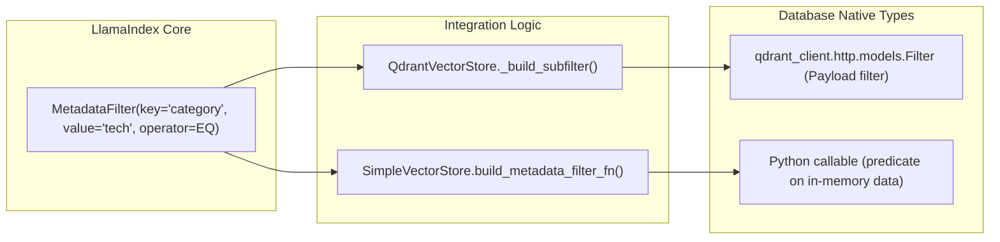
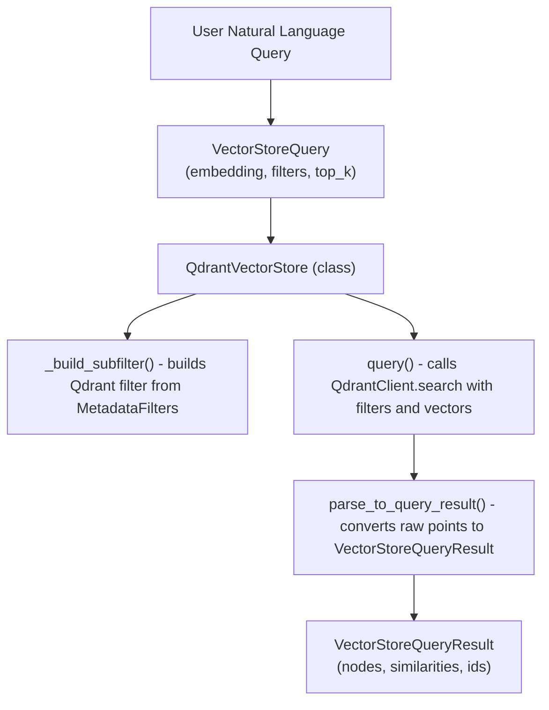
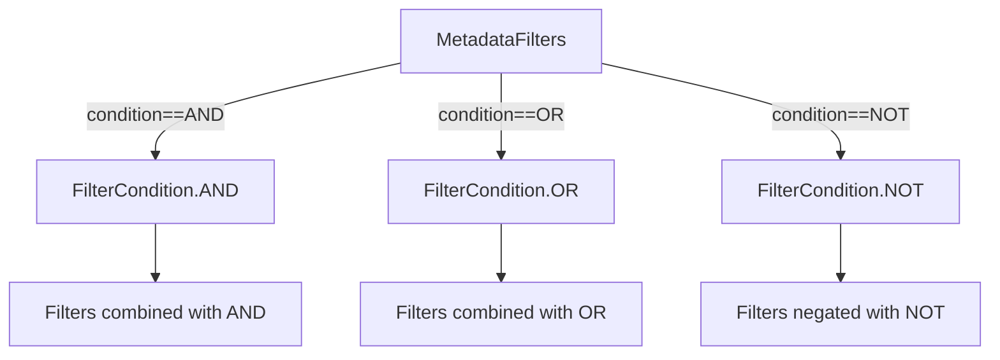

<!-- source: DeepWiki mcp.deepwiki.com · repo run-llama/llama_index · page 7 Vector Store Integrations · fetched 2026-10-26 -->

# Vector Store Integrations

<details>
<summary>Relevant source files</summary>

The following files were used as context for generating this wiki page:

- [llama-index-core/llama_index/core/graph_stores/simple.py](llama-index-core/llama_index/core/graph_stores/simple.py)
- [llama-index-core/llama_index/core/graph_stores/simple_labelled.py](llama-index-core/llama_index/core/graph_stores/simple_labelled.py)
- [llama-index-core/llama_index/core/storage/chat_store/simple_chat_store.py](llama-index-core/llama_index/core/storage/chat_store/simple_chat_store.py)
- [llama-index-core/llama_index/core/storage/index_store/simple_index_store.py](llama-index-core/llama_index/core/storage/index_store/simple_index_store.py)
- [llama-index-core/llama_index/core/storage/kvstore/simple_kvstore.py](llama-index-core/llama_index/core/storage/kvstore/simple_kvstore.py)
- [llama-index-core/llama_index/core/storage/kvstore/types.py](llama-index-core/llama_index/core/storage/kvstore/types.py)
- [llama-index-core/llama_index/core/storage/storage_context.py](llama-index-core/llama_index/core/storage/storage_context.py)
- [llama-index-core/llama_index/core/vector_stores/simple.py](llama-index-core/llama_index/core/vector_stores/simple.py)
- [llama-index-core/llama_index/core/vector_stores/types.py](llama-index-core/llama_index/core/vector_stores/types.py)
- [llama-index-core/tests/graph_stores/test_simple_lpg.py](llama-index-core/tests/graph_stores/test_simple_lpg.py)
- [llama-index-core/tests/storage/chat_store/test_simple_chat_store.py](llama-index-core/tests/storage/chat_store/test_simple_chat_store.py)
- [llama-index-core/tests/storage/kvstore/test_mutable_mapping_kvstore.py](llama-index-core/tests/storage/kvstore/test_mutable_mapping_kvstore.py)
- [llama-index-core/tests/vector_stores/test_simple.py](llama-index-core/tests/vector_stores/test_simple.py)
- [llama-index-integrations/vector_stores/llama-index-vector-stores-qdrant/llama_index/vector_stores/qdrant/base.py](llama-index-integrations/vector_stores/llama-index-vector-stores-qdrant/llama_index/vector_stores/qdrant/base.py)
- [llama-index-integrations/vector_stores/llama-index-vector-stores-qdrant/llama_index/vector_stores/qdrant/utils.py](llama-index-integrations/vector_stores/llama-index-vector-stores-qdrant/llama_index/vector_stores/qdrant/utils.py)
- [llama-index-integrations/vector_stores/llama-index-vector-stores-qdrant/pyproject.toml](llama-index-integrations/vector_stores/llama-index-vector-stores-qdrant/pyproject.toml)
- [llama-index-integrations/vector_stores/llama-index-vector-stores-qdrant/tests/conftest.py](llama-index-integrations/vector_stores/llama-index-vector-stores-qdrant/tests/conftest.py)
- [llama-index-integrations/vector_stores/llama-index-vector-stores-qdrant/tests/test_vector_stores_qdrant.py](llama-index-integrations/vector_stores/llama-index-vector-stores-qdrant/tests/test_vector_stores_qdrant.py)
- [llama-index-integrations/vector_stores/llama-index-vector-stores-qdrant/uv.lock](llama-index-integrations/vector_stores/llama-index-vector-stores-qdrant/uv.lock)

</details>


## Purpose and Scope

This document provides an overview of LlamaIndex's vector store integration ecosystem. Vector stores are specialized databases optimized for storing and querying high-dimensional vector embeddings, which are essential for semantic search and retrieval-augmented generation (RAG) applications.

This page covers:
- The core vector store abstraction and interfaces.
- Query modes and metadata filtering capabilities.
- Available vector store integrations and their features.
- Integration architecture and design patterns.

For detailed technical documentation of specific vector store implementations and advanced topics, see the child pages [Vector Store Architecture](#7.1) through [Additional Vector Stores](#7.6).

---

## Vector Store Ecosystem Overview

LlamaIndex provides a unified API for numerous vector store backends, all implementing the `BasePydanticVectorStore` interface. This abstract base class defines the essential methods for adding embeddings, querying with similarity and metadata filters, and deleting stored vectors with associated metadata.

The ecosystem includes:

- **Cloud-Managed Services**: Azure AI Search, Pinecone, Zilliz Cloud.
- **Self-Hosted/Open Source Solutions**: 
  - `QdrantVectorStore` — A feature-rich integration supporting dense and sparse hybrid search, sharding, and named vector fields [llama-index-integrations/vector_stores/llama-index-vector-stores-qdrant/llama_index/vector_stores/qdrant/base.py:79-170]().
  - `PGVectorStore` — Offers Postgres vector DB integration with HNSW indexing.
  - Milvus — For high performance vector similarity search.
  - Chroma — Lightweight vector store.
- **In-Memory and Simple Persistence**: 
  - `SimpleVectorStore` stores embeddings in memory with optional JSON persistence, ideal for lightweight prototyping [llama-index-core/llama_index/core/vector_stores/simple.py:64-79]().

This structured ecosystem allows seamless swapping and upgrading of vector store backends while maintaining a consistent programming model.

**Sources:**  
[llama-index-core/llama_index/core/vector_stores/types.py:284-285](),  
[llama-index-integrations/vector_stores/llama-index-vector-stores-qdrant/llama_index/vector_stores/qdrant/base.py:79-170](),  
[llama-index-core/llama_index/core/vector_stores/simple.py:64-79]()

---

## Core Architecture

### Vector Store Abstraction Hierarchy

The following diagram bridges the natural language concept of a semantic query to the corresponding core code abstractions and their implementations. This mapping helps developers connect user intent with system components and integration classes.

```mermaid
graph TB
    subgraph "Natural Language Space"
        UserQuery["User Natural Language Query"]
    end

    subgraph "Code Entity Space: llama-index-core"
        BVS["BasePydanticVectorStore<br/>(Abstract vector store base class)"]
        VSQ["VectorStoreQuery<br/>(Encapsulates query params, filters, embeddings)"]
        VSQR["VectorStoreQueryResult<br/>(Query results: nodes, scores, ids)"]
        MF["MetadataFilters<br/>(Composed metadata filter groups)"]
        MFilter["MetadataFilter<br/>(Single key-value-operator predicate)"]
    end
    
    subgraph "Integration Implementations"
        QVS["QdrantVectorStore<br/>(In llama-index-vector-stores-qdrant)"]
        SIM["SimpleVectorStore<br/>(In-memory store, core-simple.py)"]
    end
    
    UserQuery -.-> VSQ
    VSQ --> BVS
    BVS --> VSQR
    MF --> VSQ
    MFilter --> MF
    
    BVS <|-- QVS
    BVS <|-- SIM
```

This illustrates how user queries are transformed into `VectorStoreQuery` objects, enriched with metadata filters, and routed via base interfaces to specific stores like Qdrant or the SimpleVectorStore.

**Sources:**  
[llama-index-core/llama_index/core/vector_stores/types.py:37-42](),  
[llama-index-core/llama_index/core/vector_stores/types.py:94-148](),  
[llama-index-core/llama_index/core/vector_stores/simple.py:64-79](),  
[llama-index-integrations/vector_stores/llama-index-vector-stores-qdrant/llama_index/vector_stores/qdrant/base.py:79-170]()

---

## Query Modes

Vector stores support multiple query modes specified by the `VectorStoreQueryMode` enum. These modes influence how searches are executed in the vector database and what embeddings or filters are applied:

| Query Mode         | Code Symbol              | Description                                                       |
|--------------------|--------------------------|-------------------------------------------------------------------|
| **Default**        | `DEFAULT`                | Standard dense vector similarity search.                          |
| **Sparse**         | `SPARSE`                 | Sparse (keyword-based) search on embeddings.                      |
| **Hybrid**         | `HYBRID`                 | Combines dense and sparse vectors for improved search quality; supported notably by Qdrant [llama-index-integrations/vector_stores/llama-index-vector-stores-qdrant/llama_index/vector_stores/qdrant/base.py:99-103]()  |
| **Text Search**    | `TEXT_SEARCH`            | Full-text substring or token matching searches.                   |
| **Semantic Hybrid**| `SEMANTIC_HYBRID`        | Semantic search with hybrid fusion (Qdrant-specific enhancements).|
| **MMR**            | `MMR`                    | Maximal Marginal Relevance for diversifying results.              |
| **Fit Learners**   | `SVM`, `LOGISTIC_REGRESSION`, `LINEAR_REGRESSION` | Machine learning model-based search relevance modes. |

This flexible mode system allows LlamaIndex to adapt to different vector store capabilities and user needs.

**Sources:**  
[llama-index-core/llama_index/core/vector_stores/types.py:45-61](),  
[llama-index-integrations/vector_stores/llama-index-vector-stores-qdrant/llama_index/vector_stores/qdrant/base.py:99-103]()

---

## Metadata Filtering

Metadata filtering is critical in narrowing down search results based on structured attributes associated with vectors/nodes. LlamaIndex defines a composable filter abstraction that supports complex logic and various operators, enabling consistent filtering across backends.

### Filter Components

- **`MetadataFilter`**: Represents a single filter condition with a key, a value, and an operator like equality, inequality, range comparisons, inclusion, and text matching [llama-index-core/llama_index/core/vector_stores/types.py:94-116]().
- **`MetadataFilters`**: Groups multiple `MetadataFilter` or nested filters with logical conditions (`AND`, `OR`, `NOT`) to form complex filter expressions [llama-index-core/llama_index/core/vector_stores/types.py:142-148]().
- **`FilterOperator`**: Enumerates operators such as EQ, GT, LT, NE, IN, ANY, ALL, TEXT_MATCH, CONTAINS, and IS_EMPTY [llama-index-core/llama_index/core/vector_stores/types.py:63-83]().

### Metadata Translation Flow

The metadata filter abstraction in LlamaIndex is translated into database- or integration-specific filter DSLs at runtime. For example, Qdrant converts these filters into its payload `Filter` model, while the `SimpleVectorStore` uses an in-memory predicate function.



This design abstracts away the differences in filter expression syntax and capabilities among various backends.

**Sources:**  
[llama-index-core/llama_index/core/vector_stores/types.py:63-83](),  
[llama-index-core/llama_index/core/vector_stores/simple.py:28-31](),  
[llama-index-integrations/vector_stores/llama-index-vector-stores-qdrant/tests/test_vector_stores_qdrant.py:139-193]()

---

## Vector Store Integration Catalog

### Key Integrations Overview

| Integration  | Class Name          | Key Features                                                                                                               |
|--------------|---------------------|----------------------------------------------------------------------------------------------------------------------------|
| **Qdrant**   | `QdrantVectorStore` | Stores embeddings and docs in a Qdrant collection. Supports dense, sparse, and hybrid search modes, FastEmbed sparse models, custom sharding, and payload indexing. Written with async and sync clients [llama-index-integrations/vector_stores/llama-index-vector-stores-qdrant/llama_index/vector_stores/qdrant/base.py:79-170](). |
| **Simple**   | `SimpleVectorStore`  | Lightweight in-memory vector store using dictionaries for embeddings and metadata, with optional JSON persistence. Great for testing and low-scale usage [llama-index-core/llama_index/core/vector_stores/simple.py:64-79](). |
| **Milvus**   | *See child page*     | High-performance, scalable vector similarity search with index management.                                                 |
| **PGVector** | *See child page*     | PostgreSQL integration using the pgvector extension and HNSW indexing for approximate nearest-neighbor lookups.            |
| **Azure AI Search** | *See child page* | Cloud integration supporting semantic reranking and index management for enterprise search use cases.                      |
| **Additional Vector Stores** | *See child page* | Pinecone, Weaviate, Chroma, Elasticsearch, Redis, LanceDB, ClickHouse, AstraDB, KDB.AI and more.                            |

This catalog allows users to select vector store backends that match their infrastructure, performance, and feature needs.

**Sources:**  
[llama-index-integrations/vector_stores/llama-index-vector-stores-qdrant/llama_index/vector_stores/qdrant/base.py:79-170](),  
[llama-index-core/llama_index/core/vector_stores/simple.py:64-79]()

---

## Integration Architecture Pattern

LlamaIndex vector store integrations follow a common architectural pattern to ensure consistency while enabling backend-specific optimizations:

1. **Serialization**: Convert a `BaseNode` into a suitable metadata dictionary for storage using `node_to_metadata_dict`, stripping text if necessary [llama-index-core/llama_index/core/vector_stores/utils.py:29]().

2. **Deserialization**: Reconstruct nodes from returned metadata using `metadata_dict_to_node` or related functions, maintaining node integrity [llama-index-core/llama_index/core/vector_stores/utils.py:28]().

3. **Storage Management**: Each integration defines its own container or schema. For example, `SimpleVectorStore` uses `SimpleVectorStoreData` that holds in-memory dictionaries for embeddings and metadata. Qdrant directly interacts with Qdrant collections and manages payload indexes and vector fields [llama-index-core/llama_index/core/vector_stores/simple.py:48-61](), [llama-index-integrations/vector_stores/llama-index-vector-stores-qdrant/llama_index/vector_stores/qdrant/base.py:140-170]().

4. **Query Processing**: Queries with embeddings and metadata filters are converted via `VectorStoreQuery` objects into platform-specific query formats. Hybrid fusion logic merges sparse and dense search results when supported.

This pattern promotes extensibility and maintainability while supporting unique features of various vector stores.

**Sources:**  
[llama-index-core/llama_index/core/vector_stores/utils.py:28-29](),  
[llama-index-core/llama_index/core/vector_stores/simple.py:48-61](),  
[llama-index-integrations/vector_stores/llama-index-vector-stores-qdrant/llama_index/vector_stores/qdrant/base.py:140-170]()

---

## Related Documentation

For in-depth exploration of vector store concepts and implementations, consult the following child pages:

- **[Vector Store Architecture](#7.1)** — Detailed explanations of base interfaces like `BasePydanticVectorStore`, query schemas, and metadata filter abstractions.
- **[Milvus Integration](#7.2)** — Coverage of Milvus vector store features, index lifecycle management, and hybrid search enhancements.
- **[PostgreSQL Integration](#7.3)** — PostgreSQL vector extension usage, indexing options, and custom query support.
- **[Qdrant Integration](#7.4)** — Comprehensive Qdrant features including FastEmbed sparse encoding, hybrid search fusion, advanced sharding, and named vectors.
- **[Azure AI Search Integration](#7.5)** — Enterprise vector search with semantic reranking and index control.
- **[Additional Vector Stores](#7.6)** — Overview of Pinecone, Weaviate, Chroma, Elasticsearch, MongoDB Atlas, OpenSearch, Redis, LanceDB, DuckDB, ClickHouse, AstraDB, KDB.AI, and more.

These child pages hold granular technical details suitable for developers extending or customizing vector stores.

---

# Summary

LlamaIndex’s vector store integrations enable a flexible and powerful semantic search ecosystem. With a unified interface offering diverse query modes and filters, developers can easily plug in their vector databases of choice. The architecture cleanly separates core abstractions, query semantics, and backend-specific implementations, fostering extensibility. The Qdrant integration exemplifies advanced features like hybrid search and scalable sharding, while the SimpleVectorStore offers a lightweight starter option.

This page serves as a high-level gateway to the vector store subsystem, linking to detailed documentation for each supported backend.

---

# Additional Diagram: From Natural Language Query to QdrantVectorStore Methods



This flow shows how a user query translates to Qdrant vector store method calls and eventually a structured result.

**Sources:** [llama-index-integrations/vector_stores/llama-index-vector-stores-qdrant/llama_index/vector_stores/qdrant/base.py:79-170]()

---

# Additional Diagram: Metadata Filter Logical Branching



This illustrates fundamental logical branching supported in metadata filtering.

**Sources:** [llama-index-core/llama_index/core/vector_stores/types.py:142-148](), [llama-index-integrations/vector_stores/llama-index-vector-stores-qdrant/tests/test_vector_stores_qdrant.py:139-193]()

---

# End of Page 7 - Vector Store Integrations

---

