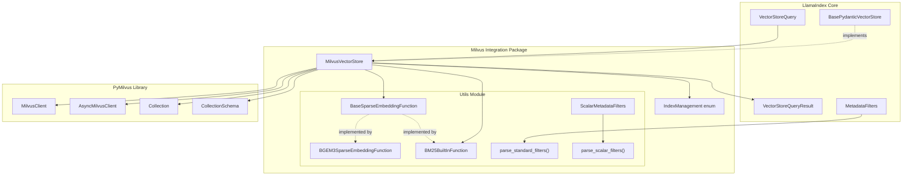
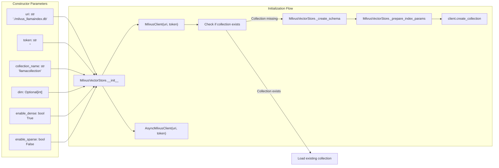
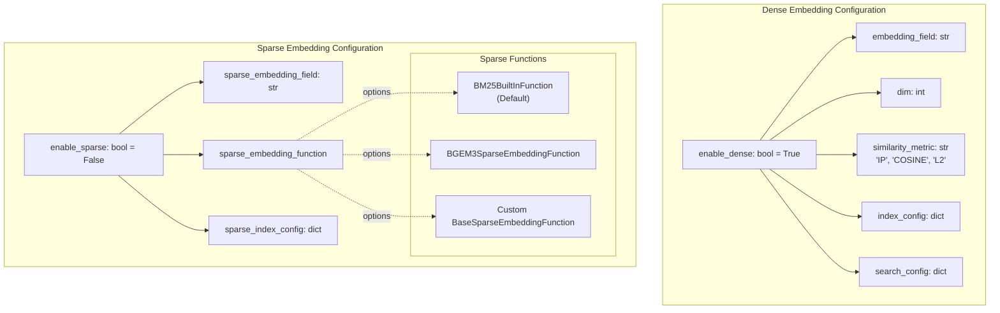
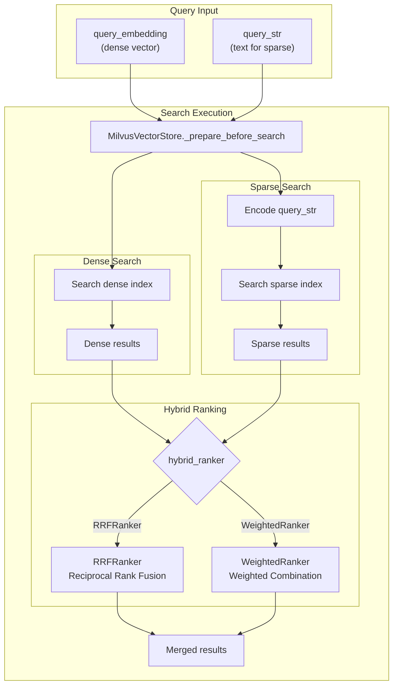
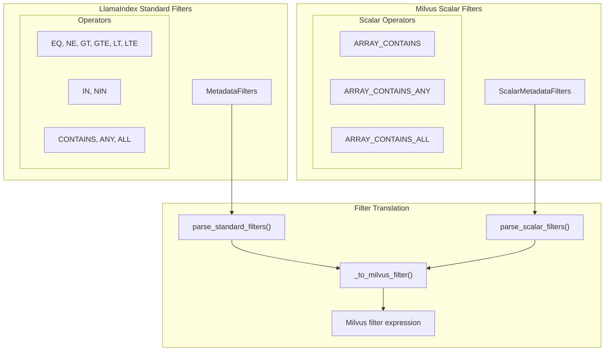
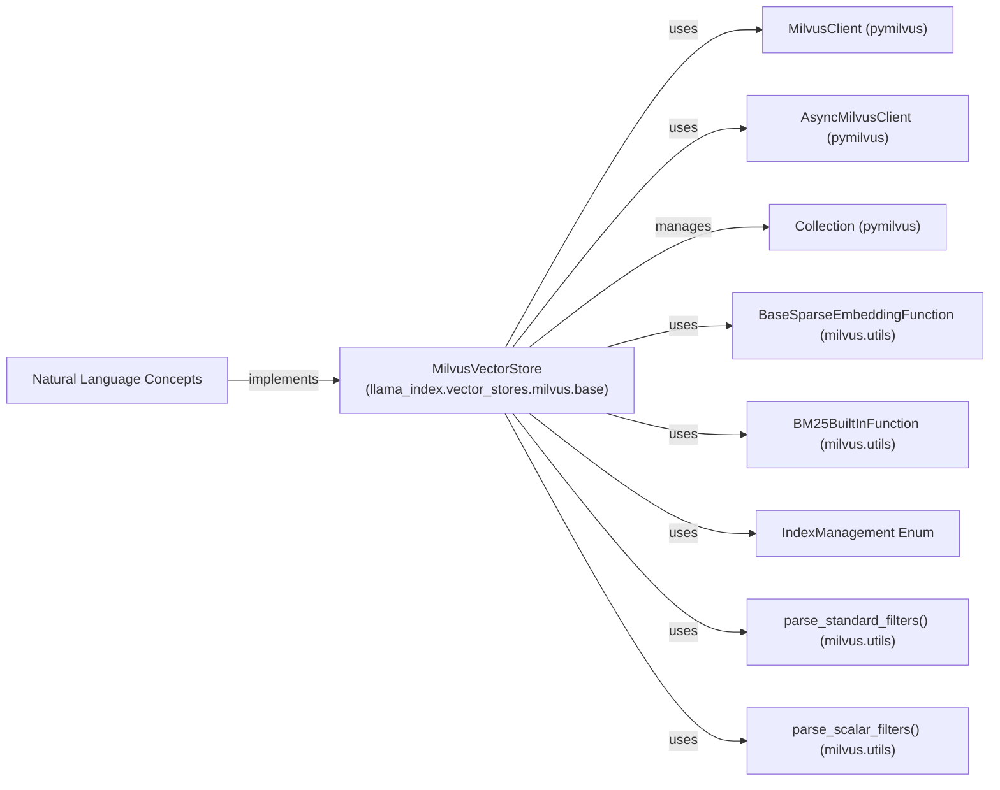
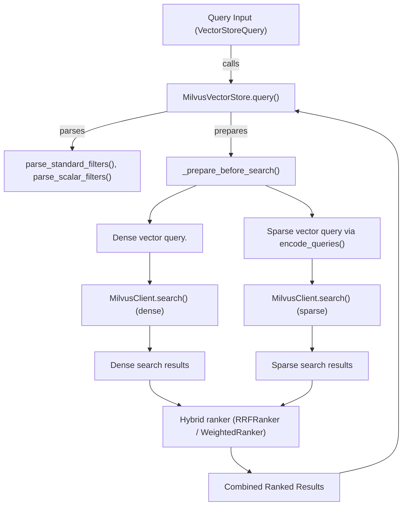

<!-- source: DeepWiki mcp.deepwiki.com · repo run-llama/llama_index · page 7.2 Milvus Integration · fetched 2026-10-26 -->

# Milvus Integration

Relevant source files

The following files were used as context for generating this wiki page:

- [llama-index-integrations/agent/llama-index-agent-agentmesh/uv.lock](llama-index-integrations/agent/llama-index-agent-agentmesh/uv.lock)
- [llama-index-integrations/embeddings/llama-index-embeddings-isaacus/uv.lock](llama-index-integrations/embeddings/llama-index-embeddings-isaacus/uv.lock)
- [llama-index-integrations/embeddings/llama-index-embeddings-upstage/uv.lock](llama-index-integrations/embeddings/llama-index-embeddings-upstage/uv.lock)
- [llama-index-integrations/llms/llama-index-llms-aibadgr/pyproject.toml](llama-index-integrations/llms/llama-index-llms-aibadgr/pyproject.toml)
- [llama-index-integrations/llms/llama-index-llms-aibadgr/uv.lock](llama-index-integrations/llms/llama-index-llms-aibadgr/uv.lock)
- [llama-index-integrations/llms/llama-index-llms-apertis/pyproject.toml](llama-index-integrations/llms/llama-index-llms-apertis/pyproject.toml)
- [llama-index-integrations/llms/llama-index-llms-apertis/uv.lock](llama-index-integrations/llms/llama-index-llms-apertis/uv.lock)
- [llama-index-integrations/llms/llama-index-llms-asi/uv.lock](llama-index-integrations/llms/llama-index-llms-asi/uv.lock)
- [llama-index-integrations/llms/llama-index-llms-cometapi/pyproject.toml](llama-index-integrations/llms/llama-index-llms-cometapi/pyproject.toml)
- [llama-index-integrations/llms/llama-index-llms-cometapi/uv.lock](llama-index-integrations/llms/llama-index-llms-cometapi/uv.lock)
- [llama-index-integrations/llms/llama-index-llms-contextual/uv.lock](llama-index-integrations/llms/llama-index-llms-contextual/uv.lock)
- [llama-index-integrations/llms/llama-index-llms-ovhcloud/uv.lock](llama-index-integrations/llms/llama-index-llms-ovhcloud/uv.lock)
- [llama-index-integrations/postprocessor/llama-index-postprocessor-google-rerank/uv.lock](llama-index-integrations/postprocessor/llama-index-postprocessor-google-rerank/uv.lock)
- [llama-index-integrations/readers/llama-index-readers-datasets/uv.lock](llama-index-integrations/readers/llama-index-readers-datasets/uv.lock)
- [llama-index-integrations/storage/chat_store/llama-index-storage-chat-store-opensearch/uv.lock](llama-index-integrations/storage/chat_store/llama-index-storage-chat-store-opensearch/uv.lock)
- [llama-index-integrations/tools/llama-index-tools-mcp-discovery/uv.lock](llama-index-integrations/tools/llama-index-tools-mcp-discovery/uv.lock)
- [llama-index-integrations/tools/llama-index-tools-moss/uv.lock](llama-index-integrations/tools/llama-index-tools-moss/uv.lock)
- [llama-index-integrations/vector_stores/llama-index-vector-stores-milvus/.gitignore](llama-index-integrations/vector_stores/llama-index-vector-stores-milvus/.gitignore)
- [llama-index-integrations/vector_stores/llama-index-vector-stores-milvus/CHANGELOG.md](llama-index-integrations/vector_stores/llama-index-vector-stores-milvus/CHANGELOG.md)
- [llama-index-integrations/vector_stores/llama-index-vector-stores-milvus/llama_index/vector_stores/milvus/__init__.py](llama-index-integrations/vector_stores/llama-index-vector-stores-milvus/llama_index/vector_stores/milvus/__init__.py)
- [llama-index-integrations/vector_stores/llama-index-vector-stores-milvus/llama_index/vector_stores/milvus/base.py](llama-index-integrations/vector_stores/llama-index-vector-stores-milvus/llama_index/vector_stores/milvus/base.py)
- [llama-index-integrations/vector_stores/llama-index-vector-stores-milvus/llama_index/vector_stores/milvus/utils.py](llama-index-integrations/vector_stores/llama-index-vector-stores-milvus/llama_index/vector_stores/milvus/utils.py)
- [llama-index-integrations/vector_stores/llama-index-vector-stores-milvus/pyproject.toml](llama-index-integrations/vector_stores/llama-index-vector-stores-milvus/pyproject.toml)
- [llama-index-integrations/vector_stores/llama-index-vector-stores-milvus/uv.lock](llama-index-integrations/vector_stores/llama-index-vector-stores-milvus/uv.lock)
- [llama-index-integrations/vector_stores/llama-index-vector-stores-opensearch/uv.lock](llama-index-integrations/vector_stores/llama-index-vector-stores-opensearch/uv.lock)

This document describes the Milvus vector store integration in LlamaIndex. Milvus is a popular open-source vector database that supports efficient management and querying of vector embeddings with rich capabilities, including dense embeddings, sparse embeddings (e.g., BM25), hybrid search combining these modes, and scalar metadata filtering. The integration is implemented in the `MilvusVectorStore` class which extends the core abstraction `BasePydanticVectorStore`, enabling seamless interaction with Milvus or Zilliz Cloud services, and also supports Milvus Lite for local testing or development.

---

## Architecture Overview

The Milvus integration package is structured around the core `MilvusVectorStore` class that manages connection setup, collection and index management, vector addition/deletion, querying, and retrieval. It leverages PyMilvus client libraries and provides utilities for flexible embedding strategies and sophisticated filtering using both standard LlamaIndex metadata filters and Milvus-specific scalar metadata filters.

**Sources:** [llama_index/vector_stores/milvus/base.py:118-118](), [llama_index/vector_stores/milvus/utils.py:1-211]()

---

## MilvusVectorStore Class

`MilvusVectorStore` is the concrete implementation of the vector store that interfaces with Milvus collections to store vectors and metadata for LlamaIndex nodes. It manages connection, collection existence, creation, schema definition, indexing, vector insertion, querying, and deletion.

### Initialization and Configuration Details

The constructor accepts configuration parameters to specify connection details, collection name, enables dense/sparse embeddings, embedding dimensions, indexing and search configurations, and index management policies.

- **uri**: Connection string to Milvus instance. Can be for Milvus Lite local file, self-hosted, or Zilliz Cloud.
- **token**: Access token or `"username:password"` for RBAC auth, or empty if none.
- **collection_name**: Name of the Milvus collection to store/query vector data.
- **dim**: Required embedding vector dimensionality if creating a new collection with dense embeddings.
- **enable_dense**: Enable dense embedding storage and queries (default is True).
- **enable_sparse**: Enable sparse embedding storage and hybrid querying (default is False).
- Additional options include text key, doc id field, embedding field names, index and search config, consistency level, overwrite flag, upsert mode, etc.

**Sources:** [llama_index/vector_stores/milvus/base.py:128-200]()

---

## Dense and Sparse Embeddings Support

Milvus integration supports storing dense vectors as well as sparse embeddings within the same collection to enable flexible query modalities.

### Embedding Configuration

- Dense embedding-related parameters:
  - `enable_dense`: Enables dense embeddings.
  - `embedding_field`: Field name storing dense vectors.
  - `dim`: Dense embedding dimension.
  - `similarity_metric`: Similarity metric for dense index (Inner Product "IP", Cosine, or Euclidean "L2").
  - `index_config` and `search_config`: Milvus index and search parameters for dense vectors.

- Sparse embedding-related parameters:
  - `enable_sparse`: Enables sparse embeddings and hybrid search.
  - `sparse_embedding_field`: Field to store sparse embedding vectors.
  - `sparse_embedding_function`: Function to convert query text to sparse embedding vector (default BM25BuiltInFunction).
  - `sparse_index_config`: Index parameters specific to sparse embeddings.

**Sources:** [llama_index/vector_stores/milvus/base.py:147-169](), [llama_index/vector_stores/milvus/base.py:242-252]()

---

### Sparse Embedding Functions

The integration provides support for built-in sparse embedding functions and allows users to implement custom functions.

- **BM25BuiltInFunction (Default):**
  - Uses Milvus built-in BM25 functionality.
  - Configured with custom analyzer parameters for tokenization, stop words, highlighting, etc.

- **BGEM3SparseEmbeddingFunction:**
  - A client-side BGE-M3 sparse embedding implementation.
  - Implements the abstract interface `BaseSparseEmbeddingFunction`.

- **Custom Implementations:**
  - Users can implement their own sparse embedding function by subclassing `BaseSparseEmbeddingFunction` and implementing `encode_queries()` and optionally `encode_documents()`.

**Sources:** [llama_index/vector_stores/milvus/utils.py:189-302](), [llama_index/vector_stores/milvus/utils.py:253-285]()

---

## Hybrid Search

Hybrid search enables combining the results of dense and sparse vector searches to improve overall retrieval accuracy and relevance.

### Hybrid Search Architecture

- The dense embedding vector and sparse text query are prepared and sent to Milvus separately.
- Dense vectors search using dense index; sparse queries encoded and searched via sparse index.
- Results from both searches are fused using configured ranker — either Reciprocal Rank Fusion (RRFRanker) or WeightedRanker (weighted combination).
- The merged result set is returned for retrieval or downstream processing.

### Hybrid Ranker Parameters

- `RRFRanker`: Configurable parameter `k` (default `60`).
- `WeightedRanker`: Configurable parameter `weights`, e.g. `[0.7, 0.3]` to weight dense vs sparse scores.

**Sources:** [llama_index/vector_stores/milvus/base.py:179-194](), [llama_index/vector_stores/milvus/base.py:837-845]()

---

## Index Management

Index management supports control for index creation behaviors via an enumeration.

### IndexManagement Enum

| Strategy             | Description                                                    |
|----------------------|----------------------------------------------------------------|
| `NO_VALIDATION`      | Skip index validation and creation completely.                  |
| `CREATE_IF_NOT_EXISTS` | Create the index only if it does not already exist (default). |

The parameter is used internally by `MilvusVectorStore` to control when and how to create or validate indices during initialization or operations.

**Sources:** [llama_index/vector_stores/milvus/base.py:66-72](), [llama-index-integrations/vector_stores/llama-index-vector-stores-milvus/CHANGELOG.md:37-40]()

---

## Metadata Filtering

Milvus integration supports metadata filtering with standard LlamaIndex filters and Milvus-specific scalar filters for advanced queries.

### Filter Processing Architecture

- `MetadataFilters` are parsed by `parse_standard_filters()` into Milvus-compatible expressions.
- `ScalarMetadataFilters` are parsed by `parse_scalar_filters()` for advanced array and scalar operations.
- Both are combined and converted into a complete Milvus filter string by `_to_milvus_filter()`.

### Common Milvus Filter Expressions

| Operator      | Milvus Expression                      |
|---------------|--------------------------------------|
| `EQ`          | `key == value`                       |
| `CONTAINS`    | `array_contains(key, value)`         |
| `TEXT_MATCH`  | `key like 'value%'` (prefix match)  |
| `IS_EMPTY`    | `array_length(key) == 0` (field empty or missing) |

**Sources:** [llama_index/vector_stores/milvus/base.py:73-98](), [llama_index/vector_stores/milvus/utils.py:126-187]()

---

## CRUD Operations

### Adding Vectors and Nodes

- `add(nodes: List[BaseNode], **add_kwargs) -> List[str]`: Adds nodes to the Milvus collection, inserting or upserting vectors and metadata.
- Supports auto-managing collection and index creation on inserts.
- Provides asynchronous counterpart `async_add()`.

### Deleting Data

- `delete(ref_doc_id: str, **delete_kwargs) -> None`: Deletes all nodes for a specified document ID.
- `delete_nodes(node_ids: Optional[List[str]], filters: Optional[MetadataFilters], **delete_kwargs) -> None`: Deletes specific nodes by ID or matching filters.
- `clear() -> None`: Removes all records from the collection.

### Querying and Retrieval

- `get_nodes(node_ids: Optional[List[str]], filters: Optional[MetadataFilters], **kwargs) -> List[BaseNode]`: Retrieves nodes by IDs or filter.
- `query(query: VectorStoreQuery, **kwargs) -> VectorStoreQueryResult`: Performs a query for nearest neighbors with support for metadata filters and hybrid querying.
- `aquery(query: VectorStoreQuery, **kwargs) -> VectorStoreQueryResult`: Async version of query.

**Sources:** [llama_index/vector_stores/milvus/base.py:421-1002]()

---

## Collection Properties

Milvus collections can be configured with additional collection-level properties such as:

- **TTL (Time-To-Live):** Set expiration time for data using `collection.ttl.seconds`.
- **Memory Mapping (MMAP):** Enable/disable memory mapped storage with `mmap.enabled`.

These properties are applied when creating collections to optimize performance or data lifecycle.

**Sources:** [llama_index/vector_stores/milvus/base.py:167-173](), [llama_index/vector_stores/milvus/base.py:393-404]()

---

# Summary Table

| Feature                     | Description                                                      | Primary Code Entity                      |
|-----------------------------|------------------------------------------------------------------|----------------------------------------|
| Vector Store Class           | Main interface to Milvus vector collections                      | `MilvusVectorStore` [base.py:118-118]()|
| Index Management Strategies  | Modes controlling automatic index creation/validation           | `IndexManagement` enum [base.py:66-72]()|
| Hybrid Search               | Combine dense and sparse search results with rank fusion         | Hybrid search logic [base.py:837-845]()|
| Dense Embeddings            | Dimension, similarity metric, index and search config            | Params in `MilvusVectorStore`          |
| Sparse Embeddings           | BM25BuiltInFunction, BGEM3SparseEmbeddingFunction,Custom         | `BaseSparseEmbeddingFunction`          |
| Metadata Filtering          | Standard and scalar filters translated to Milvus filter string   | Utils: `parse_standard_filters()` etc. |
| CRUD Operations             | Add, delete, retrieve nodes with optional filters                | Methods on `MilvusVectorStore`          |
| Collection Properties       | TTL and MMAP flags for collection lifecycle and performance      | Config passed on collection creation   |

---

# Natural Language to Code Entity Bridge Diagrams

### Milvus Integration Namespaces and Key Classes

### Query Flow from Input to Result in MilvusVectorStore

---

# Conclusion

The Milvus integration offers a comprehensive, flexible vector store solution within LlamaIndex, leveraging Milvus's powerful vector and scalar search capabilities. It supports dense and sparse embeddings with hybrid search and fine-grained metadata filtering, along with robust index and collection management.

Users can interface with Milvus collections via the `MilvusVectorStore` class for fast, scalable retrieval backed by Milvus. The integration balances ease of use, configurability, and performance by exposing detailed control over indices, embeddings, search, and filtering, all aligned with LlamaIndex's core abstractions.

---

# References

- `MilvusVectorStore` class and methods: [llama_index/vector_stores/milvus/base.py:118-404,421-1002]()
- IndexManagement enum and filtering utilities: [llama_index/vector_stores/milvus/base.py:66-98,73-98]()
- Sparse embedding functions and utils: [llama_index/vector_stores/milvus/utils.py:189-302,253-285]()
- Hybrid search and ranker params: [llama_index/vector_stores/milvus/base.py:179-194,837-845]()
- Package metadata and changelog: [pyproject.toml:28-39](), [CHANGELOG.md:37-40]()

---

