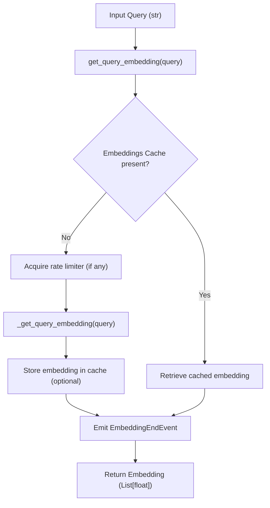
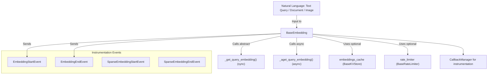
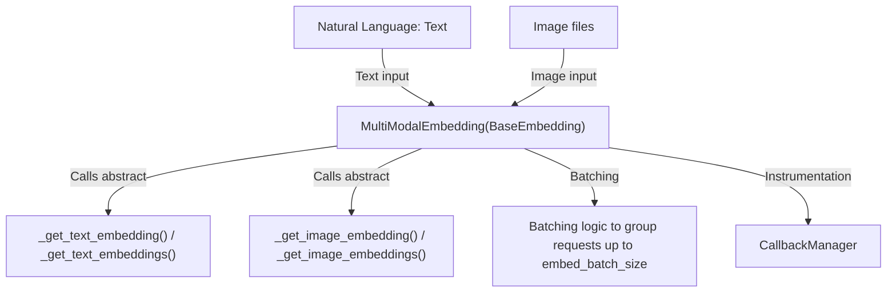

<!-- source: DeepWiki mcp.deepwiki.com · repo run-llama/llama_index · page 8.1 Embedding Architecture · fetched 2026-10-26 -->

# Embedding Architecture

Relevant source files

The following files were used as context for generating this wiki page:

- [llama-index-core/llama_index/core/base/embeddings/base.py](llama-index-core/llama_index/core/base/embeddings/base.py)
- [llama-index-core/llama_index/core/base/embeddings/base_sparse.py](llama-index-core/llama_index/core/base/embeddings/base_sparse.py)
- [llama-index-core/llama_index/core/base/llms/base.py](llama-index-core/llama_index/core/base/llms/base.py)
- [llama-index-core/llama_index/core/embeddings/multi_modal_base.py](llama-index-core/llama_index/core/embeddings/multi_modal_base.py)
- [llama-index-core/llama_index/core/instrumentation/events/embedding.py](llama-index-core/llama_index/core/instrumentation/events/embedding.py)
- [llama-index-core/llama_index/core/instrumentation/events/exception.py](llama-index-core/llama_index/core/instrumentation/events/exception.py)
- [llama-index-core/llama_index/core/instrumentation/events/llm.py](llama-index-core/llama_index/core/instrumentation/events/llm.py)
- [llama-index-core/llama_index/core/llms/callbacks.py](llama-index-core/llama_index/core/llms/callbacks.py)
- [llama-index-core/llama_index/core/rate_limiter.py](llama-index-core/llama_index/core/rate_limiter.py)
- [llama-index-core/llama_index/core/sparse_embeddings/__init__.py](llama-index-core/llama_index/core/sparse_embeddings/__init__.py)
- [llama-index-core/llama_index/core/sparse_embeddings/mock_sparse_embedding.py](llama-index-core/llama_index/core/sparse_embeddings/mock_sparse_embedding.py)
- [llama-index-core/tests/embeddings/test_base.py](llama-index-core/tests/embeddings/test_base.py)
- [llama-index-core/tests/embeddings/test_with_cache.py](llama-index-core/tests/embeddings/test_with_cache.py)
- [llama-index-core/tests/llms/test_callbacks.py](llama-index-core/tests/llms/test_callbacks.py)
- [llama-index-core/tests/sparse_embeddings/__init__.py](llama-index-core/tests/sparse_embeddings/__init__.py)
- [llama-index-core/tests/sparse_embeddings/test_mock_sparse_embeddings.py](llama-index-core/tests/sparse_embeddings/test_mock_sparse_embeddings.py)
- [llama-index-core/tests/test_rate_limiter.py](llama-index-core/tests/test_rate_limiter.py)
- [llama-index-integrations/embeddings/llama-index-embeddings-fastembed/llama_index/embeddings/fastembed/base.py](llama-index-integrations/embeddings/llama-index-embeddings-fastembed/llama_index/embeddings/fastembed/base.py)
- [llama-index-integrations/embeddings/llama-index-embeddings-fastembed/pyproject.toml](llama-index-integrations/embeddings/llama-index-embeddings-fastembed/pyproject.toml)
- [llama-index-integrations/embeddings/llama-index-embeddings-fastembed/tests/test_embeddings_fastembed.py](llama-index-integrations/embeddings/llama-index-embeddings-fastembed/tests/test_embeddings_fastembed.py)
- [llama-index-integrations/embeddings/llama-index-embeddings-fastembed/uv.lock](llama-index-integrations/embeddings/llama-index-embeddings-fastembed/uv.lock)
- [llama-index-integrations/embeddings/llama-index-embeddings-fireworks/README.md](llama-index-integrations/embeddings/llama-index-embeddings-fireworks/README.md)
- [llama-index-integrations/embeddings/llama-index-embeddings-fireworks/llama_index/embeddings/fireworks/base.py](llama-index-integrations/embeddings/llama-index-embeddings-fireworks/llama_index/embeddings/fireworks/base.py)
- [llama-index-integrations/embeddings/llama-index-embeddings-fireworks/llama_index/embeddings/fireworks/utils.py](llama-index-integrations/embeddings/llama-index-embeddings-fireworks/llama_index/embeddings/fireworks/utils.py)
- [llama-index-integrations/embeddings/llama-index-embeddings-fireworks/pyproject.toml](llama-index-integrations/embeddings/llama-index-embeddings-fireworks/pyproject.toml)
- [llama-index-integrations/embeddings/llama-index-embeddings-fireworks/tests/__init__.py](llama-index-integrations/embeddings/llama-index-embeddings-fireworks/tests/__init__.py)
- [llama-index-integrations/embeddings/llama-index-embeddings-fireworks/tests/test_embeddings.py](llama-index-integrations/embeddings/llama-index-embeddings-fireworks/tests/test_embeddings.py)
- [llama-index-integrations/embeddings/llama-index-embeddings-fireworks/uv.lock](llama-index-integrations/embeddings/llama-index-embeddings-fireworks/uv.lock)
- [llama-index-integrations/embeddings/llama-index-embeddings-instructor/pyproject.toml](llama-index-integrations/embeddings/llama-index-embeddings-instructor/pyproject.toml)
- [llama-index-integrations/llms/llama-index-llms-baseten/uv.lock](llama-index-integrations/llms/llama-index-llms-baseten/uv.lock)
- [llama-index-integrations/sparse_embeddings/llama-index-sparse-embeddings-fastembed/Makefile](llama-index-integrations/sparse_embeddings/llama-index-sparse-embeddings-fastembed/Makefile)
- [llama-index-integrations/sparse_embeddings/llama-index-sparse-embeddings-fastembed/README.md](llama-index-integrations/sparse_embeddings/llama-index-sparse-embeddings-fastembed/README.md)

This page (section 8.1) details the embedding architecture in the LlamaIndex codebase. It covers the core `BaseEmbedding` abstraction, support for sparse embeddings, batching and caching mechanisms, rate limiting, and multi-modal embeddings. The goal is to explain the design and implementation of embeddings as they relate to the broader LlamaIndex vector search and retrieval framework.

---

## 1. BaseEmbedding

The `BaseEmbedding` class serves as the foundational interface and implementation base for all embeddings in LlamaIndex. It abstracts how text (queries or documents) are converted into numerical vector embeddings usable for similarity search or downstream tasks.

### Key Responsibilities and Properties

- **Model metadata:** `model_name` identifies the embedding model used.
- **Batching:** `embed_batch_size` controls the maximum batch size for embedding calls, which can improve efficiency.
- **Callbacks:** Embedding events use a `CallbackManager` for instrumentation and observability.
- **Caching:** Optionally stores and retrieves embeddings via an `embeddings_cache` (e.g., a key-value store).
- **Rate limiting:** Supports a `rate_limiter` instance to throttle remote API calls.

### Essential Abstract Methods

- `_get_query_embedding(self, query: str) -> Embedding`  
  Implements synchronous embedding of query strings.

- `_aget_query_embedding(self, query: str) -> Embedding`  
  Async counterpart of the above.

These must be implemented by subclasses to define the actual embedding retrieval logic.

### Concrete Methods for Embedding

- `get_query_embedding(self, query: str) -> Embedding`  
  Embeds a query string with instrumentation, optional caching, and rate limiting. It emits `EmbeddingStartEvent` and `EmbeddingEndEvent`. If caching is enabled, it first tries to retrieve embedding from the cache keyed by the query string before performing the embedding call.

- Async versions and batch embedding functions similarly wrap the abstract methods with instrumentation and batch management.

### Data Flow in `get_query_embedding`

1. Emit `EmbeddingStartEvent`.
2. Check `embeddings_cache` for a cached embedding:
   - If cached, return cached embedding immediately.
   - Else, acquire rate limiter if configured and call `_get_query_embedding`.
3. If embedding was newly computed, store in cache with a UUID as the embedding identifier.
4. Emit `EmbeddingEndEvent` with embedding and chunk info.

This architecture allows seamless plugging of various embedding backends while ensuring observability, performance, and cost controls through batching, caching, and throttling.

### Similarity Utility

The module also supplies a `similarity` function supporting multiple modes (`cosine`, `dot_product`, `euclidean`) to compute similarity scores between embeddings, vital in ranking retrieval results.

### Diagram: BaseEmbedding Core Flow

Sources: `llama-index-core/llama_index/core/base/embeddings/base.py:1-191`()

---

## 2. Sparse Embeddings

Sparse embeddings represent embedding vectors where only a subset of dimensions have non-zero values, often encoded as dictionaries mapping token IDs to weights. These can improve performance/storage in certain contexts.

### Sparse Embedding Events

Separate instrumentation events exist for sparse embeddings:

- `SparseEmbeddingStartEvent`
- `SparseEmbeddingEndEvent`

to differentiate their logging from dense embeddings.

### Sparse Embedding Interface

Sparse embeddings extend the base interface with a dictionary-based embedding type. The codebase includes modules for sparse embedding abstractions and mocks. They conform to the same batch, caching, and rate limiting design principles.

Sources:  
- `llama-index-core/llama_index/core/instrumentation/events/embedding.py:44-80`  
- `llama-index-core/llama_index/core/base/embeddings/base_sparse.py` (imported, not shown)  
- `llama-index-core/llama_index/core/sparse_embeddings/mock_sparse_embedding.py`

---

## 3. Batching

Batching is key to maximizing throughput and reducing overhead for embedding calls. The embedding classes support batch embedding of texts or images.

### BaseEmbedding and Batching

- `embed_batch_size` property controls maximum batch size.
- Batching applies both to synchronous and asynchronous methods.
- The batching logic accumulates requests into batches and flushes when the batch is full or on the last item.

### Multi-Modal Embeddings Batching

For multi-modal embeddings (supporting images), batching is similarly supported for image inputs.

- Methods like `get_image_embedding_batch` and `aget_image_embedding_batch` process lists of image paths, batching calls up to `embed_batch_size`.
- They include instrumentation wrapping each batch call.

### Iterator with Progress

Batch processing supports optional progress display using `tqdm`. This applies to synchronous and asynchronous batch processing alike.

Sources:  
- `llama-index-core/llama_index/core/base/embeddings/base.py:70-190`  
- `llama-index-core/llama_index/core/embeddings/multi_modal_base.py:16-183`

---

## 4. Caching

Embedding caching is supported via an optional `embeddings_cache` attribute that must implement the key-value store interface (`BaseKVStore`). 

### Caching Behavior

- Keys: Query strings or chunk identifiers
- Values: Mappings from UUID strings to embeddings (for uniqueness)
- On embedding request:
  - Check cache for key.
  - If found, use cached embedding.
  - Else, compute embedding and store in cache.

This reduces redundant embedding calls, significantly improving performance and cost on repeated queries/documents.

### Validation

At initialization, the code validates that any provided cache is the correct type.

Sources:  
- `llama-index-core/llama_index/core/base/embeddings/base.py:90-130`  
- `llama-index-core/tests/embeddings/test_with_cache.py` (testing cache, not shown)

---

## 5. Rate Limiting

To prevent surpassing API quotas or overwhelming resources, the embedding system supports rate limiting via an optional `rate_limiter` object.

### How Rate Limiting Works

- Before making embedding calls (`_get_query_embedding` or batch calls), if `rate_limiter` is set:
  - Acquire permission (sync or async).
- This throttles calls respecting configured limits.

This behavior is integrated automatically in embedding methods without changing client code.

Sources:  
- `llama-index-core/llama_index/core/base/embeddings/base.py:160-190`

---

## 6. Multi-Modal Embeddings

LlamaIndex supports embeddings not only for text but also images, under the `MultiModalEmbedding` abstract class extending `BaseEmbedding`.

### MultiModalEmbedding Key Methods

- `_get_image_embedding(img_file_path: ImageType) -> Embedding` (sync)
- `_aget_image_embedding(img_file_path: ImageType) -> Embedding` (async)
- Batched variants for image embeddings with progress reporting and callback instrumentation.

### Instrumentation

Image embedding calls are wrapped with embedding events for observability.

### Implementation Note

Concrete subclasses must implement how to embed images, enabling usage of models that accept multi-modal input.

Sources:  
- `llama-index-core/llama_index/core/embeddings/multi_modal_base.py:16-183`

---

## 7. Example: FastEmbedEmbedding Integration

An example concrete embedding implementation is `FastEmbedEmbedding`, which derives from `BaseEmbedding` and connects to the [`fastembed`](https://github.com/qdrant/fastembed) library.

Highlights:

- Provides parameters for model name, cache directory, threading, ONNX providers.
- Implements both sync and async embedding methods.
- Uses FastEmbed's `TextEmbedding` for vector inference.
- Supports doc embedding types such as `"default"` or `"passage"`.

This serves as a reference for implementing custom embedding providers.

Sources:  
- `llama-index-integrations/embeddings/llama-index-embeddings-fastembed/llama_index/embeddings/fastembed/base.py:1-126`

---

# Summary Diagram: Natural Language to Code Entities Embedding Flow

# Summary Diagram: Multi-Modal Embeddings — Natural Language and Images to Embeddings

---

# Technical Summary Table

| Feature               | Description                                                                                         | Code Location / Class                          |
|-----------------------|-------------------------------------------------------------------------------------------------|-----------------------------------------------|
| Base interface        | Abstract base class for embedding models including sync/async embedding methods.                 | `BaseEmbedding` [base.py:72-191]()            |
| Similarity calculations| Utilities for cosine, dot product, Euclidean similarity among embeddings.                        | `similarity` function [base.py:55-70]()       |
| Embedding caching     | Optional embedding cache with key-value storage to avoid redundant calls.                       | `BaseEmbedding.embeddings_cache` property     |
| Rate limiting         | Optional API call rate limiter to throttle embedding requests.                                  | `BaseEmbedding.rate_limiter` property         |
| Sparse embeddings     | Support for sparse vector embeddings with custom instrumentation events.                        | Events: `SparseEmbeddingStartEvent`, `SparseEmbeddingEndEvent` [embedding.py:44-80]() |
| Batching support      | Batch embedding calls for both text and image inputs with progress reporting.                   | `embed_batch_size` config and batch methods   |
| Multi-modal embedding | Extension for embedding images alongside text.                                                 | `MultiModalEmbedding` [multi_modal_base.py:16-183]() |
| Example integration   | Concrete FastEmbed embedding integration example.                                               | `FastEmbedEmbedding` [fastembed/base.py:1-126]() |

---

# Conclusion

The embedding architecture in LlamaIndex is designed for flexibility, observability, and scalability. `BaseEmbedding` defines the core interface with methods for synchronous and asynchronous embeddings, enriched with callback instrumentation and event dispatching. The framework supports sparse embeddings and multi-modal inputs, enabling advanced vector representation use cases. Batching, caching, and rate limiting ensure performance and cost control, essential for practical production deployments. Concrete embedding integrations, such as FastEmbed, demonstrate how to extend this base to support new embedding backends.

---

Sources:  
- `llama-index-core/llama_index/core/base/embeddings/base.py:1-191`  
- `llama-index-core/llama_index/core/instrumentation/events/embedding.py:1-81`  
- `llama-index-core/llama_index/core/embeddings/multi_modal_base.py:1-183`  
- `llama-index-integrations/embeddings/llama-index-embeddings-fastembed/llama_index/embeddings/fastembed/base.py:1-126`

---

