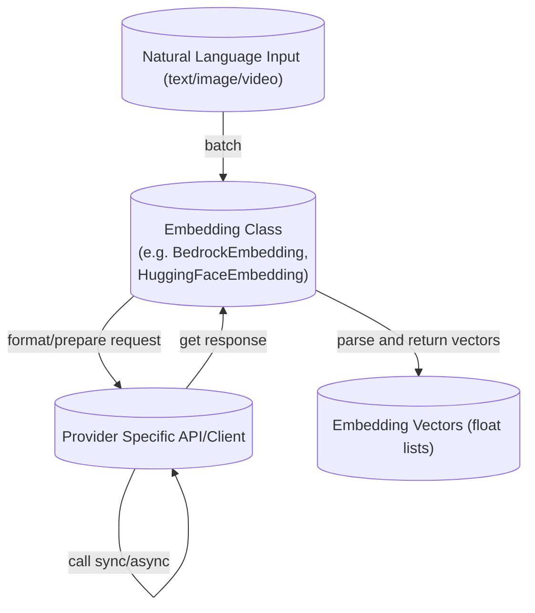
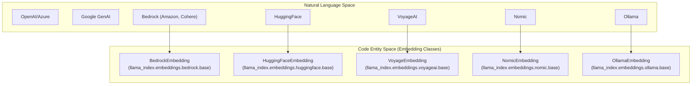
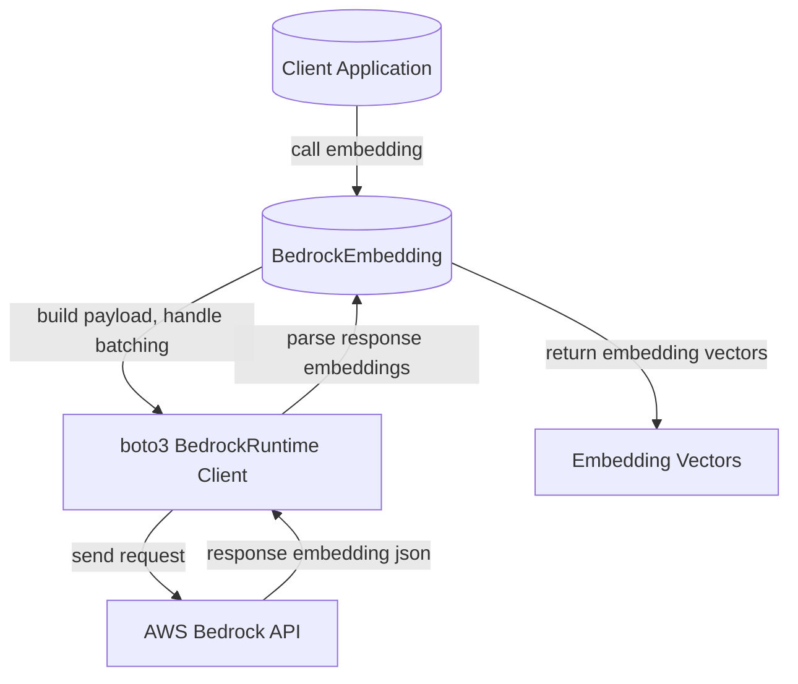

<!-- source: DeepWiki mcp.deepwiki.com · repo run-llama/llama_index · page 8.2 Embedding Providers · fetched 2026-10-26 -->

# 8.2 Embedding Providers

<details>
<summary>Relevant source files</summary>

The following files were used as context for generating this wiki page:

- [docs/examples/embeddings/bedrock.ipynb](docs/examples/embeddings/bedrock.ipynb)
- [docs/examples/llm/bedrock.ipynb](docs/examples/llm/bedrock.ipynb)
- [llama-index-core/llama_index/core/extractors/__init__.py](llama-index-core/llama_index/core/extractors/__init__.py)
- [llama-index-core/tests/extractors/test_document_context_extractor.py](llama-index-core/tests/extractors/test_document_context_extractor.py)
- [llama-index-integrations/callbacks/llama-index-callbacks-langfuse/README.md](llama-index-integrations/callbacks/llama-index-callbacks-langfuse/README.md)
- [llama-index-integrations/callbacks/llama-index-callbacks-langfuse/llama_index/callbacks/langfuse/__init__.py](llama-index-integrations/callbacks/llama-index-callbacks-langfuse/llama_index/callbacks/langfuse/__init__.py)
- [llama-index-integrations/callbacks/llama-index-callbacks-langfuse/pyproject.toml](llama-index-integrations/callbacks/llama-index-callbacks-langfuse/pyproject.toml)
- [llama-index-integrations/embeddings/llama-index-embeddings-adapter/llama_index/embeddings/adapter/__init__.py](llama-index-integrations/embeddings/llama-index-embeddings-adapter/llama_index/embeddings/adapter/__init__.py)
- [llama-index-integrations/embeddings/llama-index-embeddings-adapter/pyproject.toml](llama-index-integrations/embeddings/llama-index-embeddings-adapter/pyproject.toml)
- [llama-index-integrations/embeddings/llama-index-embeddings-bedrock/README.md](llama-index-integrations/embeddings/llama-index-embeddings-bedrock/README.md)
- [llama-index-integrations/embeddings/llama-index-embeddings-bedrock/llama_index/embeddings/bedrock/base.py](llama-index-integrations/embeddings/llama-index-embeddings-bedrock/llama_index/embeddings/bedrock/base.py)
- [llama-index-integrations/embeddings/llama-index-embeddings-bedrock/pyproject.toml](llama-index-integrations/embeddings/llama-index-embeddings-bedrock/pyproject.toml)
- [llama-index-integrations/embeddings/llama-index-embeddings-bedrock/tests/test_bedrock.py](llama-index-integrations/embeddings/llama-index-embeddings-bedrock/tests/test_bedrock.py)
- [llama-index-integrations/embeddings/llama-index-embeddings-bedrock/tests/test_bedrock_async.py](llama-index-integrations/embeddings/llama-index-embeddings-bedrock/tests/test_bedrock_async.py)
- [llama-index-integrations/embeddings/llama-index-embeddings-bedrock/tests/test_bedrock_embedding.py](llama-index-integrations/embeddings/llama-index-embeddings-bedrock/tests/test_bedrock_embedding.py)
- [llama-index-integrations/embeddings/llama-index-embeddings-bedrock/uv.lock](llama-index-integrations/embeddings/llama-index-embeddings-bedrock/uv.lock)
- [llama-index-integrations/embeddings/llama-index-embeddings-huggingface-openvino/Makefile](llama-index-integrations/embeddings/llama-index-embeddings-huggingface-openvino/Makefile)
- [llama-index-integrations/embeddings/llama-index-embeddings-huggingface-openvino/README.md](llama-index-integrations/embeddings/llama-index-embeddings-huggingface-openvino/README.md)
- [llama-index-integrations/embeddings/llama-index-embeddings-huggingface-openvino/llama_index/embeddings/huggingface_openvino/__init__.py](llama-index-integrations/embeddings/llama-index-embeddings-huggingface-openvino/llama_index/embeddings/huggingface_openvino/__init__.py)
- [llama-index-integrations/embeddings/llama-index-embeddings-huggingface-openvino/llama_index/embeddings/huggingface_openvino/base.py](llama-index-integrations/embeddings/llama-index-embeddings-huggingface-openvino/llama_index/embeddings/huggingface_openvino/base.py)
- [llama-index-integrations/embeddings/llama-index-embeddings-huggingface-openvino/pyproject.toml](llama-index-integrations/embeddings/llama-index-embeddings-huggingface-openvino/pyproject.toml)
- [llama-index-integrations/embeddings/llama-index-embeddings-huggingface/llama_index/embeddings/huggingface/base.py](llama-index-integrations/embeddings/llama-index-embeddings-huggingface/llama_index/embeddings/huggingface/base.py)
- [llama-index-integrations/embeddings/llama-index-embeddings-huggingface/llama_index/embeddings/huggingface/pooling.py](llama-index-integrations/embeddings/llama-index-embeddings-huggingface/llama_index/embeddings/huggingface/pooling.py)
- [llama-index-integrations/embeddings/llama-index-embeddings-huggingface/pyproject.toml](llama-index-integrations/embeddings/llama-index-embeddings-huggingface/pyproject.toml)
- [llama-index-integrations/embeddings/llama-index-embeddings-huggingface/tests/test_embeddings_huggingface.py](llama-index-integrations/embeddings/llama-index-embeddings-huggingface/tests/test_embeddings_huggingface.py)
- [llama-index-integrations/embeddings/llama-index-embeddings-nomic/llama_index/embeddings/nomic/base.py](llama-index-integrations/embeddings/llama-index-embeddings-nomic/llama_index/embeddings/nomic/base.py)
- [llama-index-integrations/embeddings/llama-index-embeddings-nomic/pyproject.toml](llama-index-integrations/embeddings/llama-index-embeddings-nomic/pyproject.toml)
- [llama-index-integrations/embeddings/llama-index-embeddings-nomic/tests/test_embeddings_nomic.py](llama-index-integrations/embeddings/llama-index-embeddings-nomic/tests/test_embeddings_nomic.py)
- [llama-index-integrations/embeddings/llama-index-embeddings-ollama/llama_index/embeddings/ollama/base.py](llama-index-integrations/embeddings/llama-index-embeddings-ollama/llama_index/embeddings/ollama/base.py)
- [llama-index-integrations/embeddings/llama-index-embeddings-ollama/pyproject.toml](llama-index-integrations/embeddings/llama-index-embeddings-ollama/pyproject.toml)
- [llama-index-integrations/embeddings/llama-index-embeddings-ollama/tests/test_embeddings_ollama.py](llama-index-integrations/embeddings/llama-index-embeddings-ollama/tests/test_embeddings_ollama.py)
- [llama-index-integrations/embeddings/llama-index-embeddings-ollama/uv.lock](llama-index-integrations/embeddings/llama-index-embeddings-ollama/uv.lock)
- [llama-index-integrations/embeddings/llama-index-embeddings-openvino-genai/LICENSE](llama-index-integrations/embeddings/llama-index-embeddings-openvino-genai/LICENSE)
- [llama-index-integrations/embeddings/llama-index-embeddings-openvino-genai/Makefile](llama-index-integrations/embeddings/llama-index-embeddings-openvino-genai/Makefile)
- [llama-index-integrations/embeddings/llama-index-embeddings-openvino-genai/README.md](llama-index-integrations/embeddings/llama-index-embeddings-openvino-genai/README.md)
- [llama-index-integrations/embeddings/llama-index-embeddings-openvino-genai/llama_index/embeddings/openvino_genai/__init__.py](llama-index-integrations/embeddings/llama-index-embeddings-openvino-genai/llama_index/embeddings/openvino_genai/__init__.py)
- [llama-index-integrations/embeddings/llama-index-embeddings-openvino-genai/llama_index/embeddings/openvino_genai/base.py](llama-index-integrations/embeddings/llama-index-embeddings-openvino-genai/llama_index/embeddings/openvino_genai/base.py)
- [llama-index-integrations/embeddings/llama-index-embeddings-openvino-genai/pyproject.toml](llama-index-integrations/embeddings/llama-index-embeddings-openvino-genai/pyproject.toml)
- [llama-index-integrations/embeddings/llama-index-embeddings-sagemaker-endpoint/llama_index/embeddings/sagemaker_endpoint/base.py](llama-index-integrations/embeddings/llama-index-embeddings-sagemaker-endpoint/llama_index/embeddings/sagemaker_endpoint/base.py)
- [llama-index-integrations/embeddings/llama-index-embeddings-sagemaker-endpoint/pyproject.toml](llama-index-integrations/embeddings/llama-index-embeddings-sagemaker-endpoint/pyproject.toml)
- [llama-index-integrations/embeddings/llama-index-embeddings-voyageai/README.md](llama-index-integrations/embeddings/llama-index-embeddings-voyageai/README.md)
- [llama-index-integrations/embeddings/llama-index-embeddings-voyageai/llama_index/embeddings/voyageai/base.py](llama-index-integrations/embeddings/llama-index-embeddings-voyageai/llama_index/embeddings/voyageai/base.py)
- [llama-index-integrations/embeddings/llama-index-embeddings-voyageai/pyproject.toml](llama-index-integrations/embeddings/llama-index-embeddings-voyageai/pyproject.toml)
- [llama-index-integrations/embeddings/llama-index-embeddings-voyageai/tests/test_embeddings_voyageai.py](llama-index-integrations/embeddings/llama-index-embeddings-voyageai/tests/test_embeddings_voyageai.py)
- [llama-index-integrations/embeddings/llama-index-embeddings-voyageai/tests/test_embeddings_voyageai_integration.py](llama-index-integrations/embeddings/llama-index-embeddings-voyageai/tests/test_embeddings_voyageai_integration.py)
- [llama-index-integrations/llms/llama-index-llms-openvino/llama_index/llms/openvino/base.py](llama-index-integrations/llms/llama-index-llms-openvino/llama_index/llms/openvino/base.py)
- [llama-index-integrations/llms/llama-index-llms-sagemaker-endpoint/llama_index/llms/sagemaker_endpoint/base.py](llama-index-integrations/llms/llama-index-llms-sagemaker-endpoint/llama_index/llms/sagemaker_endpoint/base.py)
- [llama-index-integrations/llms/llama-index-llms-sagemaker-endpoint/pyproject.toml](llama-index-integrations/llms/llama-index-llms-sagemaker-endpoint/pyproject.toml)
- [llama-index-integrations/postprocessor/llama-index-postprocessor-openvino-rerank/llama_index/postprocessor/openvino_rerank/base.py](llama-index-integrations/postprocessor/llama-index-postprocessor-openvino-rerank/llama_index/postprocessor/openvino_rerank/base.py)
- [llama-index-integrations/postprocessor/llama-index-postprocessor-voyageai-rerank/.gitignore](llama-index-integrations/postprocessor/llama-index-postprocessor-voyageai-rerank/.gitignore)
- [llama-index-integrations/postprocessor/llama-index-postprocessor-voyageai-rerank/Makefile](llama-index-integrations/postprocessor/llama-index-postprocessor-voyageai-rerank/Makefile)
- [llama-index-integrations/postprocessor/llama-index-postprocessor-voyageai-rerank/README.md](llama-index-integrations/postprocessor/llama-index-postprocessor-voyageai-rerank/README.md)
- [llama-index-integrations/postprocessor/llama-index-postprocessor-voyageai-rerank/llama_index/postprocessor/voyageai_rerank/__init__.py](llama-index-integrations/postprocessor/llama-index-postprocessor-voyageai-rerank/llama_index/postprocessor/voyageai_rerank/__init__.py)
- [llama-index-integrations/postprocessor/llama-index-postprocessor-voyageai-rerank/tests/__init__.py](llama-index-integrations/postprocessor/llama-index-postprocessor-voyageai-rerank/tests/__init__.py)
- [llama-index-integrations/postprocessor/llama-index-postprocessor-voyageai-rerank/tests/test_postprocessor_voyageai-rerank.py](llama-index-integrations/postprocessor/llama-index-postprocessor-voyageai-rerank/tests/test_postprocessor_voyageai-rerank.py)

</details>


This section documents the various embedding provider integrations available in the LlamaIndex codebase. It covers implementations for widely used providers such as OpenAI/Azure, Google GenAI, HuggingFace (including OpenVINO acceleration), AWS Bedrock, Cohere, VoyageAI, NVIDIA, Ollama, Nomic, and related platforms. We explain their implementation details, data flow, key classes and functions, and provide diagrams connecting these natural language space providers to the code entities that encapsulate them.

---

## Overview

In LlamaIndex, embedding providers are encapsulated by classes implementing the `BaseEmbedding` interface which defines standardized methods for obtaining vector embeddings from text or multimodal inputs. These provider-specific embedding classes handle batching, calls to remote APIs or local models, formatting input and output data, and optimizations such as asynchronous execution and multi-modal data processing.

Embedding providers covered here are implemented as integration packages under the path:
```
llama-index-integrations/embeddings/
```
Each has their own module containing a subclass of `BaseEmbedding`, implemented to support both synchronous and asynchronous embedding calls, with configurable batching and other parameters.

---

## Common Embedding Architecture

All embedding providers implement or subclass from:

- `BaseEmbedding` (`llama_index.core.base.embeddings.base`) — the fundamental interface for embedding providers.
- For multimodal or advanced embeddings, often subclass `MultiModalEmbedding` which supports embedding text, images, and sometimes video.

Key abstracted methods implemented include:
- `_get_query_embedding`: Get vector for query text.
- `_get_text_embedding`: Get vector for general text.
- Batch variants for efficiency.
- Some providers extend to support image/video embeddings if their model/API supports multimodal inputs.

---

## Embedding Provider Implementations

### 1. **AWS Bedrock Embedding**

- **Module:** `llama_index.embeddings.bedrock.base.BedrockEmbedding`
- **Provider:** Amazon Bedrock (and all Bedrock-compatible models including Cohere)
- **Highlights:**
  - Uses `boto3` Bedrock runtime client for API calls.
  - Supports model_name strings that encode the provider and model, e.g., `"amazon.titan-embed-text-v1"`, `"cohere.embed-english-v3"`.
  - Provider is inferred from the model name prefix; handles 2-part and 3-part model name formatting.
  - Handles response parsing specialized for providers (e.g., parse Cohere embedding response differently).
  - Supports AWS credentials, profile, region, etc. for client session management.
  - Supports retrying, timeouts, additional kwargs, application inference profiles.
  - Validates inputs locally to reject empty payloads before calling API (prevents confusing AWS errors).
  - Supports synchronous and asynchronous embedding calls (uses optional `aioboto3` for async).
- **Key methods:**
  - `_get_provider`: parses model name to get provider.
  - `_get_embedding`: sends embedding request and extracts vectors from response.
  - `_get_request_body`: preps JSON payload for Bedrock API depending on provider.
- **Reference:** Implementation starting line 1 in `llama-index-integrations/embeddings/llama-index-embeddings-bedrock/llama_index/embeddings/bedrock/base.py` and corresponding test coverage in `tests/test_bedrock_embedding.py`.

---

### 2. **VoyageAI Embeddings**

- **Module:** `llama_index.embeddings.voyageai.base.VoyageEmbedding`
- **Provider:** VoyageAI API
- **Highlights:**
  - Supports large-scale batch embedding with token limits per model.
  - Supports multimodal inputs: text, images, and video.
  - Validates image/video formats before embedding.
  - Integrates synchronous and async VoyageAI clients.
  - Has robust batching logic considering token count limits and max batch size.
  - Supports model types:
    - Multimodal: `"voyage-multimodal-3"`, `"voyage-multimodal-3.5"` (video supported only in 3.5)
    - Contextual: `"voyage-context-3"`, `"voyage-context-4"`
    - Various limits per model are enforced.
- **Key methods:**
  - `_build_batches`: yields batches of texts respecting token limit constraints.
  - `_image_to_content`: converts images to base64 for API ingestion.
  - `_validate_image_format` / `_validate_video_format`: format validation utilities.
- **Reference:** Implementation in `llama-index-integrations/embeddings/llama-index-embeddings-voyageai/llama_index/embeddings/voyageai/base.py`

---

### 3. **HuggingFace Embeddings**

- **Module:** `llama_index.embeddings.huggingface.base.HuggingFaceEmbedding`
- **Provider:** HuggingFace 
- **Highlights:**
  - Supports embedding text and images (multimodal).
  - Uses `sentence-transformers` and HuggingFace Hub for model loading.
  - Supports local cache and device inference control (`cpu`, `cuda`, `mps`, etc.).
  - Enables normalization, batching, custom instructions for queries and texts.
  - Supports parallel embedding via multi-process pools.
  - Supports asynchronous inference calls using `huggingface_hub` clients.
  - Deprecated parameters supported for backward compatibility.
- **Key methods:**
  - Model initialization loads or downloads appropriate embedding model.
  - `_get_text_embedding` and async variants for text embedding.
  - Extends to image embeddings with proper preprocessing.
- **Reference:** Implementation in `llama-index-integrations/embeddings/llama-index-embeddings-huggingface/llama_index/embeddings/huggingface/base.py`

---

### 4. **HuggingFace OpenVINO Embeddings**

- **Module:** `llama_index.embeddings.huggingface_openvino.base.OpenVINOEmbedding`
- **Provider:** HuggingFace with OpenVINO acceleration
- **Highlights:**
  - Leverages Intel OpenVINO toolkit for CPU-optimized inference.
  - Extends HuggingFace integration with OpenVINO runtime.
  - Suitable for lower-latency or CPU-constrained environments.
- **Reference:** Package `llama-index-embeddings-openvino` and base implementation at `llama-index-integrations/embeddings/llama-index-embeddings-huggingface-openvino/llama_index/embeddings/huggingface_openvino/base.py`.

---

### 5. **Ollama Embeddings**

- **Module:** `llama_index.embeddings.ollama.base.OllamaEmbedding`
- **Provider:** Ollama (local hosting for various models)
- **Highlights:**
  - Communication with Ollama API endpoints on local host or specified URL.
  - Supports query and text embedding with configurable prepend instructions.
  - Supports synchronous and asynchronous calls.
  - Configuration includes base URL, batch size, keep-alive for hosted model.
  - Additional kwargs can be passed to underlying API call.
- **Key methods:**
  - `get_general_text_embedding` and async variant invoke Ollama client's embed endpoint.
  - Formatting helpers to prepend instructions on queries or texts.
- **Reference:** `llama-index-integrations/embeddings/llama-index-embeddings-ollama/llama_index/embeddings/ollama/base.py`

---

### 6. **Nomic Embeddings**

- **Module:** `llama_index.embeddings.nomic.base.NomicEmbedding`
- **Provider:** Nomic AI embeddings with efficient tensor operations
- **Highlights:**
  - Built on top of HuggingFace (inherits `HuggingFaceEmbedding`).
  - Adds Nomic-specific tensor reshaping and embedding extraction.
  - Supports advanced input/output dtype and projection configurations.
- **Reference:** Implementation at `llama-index-integrations/embeddings/llama-index-embeddings-nomic/llama_index/embeddings/nomic/base.py`.

---

### 7. **Cohere Embeddings**

- **Implemented as part of BedrockEmbedding** (same module as AWS Bedrock, leveraging the same interface)
- Embedded as one of the providers with dedicated response parsing logic.

---

### 8. **Google GenAI Embeddings**

- **Implementation:** Provided via Google GenAI integration package (not shown in the excerpt).
- Expected to follow similar structure with Google GenAI client calls wrapped in embedding classes.

---

### 9. **Other Embedding Providers**

- NVIDIA, OpenAI/Azure, and others typically follow the pattern of:
  - A provider-specific embedding class implementing `BaseEmbedding`.
  - Synchronous and asynchronous embedding calls.
  - Batching support.
  - Input pre/post processing specific to provider.
  - API key, region, or other credential management.

---

## Data Flow and Calls

Typical embedding workflow in LlamaIndex:



Details per provider might differ on calls, batching logic, or supported modalities (see respective implementations).

---

## Class-Provider Associations Diagram (Natural Language to Code)



---

## Detailed Mermeid Diagram: AWS Bedrock Embedding Data Flow



- `BedrockEmbedding` encapsulates creating the request JSON based on provider (Amazon or Cohere).
- `_get_provider()` parses the model name to route logic internally.
- Special parsing logic for cohort embedding responses.
- Supports retries and timeouts.
- Enforces input validation before API calls.

---

## Summary Table of Core Embedding Provider Classes

| Provider       | Class Name          | Module Path                                  | Key Features                          | Supported Modalities           |
|----------------|---------------------|----------------------------------------------|-------------------------------------|-------------------------------|
| AWS Bedrock + Cohere | `BedrockEmbedding`    | `embeddings.bedrock.base`                    | AWS client, provider parsing, retries | Text                         |
| VoyageAI       | `VoyageEmbedding`    | `embeddings.voyageai.base`                    | Token-limited batching, multimodal   | Text, Images, Video           |
| HuggingFace    | `HuggingFaceEmbedding`| `embeddings.huggingface.base`                 | Local/Hub model loading, async calls | Text, Images                 |
| HuggingFace OpenVINO | `OpenVINOEmbedding` | `embeddings.huggingface_openvino.base`        | Intel OpenVINO acceleration          | Text                         |
| Ollama         | `OllamaEmbedding`    | `embeddings.ollama.base`                       | Local/remote API, keep-alive control | Text                         |
| Nomic          | `NomicEmbedding`     | `embeddings.nomic.base`                        | Tensor ops extension on HF embedding  | Text                         |

---

## Implementation Highlights

### Multi-modal Support Hierarchy

Providers such as VoyageAI and HuggingFace out-of-the-box support multimodal embeddings:

- These classes subclass `MultiModalEmbedding` (`llama_index.core.embeddings.multi_modal_base.MultiModalEmbedding`).
- Implement modality-specific input formatting, e.g., `image_to_content`.
- Validate input formats/types before embedding.

### Batching and Token Limits

- VoyageAI has limits on total tokens per batch which affects batching logic.
- HuggingFace supports batch embedding with configurable batch size.
- Bedrock class enforces non-empty batch to avoid API errors.

### Synchronous & Asynchronous APIs

- All providers implement synchronous and asynchronous embedding methods to fit different use cases.
- Async support uses underlying async clients or HTTP calls (e.g., aioboto3 for Bedrock, `voyageai.AsyncClient`).
  
---

## Class: BedrockEmbedding - Implementation Details

Defined in `llama_index.embeddings.bedrock.base`, main features:

- Fields for AWS credentials/profile/region.
- `model_name` to specify embedding model.
- `_get_provider()` parses the model_name (e.g. `"amazon.titan-embed-text-v1"`) to detect provider (`amazon`, `cohere`).
- `_get_embedding()` sends payload depending on provider with JSON-encoded text batch.
- Response parsing with special handling of Cohere's response structure.
- `max_retries` and `timeout` configuration for API reliability.
- Optional `botocore_session` and `botocore_config` for AWS client customization.

This class fits into LlamaIndex as a first-class embedding integration supporting common models found in AWS Bedrock environment.

---

## Class: VoyageEmbedding - Implementation Highlights

Defined in `llama_index.embeddings.voyageai.base`:

- Requires `voyageai` Python SDK client.
- Supports embedding documents containing text, images, video.
- Performs careful batch splitting according to token limits per model to avoid API errors.
- Validates allowed image and video formats.
- Supports large batch sizes (up to 1000).
- Use API key for client instantiation.
- Handles sync/async calls with distinct clients.
- Models include `"voyage-multimodal-3"`, `"voyage-context-4"`, etc.

---

## Class: HuggingFaceEmbedding - Implementation Highlights

Defined in `llama_index.embeddings.huggingface.base`:

- Loads embedding models using `sentence-transformers` or HuggingFace Hub Inference API.
- Supports configuration for:
  - Device usage (CPU/GPU).
  - Instruction prompts for query and text.
  - Embedding normalization.
  - Cache folder for model files.
  - Batch size and parallel processing.
- Exposes sync and async embedding methods.
- Integrates pooling strategies (mean pooling by default).
- Supports embedding of both text and images (multimodal).

---

## Class: OllamaEmbedding

Defined in `llama_index.embeddings.ollama.base`:

- Wraps Ollama client for local or remote embedding service.
- Configurable model name and base URL.
- Supports embedding with prepended instructions to query/text.
- Supports keep-alive to keep models loaded for performance.
- Implements underlying calls to Ollama's embed API exposing sync/async methods.

---

# Summary

LlamaIndex provides a rich ecosystem of embedding providers as modular, consistent interfaces implementing the `BaseEmbedding` class. These range from direct cloud API calls (AWS Bedrock, Cohere, Google GenAI), local or hub-based models (HuggingFace, Ollama), to specialized providers with multimodal support (VoyageAI, HuggingFace OpenVINO accelerator). All providers provide batching, synchronous/asynchronous calls, and handle provider-specific request/response formatting. This allows seamless switching or combining embedding models in an LLM application.

---

# References & Sources

- `llama-index-integrations/embeddings/llama-index-embeddings-bedrock/llama_index/embeddings/bedrock/base.py:1-183`  
- `llama-index-integrations/embeddings/llama-index-embeddings-bedrock/tests/test_bedrock_embedding.py:1-128`  
- `llama-index-integrations/embeddings/llama-index-embeddings-voyageai/llama_index/embeddings/voyageai/base.py:1-195`  
- `llama-index-integrations/embeddings/llama-index-embeddings-huggingface/llama_index/embeddings/huggingface/base.py:1-152`  
- `llama-index-integrations/embeddings/llama-index-embeddings-ollama/llama_index/embeddings/ollama/base.py:1-153`  
- `llama-index-integrations/embeddings/llama-index-embeddings-nomic/llama_index/embeddings/nomic/base.py`  
- `llama-index-integrations/embeddings/llama-index-embeddings-huggingface-openvino/llama_index/embeddings/huggingface_openvino/base.py`

---

