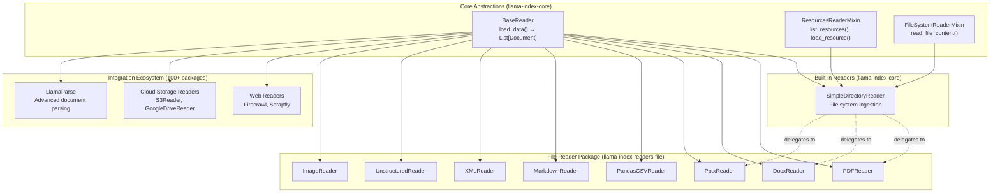
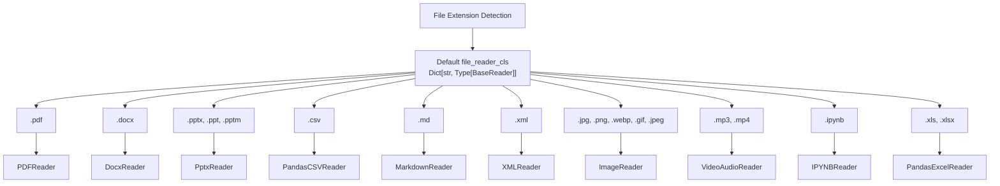

<!-- source: DeepWiki mcp.deepwiki.com · repo run-llama/llama_index · page 9 Data Connectors · fetched 2026-10-26 -->

# Data Connectors

Relevant source files

The following files were used as context for generating this wiki page:

- [docs/examples/data_connectors/simple_directory_reader.ipynb](docs/examples/data_connectors/simple_directory_reader.ipynb)
- [docs/examples/data_connectors/simple_directory_reader_remote_fs.ipynb](docs/examples/data_connectors/simple_directory_reader_remote_fs.ipynb)
- [llama-index-core/llama_index/core/readers/file/base.py](llama-index-core/llama_index/core/readers/file/base.py)
- [llama-index-core/tests/readers/file/test_base.py](llama-index-core/tests/readers/file/test_base.py)
- [llama-index-integrations/readers/llama-index-readers-file/README.md](llama-index-integrations/readers/llama-index-readers-file/README.md)
- [llama-index-integrations/readers/llama-index-readers-file/llama_index/readers/file/epub/base.py](llama-index-integrations/readers/llama-index-readers-file/llama_index/readers/file/epub/base.py)
- [llama-index-integrations/readers/llama-index-readers-file/llama_index/readers/file/image/base.py](llama-index-integrations/readers/llama-index-readers-file/llama_index/readers/file/image/base.py)
- [llama-index-integrations/readers/llama-index-readers-file/llama_index/readers/file/ipynb/base.py](llama-index-integrations/readers/llama-index-readers-file/llama_index/readers/file/ipynb/base.py)
- [llama-index-integrations/readers/llama-index-readers-file/llama_index/readers/file/markdown/base.py](llama-index-integrations/readers/llama-index-readers-file/llama_index/readers/file/markdown/base.py)
- [llama-index-integrations/readers/llama-index-readers-file/llama_index/readers/file/mbox/base.py](llama-index-integrations/readers/llama-index-readers-file/llama_index/readers/file/mbox/base.py)
- [llama-index-integrations/readers/llama-index-readers-file/llama_index/readers/file/slides/__init__.py](llama-index-integrations/readers/llama-index-readers-file/llama_index/readers/file/slides/__init__.py)
- [llama-index-integrations/readers/llama-index-readers-file/llama_index/readers/file/slides/base.py](llama-index-integrations/readers/llama-index-readers-file/llama_index/readers/file/slides/base.py)
- [llama-index-integrations/readers/llama-index-readers-file/llama_index/readers/file/slides/content_extractor.py](llama-index-integrations/readers/llama-index-readers-file/llama_index/readers/file/slides/content_extractor.py)
- [llama-index-integrations/readers/llama-index-readers-file/llama_index/readers/file/slides/image_extractor.py](llama-index-integrations/readers/llama-index-readers-file/llama_index/readers/file/slides/image_extractor.py)
- [llama-index-integrations/readers/llama-index-readers-file/llama_index/readers/file/tabular/__init__.py](llama-index-integrations/readers/llama-index-readers-file/llama_index/readers/file/tabular/__init__.py)
- [llama-index-integrations/readers/llama-index-readers-file/llama_index/readers/file/tabular/base.py](llama-index-integrations/readers/llama-index-readers-file/llama_index/readers/file/tabular/base.py)
- [llama-index-integrations/readers/llama-index-readers-file/llama_index/readers/file/unstructured/README.md](llama-index-integrations/readers/llama-index-readers-file/llama_index/readers/file/unstructured/README.md)
- [llama-index-integrations/readers/llama-index-readers-file/llama_index/readers/file/unstructured/base.py](llama-index-integrations/readers/llama-index-readers-file/llama_index/readers/file/unstructured/base.py)
- [llama-index-integrations/readers/llama-index-readers-file/llama_index/readers/file/unstructured/requirements.txt](llama-index-integrations/readers/llama-index-readers-file/llama_index/readers/file/unstructured/requirements.txt)
- [llama-index-integrations/readers/llama-index-readers-file/llama_index/readers/file/xml/base.py](llama-index-integrations/readers/llama-index-readers-file/llama_index/readers/file/xml/base.py)
- [llama-index-integrations/readers/llama-index-readers-file/pyproject.toml](llama-index-integrations/readers/llama-index-readers-file/pyproject.toml)
- [llama-index-integrations/readers/llama-index-readers-file/tests/generate_test_ppt.py](llama-index-integrations/readers/llama-index-readers-file/tests/generate_test_ppt.py)
- [llama-index-integrations/readers/llama-index-readers-file/tests/test_file.py](llama-index-integrations/readers/llama-index-readers-file/tests/test_file.py)
- [llama-index-integrations/readers/llama-index-readers-file/tests/test_markdown.py](llama-index-integrations/readers/llama-index-readers-file/tests/test_markdown.py)
- [llama-index-integrations/readers/llama-index-readers-file/tests/test_slides.py](llama-index-integrations/readers/llama-index-readers-file/tests/test_slides.py)
- [llama-index-integrations/readers/llama-index-readers-file/tests/test_xml.py](llama-index-integrations/readers/llama-index-readers-file/tests/test_xml.py)
- [llama-index-integrations/readers/llama-index-readers-file/uv.lock](llama-index-integrations/readers/llama-index-readers-file/uv.lock)

Data Connectors (also called Readers or Data Loaders) provide LlamaIndex's core data ingestion capabilities, enabling the framework to load and process documents from diverse file formats and data sources. The system includes 100+ integration packages that transform unstructured data from various sources into standardized `Document` objects for indexing and querying.

**Key Components:**
- **SimpleDirectoryReader**: A core reader for local filesystem ingestion which automatically selects readers based on file extensions. [llama-index-core/llama_index/core/readers/file/base.py:208-248]()
- **Specialized File Readers**: For PDF, DOCX, PPTX, XML, CSV, Markdown, images, and more, offering rich content extraction capabilities. [llama-index-integrations/readers/llama-index-readers-file/pyproject.toml:97-124]()
- **UnstructuredReader**: Leverages the Unstructured.io library or API to parse a broad variety of unstructured file types with advanced content partitioning. [llama-index-integrations/readers/llama-index-readers-file/llama_index/readers/file/unstructured/base.py:24-175]()
- **100+ Integration Readers**: Connectors for web scraping, cloud platforms, databases, and enterprise services. [llama-index-integrations/readers/llama-index-readers-file/pyproject.toml:97-124]()

**Related Pages:**
- For details on file system ingestion and document parsing, see [File and Document Readers](#9.1)
- For details on web scraping and cloud integrations, see [Web and Cloud Readers](#9.2)

---

## Architecture Overview

The Data Connector system is stratified into three concentric layers:

- **Core Abstractions:** The foundational interfaces and mixins (`BaseReader`, `ResourcesReaderMixin`, `FileSystemReaderMixin`) residing in `llama-index-core`. These define the protocols for loading documents and handling resources.
  
- **Built-in Readers:** Includes the important `SimpleDirectoryReader` that leverages core abstractions to enable flexible directory and file ingestion.
  
- **Specialized Readers and Integration Ecosystem:** The file readers packaged primarily in the `llama-index-readers-file` module support a wide array of file formats such as PDF, DOCX, PPTX, CSV, Markdown, XML, and images. Beyond this, over 100 integration readers enable connections to web data, cloud storages, and specialized APIs.

**Sources:**  
[llama-index-core/llama_index/core/readers/file/base.py:19-58]()  
[llama-index-core/llama_index/core/readers/file/base.py:208-248]()  
[llama-index-integrations/readers/llama-index-readers-file/pyproject.toml:97-124]()  
[llama-index-integrations/readers/llama-index-readers-file/llama_index/readers/file/slides/base.py:32-39]()  
[llama-index-integrations/readers/llama-index-readers-file/llama_index/readers/file/unstructured/base.py:24-175]()

---

## SimpleDirectoryReader

The `SimpleDirectoryReader` is the core class for ingesting data from a file directory or explicitly provided list of files. It automatically selects the most suitable file reader based on file extensions, providing a seamless ingestion experience for heterogeneous file collections. It is widely used as the default connector for local filesystem data ingestion. 

Key features include:

- Support for recursive directory scanning
- Flexible file filtering with inclusion and exclusion patterns
- Ability to load files from diverse filesystems using `fsspec`
- Delegation to specialized readers for complex file types

### Key Parameters and Capabilities

| Parameter          | Type                                | Description                                                              |
|--------------------|-----------------------------------|--------------------------------------------------------------------------|
| `input_dir`        | `Path | str`                       | Directory path from which to recursively or non-recursively load files. [llama-index-core/llama_index/core/readers/file/base.py:216]() |
| `input_files`      | `List[Path | str]`                | Explicit list of file paths to load, overrides `input_dir`. [llama-index-core/llama_index/core/readers/file/base.py:217-218]() |
| `exclude`          | `List[str]`                      | Glob patterns for files to exclude from loading, e.g. `*.tmp`. [llama-index-core/llama_index/core/readers/file/base.py:219]() |
| `required_exts`    | `List[str]`                      | File extensions to restrict reading to, e.g. [".md", ".txt"]. [llama-index-core/llama_index/core/readers/file/base.py:230]() |
| `file_extractor`   | `Dict[str, BaseReader]`           | Optional custom file readers mapped by extension to override defaults. [llama-index-core/llama_index/core/readers/file/base.py:231-232]() |
| `recursive`        | `bool`                          | Whether to recursively search files within subdirectories. [llama-index-core/llama_index/core/readers/file/base.py:226-227]() |
| `fs`               | `fsspec.AbstractFileSystem`        | Optional file system to use for reading files, allowing cloud or remote FS. [llama-index-core/llama_index/core/readers/file/base.py:233]() |

The reader inspects file extensions and maps them to respective loaders via an internal registry: `_try_loading_included_file_formats()`. If no custom extractor is provided for a file type, it defaults to these mappings.

**Sources:**  
[llama-index-core/llama_index/core/readers/file/base.py:208-248]()  
[llama-index-core/llama_index/core/readers/file/base.py:68-113]()

---

## File Format Auto-Detection

The system automatically associates file extensions with specialized readers for seamless document parsing in `SimpleDirectoryReader`.

**Sources:**  
[llama-index-core/llama_index/core/readers/file/base.py:68-113]()  
[llama-index-integrations/readers/llama-index-readers-file/pyproject.toml:97-124]()

---

## Specialized Readers Overview

To handle the diversity of file formats, the codebase offers an array of specialized reader implementations packaged in `llama-index-readers-file`. These readers parse files into structured text and metadata, enhancing their value for indexing.

### Common File and Document Readers:
- **PDFReader:** Extracts text and metadata from PDF files efficiently. [llama-index-integrations/readers/llama-index-readers-file/pyproject.toml:115]()
- **DocxReader:** Reads Microsoft Word `.docx` documents, extracting well-structured text. [llama-index-integrations/readers/llama-index-readers-file/pyproject.toml:103]()
- **PptxReader:** An enhanced PowerPoint reader extracting text, tables, charts, speaker notes, and optionally image captions. Supports batch and multithreaded processing, optionally consolidating content via LLMs. [llama-index-integrations/readers/llama-index-readers-file/llama_index/readers/file/slides/base.py:32-152]()
- **CSVReader & PandasCSVReader:** Parses CSV files, with support for concatenating rows or returning one document per row. PandasCSVReader leverages pandas for smarter separator detection and config. [llama-index-integrations/readers/llama-index-readers-file/llama_index/readers/file/tabular/base.py:18-133]()
- **MarkdownReader:** Converts markdown files into documents, preserving headers and text sections. Includes options to remove hyperlinks and images. [llama-index-integrations/readers/llama-index-readers-file/llama_index/readers/file/markdown/base.py:16-150]()
- **XMLReader:** Parses XML documents extracting structured content. [llama-index-integrations/readers/llama-index-readers-file/pyproject.toml:124]()
- **ImageReader:** Extracts text content from images using OCR or vision models like DONUT, with optional base64 embedding of the image. [llama-index-integrations/readers/llama-index-readers-file/llama_index/readers/file/image/base.py:19-153]()
- **UnstructuredReader:** Uses Unstructured.io (local or API) to parse more than 20 file types (.csv, .docx, .pdf, .pptx, .md, .eml, .html, .xml, .txt, .json, images, etc.) into rich document elements. [llama-index-integrations/readers/llama-index-readers-file/llama_index/readers/file/unstructured/base.py:24-175]()

For usage details and configuration, see the child page: [File and Document Readers](#9.1)

---

## Web and Cloud Readers Overview

Beyond file-based ingestion, LlamaIndex supports reading from various live and cloud-hosted data sources:

- **Web Readers:** Web scraping integrations like Firecrawl and Scrapfly enable ingestion of web page content, including dynamic and SPA sites.
- **Cloud Storage Readers:** Readers for S3 buckets, Google Drive, Google Docs/Sheets, Microsoft SharePoint and OneDrive.
- **Enterprise Platforms:** Specialized connectors to GitHub repositories, Atlassian Confluence, and databases.
  
These readers encapsulate API interactions, session management, and data parsing from remote sources.

For further details, see the child page: [Web and Cloud Readers](#9.2)

---

## Metadata Extraction

Every loaded document includes automatically extracted filesystem metadata to provide context and provenance information. This metadata is populated by the function `default_file_metadata_func`:

| Metadata Field         | Description                                                  |
|-----------------------|--------------------------------------------------------------|
| `file_path`           | Full absolute path or URI of the file. [llama-index-core/llama_index/core/readers/file/base.py:170-170]() |
| `file_name`           | Base filename extracted from the path. [llama-index-core/llama_index/core/readers/file/base.py:171-171]() |
| `file_type`           | Mime type guessed based on file extension (e.g., `text/plain`). [llama-index-core/llama_index/core/readers/file/base.py:172-172]() |
| `file_size`           | File size in bytes.                                           |
| `creation_date`       | File creation date formatted as ISO date string.             |
| `last_modified_date`  | Last modification date formatted as ISO date string.         |
| `last_accessed_date`  | Last accessed date formatted as ISO date string.              |

This metadata is useful for filtering, provenance tracking, and display in downstream applications. The metadata extraction is designed to work with local or abstracted filesystems (`fsspec`).

**Sources:**  
[llama-index-core/llama_index/core/readers/file/base.py:148-184]()  

---

# Summary Table of Key Readers

| Reader                   | Supported Formats / Focus                          | Notes                          | Main Implementation Reference          |
|--------------------------|--------------------------------------------------|--------------------------------|--------------------------------------|
| `SimpleDirectoryReader`   | Any local files with automatic file-type detection | General purpose unified reader | `llama-index-core/llama_index/core/readers/file/base.py:208-248` |
| `PDFReader`              | PDF                                              | Text and metadata extraction   | `llama-index-integrations/readers/llama-index-readers-file` package |
| `DocxReader`             | Microsoft Word `.docx`                           | Structured document parsing    | Same                                 |
| `PptxReader`             | Microsoft PowerPoint `.pptx`                      | Extracts text, tables, notes, charts, images | `llama-index-integrations/readers/llama-index-readers-file/llama_index/readers/file/slides/base.py` |
| `CSVReader` / `PandasCSVReader` | CSV files                                  | Row-level and table-level parsing | `llama-index-integrations/readers/llama-index-readers-file/llama_index/readers/file/tabular/base.py` |
| `MarkdownReader`         | Markdown `.md`                                   | Preserves header structure     | `llama-index-integrations/readers/llama-index-readers-file/llama_index/readers/file/markdown/base.py` |
| `XMLReader`              | XML files                                        | Structured content parsing     | `llama-index-integrations/readers/llama-index-readers-file`  |
| `ImageReader`            | Image files (JPEG, PNG, GIF, etc.)                | OCR and caption extraction     | `llama-index-integrations/readers/llama-index-readers-file/llama_index/readers/file/image/base.py` |
| `UnstructuredReader`     | 20+ formats including docx, pdf, pptx, rtf, md, html, xml, images | Uses unstructured.io local or API parsing | `llama-index-integrations/readers/llama-index-readers-file/llama_index/readers/file/unstructured/base.py` |

---

This page provided a structured high-level overview of the Data Connectors subsystem, including core readers, specialized file readers, the UnstructuredReader integration, and the extensive ecosystem of web and cloud readers. For detailed implementation and configuration guidance, please refer to the linked child pages.

**Sources:**  
[llama-index-core/llama_index/core/readers/file/base.py:1-248]()  
[llama-index-integrations/readers/llama-index-readers-file/pyproject.toml:97-124]()  
[llama-index-integrations/readers/llama-index-readers-file/llama_index/readers/file/unstructured/base.py:1-175]()  
[llama-index-integrations/readers/llama-index-readers-file/llama_index/readers/file/slides/base.py:1-152]()  
[llama-index-integrations/readers/llama-index-readers-file/llama_index/readers/file/tabular/base.py:18-133]()  
[llama-index-integrations/readers/llama-index-readers-file/llama_index/readers/file/markdown/base.py:16-150]()

---

