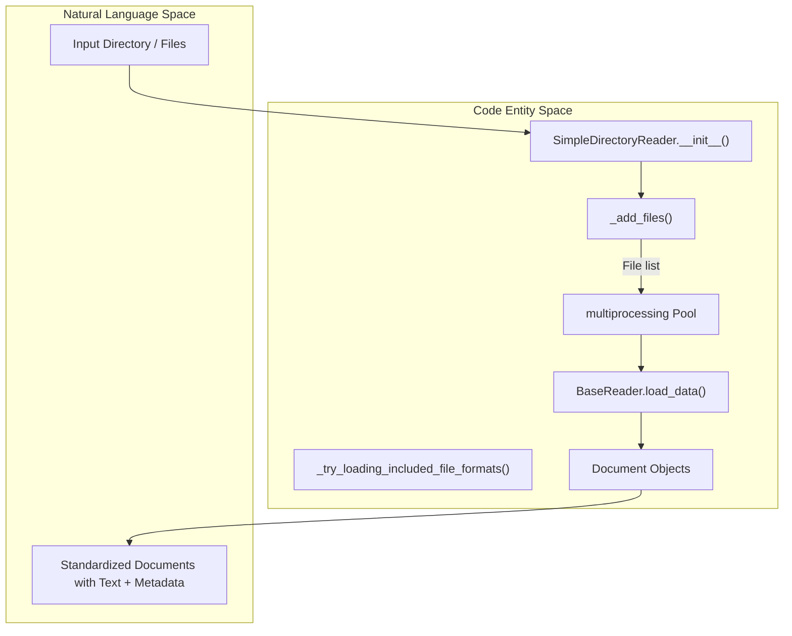
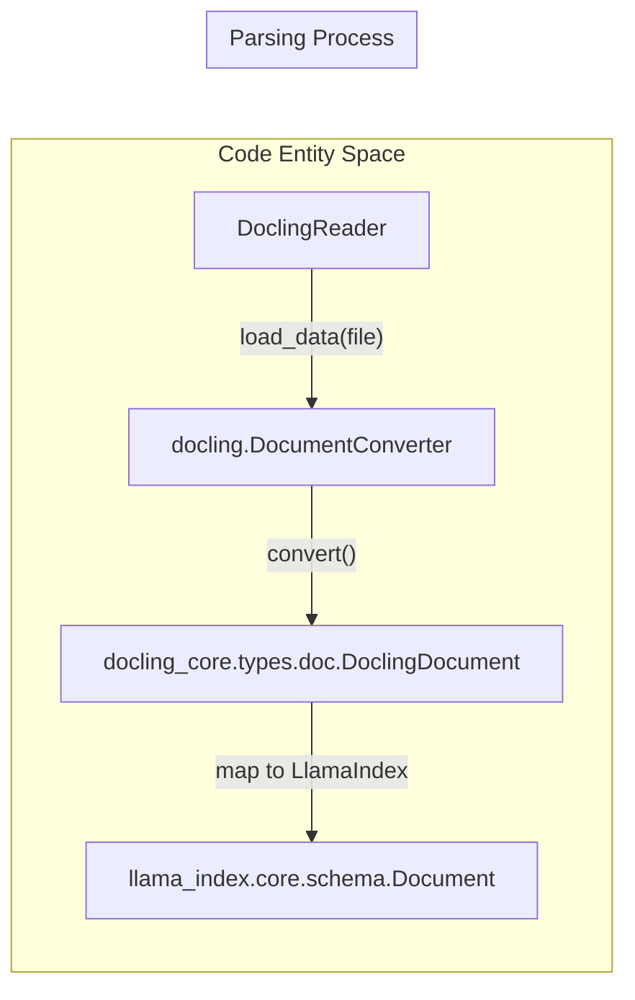
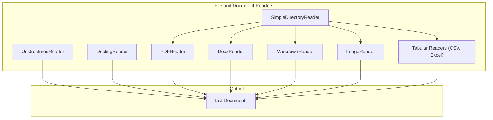

<!-- source: DeepWiki mcp.deepwiki.com · repo run-llama/llama_index · page 9.1 File and Document Readers · fetched 2026-10-26 -->

# File and Document Readers

Relevant source files

The following files were used as context for generating this wiki page:

- [docs/examples/data_connectors/simple_directory_reader.ipynb](docs/examples/data_connectors/simple_directory_reader.ipynb)
- [docs/examples/data_connectors/simple_directory_reader_remote_fs.ipynb](docs/examples/data_connectors/simple_directory_reader_remote_fs.ipynb)
- [llama-index-core/llama_index/core/node_parser/text/sentence.py](llama-index-core/llama_index/core/node_parser/text/sentence.py)
- [llama-index-core/llama_index/core/node_parser/text/token.py](llama-index-core/llama_index/core/node_parser/text/token.py)
- [llama-index-core/llama_index/core/readers/file/base.py](llama-index-core/llama_index/core/readers/file/base.py)
- [llama-index-core/llama_index/core/response_synthesizers/__init__.py](llama-index-core/llama_index/core/response_synthesizers/__init__.py)
- [llama-index-core/tests/readers/file/test_base.py](llama-index-core/tests/readers/file/test_base.py)
- [llama-index-core/tests/text_splitter/test_sentence_splitter.py](llama-index-core/tests/text_splitter/test_sentence_splitter.py)
- [llama-index-core/tests/text_splitter/test_splitter_oversized_unit.py](llama-index-core/tests/text_splitter/test_splitter_oversized_unit.py)
- [llama-index-integrations/node_parser/llama-index-node-parser-docling/README.md](llama-index-integrations/node_parser/llama-index-node-parser-docling/README.md)
- [llama-index-integrations/node_parser/llama-index-node-parser-docling/llama_index/node_parser/docling/base.py](llama-index-integrations/node_parser/llama-index-node-parser-docling/llama_index/node_parser/docling/base.py)
- [llama-index-integrations/node_parser/llama-index-node-parser-docling/pyproject.toml](llama-index-integrations/node_parser/llama-index-node-parser-docling/pyproject.toml)
- [llama-index-integrations/readers/llama-index-readers-couchbase/pyproject.toml](llama-index-integrations/readers/llama-index-readers-couchbase/pyproject.toml)
- [llama-index-integrations/readers/llama-index-readers-couchdb/pyproject.toml](llama-index-integrations/readers/llama-index-readers-couchdb/pyproject.toml)
- [llama-index-integrations/readers/llama-index-readers-dad-jokes/pyproject.toml](llama-index-integrations/readers/llama-index-readers-dad-jokes/pyproject.toml)
- [llama-index-integrations/readers/llama-index-readers-dashscope/pyproject.toml](llama-index-integrations/readers/llama-index-readers-dashscope/pyproject.toml)
- [llama-index-integrations/readers/llama-index-readers-dashvector/pyproject.toml](llama-index-integrations/readers/llama-index-readers-dashvector/pyproject.toml)
- [llama-index-integrations/readers/llama-index-readers-database/pyproject.toml](llama-index-integrations/readers/llama-index-readers-database/pyproject.toml)
- [llama-index-integrations/readers/llama-index-readers-deeplake/pyproject.toml](llama-index-integrations/readers/llama-index-readers-deeplake/pyproject.toml)
- [llama-index-integrations/readers/llama-index-readers-discord/pyproject.toml](llama-index-integrations/readers/llama-index-readers-discord/pyproject.toml)
- [llama-index-integrations/readers/llama-index-readers-docling/README.md](llama-index-integrations/readers/llama-index-readers-docling/README.md)
- [llama-index-integrations/readers/llama-index-readers-docling/llama_index/readers/docling/base.py](llama-index-integrations/readers/llama-index-readers-docling/llama_index/readers/docling/base.py)
- [llama-index-integrations/readers/llama-index-readers-docling/pyproject.toml](llama-index-integrations/readers/llama-index-readers-docling/pyproject.toml)
- [llama-index-integrations/readers/llama-index-readers-docstring-walker/pyproject.toml](llama-index-integrations/readers/llama-index-readers-docstring-walker/pyproject.toml)
- [llama-index-integrations/readers/llama-index-readers-docugami/llama_index/readers/docugami/base.py](llama-index-integrations/readers/llama-index-readers-docugami/llama_index/readers/docugami/base.py)
- [llama-index-integrations/readers/llama-index-readers-docugami/pyproject.toml](llama-index-integrations/readers/llama-index-readers-docugami/pyproject.toml)
- [llama-index-integrations/readers/llama-index-readers-file/README.md](llama-index-integrations/readers/llama-index-readers-file/README.md)
- [llama-index-integrations/readers/llama-index-readers-file/llama_index/readers/file/docs/base.py](llama-index-integrations/readers/llama-index-readers-file/llama_index/readers/file/docs/base.py)
- [llama-index-integrations/readers/llama-index-readers-file/llama_index/readers/file/epub/base.py](llama-index-integrations/readers/llama-index-readers-file/llama_index/readers/file/epub/base.py)
- [llama-index-integrations/readers/llama-index-readers-file/llama_index/readers/file/flat/base.py](llama-index-integrations/readers/llama-index-readers-file/llama_index/readers/file/flat/base.py)
- [llama-index-integrations/readers/llama-index-readers-file/llama_index/readers/file/image/base.py](llama-index-integrations/readers/llama-index-readers-file/llama_index/readers/file/image/base.py)
- [llama-index-integrations/readers/llama-index-readers-file/llama_index/readers/file/image_deplot/base.py](llama-index-integrations/readers/llama-index-readers-file/llama_index/readers/file/image_deplot/base.py)
- [llama-index-integrations/readers/llama-index-readers-file/llama_index/readers/file/ipynb/base.py](llama-index-integrations/readers/llama-index-readers-file/llama_index/readers/file/ipynb/base.py)
- [llama-index-integrations/readers/llama-index-readers-file/llama_index/readers/file/markdown/base.py](llama-index-integrations/readers/llama-index-readers-file/llama_index/readers/file/markdown/base.py)
- [llama-index-integrations/readers/llama-index-readers-file/llama_index/readers/file/mbox/base.py](llama-index-integrations/readers/llama-index-readers-file/llama_index/readers/file/mbox/base.py)
- [llama-index-integrations/readers/llama-index-readers-file/llama_index/readers/file/slides/__init__.py](llama-index-integrations/readers/llama-index-readers-file/llama_index/readers/file/slides/__init__.py)
- [llama-index-integrations/readers/llama-index-readers-file/llama_index/readers/file/slides/base.py](llama-index-integrations/readers/llama-index-readers-file/llama_index/readers/file/slides/base.py)
- [llama-index-integrations/readers/llama-index-readers-file/llama_index/readers/file/slides/content_extractor.py](llama-index-integrations/readers/llama-index-readers-file/llama_index/readers/file/slides/content_extractor.py)
- [llama-index-integrations/readers/llama-index-readers-file/llama_index/readers/file/slides/image_extractor.py](llama-index-integrations/readers/llama-index-readers-file/llama_index/readers/file/slides/image_extractor.py)
- [llama-index-integrations/readers/llama-index-readers-file/llama_index/readers/file/tabular/__init__.py](llama-index-integrations/readers/llama-index-readers-file/llama_index/readers/file/tabular/__init__.py)
- [llama-index-integrations/readers/llama-index-readers-file/llama_index/readers/file/tabular/base.py](llama-index-integrations/readers/llama-index-readers-file/llama_index/readers/file/tabular/base.py)
- [llama-index-integrations/readers/llama-index-readers-file/llama_index/readers/file/unstructured/README.md](llama-index-integrations/readers/llama-index-readers-file/llama_index/readers/file/unstructured/README.md)
- [llama-index-integrations/readers/llama-index-readers-file/llama_index/readers/file/unstructured/base.py](llama-index-integrations/readers/llama-index-readers-file/llama_index/readers/file/unstructured/base.py)
- [llama-index-integrations/readers/llama-index-readers-file/llama_index/readers/file/unstructured/requirements.txt](llama-index-integrations/readers/llama-index-readers-file/llama_index/readers/file/unstructured/requirements.txt)
- [llama-index-integrations/readers/llama-index-readers-file/llama_index/readers/file/xml/base.py](llama-index-integrations/readers/llama-index-readers-file/llama_index/readers/file/xml/base.py)
- [llama-index-integrations/readers/llama-index-readers-file/pyproject.toml](llama-index-integrations/readers/llama-index-readers-file/pyproject.toml)
- [llama-index-integrations/readers/llama-index-readers-file/tests/generate_test_ppt.py](llama-index-integrations/readers/llama-index-readers-file/tests/generate_test_ppt.py)
- [llama-index-integrations/readers/llama-index-readers-file/tests/test_docs.py](llama-index-integrations/readers/llama-index-readers-file/tests/test_docs.py)
- [llama-index-integrations/readers/llama-index-readers-file/tests/test_file.py](llama-index-integrations/readers/llama-index-readers-file/tests/test_file.py)
- [llama-index-integrations/readers/llama-index-readers-file/tests/test_markdown.py](llama-index-integrations/readers/llama-index-readers-file/tests/test_markdown.py)
- [llama-index-integrations/readers/llama-index-readers-file/tests/test_readers_file.py](llama-index-integrations/readers/llama-index-readers-file/tests/test_readers_file.py)
- [llama-index-integrations/readers/llama-index-readers-file/tests/test_slides.py](llama-index-integrations/readers/llama-index-readers-file/tests/test_slides.py)
- [llama-index-integrations/readers/llama-index-readers-file/tests/test_xml.py](llama-index-integrations/readers/llama-index-readers-file/tests/test_xml.py)
- [llama-index-integrations/readers/llama-index-readers-file/uv.lock](llama-index-integrations/readers/llama-index-readers-file/uv.lock)
- [llama-index-integrations/readers/llama-index-readers-hwp/llama_index/readers/hwp/base.py](llama-index-integrations/readers/llama-index-readers-hwp/llama_index/readers/hwp/base.py)
- [llama-index-integrations/readers/llama-index-readers-hwp/tests/test_readers_hwp.py](llama-index-integrations/readers/llama-index-readers-hwp/tests/test_readers_hwp.py)

File and document readers are the primary entry point for ingesting unstructured data into LlamaIndex. These readers transform diverse file formats into a standardized `Document` abstraction, which bundles the raw textual content alongside relevant metadata. This unified object allows downstream components like indexers and retrievers to operate uniformly regardless of the source file's format.

## SimpleDirectoryReader

`SimpleDirectoryReader` is the most versatile and frequently used data connector in LlamaIndex for batch ingestion of files from directories. Its design philosophy is to "just work" by automatically detecting file extensions and dispatching the file to the most appropriate specialized reader.

### Implementation and Data Flow

- **File Discovery**: Given an input directory path or explicit list of files, it recursively or non-recursively lists all files, optionally filtering by required extensions (`required_exts`), exclusion globs, and hidden files [llama-index-core/llama_index/core/readers/file/base.py:208-227]().
- **File Reader Selection**: It uses a default mapping from file extensions to reader classes (e.g., `.pdf` → `PDFReader`, `.docx` → `DocxReader`, `.pptx` → `PptxReader`) maintained by the internal function `_try_loading_included_file_formats()` [llama-index-core/llama_index/core/readers/file/base.py:68-113]().
- **Metadata Extraction**: For each file, basic filesystem metadata (file size, creation/modification/access time) is gathered using `default_file_metadata_func()` for consistent metadata inclusion [llama-index-core/llama_index/core/readers/file/base.py:148-185]().
- **Reading and Parsing**: For each file, the selected reader's `load_data()` method is invoked to yield a list of `Document` objects. This is performed in parallel using multiprocessing for efficiency [llama-index-core/llama_index/core/readers/file/base.py:240-250]().
- **Remote Filesystem Support**: The reader integrates seamlessly with `fsspec` for accessing remote or cloud filesystems (S3, GCS, Azure Blob) [llama-index-core/llama_index/core/readers/file/base.py:26-27]().

### Key Methods and Classes

- `SimpleDirectoryReader.__init__()`: Constructor accepts directory path or list of files, flags for recursion, filters, encoding etc.
- `SimpleDirectoryReader._add_files()`: Internal method to discover and filter input files. Supports recursion, filtering by extensions, excludes by patterns.
- `SimpleDirectoryReader.load_data()`: Loads and parses all matching files concurrently into a list of `Document`.
- `_try_loading_included_file_formats()`: Returns a dictionary mapping file suffixes to specialized readers.

### SimpleDirectoryReader Logic Flow

Sources: [llama-index-core/llama_index/core/readers/file/base.py:208-250](), [llama-index-core/llama_index/core/readers/file/base.py:68-113]()

## Specialized File Readers

While `SimpleDirectoryReader` orchestrates file discovery and dispatch, individual reader classes are responsible for reading and parsing specific file formats into `Document` objects.

### PDFReader

- Parses PDF files using the `pypdf` library.
- Can load the entire PDF as a single `Document` or split into one `Document` per page.
- Preserves page-level metadata like `page_label` and `file_name`.
- Uses tenacity for retry logic during loading.
- Raises an informative error if `pypdf` is missing [llama-index-integrations/readers/llama-index-readers-file/llama_index/readers/file/docs/base.py:28-100]().

### DocxReader

- Parses Microsoft Word `.docx` files using `docx2txt`.
- Reads text content and adds basic metadata such as `file_name`.
- Can read from `fsspec` filesystems if a filesystem handle is provided [llama-index-integrations/readers/llama-index-readers-file/llama_index/readers/file/docs/base.py:103-133]().

### MarkdownReader

- Parses Markdown `.md` files extracting text structured by Markdown headers.
- Converts sections under headers into individual `Document` objects, preserving hierarchy by concatenating parent headers as metadata.
- Supports stripping images and hyperlinks.
- Uses regex-based header detection and careful code block handling [llama-index-integrations/readers/llama-index-readers-file/llama_index/readers/file/markdown/base.py:16-150]().

### ImageReader

- Extracts text from image files (`jpg`, `png`, `gif`, etc.) using either `pytesseract` for OCR or the DONUT transformer model for structured extraction.
- Returns an `ImageDocument` containing both extracted textual content and optionally base64-encoded image data.
- Supports multiple parsing backends, configurable at instantiation [llama-index-integrations/readers/llama-index-readers-file/llama_index/readers/file/image/base.py:19-153]().

### Tabular Readers

- **CSVReader**: Basic CSV parsing using Python's built-in `csv` module, producing one `Document` concatenating all rows or one per row [llama-index-integrations/readers/llama-index-readers-file/llama_index/readers/file/tabular/base.py:18-62]().

- **PandasCSVReader**: More robust CSV loading using `pandas.read_csv` with configurable parameters, better separator detection, and format control [llama-index-integrations/readers/llama-index-readers-file/llama_index/readers/file/tabular/base.py:64-133]().

- **PandasExcelReader**: Parses Excel files (`.xls`, `.xlsx`), formatting each row to include header names as key-value pairs in text (e.g., `"name: John, age: 30"`), optionally concatenated or per-row splitting [llama-index-integrations/readers/llama-index-readers-file/llama_index/readers/file/tabular/base.py:136-211]().

| Reader Class   | Primary Dependency | Key Metadata                   |
| -------------- | ------------------ | ------------------------------|
| `PDFReader`    | `pypdf`            | `page_label`, `file_name`      |
| `DocxReader`   | `docx2txt`         | `file_name`                    |
| `MarkdownReader` | `re`             | Header-based nesting           |
| `ImageReader`  | `pytesseract` / `transformers` | `image_path`       |

Sources: [llama-index-integrations/readers/llama-index-readers-file/llama_index/readers/file/docs/base.py:1-133](), [llama-index-integrations/readers/llama-index-readers-file/llama_index/readers/file/markdown/base.py:16-150](), [llama-index-integrations/readers/llama-index-readers-file/llama_index/readers/file/tabular/base.py:18-211](), [llama-index-integrations/readers/llama-index-readers-file/llama_index/readers/file/image/base.py:19-153]()

## UnstructuredReader

The `UnstructuredReader` is a powerful, general-purpose reader capable of parsing over 20+ file types including `.csv`, `.doc`, `.docx`, `.pdf`, `.pptx`, `.xlsx`, `.html`, `.xml`, `.txt`, `.json` and many image formats by integrating with the external `unstructured` Python library.

### Operating Modes

- **Local Partitioning**: Uses the `unstructured.partition.auto.partition` function to parse files locally if no API key is specified [llama-index-integrations/readers/llama-index-readers-file/llama_index/readers/file/unstructured/base.py:150-152]().
- **API-Based Partitioning**: If an API key is provided, sends the file to a remote Unstructured API server for parsing using `partition_via_api` [llama-index-integrations/readers/llama-index-readers-file/llama_index/readers/file/unstructured/base.py:142-148]().

### Metadata Handling

- Supports filtering of metadata keys based on allowed types and explicitly excluded keys.
- Returns a list of `Document` objects constructed from the parsed elements.

This reader offers a "catch-all" ingestion capability especially useful when file formats are diverse or unsupported by specific readers.

Sources: [llama-index-integrations/readers/llama-index-readers-file/llama_index/readers/file/unstructured/base.py:24-175]()

## Docling Integration

`DoclingReader` is an advanced document reader integrating the Docling framework for complex document parsing beyond simple text extraction.

### Features and Purpose

- Designed to handle intricate document layouts and structured data extraction typical in enterprise or industrial document processing.
- Utilizes the Docling `DocumentConverter` for transforming files into rich `DoclingDocument` representations.
- Maps Docling documents into LlamaIndex's `Document` abstraction capturing extracted content and metadata.

### Data Flow in DoclingReader

Sources: [llama-index-integrations/readers/llama-index-readers-docling/pyproject.toml:28-60](), [llama-index-integrations/readers/llama-index-readers-docling/llama_index/readers/docling/base.py:1-40]()

## Metadata Management

A consistent approach to metadata ensures uniformity across documents from multiple sources and formats.

### Standard File Metadata

The `default_file_metadata_func()` function extracts and formats key filesystem attributes into metadata:

| Metadata Key          | Description                                  |
| --------------------- | --------------------------------------------|
| `file_path`           | Full path or URI of the source file           |
| `file_name`           | Base name of the file                          |
| `file_type`           | MIME type guessed via Python `mimetypes`      |
| `file_size`           | Size of the file in bytes                       |
| `creation_date`       | ISO-formatted creation timestamp               |
| `last_modified_date`  | ISO-formatted last modified timestamp          |
| `last_accessed_date`  | ISO-formatted last accessed timestamp          |

These keys are assembled while filtering out any with `None` values for cleanliness [llama-index-core/llama_index/core/readers/file/base.py:148-185]().

## Summary Diagram: File Readers to Document Flow

This diagram summarizes how file and document readers transform raw files into standardized `Document` objects usable across LlamaIndex.

## References

- `SimpleDirectoryReader` and base file readers: [llama-index-core/llama_index/core/readers/file/base.py:1-250]()  
- PDF, DOCX, HWP document readers: [llama-index-integrations/readers/llama-index-readers-file/llama_index/readers/file/docs/base.py:1-134]()  
- Markdown reader: [llama-index-integrations/readers/llama-index-readers-file/llama_index/readers/file/markdown/base.py:1-150]()  
- Image reader: [llama-index-integrations/readers/llama-index-readers-file/llama_index/readers/file/image/base.py:1-153]()  
- Tabular readers (CSV, Excel): [llama-index-integrations/readers/llama-index-readers-file/llama_index/readers/file/tabular/base.py:1-211]()  
- Unstructured reader: [llama-index-integrations/readers/llama-index-readers-file/llama_index/readers/file/unstructured/base.py:1-175]()  
- Docling integration: [llama-index-integrations/readers/llama-index-readers-docling/llama_index/readers/docling/base.py:1-40]()  

Sources:  
[llama-index-core/llama_index/core/readers/file/base.py:1-250](),  
[llama-index-integrations/readers/llama-index-readers-file/llama_index/readers/file/docs/base.py:1-134](),  
[llama-index-integrations/readers/llama-index-readers-file/llama_index/readers/file/markdown/base.py:1-150](),  
[llama-index-integrations/readers/llama-index-readers-file/llama_index/readers/file/image/base.py:1-153](),  
[llama-index-integrations/readers/llama-index-readers-file/llama_index/readers/file/tabular/base.py:1-211](),  
[llama-index-integrations/readers/llama-index-readers-file/llama_index/readers/file/unstructured/base.py:1-175](),  
[llama-index-integrations/readers/llama-index-readers-docling/llama_index/readers/docling/base.py:1-40]()

---

