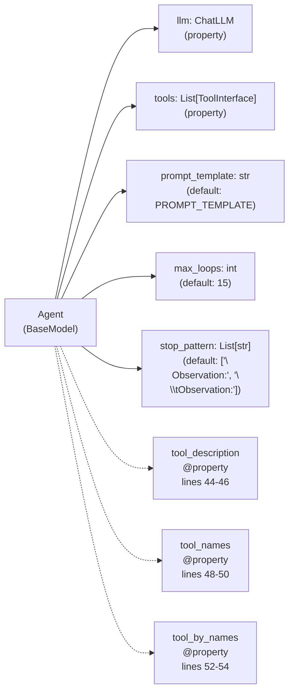
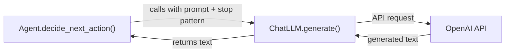
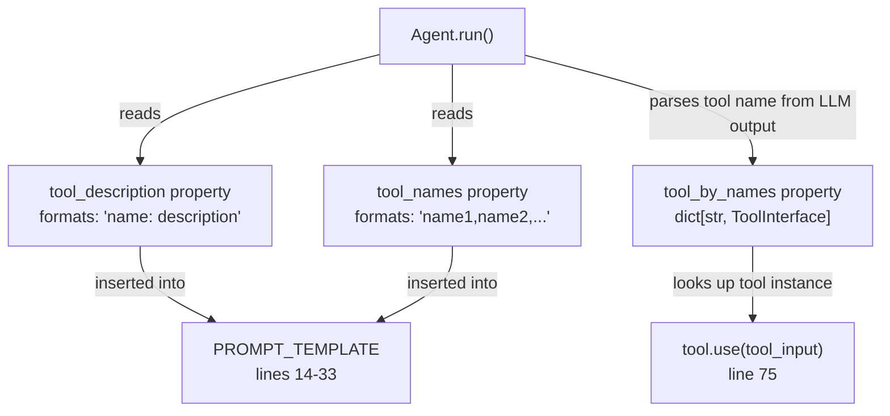
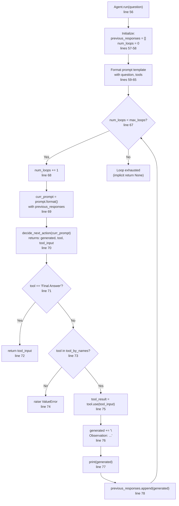
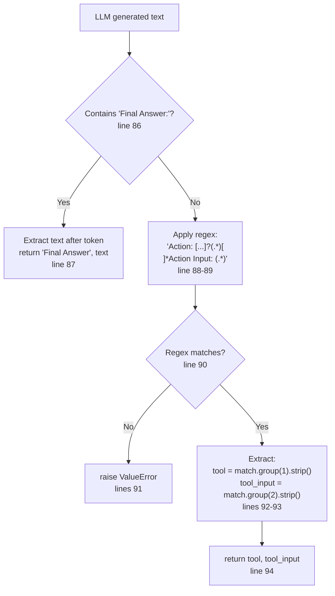
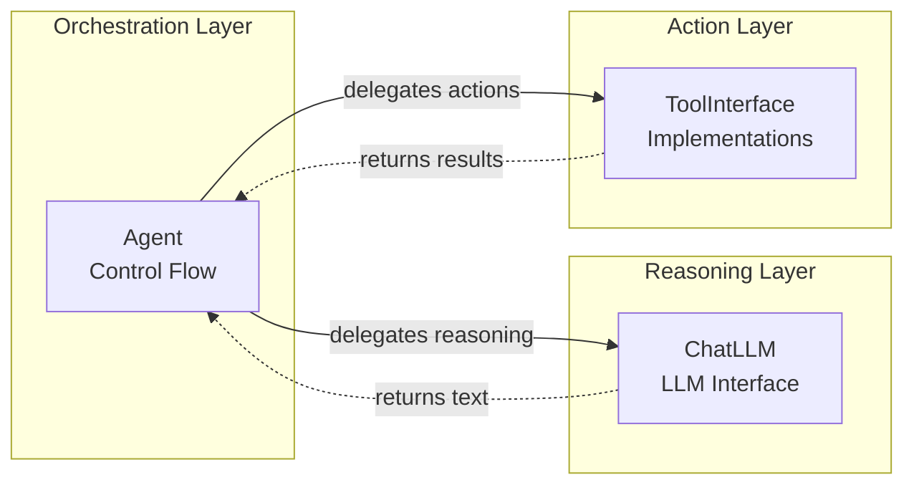
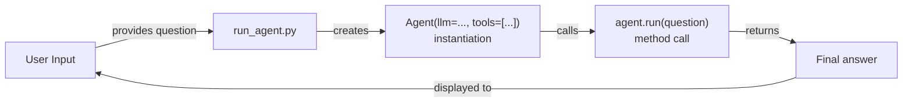

<!-- source: DeepWiki mcp.deepwiki.com · repo mpaepper/llm_agents · page 2 Core Architecture · fetched 2026-10-26 -->

# Core Architecture

<details>
<summary>Relevant source files</summary>

The following files were used as context for generating this wiki page:

- [README.md](README.md)
- [llm_agents/__init__.py](llm_agents/__init__.py)
- [llm_agents/agent.py](llm_agents/agent.py)
- [llm_agents/tools/searx.py](llm_agents/tools/searx.py)

</details>


## Purpose and Scope

This document describes the high-level architecture of the llm_agents system, focusing on how the three core components—`Agent`, `ChatLLM`, and `ToolInterface`—work together to implement the Thought-Action-Observation loop pattern. This page covers the structural organization and interaction patterns that enable LLM-driven agents to reason about problems and execute actions through tools.

For implementation details of specific components, see:
- The `Agent` orchestration logic: [The Agent](#2.1)
- The `ChatLLM` OpenAI integration: [ChatLLM Integration](#2.2)
- The iterative reasoning pattern: [Thought-Action-Observation Loop](#2.3)
- Tool system architecture: [Tool System](#3)

---

## Core Components

The system consists of three primary components that form a clean separation of concerns:

| Component | Class | Responsibility | Key Methods |
|-----------|-------|---------------|-------------|
| **Orchestrator** | `Agent` | Manages the reasoning loop, parses LLM outputs, invokes tools | `run()`, `decide_next_action()`, `_parse()` |
| **Reasoning Engine** | `ChatLLM` | Interfaces with OpenAI API to generate thoughts and actions | `generate()` |
| **Action Executors** | `ToolInterface` implementations | Execute specific capabilities (search, code execution, etc.) | `use()` |

### Component Diagram

```mermaid
graph TB
    Agent["Agent<br/>(llm_agents/agent.py)"]
    ChatLLM["ChatLLM<br/>(llm_agents/llm.py)"]
    ToolInterface["ToolInterface<br/>(llm_agents/tools/base.py)"]
    
    PythonREPL["PythonREPLTool<br/>(tools/python_repl.py)"]
    SerpAPI["SerpAPITool<br/>(tools/search.py)"]
    GoogleSearch["GoogleSearchTool<br/>(tools/google_search.py)"]
    HackerNews["HackerNewsSearchTool<br/>(tools/hackernews.py)"]
    Searx["SearxSearchTool<br/>(tools/searx.py)"]
    
    Agent -->|"uses (property: llm)"| ChatLLM
    Agent -->|"manages (property: tools)"| ToolInterface
    
    ToolInterface <-..|"implements"| PythonREPL
    ToolInterface <-..|"implements"| SerpAPI
    ToolInterface <-..|"implements"| GoogleSearch
    ToolInterface <-..|"implements"| HackerNews
    ToolInterface <-..|"implements"| Searx
    
    Agent -->|"calls generate()"| ChatLLM
    Agent -->|"calls use()"| ToolInterface
```

**Sources:** [llm_agents/__init__.py:1-10](), [llm_agents/agent.py:1-102]()

---

## Agent Class

The `Agent` class ([llm_agents/agent.py:36-95]()) serves as the orchestrator, implementing the core control flow that coordinates between the LLM and tools.

### Agent Properties and Configuration



**Key Properties:**
- `llm`: The `ChatLLM` instance used for generating reasoning and actions
- `tools`: List of available `ToolInterface` implementations
- `prompt_template`: Template string defining the agent's instructions ([llm_agents/agent.py:14-33]())
- `max_loops`: Maximum iterations to prevent infinite loops (default: 15)
- `stop_pattern`: Tokens that stop LLM generation to prevent hallucination ([llm_agents/agent.py:42]())

**Computed Properties:**
- `tool_description`: Generates formatted tool descriptions for the prompt ([llm_agents/agent.py:44-46]())
- `tool_names`: Comma-separated list of tool names ([llm_agents/agent.py:48-50]())
- `tool_by_names`: Dictionary mapping tool names to instances ([llm_agents/agent.py:52-54]())

**Sources:** [llm_agents/agent.py:36-54]()

---

## ChatLLM Integration

The `ChatLLM` component abstracts the OpenAI API interaction. While not fully shown in the provided files, the `Agent` interacts with it through the `generate()` method:



The call occurs at [llm_agents/agent.py:81](), where the agent passes:
- The constructed prompt
- The `stop_pattern` to prevent the LLM from generating past the observation phase

**Sources:** [llm_agents/agent.py:80-83](), [llm_agents/__init__.py:2]()

---

## Tool Architecture

Tools implement a standardized interface (`ToolInterface`) with three required attributes:

| Attribute | Type | Purpose |
|-----------|------|---------|
| `name` | `str` | Identifier used by the agent to select the tool |
| `description` | `str` | Natural language description included in the prompt |
| `use()` | `method` | Executes the tool with input text, returns result string |

### Tool Registration Pattern



The agent discovers tools dynamically through properties that format tool metadata into the prompt ([llm_agents/agent.py:44-54]()), and looks up tools by name when executing actions ([llm_agents/agent.py:73-75]()).

**Sources:** [llm_agents/agent.py:44-54](), [llm_agents/agent.py:73-75](), [llm_agents/tools/searx.py:74-81]()

---

## The Thought-Action-Observation Loop

The system implements an iterative reasoning pattern where:
1. **Thought**: LLM generates reasoning about what to do next
2. **Action**: LLM specifies a tool and input
3. **Observation**: Tool executes and returns results
4. Loop continues until LLM produces a "Final Answer"

### Loop Implementation



**Sources:** [llm_agents/agent.py:56-78]()

### Prompt Accumulation

The key to the loop's effectiveness is that each iteration appends to `previous_responses`, which gets inserted into the prompt template. This creates a growing context window:

```
Question: {question}
Thought: {previous_responses}
```

Where `previous_responses` contains the full history:
```
Thought: I need to search for X
Action: Google Search
Action Input: X
Observation: Result about X
Thought: Now I need to calculate Y
Action: python_repl
Action Input: code for Y
Observation: Y = 42
Thought: I now know the final answer
```

**Sources:** [llm_agents/agent.py:32](), [llm_agents/agent.py:69](), [llm_agents/agent.py:76-78]()

---

## Response Parsing

The `Agent._parse()` method ([llm_agents/agent.py:85-94]()) extracts structured information from the LLM's free-text response:

### Parsing Logic



**Pattern Matching:**
- **Final Answer**: Checks for literal string `FINAL_ANSWER_TOKEN` ([llm_agents/agent.py:11]())
- **Action Parsing**: Uses regex to extract action name and input ([llm_agents/agent.py:88]())
- **Error Handling**: Raises `ValueError` if output cannot be parsed ([llm_agents/agent.py:91]())

**Sources:** [llm_agents/agent.py:11](), [llm_agents/agent.py:85-94]()

---

## Prompt Template Structure

The `PROMPT_TEMPLATE` ([llm_agents/agent.py:14-33]()) defines the agent's instructions and expected format:

### Template Sections

| Section | Purpose | Template Variables |
|---------|---------|-------------------|
| **Context** | Provides current date and capabilities | `{today}`, `{tool_description}` |
| **Format Instructions** | Defines the Thought-Action-Observation structure | `{tool_names}` |
| **Task** | Presents the user's question | `{question}` |
| **History** | Contains accumulated conversation | `{previous_responses}` |

**Key Features:**
- **Tool Injection**: Tool descriptions are dynamically inserted at line 16
- **Format Specification**: Lines 18-27 provide explicit formatting instructions
- **Few-Shot Pattern**: The template itself serves as an example of the expected format
- **Stop Tokens**: The pattern ends with `Thought: {previous_responses}` to prime the next generation

**Sources:** [llm_agents/agent.py:14-33]()

---

## Design Principles

### Separation of Concerns



**Key Architectural Decisions:**
1. **Agent as Orchestrator**: Does not implement reasoning or actions itself
2. **Stateful Loop**: Maintains `previous_responses` list for context accumulation
3. **Tool Polymorphism**: All tools implement identical interface, enabling uniform interaction
4. **Stop Patterns**: Prevents LLM hallucination by stopping generation at observation boundaries ([llm_agents/agent.py:42]())
5. **Max Loops**: Safety mechanism to prevent infinite loops ([llm_agents/agent.py:40]())

**Sources:** [llm_agents/agent.py:36-95]()

### Extensibility

The architecture supports extension through:
- **New Tools**: Implement `ToolInterface` and add to `tools` list
- **Custom Prompts**: Override `prompt_template` property
- **Different LLMs**: Swap `ChatLLM` implementation (must provide `generate()` method)

**Sources:** [README.md:46-57](), [llm_agents/__init__.py:1-10]()

---

## Entry Point Integration

The `run_agent.py` script demonstrates the standard initialization pattern:



Typical usage pattern from README:
```python
from llm_agents import Agent, ChatLLM, PythonREPLTool, HackerNewsSearchTool, SerpAPITool

agent = Agent(llm=ChatLLM(), tools=[PythonREPLTool(), SerpAPITool(), HackerNewsSearchTool()])
result = agent.run("Your question to the agent")
```

**Sources:** [README.md:46-55]()

---

