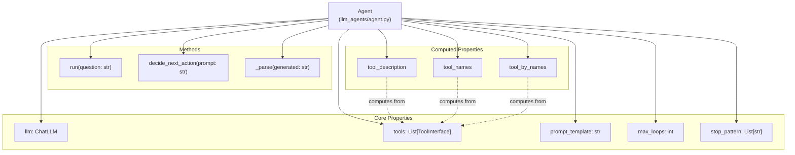
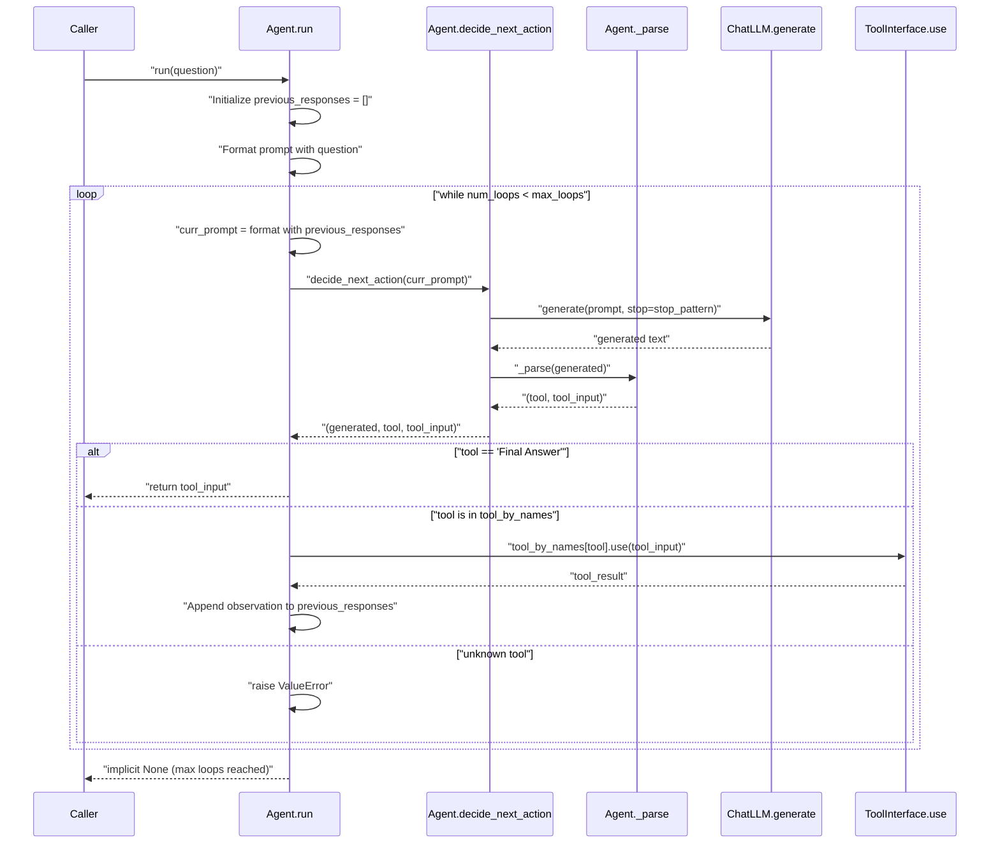
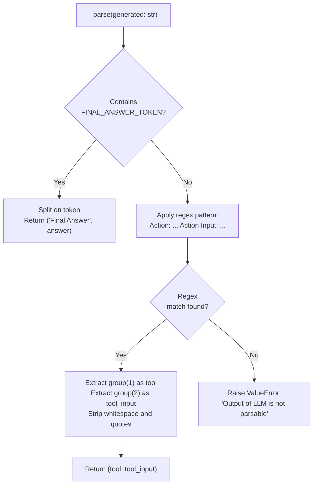
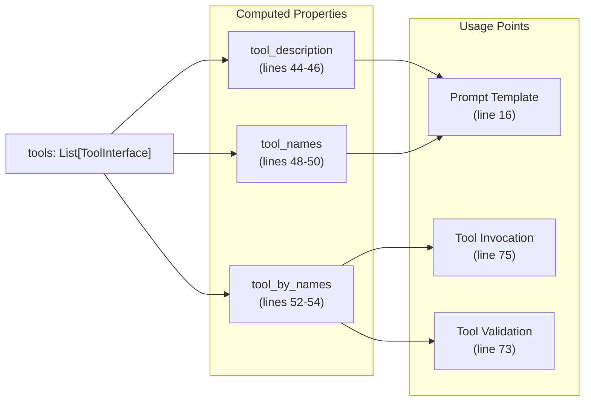

<!-- source: DeepWiki mcp.deepwiki.com · repo mpaepper/llm_agents · page 2.1 The Agent · fetched 2026-10-26 -->

# The Agent

<details>
<summary>Relevant source files</summary>

The following files were used as context for generating this wiki page:

- [README.md](README.md)
- [llm_agents/__init__.py](llm_agents/__init__.py)
- [llm_agents/agent.py](llm_agents/agent.py)
- [llm_agents/tools/searx.py](llm_agents/tools/searx.py)

</details>


## Purpose and Scope

This document provides a detailed technical reference for the `Agent` class, which serves as the central orchestrator in the llm_agents system. The Agent is responsible for managing the iterative reasoning loop, parsing LLM responses, invoking tools, and maintaining conversation state until a final answer is reached.

This page covers the internal implementation details of the Agent class. For information about how the Agent integrates with the ChatLLM component, see [ChatLLM Integration](#2.2). For a conceptual explanation of the Thought-Action-Observation loop pattern, see [Thought-Action-Observation Loop](#2.3). For information about available tools, see [Tool System](#3).

**Sources:** [llm_agents/agent.py:1-102](), [README.md:11-24]()

---

## Agent Class Overview

The `Agent` class is defined in [llm_agents/agent.py:36-95]() and inherits from Pydantic's `BaseModel` for data validation and configuration management. The Agent acts as the orchestration layer that connects three key components:

1. **ChatLLM** - Generates reasoning steps and action proposals
2. **Tool Registry** - Provides executable capabilities
3. **Prompt Management** - Maintains conversation history and context

The Agent's primary responsibility is to execute the iterative reasoning loop: it sends prompts to the LLM, parses the responses to extract actions and action inputs, executes those actions using registered tools, and feeds observations back into the prompt for the next iteration.



**Agent Class Structure**

| Component | Type | Purpose |
|-----------|------|---------|
| `llm` | `ChatLLM` | Interface to the language model for generating responses |
| `tools` | `List[ToolInterface]` | Registered tools available for the agent to invoke |
| `prompt_template` | `str` | Template for constructing prompts with placeholders |
| `max_loops` | `int` | Maximum iterations before forced termination (default: 15) |
| `stop_pattern` | `List[str]` | Tokens that signal the LLM to stop generation |

**Sources:** [llm_agents/agent.py:36-42]()

---

## The Orchestration Loop

The `run()` method at [llm_agents/agent.py:56-78]() implements the core orchestration logic. This method executes a while loop that continues until either a final answer is generated or the maximum iteration limit is reached.

### Execution Flow



### Key Implementation Details

The orchestration loop maintains several critical pieces of state:

1. **`previous_responses`** - A list of strings accumulating all previous Thought/Action/Observation cycles [llm_agents/agent.py:57]()
2. **`num_loops`** - Counter to prevent infinite loops [llm_agents/agent.py:58]()
3. **`curr_prompt`** - The fully formatted prompt including conversation history [llm_agents/agent.py:69]()

The prompt is constructed using the template at [llm_agents/agent.py:59-65](), which injects:
- Current date via `datetime.date.today()`
- Tool descriptions via `self.tool_description`
- Tool names via `self.tool_names`
- The user's question
- Accumulated conversation history via `previous_responses`

After each tool invocation, the result is formatted with observation markers and appended to `previous_responses` at [llm_agents/agent.py:76-78]():

```
generated += f"\n{OBSERVATION_TOKEN} {tool_result}\n{THOUGHT_TOKEN}"
previous_responses.append(generated)
```

This accumulation pattern ensures that each LLM invocation has access to the complete history of reasoning steps and tool outputs.

**Sources:** [llm_agents/agent.py:56-78]()

---

## Response Parsing

The `_parse()` method at [llm_agents/agent.py:85-94]() is responsible for extracting structured information from the LLM's free-form text responses. This method must handle two distinct response patterns:

### Final Answer Pattern

When the LLM believes it has sufficient information to answer the user's question, it includes the `FINAL_ANSWER_TOKEN` ("Final Answer:") in its response. The parser detects this token and extracts everything after it as the final answer:

```python
if FINAL_ANSWER_TOKEN in generated:
    return "Final Answer", generated.split(FINAL_ANSWER_TOKEN)[-1].strip()
```

This check occurs first at [llm_agents/agent.py:86-87](), taking precedence over action parsing.

### Action Pattern

For intermediate reasoning steps, the LLM must specify an action to take. The parser uses a regular expression at [llm_agents/agent.py:88-89]() to extract:
- **Action**: The tool name to invoke
- **Action Input**: The input parameter for the tool

The regex pattern is:
```python
r"Action: [\[]?(.*?)[\]]?[\n]*Action Input:[\s]*(.*)"
```

This pattern handles optional square brackets around the action name and flexible whitespace between the action and input. The regex uses `re.DOTALL` flag to match across multiple lines, allowing multi-line action inputs.

### Parsing Diagram



**Error Handling:** If the LLM response doesn't match either pattern, the parser raises a `ValueError` with the unparseable text at [llm_agents/agent.py:91](), providing debugging information about malformed LLM outputs.

**Sources:** [llm_agents/agent.py:85-94]()

---

## Tool Management

The Agent class provides three computed properties for managing the tool registry. These properties dynamically generate tool-related information from the `tools` list.

### Tool Properties

| Property | Return Type | Purpose | Implementation |
|----------|-------------|---------|----------------|
| `tool_description` | `str` | Multi-line string with all tool descriptions for prompt injection | [llm_agents/agent.py:44-46]() |
| `tool_names` | `str` | Comma-separated list of tool names | [llm_agents/agent.py:48-50]() |
| `tool_by_names` | `Dict[str, ToolInterface]` | Dictionary mapping tool names to tool instances | [llm_agents/agent.py:52-54]() |

### Tool Description Format

The `tool_description` property generates a formatted string like:

```
python_repl: A Python shell. Use this to execute python commands...
Google Search: Get specific information from a search query...
```

This string is injected into the prompt template at [llm_agents/agent.py:16]() to inform the LLM about available tools.

### Tool Registry Lookup

When the parser extracts a tool name from the LLM response, the Agent uses `tool_by_names` to retrieve the corresponding tool instance at [llm_agents/agent.py:75]():

```python
tool_result = self.tool_by_names[tool].use(tool_input)
```

If the tool name doesn't exist in the registry, a `ValueError` is raised at [llm_agents/agent.py:73-74]().



**Sources:** [llm_agents/agent.py:44-54]()

---

## Prompt Template Structure

The `PROMPT_TEMPLATE` constant at [llm_agents/agent.py:14-33]() defines the instruction format that guides the LLM's behavior. This template uses placeholder variables that are filled in during execution.

### Template Variables

| Placeholder | Source | Injection Point |
|-------------|--------|-----------------|
| `{today}` | `datetime.date.today()` | [llm_agents/agent.py:60]() |
| `{tool_description}` | `self.tool_description` | [llm_agents/agent.py:61]() |
| `{tool_names}` | `self.tool_names` | [llm_agents/agent.py:62]() |
| `{question}` | User-provided question parameter | [llm_agents/agent.py:63]() |
| `{previous_responses}` | Accumulated conversation history | [llm_agents/agent.py:64]() |

### Template Format Specification

The template instructs the LLM to follow a specific output format:

```
Question: the input question you must answer
Thought: comment on what you want to do next
Action: the action to take, exactly one element of [tool_names]
Action Input: the input to the action
Observation: the result of the action
... (this Thought/Action/Action Input/Observation repeats N times)
Thought: I now know the final answer
Final Answer: your final answer to the original input question
```

This format specification is critical because the `_parse()` method expects LLM responses to conform to this structure.

**Sources:** [llm_agents/agent.py:14-33]()

---

## Configuration Parameters

The Agent class exposes several configuration parameters that control its behavior:

### max_loops

**Type:** `int`  
**Default:** `15`  
**Location:** [llm_agents/agent.py:40]()  
**Purpose:** Limits the maximum number of Thought-Action-Observation cycles to prevent infinite loops. After `max_loops` iterations, the `run()` method will exit even if no final answer has been generated.

### stop_pattern

**Type:** `List[str]`  
**Default:** `[f'\n{OBSERVATION_TOKEN}', f'\n\t{OBSERVATION_TOKEN}']`  
**Location:** [llm_agents/agent.py:42]()  
**Purpose:** Specifies token sequences that signal the LLM to stop generating text. This prevents the LLM from hallucinating observation results. The stop pattern includes both newline and tab-prefixed observation tokens to handle different formatting scenarios.

The stop pattern is passed to the LLM during generation at [llm_agents/agent.py:81]():

```python
generated = self.llm.generate(prompt, stop=self.stop_pattern)
```

### prompt_template

**Type:** `str`  
**Default:** `PROMPT_TEMPLATE`  
**Location:** [llm_agents/agent.py:39]()  
**Purpose:** Allows customization of the instruction format. While the default template follows the standard Thought-Action-Observation pattern, users can provide alternative templates for different reasoning strategies.

**Configuration Example:**

```python
from llm_agents import Agent, ChatLLM, PythonREPLTool

agent = Agent(
    llm=ChatLLM(),
    tools=[PythonREPLTool()],
    max_loops=20,  # Allow more iterations
    stop_pattern=['\nObservation:']  # Custom stop token
)
```

**Sources:** [llm_agents/agent.py:39-42]()

---

## Token Constants

The Agent module defines several string constants that serve as structural markers in the conversation flow:

| Constant | Value | Purpose | Usage |
|----------|-------|---------|-------|
| `FINAL_ANSWER_TOKEN` | `"Final Answer:"` | Signals completion | [llm_agents/agent.py:11](), used in parsing at [llm_agents/agent.py:86]() |
| `OBSERVATION_TOKEN` | `"Observation:"` | Marks tool output | [llm_agents/agent.py:12](), used in formatting at [llm_agents/agent.py:76]() and stop pattern |
| `THOUGHT_TOKEN` | `"Thought:"` | Marks reasoning step | [llm_agents/agent.py:13](), used in formatting at [llm_agents/agent.py:76]() |

These constants ensure consistency between the prompt template instructions and the parsing logic. They also make the code more maintainable by centralizing token definitions.

**Sources:** [llm_agents/agent.py:11-13]()

---

## Entry Point Example

The Agent module includes a standalone execution example at [llm_agents/agent.py:97-101]():

```python
if __name__ == '__main__':
    agent = Agent(llm=ChatLLM(), tools=[PythonREPLTool()])
    result = agent.run("What is 7 * 9 - 34 in Python?")
    print(f"Final answer is {result}")
```

This example demonstrates:
1. Agent instantiation with a ChatLLM and a single PythonREPLTool
2. Running the agent with a mathematical question that requires code execution
3. Retrieving and displaying the final answer

The Agent is also exposed as a public API through [llm_agents/__init__.py:1](), making it available via:

```python
from llm_agents import Agent
```

**Sources:** [llm_agents/agent.py:97-101](), [llm_agents/__init__.py:1]()

---

