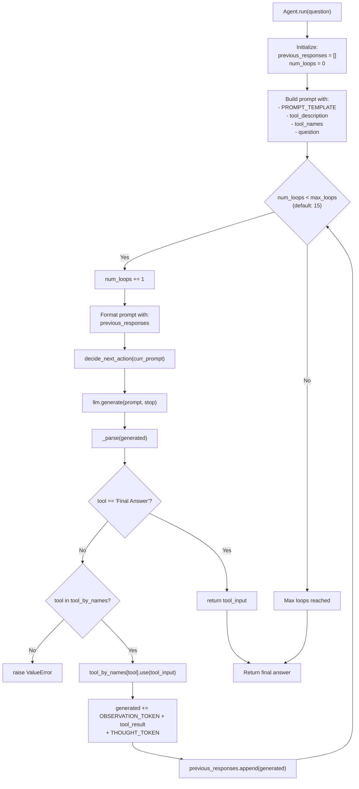
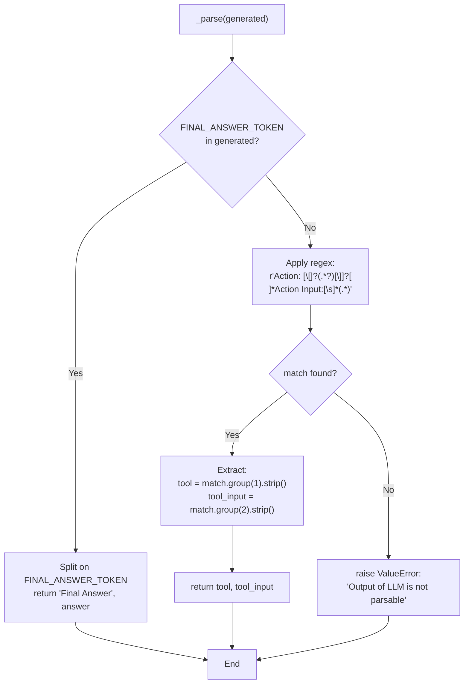
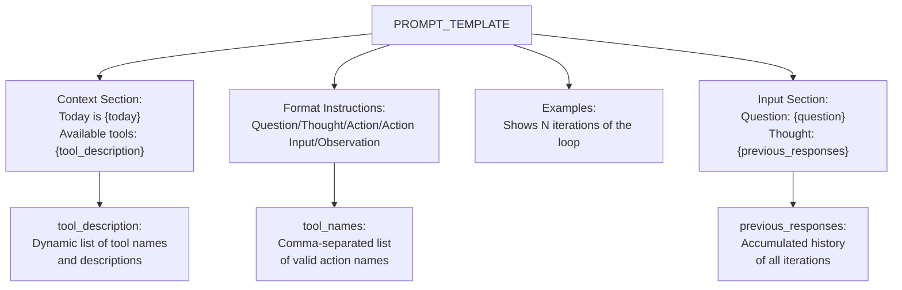

<!-- source: DeepWiki mcp.deepwiki.com · repo mpaepper/llm_agents · page 2.3 Thought-Action-Observation Loop · fetched 2026-10-26 -->

# Thought-Action-Observation Loop

<details>
<summary>Relevant source files</summary>

The following files were used as context for generating this wiki page:

- [README.md](README.md)
- [llm_agents/__init__.py](llm_agents/__init__.py)
- [llm_agents/agent.py](llm_agents/agent.py)
- [llm_agents/tools/searx.py](llm_agents/tools/searx.py)

</details>


## Purpose and Scope

This document explains the Thought-Action-Observation (TAO) loop, the core iterative reasoning pattern that drives agent execution in the llm_agents system. The TAO loop enables the agent to break down complex tasks into steps, execute actions using tools, observe results, and refine its approach until reaching a final answer.

For information about how the Agent class orchestrates this loop, see [The Agent](#2.1). For details on how tools are invoked during the Action phase, see [Tool System](#3). For information about the ChatLLM component that generates thoughts and actions, see [ChatLLM Integration](#2.2).

## Overview

The Thought-Action-Observation loop is an iterative reasoning cycle where an LLM-powered agent:

1. **Thinks**: Generates reasoning about what to do next (produced by LLM)
2. **Acts**: Decides on a tool to use and provides input to it (produced by LLM)
3. **Observes**: Receives the result from tool execution (produced by tool)

This cycle repeats until the agent produces a "Final Answer" or reaches the maximum iteration limit. Each iteration appends its Thought, Action, and Observation to the conversation history, building a growing context that informs subsequent iterations.

**Core Loop Flow**



Sources: [llm_agents/agent.py:56-79]()

## Loop Phases

### Phase 1: Thought Generation

The Thought phase is when the LLM generates reasoning about the current state and what action to take next. The LLM receives the accumulated conversation history and must produce a response in a specific format.

**Thought Format Requirements**

The LLM output must follow this structure:
- **Thought**: Commentary on what to do next
- **Action**: The tool name to use (from available tools)
- **Action Input**: The input parameter to pass to the tool

The prompt template defines this expected format in [llm_agents/agent.py:14-33]():

```
Thought: comment on what you want to do next
Action: the action to take, exactly one element of [tool_names]
Action Input: the input to the action
Observation: the result of the action
... (this Thought/Action/Action Input/Observation repeats N times)
```

**LLM Generation with Stop Patterns**

The agent uses stop patterns to prevent the LLM from hallucinating observations. The `stop_pattern` list [llm_agents/agent.py:42]() contains:
- `'\n{OBSERVATION_TOKEN}'` 
- `'\n\t{OBSERVATION_TOKEN}'`

This ensures the LLM stops generating before it reaches the Observation section, which must be produced by actual tool execution.

Sources: [llm_agents/agent.py:14-33](), [llm_agents/agent.py:42](), [llm_agents/agent.py:80-83]()

### Phase 2: Action Parsing and Execution

Once the LLM generates a response, the agent parses it to extract the action and action input. This parsing logic is critical for translating natural language intent into executable tool invocations.

**Parsing Logic**



The `_parse` method [llm_agents/agent.py:85-94]() handles two cases:

1. **Final Answer Detection**: If `FINAL_ANSWER_TOKEN` ("Final Answer:") appears in the generated text, extract everything after it as the final answer
2. **Action Extraction**: Use regex to extract the action name and action input from the structured format

The regex pattern [llm_agents/agent.py:88]() allows for optional brackets around the action name and flexible whitespace:
```
Action: [\[]?(.*?)[\]]?[\n]*Action Input:[\s]*(.*)
```

**Tool Invocation**

After parsing, the agent:
1. Validates the tool name exists in `tool_by_names` [llm_agents/agent.py:73-74]()
2. Retrieves the tool instance from the registry [llm_agents/agent.py:53-54]()
3. Invokes `tool.use(tool_input)` to execute the action [llm_agents/agent.py:75]()

Sources: [llm_agents/agent.py:85-94](), [llm_agents/agent.py:73-75]()

### Phase 3: Observation Integration

The Observation phase captures the tool execution result and integrates it back into the conversation history. This is where external information enters the reasoning loop.

**Observation Formatting**

After tool execution, the observation is formatted and appended to the generated text [llm_agents/agent.py:76]():

```python
generated += f"\n{OBSERVATION_TOKEN} {tool_result}\n{THOUGHT_TOKEN}"
```

This creates a structured entry like:
```
Thought: I need to search for information
Action: Google Search
Action Input: population of Tokyo 2024
Observation: Tokyo has a population of approximately 14 million...
Thought:
```

The trailing `THOUGHT_TOKEN` prepares the prompt for the next iteration, prompting the LLM to generate another thought.

**History Accumulation**

The complete generated text (Thought + Action + Action Input + Observation + Thought token) is appended to `previous_responses` [llm_agents/agent.py:78]():

```python
previous_responses.append(generated)
```

This list accumulates all previous iterations, creating a growing context window that the LLM can reference in subsequent iterations.

Sources: [llm_agents/agent.py:76-78](), [llm_agents/agent.py:11-12]()

## State Accumulation Across Iterations

The TAO loop maintains state through the `previous_responses` list, which accumulates the complete history of all Thought-Action-Observation cycles. This accumulated state is critical for multi-step reasoning.

**State Flow Diagram**

```mermaid
flowchart LR
    subgraph "Iteration 1"
        I1Start["Empty previous_responses"] --> I1Gen["LLM generates:<br/>Thought1 + Action1"]
        I1Gen --> I1Tool["Tool execution:<br/>Observation1"]
        I1Tool --> I1Append["Append to previous_responses:<br/>'Thought1\\nAction1\\nObservation1\\nThought:'"]
    end
    
    subgraph "Iteration 2"
        I2Start["previous_responses has 1 entry"] --> I2Prompt["Prompt includes:<br/>previous iteration"]
        I2Prompt --> I2Gen["LLM generates:<br/>Thought2 + Action2"]
        I2Gen --> I2Tool["Tool execution:<br/>Observation2"]
        I2Tool --> I2Append["Append to previous_responses:<br/>'Thought2\\nAction2\\nObservation2\\nThought:'"]
    end
    
    subgraph "Iteration N"
        INStart["previous_responses has N-1 entries"] --> INPrompt["Prompt includes:<br/>all previous iterations"]
        INPrompt --> INGen["LLM generates:<br/>Final Answer"]
    end
    
    I1Append --> I2Start
    I2Append --> INStart
```



**Prompt Construction**

On each iteration, the current prompt is constructed by formatting the template with the accumulated history [llm_agents/agent.py:69]():

```python
curr_prompt = prompt.format(previous_responses='\n'.join(previous_responses))
```

The `previous_responses` list is joined with newlines and inserted into the `{previous_responses}` placeholder in the prompt template [llm_agents/agent.py:32]().

This means:
- **Iteration 1**: Prompt contains only the original question
- **Iteration 2**: Prompt contains question + first Thought/Action/Observation
- **Iteration 3**: Prompt contains question + first two Thought/Action/Observation cycles
- **Iteration N**: Prompt contains the complete history

This growing context allows the LLM to:
- Reference information from previous tool outputs
- Avoid repeating unsuccessful actions
- Build complex multi-step reasoning chains
- Synthesize information from multiple sources

Sources: [llm_agents/agent.py:57-69]()

## Loop Termination

The TAO loop has two termination conditions, checked in order of priority.

### Condition 1: Final Answer Detection

The primary termination condition is when the LLM generates a response containing `FINAL_ANSWER_TOKEN` ("Final Answer:") [llm_agents/agent.py:11]().

When detected during parsing [llm_agents/agent.py:86-87]():
1. The `_parse` method extracts the text after "Final Answer:"
2. The `decide_next_action` method returns "Final Answer" as the tool name
3. The main loop checks if `tool == 'Final Answer'` [llm_agents/agent.py:71-72]()
4. If true, returns the extracted answer immediately

This allows the agent to terminate as soon as it has sufficient information to answer the question.

### Condition 2: Maximum Iterations

The secondary termination condition is reaching `max_loops` (default: 15) [llm_agents/agent.py:40]().

The loop counter is checked before each iteration [llm_agents/agent.py:67]():
```python
while num_loops < self.max_loops:
    num_loops += 1
    # ... iteration logic
```

If the agent reaches 15 iterations without producing a final answer:
- The loop exits naturally
- No explicit return value (implicitly returns `None`)
- This prevents infinite loops if the LLM fails to converge

This safety mechanism ensures the agent doesn't run indefinitely on unsolvable or poorly-specified tasks.

Sources: [llm_agents/agent.py:40](), [llm_agents/agent.py:67-72](), [llm_agents/agent.py:86-87]()

## Implementation Details

### Complete Loop Implementation

The main loop is implemented in the `Agent.run` method [llm_agents/agent.py:56-79](). Here's a detailed breakdown of the implementation:

**Initialization Phase** [llm_agents/agent.py:57-65]():
```python
previous_responses = []  # Accumulator for conversation history
num_loops = 0           # Iteration counter
prompt = self.prompt_template.format(  # One-time prompt construction
    today=datetime.date.today(),
    tool_description=self.tool_description,
    tool_names=self.tool_names,
    question=question,
    previous_responses='{previous_responses}'  # Placeholder for later
)
```

**Loop Iteration** [llm_agents/agent.py:67-79]():
```python
while num_loops < self.max_loops:
    num_loops += 1
    
    # Format prompt with accumulated history
    curr_prompt = prompt.format(previous_responses='\n'.join(previous_responses))
    
    # Generate and parse LLM response
    generated, tool, tool_input = self.decide_next_action(curr_prompt)
    
    # Check for final answer
    if tool == 'Final Answer':
        return tool_input
    
    # Validate tool exists
    if tool not in self.tool_by_names:
        raise ValueError(f"Unknown tool: {tool}")
    
    # Execute tool and format observation
    tool_result = self.tool_by_names[tool].use(tool_input)
    generated += f"\n{OBSERVATION_TOKEN} {tool_result}\n{THOUGHT_TOKEN}"
    
    # Print and accumulate
    print(generated)
    previous_responses.append(generated)
```

### Token Definitions

The agent uses string tokens to structure the conversation [llm_agents/agent.py:11-13]():

| Token | Value | Purpose |
|-------|-------|---------|
| `FINAL_ANSWER_TOKEN` | `"Final Answer:"` | Marks the final answer in LLM output |
| `OBSERVATION_TOKEN` | `"Observation:"` | Marks tool execution results |
| `THOUGHT_TOKEN` | `"Thought:"` | Marks reasoning sections |

These tokens serve dual purposes:
1. **Prompt structure**: Define the expected format for the LLM
2. **Parsing markers**: Enable regex-based extraction of components

### Tool Registry Access

The agent maintains three properties for tool access [llm_agents/agent.py:44-54]():

**`tool_description`**: Concatenates all tool descriptions for the prompt
```python
@property
def tool_description(self) -> str:
    return "\n".join([f"{tool.name}: {tool.description}" for tool in self.tools])
```

**`tool_names`**: Comma-separated list of tool names
```python
@property
def tool_names(self) -> str:
    return ",".join([tool.name for tool in self.tools])
```

**`tool_by_names`**: Dictionary mapping tool names to instances
```python
@property
def tool_by_names(self) -> Dict[str, ToolInterface]:
    return {tool.name: tool for tool in self.tools}
```

These properties enable:
- Dynamic prompt construction based on available tools
- Fast tool lookup by name during action execution
- Tool description injection into the LLM prompt

Sources: [llm_agents/agent.py:11-13](), [llm_agents/agent.py:44-54](), [llm_agents/agent.py:56-79]()

## Prompt Template Structure

The prompt template is the foundation of the TAO loop, providing instructions and structure for the LLM's outputs.

**Template Components**



**Full Template Definition** [llm_agents/agent.py:14-33]():

```
Today is {today} and you can use tools to get new information. Answer the question as best as you can using the following tools: 

{tool_description}

Use the following format:

Question: the input question you must answer
Thought: comment on what you want to do next
Action: the action to take, exactly one element of [{tool_names}]
Action Input: the input to the action
Observation: the result of the action
... (this Thought/Action/Action Input/Observation repeats N times, use it until you are sure of the answer)
Thought: I now know the final answer
Final Answer: your final answer to the original input question

Begin!

Question: {question}
Thought: {previous_responses}
```

**Template Placeholders**:
- `{today}`: Current date via `datetime.date.today()` [llm_agents/agent.py:60]()
- `{tool_description}`: Multi-line list of available tools [llm_agents/agent.py:45-46]()
- `{tool_names}`: Comma-separated valid action names [llm_agents/agent.py:49-50]()
- `{question}`: The user's input question [llm_agents/agent.py:63]()
- `{previous_responses}`: Accumulated TAO iterations [llm_agents/agent.py:64]()

The template uses nested formatting: the outer `format()` call fills in static values once at initialization [llm_agents/agent.py:59-65](), while preserving `{previous_responses}` as a literal `'{previous_responses}'` string for repeated formatting on each iteration [llm_agents/agent.py:69]().

Sources: [llm_agents/agent.py:14-33](), [llm_agents/agent.py:59-65]()

## Example TAO Execution Flow

Consider a question: "What is the capital of France and what is 2 + 2?"

**Iteration 1**:
```
Thought: I need to find the capital of France first
Action: Google Search
Action Input: capital of France
Observation: The capital of France is Paris.
Thought:
```

**Iteration 2** (prompt now includes Iteration 1):
```
Thought: Now I need to calculate 2 + 2
Action: python_repl
Action Input: 2 + 2
Observation: 4
Thought:
```

**Iteration 3** (prompt now includes Iterations 1 and 2):
```
Thought: I now know the final answer
Final Answer: The capital of France is Paris, and 2 + 2 equals 4.
```

Each iteration builds on previous observations, enabling multi-step reasoning that combines information from multiple tools.

Sources: [README.md:13-24](), [llm_agents/agent.py:56-79]()

---

