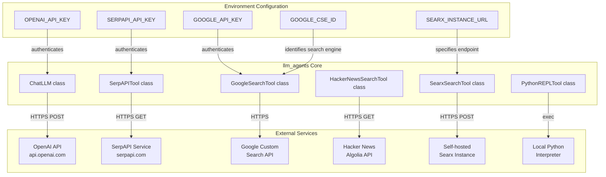
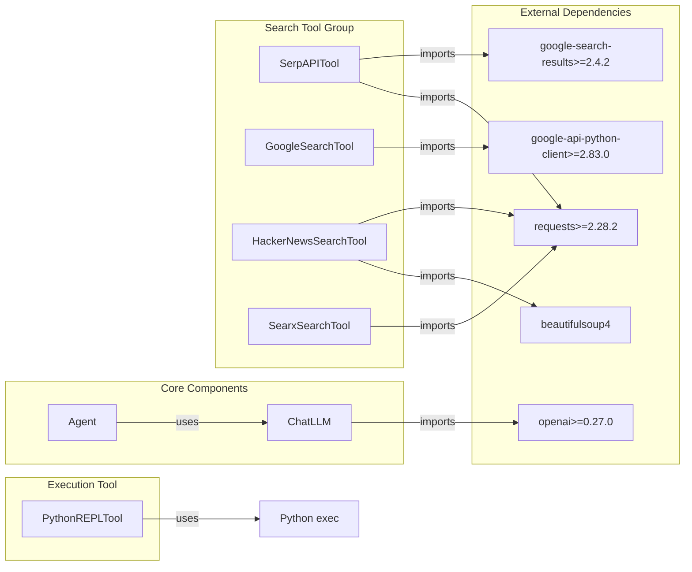
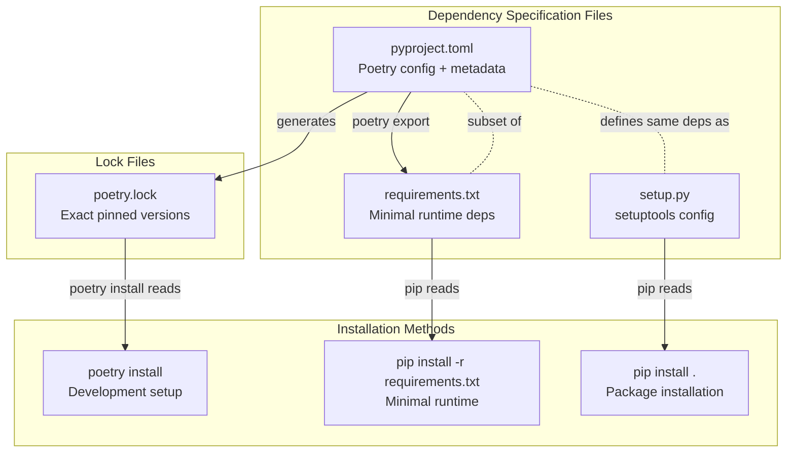
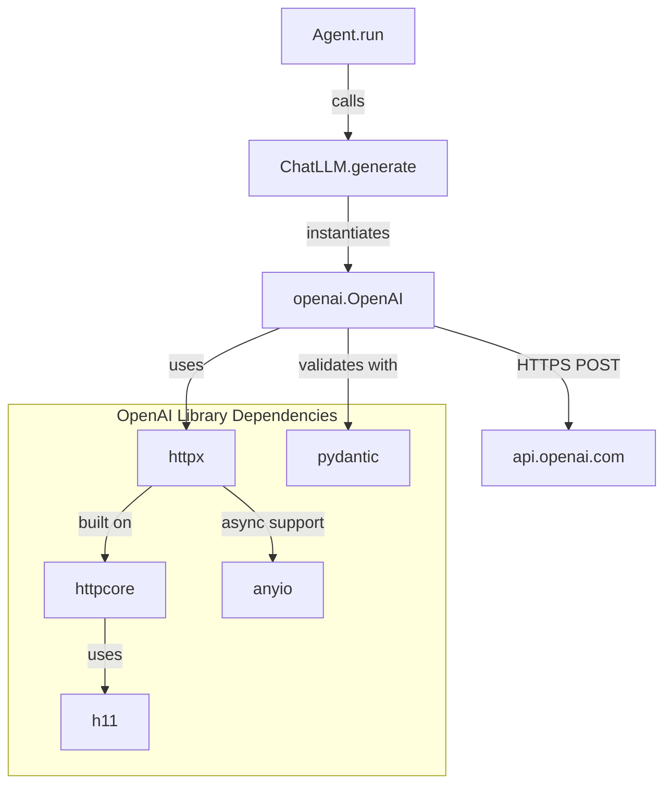
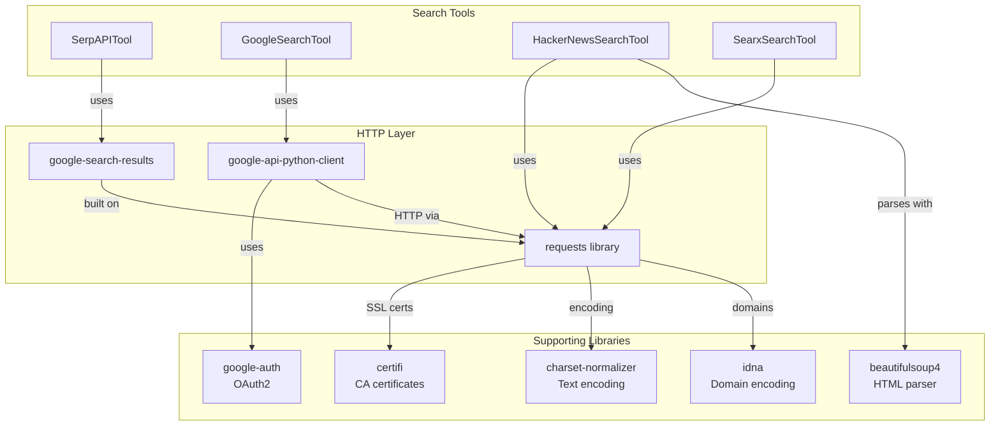

<!-- source: DeepWiki mcp.deepwiki.com · repo mpaepper/llm_agents · page 4 Dependencies and External Services · fetched 2026-10-26 -->

# Dependencies and External Services

<details>
<summary>Relevant source files</summary>

The following files were used as context for generating this wiki page:

- [poetry.lock](poetry.lock)
- [pyproject.toml](pyproject.toml)
- [requirements.txt](requirements.txt)
- [setup.py](setup.py)

</details>


This page documents all external dependencies and third-party service integrations required by the llm_agents package. It covers both runtime Python package dependencies and external API services that tools connect to.

For detailed instructions on obtaining and configuring API keys, see [Required API Keys](#4.1). For a comprehensive breakdown of Python package dependencies and their purposes, see [Python Dependencies](#4.2).

## Overview

The llm_agents system has two categories of external dependencies:

1. **External API Services**: Third-party web services that tools integrate with to provide capabilities like web search and code execution
2. **Python Package Dependencies**: Libraries required for LLM integration, HTTP communication, data validation, and web scraping

All external API services require authentication via environment variables. The system uses modern Python dependency management through Poetry, with locked versions for reproducible builds.

Sources: [requirements.txt:1-5](), [pyproject.toml:16-23](), [poetry.lock:1-391]()

## External API Services

The system integrates with five external services, each providing specific capabilities to different tools.

### Service Integration Architecture



**External API Services**

| Service | Purpose | Authentication Required | Used By |
|---------|---------|------------------------|---------|
| OpenAI API | LLM text generation for agent reasoning | `OPENAI_API_KEY` | `ChatLLM` class |
| SerpAPI | Google search results via third-party API | `SERPAPI_API_KEY` | `SerpAPITool` |
| Google Custom Search API | Direct Google search integration | `GOOGLE_API_KEY`, `GOOGLE_CSE_ID` | `GoogleSearchTool` |
| Hacker News Algolia API | Search Hacker News stories | None (public API) | `HackerNewsSearchTool` |
| Searx Instance | Privacy-focused meta-search engine | `SEARX_INSTANCE_URL` | `SearxSearchTool` |
| Python Interpreter | Local code execution | None (system Python) | `PythonREPLTool` |

Sources: [requirements.txt:1-5](), [pyproject.toml:16-23]()

### Service Dependencies by Component



Sources: [requirements.txt:1-5](), [pyproject.toml:16-23]()

## Python Package Dependencies

The project uses **Poetry** for dependency management with pinned versions in `poetry.lock` for reproducible builds. Dependencies are organized into main (runtime) and dev (testing) groups.

### Core Runtime Dependencies

| Package | Minimum Version | Purpose | Primary Consumer |
|---------|----------------|---------|------------------|
| `openai` | 0.27.0 | OpenAI API client for LLM access | `ChatLLM` class |
| `pydantic` | 1.10.5 | Data validation and settings management | Configuration validation |
| `requests` | 2.28.2 | HTTP client for API calls | All search tools |
| `google-api-python-client` | 2.83.0 | Google APIs client library | `GoogleSearchTool` |
| `google-search-results` | 2.4.2 | SerpAPI Python client | `SerpAPITool` |
| `beautifulsoup4` | 4.12.0+ | HTML parsing for web scraping | `HackerNewsSearchTool` |

Sources: [requirements.txt:1-5](), [pyproject.toml:16-23]()

### Transitive Dependencies

The `poetry.lock` file pins all transitive dependencies. Key transitive dependencies include:

| Package | Purpose | Brought in by |
|---------|---------|---------------|
| `httpx` | Async HTTP client | `openai` library |
| `httpcore` | Low-level HTTP implementation | `httpx` |
| `certifi` | SSL certificate bundle | `requests`, `httpcore` |
| `google-auth` | Google API authentication | `google-api-python-client` |
| `protobuf` | Protocol buffer serialization | Google client libraries |
| `soupsieve` | CSS selector library | `beautifulsoup4` |

Sources: [poetry.lock:1-391]()

### Development Dependencies

| Package | Version | Purpose |
|---------|---------|---------|
| `pytest` | 7.4.0+ | Test framework |
| `pytest-cov` | 4.1.0+ | Code coverage measurement |
| `pytest-mock` | 3.11.1+ | Mocking support for tests |

Sources: [pyproject.toml:25-28]()

## Dependency Management System

### Build System Configuration



The project maintains three dependency specification files for different use cases:

1. **pyproject.toml**: Primary Poetry configuration with full metadata
2. **requirements.txt**: Minimal runtime dependencies for pip-based installs
3. **setup.py**: Classic setuptools configuration for package distribution

Sources: [pyproject.toml:1-89](), [requirements.txt:1-5](), [setup.py:1-21]()

### Dependency Version Constraints

The project specifies minimum versions (using `>=`) rather than exact versions in the source files, allowing patch and minor version updates. The `poetry.lock` file pins exact versions for all direct and transitive dependencies.

**Version Constraint Philosophy:**
- **Direct dependencies** in [requirements.txt:1-5]() use minimum version constraints (`>=`)
- **Poetry lock file** in [poetry.lock:1-391]() pins exact versions with SHA256 hashes
- **Python version** requires `^3.8` (3.8 or higher, but below 4.0)

Sources: [pyproject.toml:17](), [requirements.txt:1-5](), [poetry.lock:1-391]()

## Dependency Relationship Map

### OpenAI Integration Stack



Sources: [poetry.lock:18-63](), [poetry.lock:562-621]()

### Search Tool Dependencies



Sources: [poetry.lock:100-211](), [poetry.lock:456-473](), [poetry.lock:518-530](), [poetry.lock:65-85]()

## Environment Variable Configuration

All external service authentication and configuration is managed through environment variables. These must be set before running the agent.

**Required Environment Variables by Feature:**

| Feature | Required Variables | Optional Variables |
|---------|-------------------|-------------------|
| Core agent (ChatLLM) | `OPENAI_API_KEY` | - |
| SerpAPI search | `OPENAI_API_KEY`, `SERPAPI_API_KEY` | - |
| Google Custom Search | `OPENAI_API_KEY`, `GOOGLE_API_KEY`, `GOOGLE_CSE_ID` | - |
| Hacker News search | `OPENAI_API_KEY` | - |
| Searx search | `OPENAI_API_KEY`, `SEARX_INSTANCE_URL` | - |
| Python REPL | `OPENAI_API_KEY` | - |

**Note:** `OPENAI_API_KEY` is required for all operations since the agent's reasoning loop depends on the ChatLLM component.

Sources: Based on tool implementations and architecture diagrams

## Installation Methods

### Poetry Installation (Recommended for Development)

```bash
# Install with locked dependencies
poetry install

# Install without dev dependencies
poetry install --no-dev
```

This installs all dependencies from [poetry.lock:1-391]() with exact versions.

### Pip Installation (Minimal Runtime)

```bash
# Install from requirements.txt
pip install -r requirements.txt

# Or install as package
pip install .
```

This installs minimum required versions from [requirements.txt:1-5]() or [setup.py:11-16]().

Sources: [pyproject.toml:87-89](), [setup.py:1-21](), [requirements.txt:1-5]()

## Dependency Security and Updates

The `poetry.lock` file includes SHA256 hashes for all packages to verify integrity during installation. The project specifies minimum versions to allow security patches while maintaining compatibility.

**Update Strategy:**
- Minimum version constraints allow automatic patch updates
- Poetry lock file ensures reproducible builds
- Manual review required for major/minor version updates

To update dependencies:
```bash
# Update within constraints
poetry update

# Update specific package
poetry update openai
```

Sources: [poetry.lock:1-391](), [pyproject.toml:16-23]()

---

