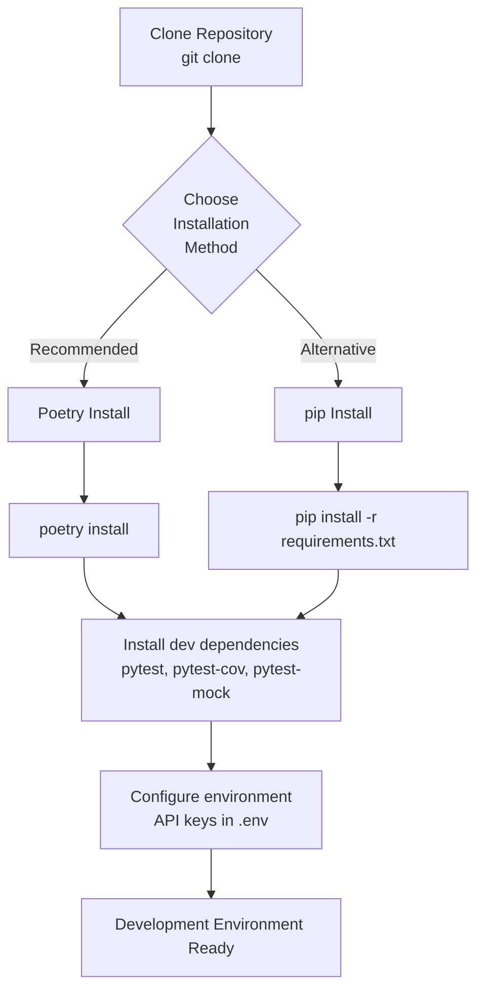
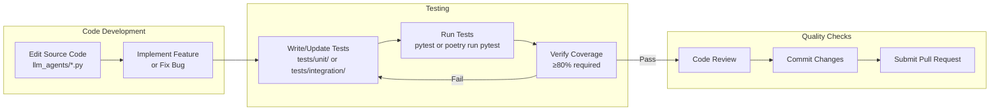
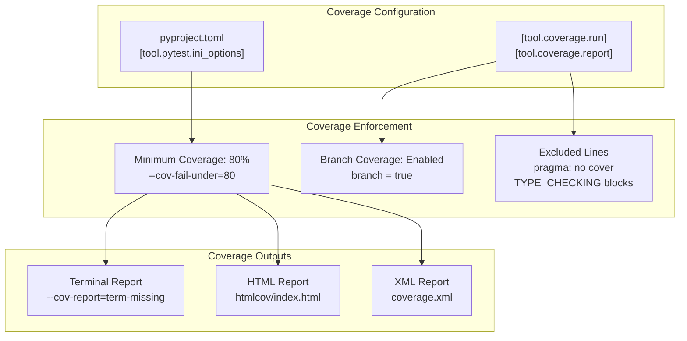
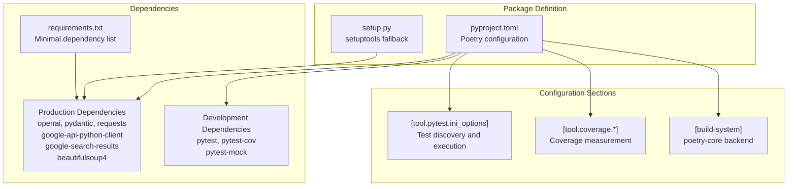

<!-- source: DeepWiki mcp.deepwiki.com · repo mpaepper/llm_agents · page 5 Development Guide · fetched 2026-10-26 -->

# Development Guide

<details>
<summary>Relevant source files</summary>

The following files were used as context for generating this wiki page:

- [.gitignore](.gitignore)
- [pyproject.toml](pyproject.toml)
- [requirements.txt](requirements.txt)
- [setup.py](setup.py)

</details>


## Purpose and Scope

This document provides guidance for developers who want to contribute to the llm_agents repository. It covers setting up a development environment, understanding the development workflow, and maintaining code quality standards. For detailed information about specific aspects of development, see:
- [Project Structure](#5.1) - Repository organization and module layout
- [Testing Infrastructure](#5.2) - Comprehensive testing guide
- [Build and Packaging](#5.3) - Distribution and version management

## Prerequisites

The llm_agents project requires:

| Requirement | Version | Purpose |
|------------|---------|---------|
| Python | ^3.8 | Core runtime |
| Poetry | Latest | Dependency management (recommended) |
| pip | Latest | Alternative dependency installation |
| Git | Any | Version control |

**Sources:** [pyproject.toml:17](), [setup.py:1-21]()

## Environment Setup

### Installation Methods

The project supports two installation methods: Poetry (recommended for development) and pip.



**Sources:** [pyproject.toml:16-28](), [requirements.txt:1-5]()

### Step-by-Step Setup

#### 1. Clone the Repository

```bash
git clone https://github.com/mpaepper/llm_agents.git
cd llm_agents
```

#### 2. Install Dependencies

**Using Poetry (Recommended):**
```bash
poetry install
```

This installs all production dependencies from [pyproject.toml:16-23]() and development dependencies from [pyproject.toml:25-28](), including:
- `pytest` - Test framework
- `pytest-cov` - Coverage reporting
- `pytest-mock` - Mocking utilities

**Using pip:**
```bash
pip install -r requirements.txt
pip install pytest pytest-cov pytest-mock
```

#### 3. Configure API Keys

Create a `.env` file in the repository root (ignored by [.gitignore:34]()):

```bash
OPENAI_API_KEY=your_openai_api_key
SERPAPI_API_KEY=your_serpapi_key  # Optional
GOOGLE_API_KEY=your_google_key    # Optional
GOOGLE_CSE_ID=your_cse_id         # Optional
SEARX_INSTANCE_URL=your_url       # Optional
```

For testing purposes, you can use mock values or omit optional keys. See [Required API Keys](#4.1) for obtaining production keys.

**Sources:** [.gitignore:34]()

## Development Workflow

The standard development workflow follows this pattern:



**Sources:** [pyproject.toml:34-54]()

### Common Development Commands

| Task | Poetry Command | Direct Command |
|------|----------------|----------------|
| Run all tests | `poetry run pytest` | `pytest` |
| Run unit tests only | `poetry run pytest -m unit` | `pytest -m unit` |
| Run with coverage | `poetry run pytest --cov` | `pytest --cov=llm_agents` |
| Generate HTML coverage | `poetry run pytest --cov-report=html` | `pytest --cov-report=html` |
| Run specific test file | `poetry run pytest tests/unit/test_agent.py` | `pytest tests/unit/test_agent.py` |
| Skip slow tests | `poetry run pytest -m "not slow"` | `pytest -m "not slow"` |

**Sources:** [pyproject.toml:30-32](), [pyproject.toml:40-49]()

## Code Quality Standards

### Coverage Requirements

The project enforces strict code quality standards through automated coverage checks:



**Sources:** [pyproject.toml:43-48](), [pyproject.toml:56-85]()

### Coverage Configuration Details

From [pyproject.toml:56-79]():

| Setting | Value | Purpose |
|---------|-------|---------|
| `source` | `["llm_agents"]` | Only measure coverage in main package |
| `branch` | `true` | Enable branch coverage analysis |
| `fail_under` | `80` | Minimum required coverage percentage |
| `precision` | `2` | Decimal places in coverage reports |
| `show_missing` | `true` | Display lines not covered by tests |

### Excluded from Coverage

The following code patterns are excluded from coverage requirements [pyproject.toml:70-79]():

- `pragma: no cover` - Explicit coverage exclusions
- `def __repr__` - String representation methods
- `def __str__` - String conversion methods
- `raise AssertionError` - Assertion failures
- `raise NotImplementedError` - Abstract method stubs
- `if __name__ == .__main__.:` - Script entry points
- `if TYPE_CHECKING:` - Type checking imports

### Test Organization

Tests are organized using pytest markers defined in [pyproject.toml:50-54]():

| Marker | Purpose | Usage |
|--------|---------|-------|
| `unit` | Unit tests for individual components | `@pytest.mark.unit` |
| `integration` | Tests involving multiple components | `@pytest.mark.integration` |
| `slow` | Long-running tests | `@pytest.mark.slow` |

Run specific test categories:
```bash
pytest -m unit              # Unit tests only
pytest -m integration       # Integration tests only
pytest -m "not slow"        # Skip slow tests
```

**Sources:** [pyproject.toml:50-54]()

## Project Configuration Files

The repository uses multiple configuration files for different purposes:



**Sources:** [pyproject.toml:1-89](), [setup.py:1-21](), [requirements.txt:1-5]()

### Configuration File Purposes

| File | Purpose | Primary Use Case |
|------|---------|------------------|
| `pyproject.toml` | Comprehensive Poetry configuration | Development and distribution |
| `setup.py` | setuptools compatibility | Legacy pip installations |
| `requirements.txt` | Minimal dependency specification | Lightweight installations |
| `.gitignore` | Version control exclusions | Repository cleanliness |

**Sources:** [pyproject.toml:1](), [setup.py:1](), [requirements.txt:1](), [.gitignore:1]()

## Ignored Files and Directories

The `.gitignore` file excludes development artifacts from version control:

| Category | Patterns | Reason |
|----------|----------|--------|
| Python bytecode | `__pycache__/`, `*.py[cod]` | Generated at runtime |
| Distribution | `dist/`, `build/`, `*.egg-info/` | Build artifacts |
| Virtual environments | `.venv`, `venv/`, `ENV/` | Local installations |
| Testing | `.pytest_cache/`, `.coverage`, `htmlcov/` | Test outputs |
| IDE | `.vscode/`, `.idea/`, `.DS_Store` | Editor configurations |
| Environment variables | `.env` | Sensitive credentials |

**Sources:** [.gitignore:1-61]()

## Quick Start for Contributors

### First-Time Setup
```bash
# Clone and setup
git clone https://github.com/mpaepper/llm_agents.git
cd llm_agents
poetry install

# Configure environment
cp .env.example .env  # If available, otherwise create manually
# Edit .env with your API keys

# Verify installation
poetry run pytest -m unit
```

### Before Submitting Changes
```bash
# Run full test suite
poetry run pytest

# Check coverage (must be ≥80%)
poetry run pytest --cov-report=term-missing

# Generate HTML coverage report
poetry run pytest --cov-report=html
# Open htmlcov/index.html to review coverage

# Ensure no files are accidentally included
git status
```

### Typical Development Cycle
```bash
# Create feature branch
git checkout -b feature/your-feature-name

# Make changes to code
# Edit llm_agents/your_module.py

# Write/update tests
# Edit tests/unit/test_your_module.py

# Run affected tests
poetry run pytest tests/unit/test_your_module.py

# Run full suite before committing
poetry run pytest

# Commit and push
git add .
git commit -m "Add your feature description"
git push origin feature/your-feature-name
```

## Integration with CI/CD

While CI/CD configuration is not visible in the provided files, the project's test configuration [pyproject.toml:40-49]() is designed to work with continuous integration systems. The strict coverage requirements (`--cov-fail-under=80`) and standardized test markers enable automated quality checks.

**Sources:** [pyproject.toml:40-49]()

## Next Steps

For detailed information about specific development topics:
- **Understanding the codebase structure**: See [Project Structure](#5.1)
- **Writing and running tests**: See [Testing Infrastructure](#5.2)
- **Building and distributing packages**: See [Build and Packaging](#5.3)
- **Creating new tools**: See [Creating Custom Tools](#3.4)
- **API integration details**: See [Dependencies and External Services](#4)

**Sources:** [pyproject.toml:1-89](), [setup.py:1-21](), [requirements.txt:1-5](), [.gitignore:1-61]()

---

