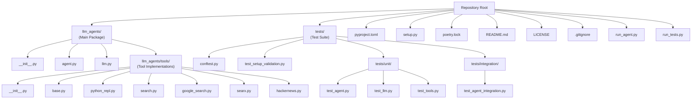
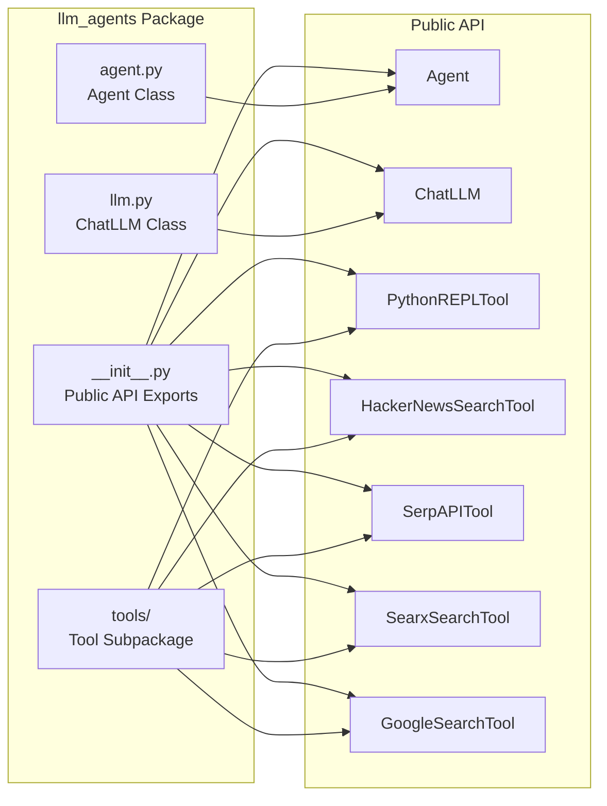
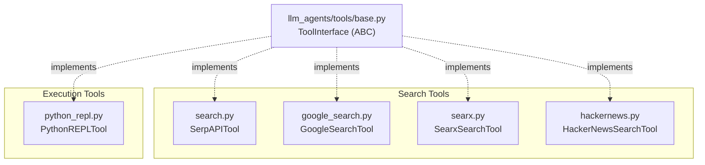
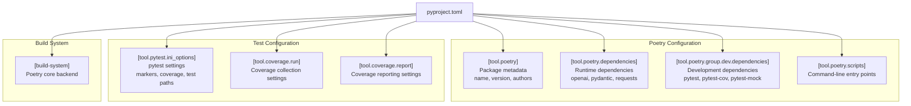
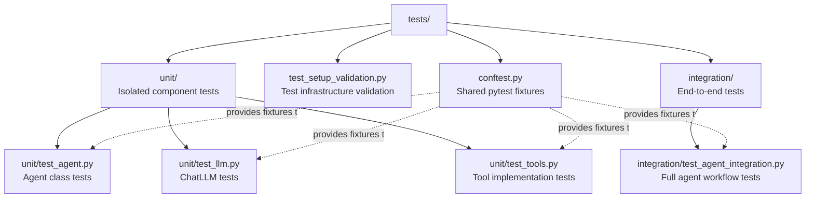
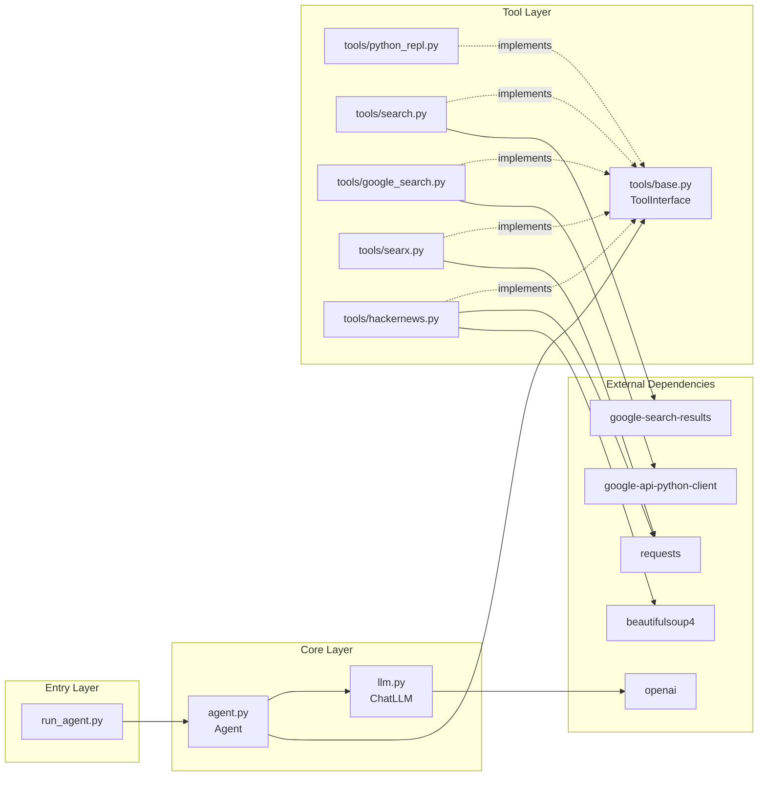

<!-- source: DeepWiki mcp.deepwiki.com · repo mpaepper/llm_agents · page 5.1 Project Structure · fetched 2026-10-26 -->

# Project Structure

Relevant source files

The following files were used as context for generating this wiki page:

- [.gitignore](.gitignore)
- [llm_agents/__init__.py](llm_agents/__init__.py)
- [llm_agents/tools/searx.py](llm_agents/tools/searx.py)
- [pyproject.toml](pyproject.toml)

This document explains the repository's directory structure and organization of modules in the `llm_agents` codebase. It provides a technical overview of where different components are located, how files are organized, and the purpose of each major directory and configuration file.

For details on the testing infrastructure within the project structure, see [Testing Infrastructure](#5.2). For build and packaging details, see [Build and Packaging](#5.3).

---

## Repository Layout

The repository follows a standard Python package structure with the main application code in `llm_agents/`, tests in `tests/`, and configuration files at the root level.

### Directory Tree

**Sources:** [llm_agents/__init__.py:1-10](), [pyproject.toml:1-89](), [.gitignore:1-61]()

---

## Core Package Structure

### The `llm_agents/` Package

The main application code is organized in the `llm_agents/` package, which contains the core agent logic, LLM integration, and tool implementations.

**Sources:** [llm_agents/__init__.py:1-10]()

#### Package Exports

The [llm_agents/__init__.py:1-10]() file defines the public API by explicitly exporting seven classes:

| Export | Source Module | Purpose |
|--------|--------------|---------|
| `Agent` | `llm_agents.agent` | Main agent orchestrator |
| `ChatLLM` | `llm_agents.llm` | OpenAI LLM integration |
| `PythonREPLTool` | `llm_agents.tools.python_repl` | Python code execution |
| `HackerNewsSearchTool` | `llm_agents.tools.hackernews` | Hacker News search |
| `SerpAPITool` | `llm_agents.tools.search` | SerpAPI-based search |
| `SearxSearchTool` | `llm_agents.tools.searx` | Searx search engine |
| `GoogleSearchTool` | `llm_agents.tools.google_search` | Google Custom Search |

**Sources:** [llm_agents/__init__.py:1-10]()

---

### The `llm_agents/tools/` Subpackage

Tool implementations are organized in their own subpackage with a clear interface-based architecture:

Each tool file contains:
- A concrete implementation class inheriting from `ToolInterface`
- Helper functions for the tool's specific functionality
- Configuration and API key management
- Optional `__main__` block for standalone testing

**Sources:** [llm_agents/__init__.py:3-7](), [llm_agents/tools/searx.py:1-88]()

---

## Configuration and Build Files

### Root-Level Configuration

The repository root contains several configuration files that define the project structure, dependencies, and build process:

| File | Purpose | Key Contents |
|------|---------|--------------|
| `pyproject.toml` | Poetry configuration and project metadata | Package metadata, dependencies, dev dependencies, pytest config, coverage settings |
| `setup.py` | Alternative setuptools configuration | Package installation configuration |
| `poetry.lock` | Locked dependency versions | Pinned versions for reproducible builds |
| `.gitignore` | Version control exclusions | Build artifacts, virtual environments, IDE files, test cache |
| `README.md` | Project documentation | Usage instructions, API key setup, examples |
| `LICENSE` | MIT License | Legal terms |

**Sources:** [pyproject.toml:1-89](), [.gitignore:1-61]()

### pyproject.toml Structure

The [pyproject.toml:1-89]() file serves multiple purposes:

**Sources:** [pyproject.toml:1-89]()

#### Package Metadata

[pyproject.toml:1-14]() defines:
- Package name: `llm-agents`
- Version: `0.1.0`
- Package inclusion: `{include = "llm_agents"}`
- License: MIT
- Repository: https://github.com/mpaepper/llm_agents

#### Dependency Groups

**Runtime Dependencies** [pyproject.toml:16-23]():
- `python = "^3.8"`
- `openai >= 0.27.0` (LLM integration)
- `pydantic >= 1.10.5` (data validation)
- `requests >= 2.28.2` (HTTP client)
- `google-api-python-client >= 2.83.0` (Google APIs)
- `google-search-results >= 2.4.2` (SerpAPI)
- `beautifulsoup4 ^4.12.0` (HTML parsing)

**Development Dependencies** [pyproject.toml:25-28]():
- `pytest ^7.4.0`
- `pytest-cov ^4.1.0`
- `pytest-mock ^3.11.1`

#### Test Configuration

[pyproject.toml:34-54]() configures pytest with:
- Test paths: `["tests"]`
- Coverage target: 80% minimum
- Markers: `unit`, `integration`, `slow`
- Coverage reports: terminal, HTML, XML

**Sources:** [pyproject.toml:1-89]()

---

## Entry Points and Runners

### Application Entry Point

`run_agent.py` serves as the primary entry point for running the agent interactively. It demonstrates how to instantiate an `Agent` with tools and execute queries.

### Test Runner

`run_tests.py` provides a programmatic interface for running the test suite, allowing execution of tests via `poetry run test` or `poetry run tests` as defined in [pyproject.toml:30-32]().

**Sources:** [pyproject.toml:30-32]()

---

## Test Organization

The `tests/` directory is organized into unit and integration tests with shared fixtures:

For detailed information on test fixtures and organization, see [Testing Infrastructure](#5.2).

**Sources:** [pyproject.toml:34-54]()

---

## Git Exclusions

The [.gitignore:1-61]() file excludes several categories of files from version control:

| Category | Files Excluded | Lines |
|----------|----------------|-------|
| Python artifacts | `__pycache__/`, `*.pyc`, `*.egg-info/` | [.gitignore:1-24]() |
| Virtual environments | `.venv`, `env/`, `venv/`, `ENV/` | [.gitignore:33-40]() |
| Test artifacts | `.pytest_cache/`, `.coverage`, `htmlcov/` | [.gitignore:42-50]() |
| IDE files | `.vscode/`, `.idea/`, `*.swp` | [.gitignore:55-60]() |
| Build artifacts | `build/`, `dist/`, `*.egg` | [.gitignore:6-24]() |

**Sources:** [.gitignore:1-61]()

---

## Module Dependencies

### Internal Dependency Flow

**Sources:** [llm_agents/__init__.py:1-10](), [pyproject.toml:16-23]()

---

## File Location Reference

This table provides quick reference for locating specific functionality:

| Functionality | File Path | Key Classes/Functions |
|--------------|-----------|----------------------|
| Agent orchestration | `llm_agents/agent.py` | `Agent` |
| LLM integration | `llm_agents/llm.py` | `ChatLLM` |
| Tool interface | `llm_agents/tools/base.py` | `ToolInterface` |
| Python execution | `llm_agents/tools/python_repl.py` | `PythonREPLTool` |
| SerpAPI search | `llm_agents/tools/search.py` | `SerpAPITool` |
| Google search | `llm_agents/tools/google_search.py` | `GoogleSearchTool` |
| Searx search | `llm_agents/tools/searx.py` | `SearxSearchTool`, `search()` |
| Hacker News | `llm_agents/tools/hackernews.py` | `HackerNewsSearchTool` |
| Test fixtures | `tests/conftest.py` | Various pytest fixtures |
| Project config | `pyproject.toml` | Poetry, pytest, coverage settings |

**Sources:** [llm_agents/__init__.py:1-10](), [llm_agents/tools/searx.py:74-81]()

---

## Navigating the Codebase

### Adding a New Tool

To add a new tool implementation:
1. Create a new file in `llm_agents/tools/`
2. Import `ToolInterface` from `llm_agents.tools.base`
3. Implement the `name`, `description`, and `use()` interface
4. Export the tool in `llm_agents/__init__.py`
5. Add tests in `tests/unit/test_tools.py`

### Modifying Core Logic

- Agent orchestration logic: `llm_agents/agent.py`
- LLM prompt construction: `llm_agents/agent.py`
- OpenAI API integration: `llm_agents/llm.py`

### Configuration Changes

- Add dependencies: [pyproject.toml:16-28]()
- Modify test settings: [pyproject.toml:34-54]()
- Update coverage thresholds: [pyproject.toml:56-85]()

**Sources:** [llm_agents/__init__.py:1-10](), [pyproject.toml:1-89]()

---

