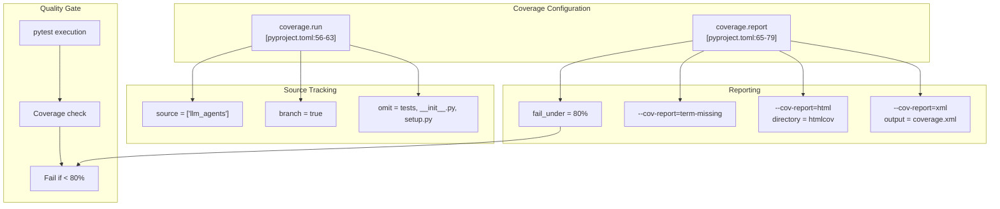
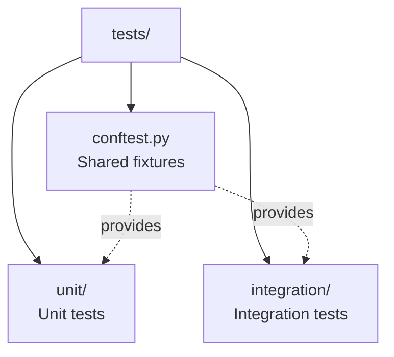
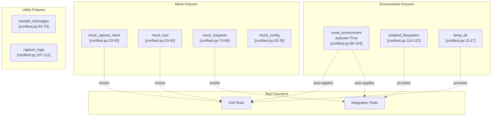
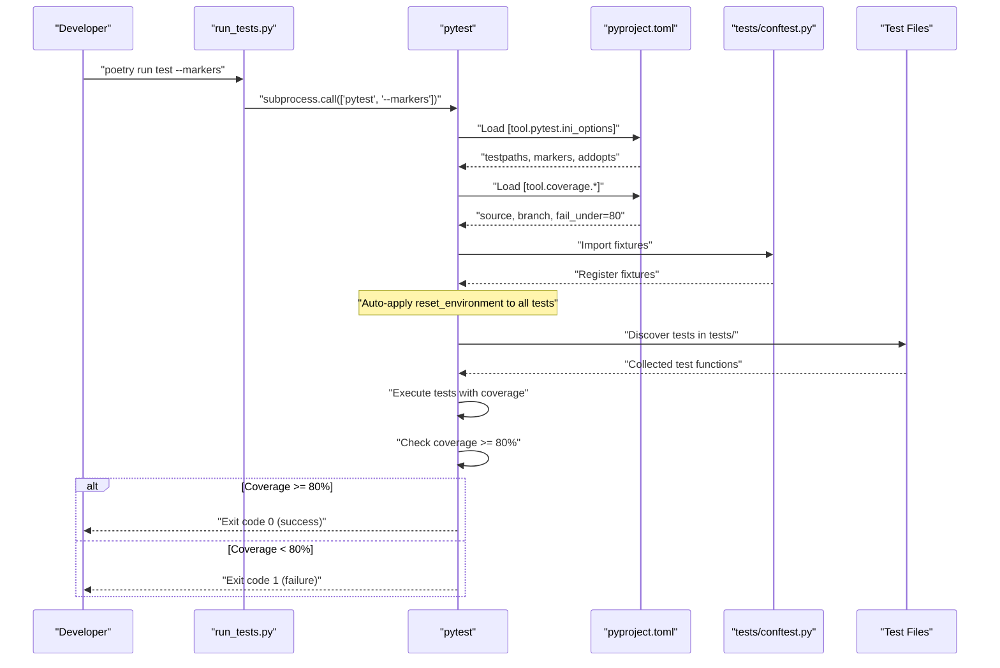
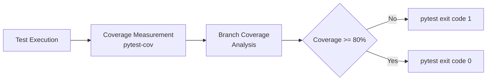

<!-- source: DeepWiki mcp.deepwiki.com · repo mpaepper/llm_agents · page 5.2 Testing Infrastructure · fetched 2026-10-26 -->

# Testing Infrastructure

<details>
<summary>Relevant source files</summary>

The following files were used as context for generating this wiki page:

- [pyproject.toml](pyproject.toml)
- [run_tests.py](run_tests.py)
- [tests/conftest.py](tests/conftest.py)

</details>


## Purpose and Scope

This document describes the testing infrastructure for the llm_agents codebase, including the pytest configuration, test organization, shared fixtures, and coverage requirements. The testing system provides comprehensive validation of all components through unit and integration tests with strict quality gates.

For detailed information about individual test fixtures, see [Test Fixtures](#5.2.1). For instructions on running tests, see [Running Tests](#5.2.2). For guidelines on writing new tests, see [Writing Tests](#5.2.3).

## Test Framework Configuration

The testing infrastructure is built on pytest with comprehensive configuration defined in [pyproject.toml:34-54]().

### Pytest Core Settings

The pytest configuration establishes the following test discovery and execution parameters:

| Setting | Value | Purpose |
|---------|-------|---------|
| `minversion` | 7.0 | Requires pytest 7.0 or newer |
| `testpaths` | `["tests"]` | Root directory for test discovery |
| `python_files` | `["test_*.py", "*_test.py", "tests.py"]` | File patterns to recognize as tests |
| `python_classes` | `["Test*", "*Tests"]` | Class patterns for test classes |
| `python_functions` | `["test_*"]` | Function patterns for test functions |

The configuration uses strict markers mode (`--strict-markers`) to prevent typos in test markers and ensure all markers are explicitly declared.

**Sources:** [pyproject.toml:34-39]()

### Test Markers

Three test markers categorize tests by type and execution time:

```python
markers = [
    "unit: Unit tests",
    "integration: Integration tests", 
    "slow: Tests that take a long time to run",
]
```

These markers enable selective test execution, such as running only fast unit tests during development or including integration tests in CI pipelines.

**Sources:** [pyproject.toml:50-54]()

## Coverage Configuration

The testing infrastructure enforces strict coverage requirements to maintain code quality.

### Coverage Targets



### Coverage Requirements

| Requirement | Value | Location |
|-------------|-------|----------|
| Minimum coverage | 80% | [pyproject.toml:48](), [pyproject.toml:69]() |
| Branch coverage | Enabled | [pyproject.toml:44](), [pyproject.toml:58]() |
| Source directory | `llm_agents` | [pyproject.toml:43](), [pyproject.toml:57]() |

The dual enforcement of 80% coverage (in both pytest options and coverage config) ensures tests cannot pass without meeting the quality threshold. Branch coverage is enabled to validate that both true and false conditions in conditional statements are tested.

### Coverage Exclusions

Certain code patterns are excluded from coverage calculations [pyproject.toml:70-79]():

- Debug representation methods (`__repr__`, `__str__`)
- Error conditions that should never occur (`raise AssertionError`, `raise NotImplementedError`)
- Main execution blocks (`if __name__ == .__main__.:`)
- Type checking blocks (`if TYPE_CHECKING:`)
- Pragmas explicitly marked with `pragma: no cover`

Files excluded from coverage tracking [pyproject.toml:59-63]():
- Test files themselves (`*/tests/*`)
- Package initialization files (`*/__init__.py`)
- Setup scripts (`*/setup.py`)

**Sources:** [pyproject.toml:40-49](), [pyproject.toml:56-85]()

## Test Organization

### Directory Structure

Tests are organized in a dedicated `tests/` directory with subdirectories for different test types:



The `conftest.py` file at the root of the tests directory provides shared fixtures available to all test files.

**Sources:** [pyproject.toml:36](), [tests/conftest.py:1-122]()

### Test Execution Wrapper

The `run_tests.py` script provides a convenient wrapper for pytest execution:

```python
def main():
    """Run pytest with all provided arguments."""
    return subprocess.call(["pytest"] + sys.argv[1:])
```

This script is registered as both `test` and `tests` commands in the Poetry scripts configuration [pyproject.toml:30-32](), allowing tests to be run using:

```bash
poetry run test
poetry run tests
```

Both commands forward all arguments to pytest, enabling usage like `poetry run test -k test_agent` or `poetry run test --markers`.

**Sources:** [run_tests.py:1-11](), [pyproject.toml:30-32]()

## Fixtures and Mocking

The `conftest.py` file provides a comprehensive set of fixtures for test isolation and mocking external dependencies.

### Fixture Architecture



### Core Fixtures

#### Environment Isolation: `reset_environment`

The `reset_environment` fixture is automatically applied to every test (`autouse=True`) to ensure consistent environment configuration:

```python
@pytest.fixture(autouse=True)
def reset_environment(monkeypatch):
    """Reset environment variables for each test."""
    test_env = {
        "OPENAI_API_KEY": "test-key",
        "GOOGLE_API_KEY": "test-google-key",
        "GOOGLE_CSE_ID": "test-cse-id"
    }
    
    for key, value in test_env.items():
        monkeypatch.setenv(key, value)
```

This fixture sets standardized test values for all API keys, preventing tests from accidentally using real credentials and ensuring reproducible test behavior.

**Sources:** [tests/conftest.py:89-104]()

#### OpenAI Client Mock: `mock_openai_client`

The `mock_openai_client` fixture provides a fully mocked OpenAI client that simulates API responses without making real API calls:

```python
@pytest.fixture
def mock_openai_client():
    """Mock OpenAI client for testing."""
    client = MagicMock()
    
    mock_response = MagicMock()
    mock_response.choices = [
        MagicMock(
            message=MagicMock(
                content="Test response",
                tool_calls=None
            )
        )
    ]
    
    client.chat.completions.create.return_value = mock_response
    
    return client
```

The mock client returns a structured response matching the OpenAI API format with `choices`, `message`, and `content` attributes.

**Sources:** [tests/conftest.py:33-50]()

#### HTTP Request Mocking: `mock_requests`

The `mock_requests` fixture patches the `requests` module to prevent actual HTTP calls during testing:

```python
@pytest.fixture
def mock_requests(monkeypatch):
    """Mock requests module for testing HTTP calls."""
    mock_get = Mock()
    mock_response = Mock()
    mock_response.status_code = 200
    mock_response.json.return_value = {"result": "success"}
    mock_response.text = '{"result": "success"}'
    mock_get.return_value = mock_response
    
    monkeypatch.setattr("requests.get", mock_get)
    monkeypatch.setattr("requests.post", mock_get)
    
    return mock_get
```

This fixture mocks both GET and POST requests, returning a standardized success response useful for testing tool integrations that make HTTP calls.

**Sources:** [tests/conftest.py:74-86]()

### Filesystem Fixtures

Two fixtures provide temporary filesystem access for tests involving file operations:

| Fixture | Type | Purpose | Location |
|---------|------|---------|----------|
| `temp_dir` | Generator | Creates temporary directory, auto-cleanup | [conftest.py:13-17]() |
| `isolated_filesystem` | Context manager | Changes to temp directory, restores CWD | [conftest.py:114-122]() |

The `isolated_filesystem` fixture changes the current working directory to a temporary location and restores the original directory after the test completes, ensuring file operations don't pollute the repository.

**Sources:** [tests/conftest.py:13-17](), [tests/conftest.py:114-122]()

### Configuration and Sample Data

Additional fixtures provide test data:

- **`mock_config`** [conftest.py:20-30](): Returns a dictionary with sample configuration values including API key, model name, temperature, and tool list
- **`sample_messages`** [conftest.py:63-70](): Provides a list of sample chat messages in the format expected by ChatLLM
- **`capture_logs`** [conftest.py:107-111](): Wraps pytest's `caplog` fixture with DEBUG level logging enabled

**Sources:** [tests/conftest.py:20-30](), [tests/conftest.py:63-70](), [tests/conftest.py:107-111]()

## Test Execution Flow

### Pytest Invocation and Configuration Loading



### Configuration Resolution Order

When pytest is invoked, configuration is loaded and applied in this order:

1. **Command-line arguments** - Override all other settings
2. **`pyproject.toml` [tool.pytest.ini_options]** [pyproject.toml:34-54]() - Project-level pytest configuration
3. **`pyproject.toml` [tool.coverage.*]** [pyproject.toml:56-85]() - Coverage measurement configuration
4. **`conftest.py` fixtures** [tests/conftest.py:1-122]() - Loaded before test execution
5. **Default pytest behavior** - Fallback for unconfigured options

The `reset_environment` fixture with `autouse=True` is automatically applied to every test function without requiring explicit declaration in test signatures.

**Sources:** [pyproject.toml:34-85](), [tests/conftest.py:89-104](), [run_tests.py:1-11]()

## Quality Gates

The testing infrastructure enforces two hard quality gates that must pass for tests to succeed:

### Coverage Gate



The coverage gate is enforced by:
- **pytest option**: `--cov-fail-under=80` [pyproject.toml:48]()
- **coverage config**: `fail_under = 80` [pyproject.toml:69]()

Both settings must be satisfied for tests to pass.

### Test Success Gate

All test functions must pass. Pytest's default behavior fails the test run if any test raises an exception or assertion error. The strict markers setting (`--strict-markers`) additionally fails the build if undefined markers are used, preventing typos like `@pytest.mark.uint` instead of `@pytest.mark.unit`.

**Sources:** [pyproject.toml:40-49](), [pyproject.toml:65-79]()

## Coverage Reporting Formats

The testing infrastructure generates coverage reports in three formats:

| Format | Output Location | Purpose |
|--------|----------------|---------|
| Terminal | stdout | Immediate feedback with missing lines |
| HTML | `htmlcov/` directory | Detailed browsable report |
| XML | `coverage.xml` | CI/CD integration (e.g., Codecov) |

All three reports are generated automatically on every test run via the `addopts` configuration [pyproject.toml:45-47]():

```toml
"--cov-report=term-missing",
"--cov-report=html",
"--cov-report=xml",
```

The HTML report directory and XML output file are configured in [pyproject.toml:81-85]().

**Sources:** [pyproject.toml:40-47](), [pyproject.toml:81-85]()

## Development Dependencies

Testing-related dependencies are isolated in the `[tool.poetry.group.dev.dependencies]` section [pyproject.toml:25-28]():

| Package | Version | Purpose |
|---------|---------|---------|
| `pytest` | ^7.4.0 | Test framework |
| `pytest-cov` | ^4.1.0 | Coverage plugin for pytest |
| `pytest-mock` | ^3.11.1 | Mocking utilities for pytest |

These dependencies are only installed in development environments and are not included when the package is installed as a library dependency.

**Sources:** [pyproject.toml:25-28]()

---

