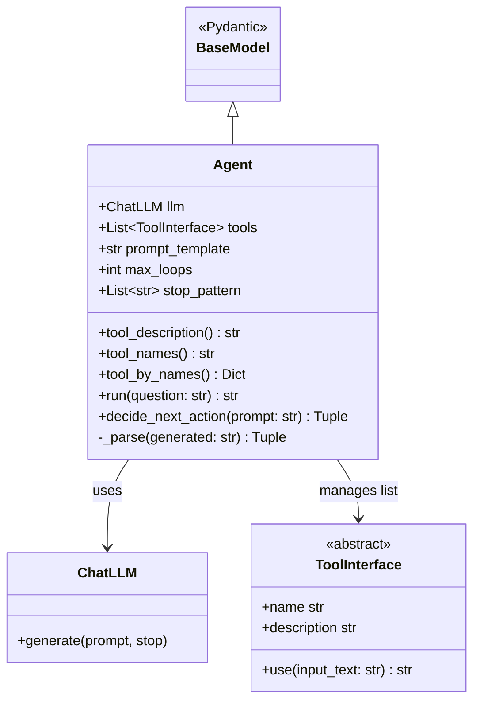
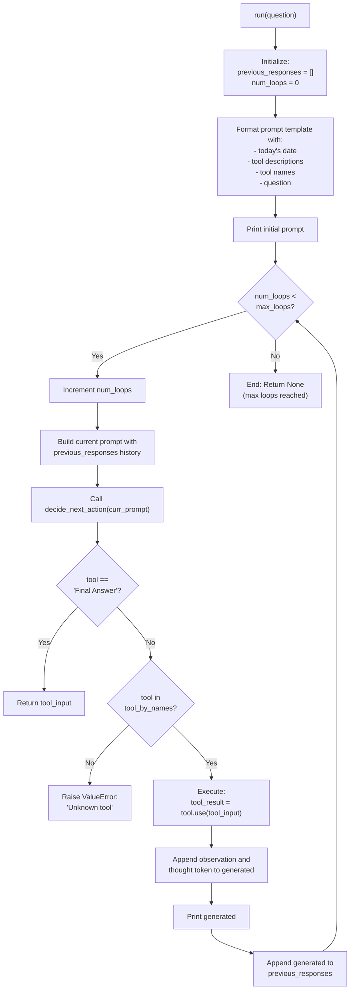
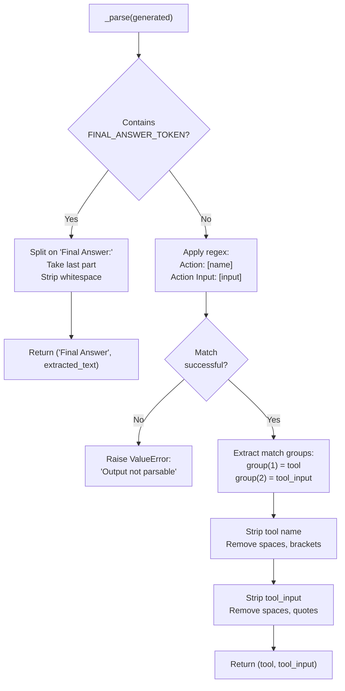
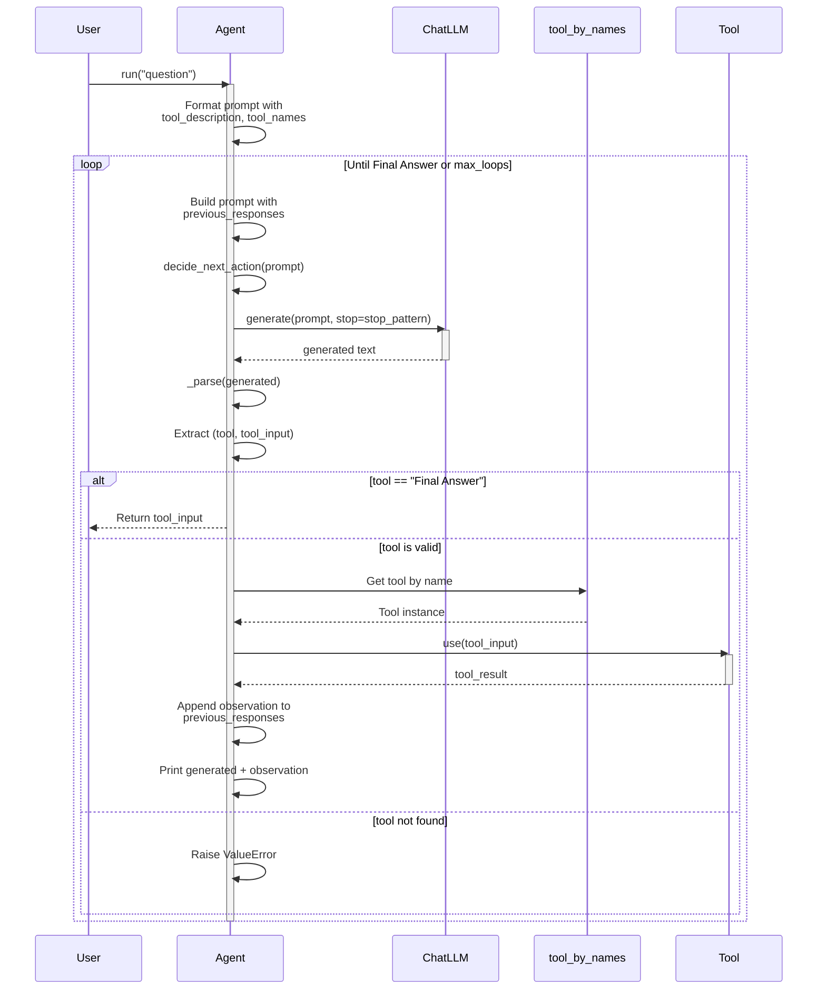

<!-- source: DeepWiki mcp.deepwiki.com · repo mpaepper/llm_agents · page 6.1 Agent API · fetched 2026-10-26 -->

# Agent API

<details>
<summary>Relevant source files</summary>

The following files were used as context for generating this wiki page:

- [llm_agents/__init__.py](llm_agents/__init__.py)
- [llm_agents/agent.py](llm_agents/agent.py)
- [llm_agents/tools/searx.py](llm_agents/tools/searx.py)

</details>


## Purpose and Scope

This page provides a comprehensive technical reference for the `Agent` class, the core orchestrator of the LLM agent system. The `Agent` class implements the Thought-Action-Observation loop, coordinates between the language model and tools, and manages the iterative reasoning process.

For information about the ChatLLM component that the Agent uses, see [ChatLLM API](#6.2). For details about tool implementations, see [Tool APIs](#6.3). For architectural context and design patterns, see [The Agent](#2.1).

**Sources:** [llm_agents/agent.py:1-102]()

---

## Class Overview

The `Agent` class is defined in [llm_agents/agent.py:36-95]() and extends Pydantic's `BaseModel` for data validation and configuration management.



**Sources:** [llm_agents/agent.py:36-43]()

---

## Constructor and Class Attributes

The `Agent` class is instantiated with the following attributes. Since it extends `BaseModel`, these can be provided as constructor arguments:

| Attribute | Type | Required | Default | Description |
|-----------|------|----------|---------|-------------|
| `llm` | `ChatLLM` | Yes | - | The language model interface used for generating thoughts and actions |
| `tools` | `List[ToolInterface]` | Yes | - | List of available tools the agent can invoke |
| `prompt_template` | `str` | No | `PROMPT_TEMPLATE` | Template string for formatting prompts (see [Prompt Template](#prompt-template)) |
| `max_loops` | `int` | No | `15` | Maximum number of reasoning iterations before terminating |
| `stop_pattern` | `List[str]` | No | `['\nObservation:', '\n\tObservation:']` | Stop sequences to prevent LLM from hallucinating observations |

### Example Instantiation

```python
from llm_agents import Agent, ChatLLM, PythonREPLTool

agent = Agent(
    llm=ChatLLM(),
    tools=[PythonREPLTool()],
    max_loops=10  # Optional: override default
)
```

**Sources:** [llm_agents/agent.py:36-42](), [llm_agents/agent.py:97-99]()

---

## Properties

The `Agent` class provides three computed properties that derive information from the configured tools:

### `tool_description`

Returns a formatted string containing the name and description of each tool, one per line. This is used in prompt construction to inform the LLM about available tools.

```python
@property
def tool_description(self) -> str:
    return "\n".join([f"{tool.name}: {tool.description}" for tool in self.tools])
```

**Returns:** String with format `"<tool_name>: <tool_description>\n..."` for each tool.

**Sources:** [llm_agents/agent.py:44-46]()

---

### `tool_names`

Returns a comma-separated string of all tool names. This is used in the prompt template to show the LLM which actions are valid.

```python
@property
def tool_names(self) -> str:
    return ",".join([tool.name for tool in self.tools])
```

**Returns:** String with format `"tool1,tool2,tool3"`.

**Sources:** [llm_agents/agent.py:48-50]()

---

### `tool_by_names`

Returns a dictionary mapping tool names to their corresponding `ToolInterface` instances. This enables efficient tool lookup during action execution.

```python
@property
def tool_by_names(self) -> Dict[str, ToolInterface]:
    return {tool.name: tool for tool in self.tools}
```

**Returns:** Dictionary with structure `{"tool_name": ToolInterface}`.

**Sources:** [llm_agents/agent.py:52-54]()

---

## Public Methods

### `run(question: str)`

The primary entry point for agent execution. Implements the Thought-Action-Observation loop, iteratively calling the LLM and executing tools until a final answer is produced or `max_loops` is reached.



#### Parameters
- `question` (str): The user's question or task to be answered/completed

#### Returns
- `str` | `None`: The final answer if found, or `None` if `max_loops` is reached without a final answer

#### Behavior
1. Formats the prompt template with the question and tool information
2. Enters a loop (up to `max_loops` iterations):
   - Constructs the current prompt with conversation history
   - Calls `decide_next_action()` to get the LLM's next thought/action
   - If the action is "Final Answer", returns the answer
   - Otherwise, validates the tool exists and executes it
   - Appends the observation to the conversation history
3. Prints intermediate steps for debugging/transparency

#### Example

```python
agent = Agent(llm=ChatLLM(), tools=[PythonREPLTool()])
result = agent.run("What is 7 * 9 - 34 in Python?")
print(f"Final answer is {result}")
```

**Sources:** [llm_agents/agent.py:56-78](), [llm_agents/agent.py:97-101]()

---

### `decide_next_action(prompt: str)`

Generates the next action by calling the LLM and parsing its response. This method encapsulates one reasoning step in the agent loop.

#### Parameters
- `prompt` (str): The complete prompt including conversation history

#### Returns
- `Tuple[str, str, str]`: A tuple containing:
  - `generated` (str): The raw LLM output
  - `tool` (str): The parsed tool/action name (or "Final Answer")
  - `tool_input` (str): The parsed input for the tool/action

#### Behavior
1. Calls `self.llm.generate()` with the prompt and stop patterns
2. Parses the generated text using `_parse()` to extract action and input
3. Returns all three components

**Sources:** [llm_agents/agent.py:80-83]()

---

## Private Methods

### `_parse(generated: str)`

Internal method that parses the LLM's generated text to extract the action and action input. Handles both final answer detection and action extraction.



#### Parameters
- `generated` (str): Raw text output from the LLM

#### Returns
- `Tuple[str, str]`: A tuple containing:
  - Tool name (or "Final Answer")
  - Tool input (or the final answer text)

#### Behavior
1. **Final Answer Detection**: If `FINAL_ANSWER_TOKEN` ("Final Answer:") is in the text:
   - Splits on the token and returns the text after it
   - Returns tuple `("Final Answer", answer_text)`

2. **Action Parsing**: Otherwise, uses regex pattern:
   ```
   Action: [\[]?(.*?)[\]]?[\n]*Action Input:[\s]*(.*)
   ```
   - Extracts action name (with optional brackets)
   - Extracts action input (everything after "Action Input:")
   - Strips whitespace and quotes from both

3. **Error Handling**: If the regex doesn't match, raises `ValueError` with the unparsable text

**Sources:** [llm_agents/agent.py:85-94]()

---

## Constants and Templates

The following module-level constants are used by the `Agent` class:

### Tokens

| Constant | Value | Purpose |
|----------|-------|---------|
| `FINAL_ANSWER_TOKEN` | `"Final Answer:"` | Marker for the agent's final answer |
| `OBSERVATION_TOKEN` | `"Observation:"` | Marker for tool execution results |
| `THOUGHT_TOKEN` | `"Thought:"` | Marker for agent's reasoning steps |

**Sources:** [llm_agents/agent.py:11-13]()

---

### Prompt Template

The default `PROMPT_TEMPLATE` is a multi-line string that structures the agent's reasoning:

```python
PROMPT_TEMPLATE = """Today is {today} and you can use tools to get new information. Answer the question as best as you can using the following tools: 

{tool_description}

Use the following format:

Question: the input question you must answer
Thought: comment on what you want to do next
Action: the action to take, exactly one element of [{tool_names}]
Action Input: the input to the action
Observation: the result of the action
... (this Thought/Action/Action Input/Observation repeats N times, use it until you are sure of the answer)
Thought: I now know the final answer
Final Answer: your final answer to the original input question

Begin!

Question: {question}
Thought: {previous_responses}
"""
```

The template uses the following placeholders:
- `{today}`: Current date (populated by `datetime.date.today()`)
- `{tool_description}`: Multi-line tool descriptions (from `agent.tool_description`)
- `{tool_names}`: Comma-separated tool names (from `agent.tool_names`)
- `{question}`: The user's input question
- `{previous_responses}`: Accumulated history of thoughts, actions, and observations

**Sources:** [llm_agents/agent.py:14-33]()

---

## Agent-Tool-LLM Interaction

The following diagram shows how `Agent` coordinates between `ChatLLM` and tools during execution:



**Sources:** [llm_agents/agent.py:56-94]()

---

## Error Conditions

The `Agent` class can raise the following errors:

### `ValueError: "Unknown tool: {tool}"`

**Raised by:** `run()` method at [llm_agents/agent.py:73-74]()

**Condition:** The LLM specifies a tool name that is not in the `tools` list

**Prevention:** Ensure the LLM is properly constrained by the prompt template and that all necessary tools are provided during agent instantiation

---

### `ValueError: "Output of LLM is not parsable for next tool use: `{generated}`"`

**Raised by:** `_parse()` method at [llm_agents/agent.py:90-91]()

**Condition:** The LLM's output doesn't match the expected format:
- Doesn't contain "Final Answer:"
- Doesn't match the regex pattern for "Action:" and "Action Input:"

**Common causes:**
- LLM hallucinating beyond the stop pattern
- Malformed LLM output
- Incomplete stop pattern configuration

**Prevention:** 
- Ensure `stop_pattern` includes observation tokens to prevent LLM continuation
- Use a well-configured prompt template
- Consider adjusting LLM temperature or other generation parameters

**Sources:** [llm_agents/agent.py:85-94]()

---

## Import Path

The `Agent` class is exported at the package level:

```python
from llm_agents import Agent
```

**Sources:** [llm_agents/__init__.py:1](), [llm_agents/__init__.py:9]()

---

