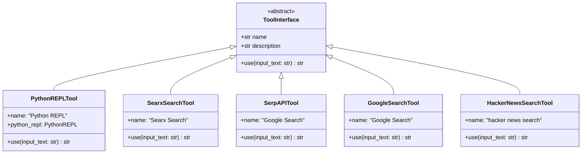
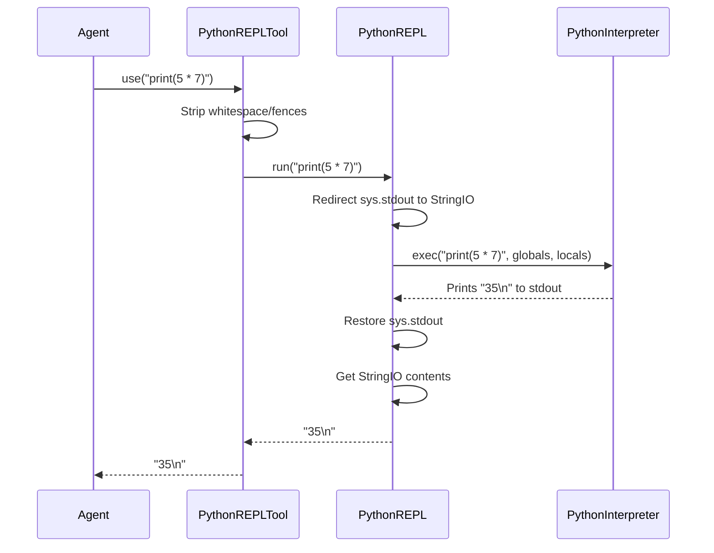
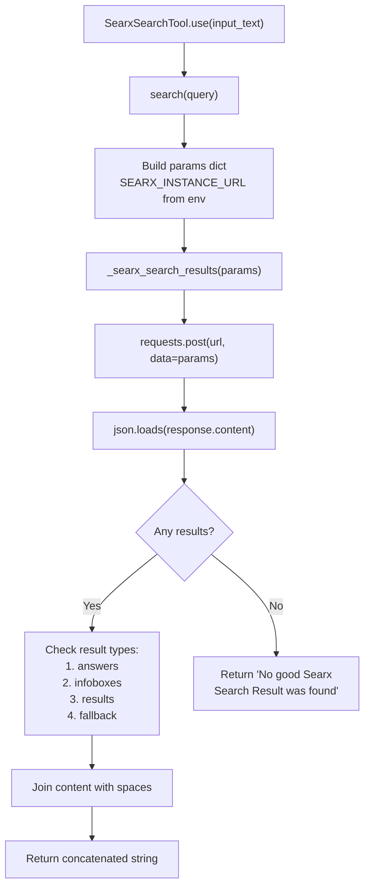
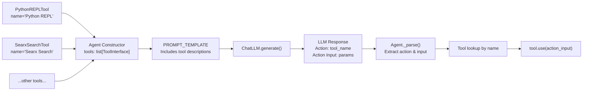

<!-- source: DeepWiki mcp.deepwiki.com · repo mpaepper/llm_agents · page 6.3 Tool APIs · fetched 2026-10-26 -->

# Tool APIs

<details>
<summary>Relevant source files</summary>

The following files were used as context for generating this wiki page:

- [llm_agents/__init__.py](llm_agents/__init__.py)
- [llm_agents/tools/base.py](llm_agents/tools/base.py)
- [llm_agents/tools/python_repl.py](llm_agents/tools/python_repl.py)
- [llm_agents/tools/searx.py](llm_agents/tools/searx.py)

</details>


This page provides comprehensive technical reference documentation for all tool implementations in the llm_agents system. It documents the `ToolInterface` base class contract and the API signatures for each concrete tool implementation.

For conceptual explanations of the tool system architecture, see [Tool System](#3). For guides on creating custom tools, see [Creating Custom Tools](#3.4). For individual tool usage guides, see [Search Tools](#3.2) and [PythonREPLTool](#3.3).

---

## Overview

All tools in the llm_agents system implement the `ToolInterface` contract defined in [llm_agents/tools/base.py:3-8](). This interface ensures uniform tool discovery and invocation by the `Agent` class.

### Tool Interface Contract

The `ToolInterface` is a Pydantic `BaseModel` that defines three required elements:

| Attribute | Type | Purpose |
|-----------|------|---------|
| `name` | `str` | Unique identifier for the tool, used by the LLM to reference it in Action fields |
| `description` | `str` | Natural language description explaining the tool's purpose and expected input format |
| `use()` | Method | Executes the tool's functionality and returns results as a string |



**Sources:** [llm_agents/tools/base.py:1-9](), [llm_agents/__init__.py:1-10]()

---

## ToolInterface Base Class

### Class Definition

```python
class ToolInterface(BaseModel)
```

Defined in [llm_agents/tools/base.py:3]()

### Attributes

| Attribute | Type | Required | Description |
|-----------|------|----------|-------------|
| `name` | `str` | Yes | Tool identifier used in LLM-generated Action fields |
| `description` | `str` | Yes | Instructions for the LLM on when and how to use the tool |

### Methods

#### `use(input_text: str) -> str`

**Location:** [llm_agents/tools/base.py:7-8]()

**Signature:**
```python
def use(self, input_text: str) -> str
```

**Parameters:**
| Parameter | Type | Description |
|-----------|------|-------------|
| `input_text` | `str` | The raw input string extracted from the LLM's "Action Input" field |

**Returns:** `str` - The observation result to be fed back to the LLM

**Raises:** `NotImplementedError` - If called on the base class without override

**Implementation Requirements:**
- Must parse and validate `input_text` appropriately for the tool's domain
- Must return a string representation of results, even for structured data
- Should handle errors gracefully and return informative error messages as strings
- Should not raise exceptions unless absolutely necessary (errors should be observation strings)

**Sources:** [llm_agents/tools/base.py:3-8]()

---

## PythonREPLTool

### Class Definition

```python
class PythonREPLTool(ToolInterface)
```

Defined in [llm_agents/tools/python_repl.py:34]()

### Purpose

Executes arbitrary Python code in an isolated REPL environment and captures printed output. Used by the agent for computational tasks, data manipulation, and algorithmic problem-solving.

### Attributes

| Attribute | Type | Default | Description |
|-----------|------|---------|-------------|
| `name` | `str` | `"Python REPL"` | Tool identifier |
| `description` | `str` | See below | Instructions for LLM usage |
| `python_repl` | `PythonREPL` | Factory | Internal REPL instance with isolated globals/locals |

**Description Text:**
```
"A Python shell. Use this to execute python commands. Input should be a valid python command. If you want to see the output of a value, you should print it out with `print(...)`."
```

### Methods

#### `use(input_text: str) -> str`

**Location:** [llm_agents/tools/python_repl.py:46-48]()

**Behavior:**
1. Strips leading/trailing whitespace and markdown code fences (```)
2. Executes code via `PythonREPL.run()`
3. Captures stdout or exception messages
4. Returns captured output as string

**Parameters:**
| Parameter | Type | Description |
|-----------|------|-------------|
| `input_text` | `str` | Python code to execute (may include markdown code fences) |

**Returns:** `str` - Captured stdout or exception message

### Internal Components

#### PythonREPL Class

**Location:** [llm_agents/tools/python_repl.py:10-27]()

A Pydantic `BaseModel` that simulates an isolated Python REPL session.

**Attributes:**
| Attribute | Type | Default | Description |
|-----------|------|---------|-------------|
| `globals` | `Optional[Dict]` | `{}` | Global namespace for code execution |
| `locals` | `Optional[Dict]` | `{}` | Local namespace for code execution |

**Method: `run(command: str) -> str`**

**Location:** [llm_agents/tools/python_repl.py:16-27]()

Executes Python code by:
1. Redirecting `sys.stdout` to `StringIO` buffer
2. Using `exec(command, self.globals, self.locals)`
3. Capturing stdout output or exception messages
4. Restoring original stdout
5. Returning captured content



**Sources:** [llm_agents/tools/python_repl.py:1-56]()

---

## SearxSearchTool

### Class Definition

```python
class SearxSearchTool(ToolInterface)
```

Defined in [llm_agents/tools/searx.py:74]()

### Purpose

Performs web searches using a self-hosted Searx/SearXNG instance. Requires manual configuration of the Searx instance to enable JSON output.

### Attributes

| Attribute | Type | Default | Description |
|-----------|------|---------|-------------|
| `name` | `str` | `"Searx Search"` | Tool identifier |
| `description` | `str` | See below | Instructions for LLM usage |

**Description Text:**
```
"Get specific information from a search query. Input should be a question like 'How to add number in Clojure?'. Result will be the answer to the question."
```

### Configuration Requirements

**Environment Variable:** `SEARX_INSTANCE_URL`

**Searx Instance Requirements:**
- Must have JSON output enabled in `settings.yml`
- See [searx/settings.yml#L63](https://github.com/searxng/searxng/blob/934249dd05142cde3461c8c4aae2c6d5804b0409/searx/settings.yml#L63)
- API documentation: https://searx.github.io/searx/dev/search_api.html

### Methods

#### `use(input_text: str) -> str`

**Location:** [llm_agents/tools/searx.py:80-81]()

Delegates to the module-level `search()` function.

### Module-Level Functions

#### `search(query: str) -> str`

**Location:** [llm_agents/tools/searx.py:36-71]()

**Parameters:**
| Parameter | Type | Description |
|-----------|------|-------------|
| `query` | `str` | Natural language search query |

**Returns:** `str` - Concatenated search result contents or error message

**Default Search Parameters:**
| Parameter | Value | Description |
|-----------|-------|-------------|
| `instance_url` | `$SEARX_INSTANCE_URL` | Base URL of Searx instance |
| `method` | `POST` | HTTP method |
| `safesearch` | `False` | Content filtering |
| `max_results` | `10` | Maximum results to process |

**Result Processing Priority:**
1. **Answers** - Direct answer content if available
2. **Infoboxes** - Knowledge panel content if available
3. **Results** - Standard search results (up to `max_results`)
4. **Fallback** - Any remaining results with "content" field

**Error Handling:**
- Returns `"No good Searx Search Result was found"` if response is empty or contains no results

#### `_searx_search_results(params) -> list[dict[str, Any]]`

**Location:** [llm_agents/tools/searx.py:21-33]()

Internal function that performs the HTTP POST request to the Searx instance.

**Request Format:**
```python
{
    "q": query_string,
    "safesearch": 0 or 1,
    "format": "json"
}
```

**Returns:** Parsed JSON response from Searx API



**Sources:** [llm_agents/tools/searx.py:1-88]()

---

## Search Tool APIs (Additional Implementations)

The following search tools are also available in the system. For detailed implementation documentation, see their individual conceptual pages.

### SerpAPITool

**Defined in:** [llm_agents/tools/search.py]()

**Export:** [llm_agents/__init__.py:5]()

**Description:** Uses SerpAPI service for Google search results

**Environment Variable:** `SERPAPI_API_KEY`

**Documentation:** See [SerpAPITool](#3.2.1)

### GoogleSearchTool

**Defined in:** [llm_agents/tools/google_search.py]()

**Export:** [llm_agents/__init__.py:7]()

**Description:** Uses Google Custom Search API directly

**Environment Variables:** 
- `GOOGLE_API_KEY`
- `GOOGLE_CSE_ID`

**Documentation:** See [GoogleSearchTool](#3.2.2)

### HackerNewsSearchTool

**Defined in:** [llm_agents/tools/hackernews.py]()

**Export:** [llm_agents/__init__.py:4]()

**Description:** Searches Hacker News stories using Algolia API

**Documentation:** See [HackerNewsSearchTool](#3.2.4)

**Sources:** [llm_agents/__init__.py:1-10]()

---

## Tool Registration and Discovery

### Exported Tools

All concrete tool implementations are exported from the package root for easy import:

```python
from llm_agents import (
    PythonREPLTool,
    SerpAPITool,
    GoogleSearchTool,
    SearxSearchTool,
    HackerNewsSearchTool
)
```

**Location:** [llm_agents/__init__.py:1-10]()

### Agent Integration

Tools are registered with the `Agent` by passing instances to the constructor. The Agent extracts the `name` and `description` attributes to build the tool selection prompt for the LLM.



### Tool Discovery Mechanism

The Agent builds tool descriptions for the prompt by iterating over the provided tool list:

1. Extract `tool.name` - Used as the Action identifier
2. Extract `tool.description` - Embedded in the prompt template
3. Store tools in a dictionary keyed by name for O(1) lookup during execution

When the LLM generates an Action, the Agent:
1. Parses the action name from the response
2. Looks up the tool instance by name
3. Calls `tool.use(action_input)` with the parsed input
4. Returns the observation string to be appended to the prompt

**Sources:** [llm_agents/__init__.py:1-10](), [llm_agents/tools/base.py:1-9]()

---

## Type Information

All tool classes use Pydantic for runtime validation and type safety:

- `ToolInterface` inherits from `pydantic.BaseModel` ([llm_agents/tools/base.py:3]())
- `PythonREPLTool` uses `pydantic.Field` for factory defaults ([llm_agents/tools/python_repl.py:44]())
- `PythonREPL` internal class uses Pydantic field aliases ([llm_agents/tools/python_repl.py:13-14]())

This provides:
- Automatic validation of `name` and `description` attributes
- Type checking via Pydantic's validation system
- Integration with static type checkers when type hints are present

**Sources:** [llm_agents/tools/base.py:1-9](), [llm_agents/tools/python_repl.py:10-14]()

---

