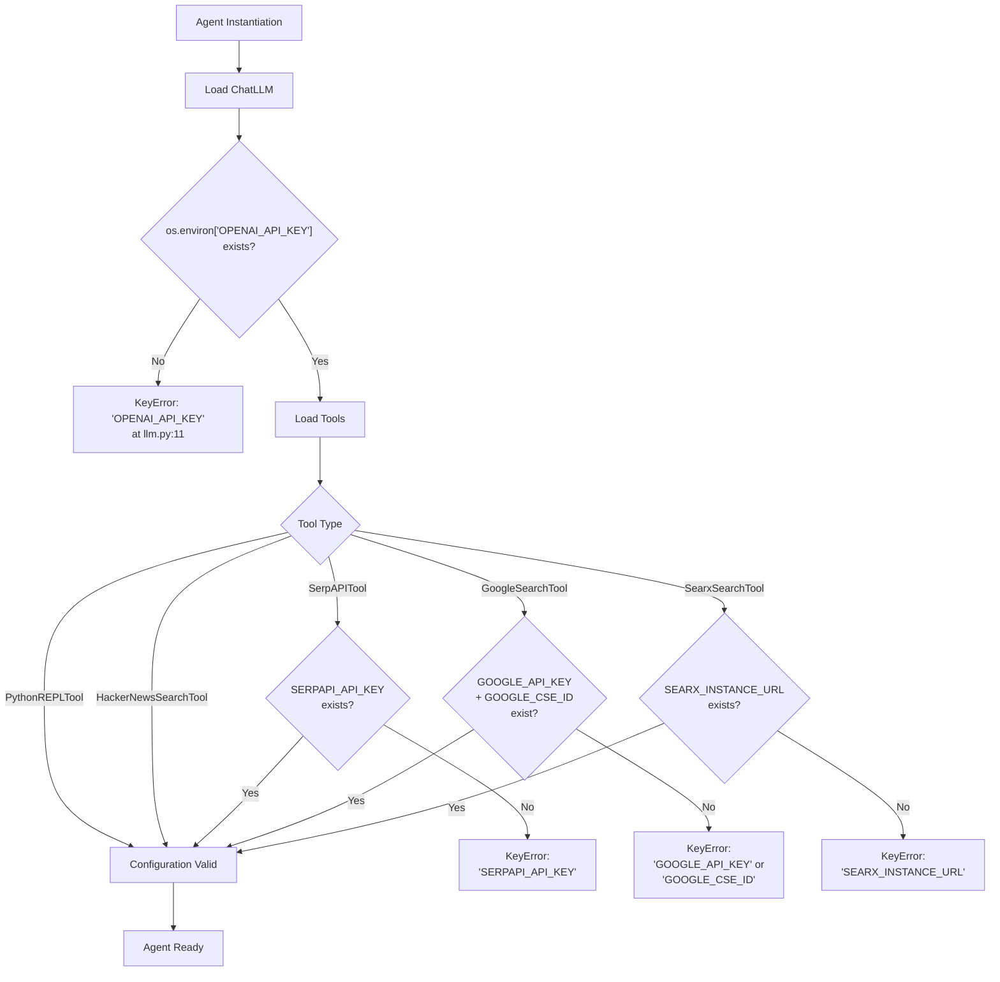
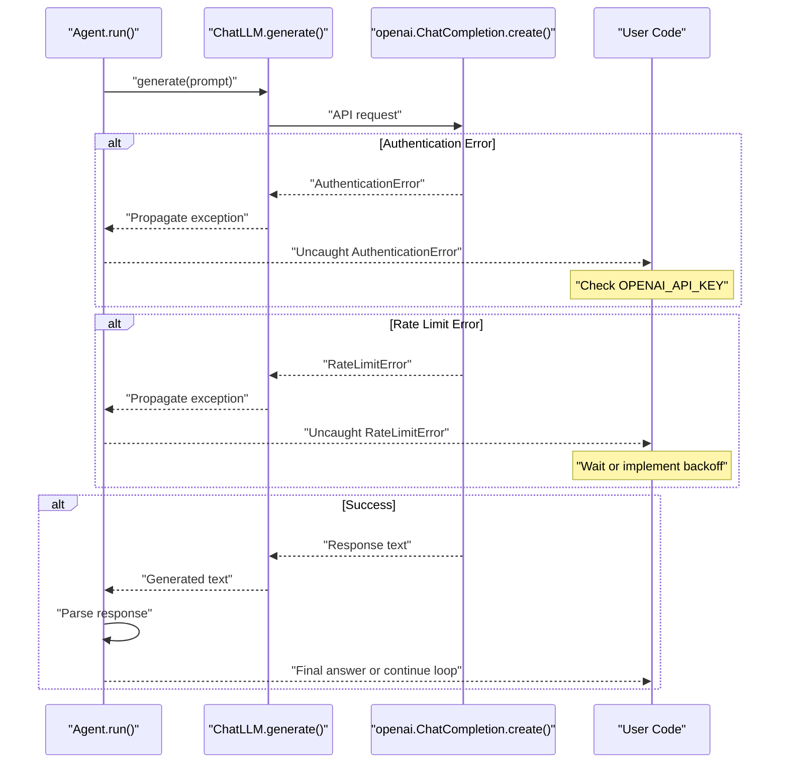
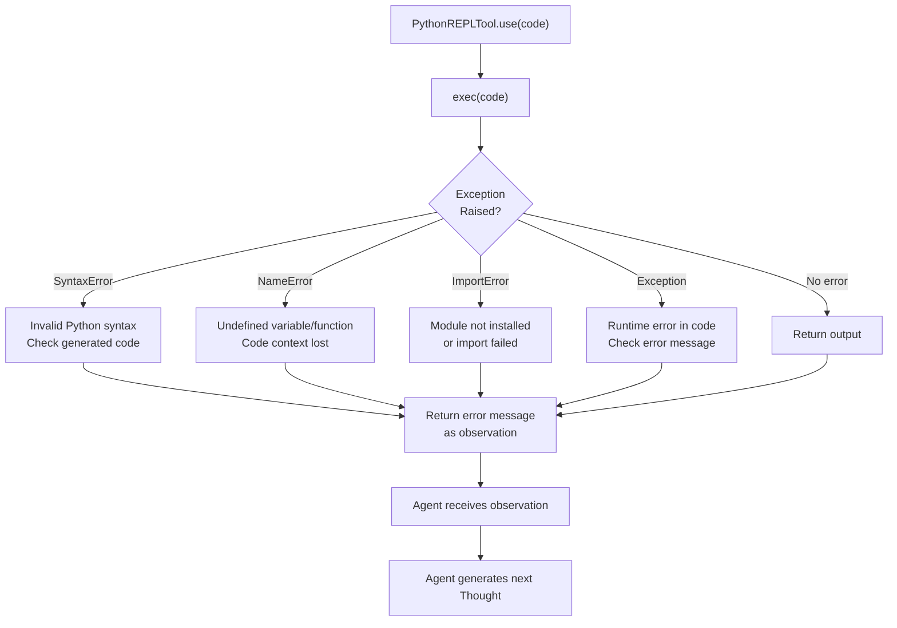
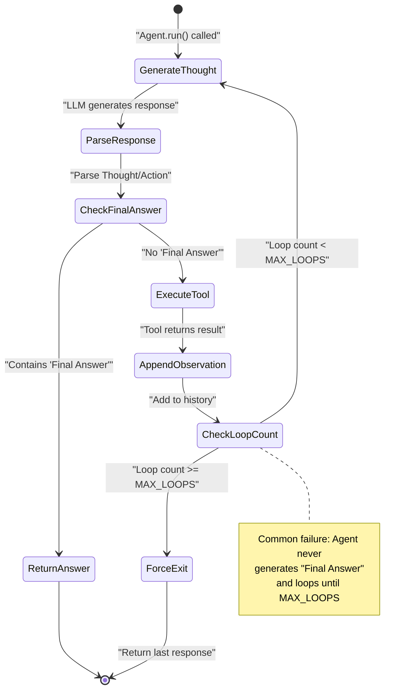
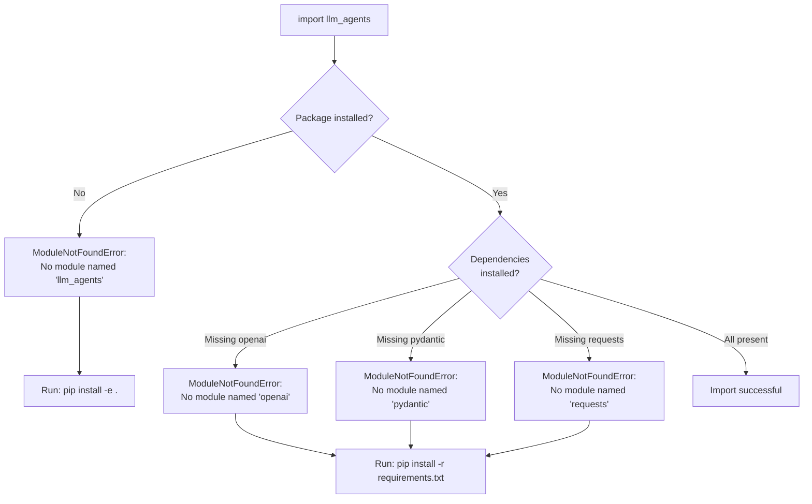
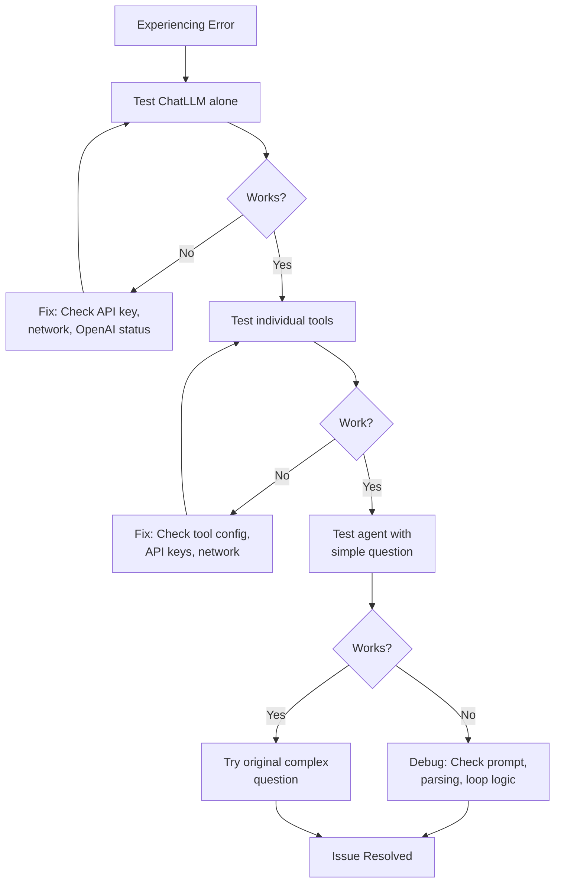

<!-- source: DeepWiki mcp.deepwiki.com · repo mpaepper/llm_agents · page 7 Troubleshooting · fetched 2026-10-26 -->

# Troubleshooting

<details>
<summary>Relevant source files</summary>

The following files were used as context for generating this wiki page:

- [README.md](README.md)
- [llm_agents/llm.py](llm_agents/llm.py)
- [requirements.txt](requirements.txt)
- [setup.py](setup.py)

</details>


This page provides solutions to common issues encountered when working with the llm_agents library. It covers configuration problems, API errors, tool failures, and agent execution issues. For information about setting up the environment initially, see [Installation and Setup](#1.1). For details about the testing infrastructure, see [Testing Infrastructure](#5.2).

## Scope

This guide addresses runtime errors, configuration issues, and common failure modes. It does not cover architectural design decisions (see [Core Architecture](#2)) or API reference details (see [API Reference](#6)).

---

## Environment and Configuration Issues

### Missing or Invalid API Keys

The most common issue is missing environment variables for API keys. The system requires specific environment variables depending on which tools you use.

#### Required Environment Variables

| Tool Used | Environment Variable | How to Obtain | Required? |
|-----------|---------------------|---------------|-----------|
| `ChatLLM` | `OPENAI_API_KEY` | https://platform.openai.com/account/api-keys | Yes (always) |
| `SerpAPITool` | `SERPAPI_API_KEY` | https://serpapi.com/ | Only if using SerpAPI |
| `GoogleSearchTool` | `GOOGLE_API_KEY`, `GOOGLE_CSE_ID` | Google Cloud Console | Only if using Google Search |
| `SearxSearchTool` | `SEARX_INSTANCE_URL` | Self-hosted or public Searx instance | Only if using Searx |

**Error Symptoms:**
- `KeyError: 'OPENAI_API_KEY'` when instantiating `ChatLLM`
- `KeyError` when instantiating search tools
- API authentication failures

**Solution:**
```bash
# Set environment variables in bash
export OPENAI_API_KEY='sk-your-key-here'
export SERPAPI_API_KEY='your-serpapi-key'

# Or in Python before importing
import os
os.environ['OPENAI_API_KEY'] = 'sk-your-key-here'
```

**Diagnostic Diagram: Configuration Resolution Flow**



Sources: [llm_agents/llm.py:11](), [README.md:37-42]()

---

## API and Authentication Errors

### OpenAI API Errors

**Common Error Patterns:**

| Error Message | Root Cause | Solution |
|--------------|------------|----------|
| `openai.error.AuthenticationError` | Invalid API key | Verify key at https://platform.openai.com/account/api-keys |
| `openai.error.RateLimitError` | Too many requests | Implement retry logic or reduce request frequency |
| `openai.error.InvalidRequestError` | Malformed prompt or parameters | Check prompt length, model compatibility |
| `openai.error.APIError` | OpenAI service issue | Retry request, check OpenAI status page |
| `openai.error.Timeout` | Network timeout | Increase timeout or check network connectivity |

**Error Propagation in System:**



**Diagnostic Steps:**
1. Test OpenAI connection independently:
   ```python
   from llm_agents import ChatLLM
   llm = ChatLLM()
   # If this fails, the issue is with OpenAI authentication
   result = llm.generate("Test prompt")
   ```
2. Check API key validity at OpenAI dashboard
3. Verify network connectivity to `api.openai.com`
4. Check rate limits and usage quotas

Sources: [llm_agents/llm.py:8-20](), [README.md:39]()

---

### Search Tool API Errors

#### SerpAPI Issues

**Common Problems:**
- Invalid `SERPAPI_API_KEY`
- Monthly search quota exceeded
- Network connectivity to SerpAPI

**Diagnostic Code:**
```python
from llm_agents import SerpAPITool

tool = SerpAPITool()
try:
    result = tool.use("test query")
    print("SerpAPI working:", result[:100])
except Exception as e:
    print(f"SerpAPI error: {type(e).__name__}: {e}")
```

#### Google Custom Search Issues

**Common Problems:**
- Missing `GOOGLE_CSE_ID` (Custom Search Engine ID)
- Invalid API key credentials
- Daily search quota exceeded (100 queries/day for free tier)

**Setup Validation:**
```python
import os
print("GOOGLE_API_KEY:", os.environ.get('GOOGLE_API_KEY', 'NOT SET'))
print("GOOGLE_CSE_ID:", os.environ.get('GOOGLE_CSE_ID', 'NOT SET'))
```

#### Searx Instance Issues

**Common Problems:**
- Searx instance URL unreachable
- Instance not configured for JSON output
- Network firewall blocking requests

**Test Connectivity:**
```python
import requests
searx_url = os.environ.get('SEARX_INSTANCE_URL')
response = requests.post(f"{searx_url}/search", 
                        data={"q": "test", "format": "json"})
print(f"Searx status: {response.status_code}")
```

Sources: [README.md:40](), High-level system diagrams showing tool integrations

---

## Tool-Specific Issues

### PythonREPLTool Execution Errors

**Error Pattern Mapping:**



**Common Issues:**

| Issue | Symptom | Solution |
|-------|---------|----------|
| Lost state between calls | `NameError: name 'x' is not defined` | Each `PythonREPLTool.use()` call is independent; combine code in single call |
| Import errors | `ImportError: No module named 'xyz'` | Only standard library available; avoid external imports |
| Infinite loops | Agent never returns | Code execution has no timeout; avoid loops without clear exit |
| Security concerns | Concerned about arbitrary code | PythonREPL runs in same process; only use with trusted prompts |

**Example Problem:**
```python
# Agent Action 1
tool.use("x = 5")

# Agent Action 2 (in next iteration)
tool.use("print(x)")  # NameError - x is not defined!
```

**Solution Pattern:**
Agent should generate all related code in single action:
```python
tool.use("x = 5\nprint(x)")  # Works correctly
```

Sources: High-level system diagrams showing tool architecture

---

## Agent Execution Issues

### Agent Loop Problems

**Infinite Loop Conditions:**



**Common Failure Modes:**

| Problem | Symptoms | Root Cause | Solution |
|---------|----------|------------|----------|
| No Final Answer | Agent loops to MAX_LOOPS limit | LLM doesn't understand when to stop | Improve prompt, check tool outputs are useful |
| Tool execution fails repeatedly | Same tool error every loop | Tool configuration issue | Fix tool setup, validate tool independently |
| Parse errors | Agent can't extract Action/Action Input | LLM output doesn't match expected format | Check LLM temperature (should be low), validate prompt template |
| Tool not found | `KeyError` during tool lookup | LLM generates invalid tool name | Ensure tool names in prompt match registered tools exactly |

**Diagnostic Technique - Trace Agent Execution:**
```python
from llm_agents import Agent, ChatLLM, PythonREPLTool

agent = Agent(llm=ChatLLM(temperature=0.0), tools=[PythonREPLTool()])

# Add print statements to trace execution
# Note: You may need to modify agent.py to add logging
result = agent.run("Calculate 2 + 2")
```

**Expected Loop Pattern:**
```
Loop 1: Thought -> Action (python_repl) -> Observation (4)
Loop 2: Thought -> Final Answer: "2 + 2 = 4"
```

**Problematic Pattern:**
```
Loop 1: Thought -> Action (python_repl) -> Observation (error)
Loop 2: Thought -> Action (python_repl) -> Observation (error)
Loop 3: Thought -> Action (python_repl) -> Observation (error)
...continues until MAX_LOOPS
```

Sources: [README.md:13-22](), High-level system diagrams showing Thought-Action-Observation loop

---

### Response Parsing Failures

The Agent expects LLM responses in a specific format:
```
Thought: <reasoning>
Action: <tool_name>
Action Input: <input_to_tool>
```

or:
```
Thought: <reasoning>
Final Answer: <answer>
```

**Common Parsing Issues:**

| Issue | Cause | Solution |
|-------|-------|----------|
| Missing "Action:" prefix | LLM doesn't follow format | Lower temperature to 0.0, improve prompt |
| Invalid tool name | LLM invents non-existent tool | List all tools clearly in prompt |
| Malformed Action Input | LLM provides wrong input format | Improve tool descriptions |
| Missing "Final Answer:" | LLM never concludes | Improve prompt instructions about when to finish |

**Error Location:**
The `Agent._parse()` method handles response parsing. If parsing fails, the agent may:
1. Raise an exception
2. Skip the action and continue looping
3. Return incomplete results

Sources: High-level system diagrams showing Agent parsing logic

---

## Dependency and Installation Issues

### Import Errors

**Common Import Problems:**



**Installation Checklist:**
1. Clone repository: `git clone https://github.com/mpaepper/llm_agents`
2. Install dependencies: `pip install -r requirements.txt`
3. Install package: `pip install -e .`
4. Verify installation:
   ```python
   import llm_agents
   print(llm_agents.__file__)  # Should print package location
   ```

### Version Compatibility Issues

**Required Versions:**

| Package | Minimum Version | Specified In |
|---------|----------------|--------------|
| `openai` | 0.27.0 | [requirements.txt:1]() |
| `pydantic` | 1.10.5 | [requirements.txt:2]() |
| `requests` | 2.28.2 | [requirements.txt:3]() |
| `google-api-python-client` | 2.83.0 | [requirements.txt:4]() |
| `google-search-results` | 2.4.2 | [requirements.txt:5]() |

**Check Installed Versions:**
```bash
pip list | grep -E "openai|pydantic|requests|google"
```

**Upgrade if Needed:**
```bash
pip install --upgrade openai pydantic requests
```

Sources: [requirements.txt:1-5](), [setup.py:11-16]()

---

## Diagnostic Tools and Techniques

### Step 1: Validate Basic Setup

Run this diagnostic script to validate your configuration:

```python
import os
import sys

print("=== Environment Check ===")
print(f"Python version: {sys.version}")
print(f"OPENAI_API_KEY set: {bool(os.environ.get('OPENAI_API_KEY'))}")
print(f"SERPAPI_API_KEY set: {bool(os.environ.get('SERPAPI_API_KEY'))}")

print("\n=== Import Check ===")
try:
    from llm_agents import Agent, ChatLLM, PythonREPLTool
    print("✓ llm_agents imports successfully")
except ImportError as e:
    print(f"✗ Import failed: {e}")
    sys.exit(1)

print("\n=== ChatLLM Test ===")
try:
    llm = ChatLLM()
    response = llm.generate("Say 'test'")
    print(f"✓ ChatLLM working: {response[:50]}")
except Exception as e:
    print(f"✗ ChatLLM failed: {e}")

print("\n=== Tool Test ===")
try:
    tool = PythonREPLTool()
    result = tool.use("print('hello')")
    print(f"✓ PythonREPLTool working: {result}")
except Exception as e:
    print(f"✗ Tool failed: {e}")

print("\n=== Agent Test ===")
try:
    agent = Agent(llm=ChatLLM(), tools=[PythonREPLTool()])
    result = agent.run("What is 2+2?")
    print(f"✓ Agent working: {result[:100]}")
except Exception as e:
    print(f"✗ Agent failed: {e}")
```

### Step 2: Enable Verbose Logging

To see what the agent is doing, you can modify the code or add print statements:

```python
from llm_agents import Agent, ChatLLM, PythonREPLTool

# Trace LLM calls
class VerboseChatLLM(ChatLLM):
    def generate(self, prompt, stop=None):
        print(f"\n=== LLM PROMPT ===\n{prompt[:200]}...\n")
        response = super().generate(prompt, stop)
        print(f"\n=== LLM RESPONSE ===\n{response}\n")
        return response

agent = Agent(llm=VerboseChatLLM(), tools=[PythonREPLTool()])
```

### Step 3: Isolate the Problem

Test components individually:



Sources: [llm_agents/llm.py:8-25](), [README.md:46-55]()

---

## Common Error Messages Reference

### Quick Error Lookup Table

| Error Message Fragment | Likely Cause | Quick Fix |
|------------------------|--------------|-----------|
| `KeyError: 'OPENAI_API_KEY'` | Environment variable not set | `export OPENAI_API_KEY='sk-...'` |
| `openai.error.AuthenticationError` | Invalid OpenAI API key | Verify key at OpenAI dashboard |
| `openai.error.RateLimitError` | Too many API requests | Wait or upgrade OpenAI plan |
| `ModuleNotFoundError: No module named 'llm_agents'` | Package not installed | `pip install -e .` |
| `ModuleNotFoundError: No module named 'openai'` | Dependencies not installed | `pip install -r requirements.txt` |
| `KeyError: '<tool_name>'` | Tool not registered or LLM generated wrong name | Check tools list matches prompt |
| `NameError` in PythonREPL | Code context lost between calls | Combine related code in single action |
| `SyntaxError` in PythonREPL | LLM generated invalid Python | Check LLM output, lower temperature |
| Agent loops without finishing | No "Final Answer" generated | Improve prompt or check tool outputs |
| `ConnectionError` or `Timeout` | Network connectivity issue | Check internet connection, firewall |

---

## Getting Help

If you've tried the solutions above and still have issues:

1. **Check Existing Issues**: Visit https://github.com/mpaepper/llm_agents/issues
2. **Review the Blog Post**: Additional context at https://www.paepper.com/blog/posts/intelligent-agents-guided-by-llms/
3. **Check Hacker News Discussion**: https://news.ycombinator.com/item?id=35446171
4. **Create New Issue**: Provide:
   - Error message (full traceback)
   - Python version
   - Installed package versions (`pip list`)
   - Environment variable configuration (without revealing actual keys)
   - Minimal code to reproduce the issue

For installation issues specifically, see [Installation and Setup](#1.1). For architectural questions, see [Core Architecture](#2).

Sources: [README.md:1-58]()

---

