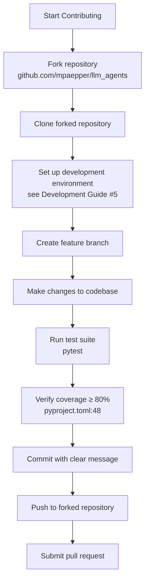
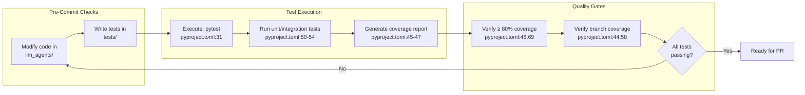
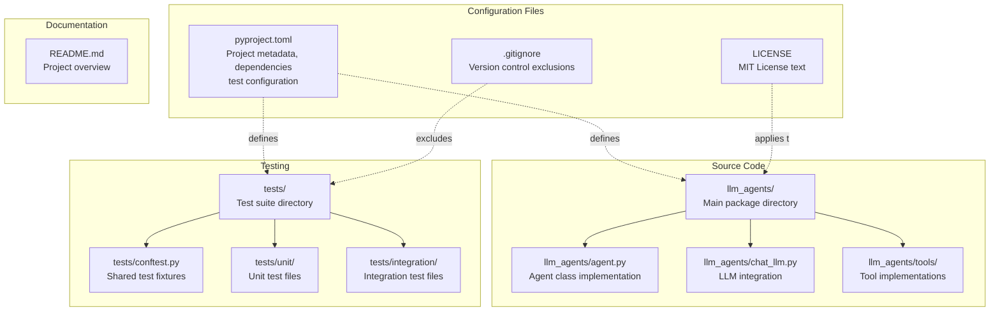

<!-- source: DeepWiki mcp.deepwiki.com · repo mpaepper/llm_agents · page 8 License and Contributing · fetched 2026-10-26 -->

# License and Contributing

<details>
<summary>Relevant source files</summary>

The following files were used as context for generating this wiki page:

- [.gitignore](.gitignore)
- [LICENSE](LICENSE)
- [pyproject.toml](pyproject.toml)

</details>


This page documents the open-source license under which the llm_agents project is distributed and provides guidelines for contributing to the codebase. For information about setting up a development environment, see [Development Guide](#5). For details on the testing infrastructure and how to run tests, see [Testing Infrastructure](#5.2).

## License

The llm_agents project is distributed under the MIT License, one of the most permissive open-source licenses. The project is copyright © 2023 Marc Päpper.

### MIT License Summary

The MIT License grants users the following rights:

| Permission | Description |
|------------|-------------|
| **Use** | Freedom to use the software for any purpose, including commercial applications |
| **Modify** | Freedom to modify the source code to suit specific needs |
| **Distribute** | Freedom to distribute copies of the original or modified software |
| **Sublicense** | Freedom to grant these same permissions to others |
| **Private Use** | Freedom to use privately without disclosure |

The license requires that the copyright notice and license text be included in all copies or substantial portions of the software, as specified in [LICENSE:1-22]().

### License Declaration in Project Metadata

The MIT License is formally declared in the project configuration at [pyproject.toml:9](), with the classifier `License :: OSI Approved :: MIT License` at [pyproject.toml:13]() for proper package index categorization.

**Sources:** [LICENSE:1-22](), [pyproject.toml:9-13]()

## Project Metadata

The project metadata defines key information for contributors:

| Property | Value |
|----------|-------|
| **Project Name** | llm-agents |
| **Version** | 0.1.0 |
| **Author** | Marc Päpper <marc@paepper.com> |
| **Repository** | https://github.com/mpaepper/llm_agents |
| **Homepage** | https://github.com/mpaepper/llm_agents |
| **License** | MIT |

This information is defined in [pyproject.toml:1-14]().

**Sources:** [pyproject.toml:1-14]()

## Contributing Guidelines

Contributions to the llm_agents project are welcome. The project follows standard open-source contribution practices.

### Getting Started

Before contributing, ensure you have completed the following steps:



**Sources:** [pyproject.toml:48]()

### Development Prerequisites

Contributors must have the following configured:

1. **Python Environment**: Python 3.8 or higher as specified in [pyproject.toml:17]()
2. **API Keys**: Required keys for testing, documented in [Required API Keys](#4.1)
3. **Development Dependencies**: pytest, pytest-cov, pytest-mock as listed in [pyproject.toml:25-28]()

For detailed setup instructions, see [Installation and Setup](#1.1) and [Development Guide](#5).

**Sources:** [pyproject.toml:17](), [pyproject.toml:25-28]()

## Code Quality Standards

All contributions must meet the project's quality standards before being merged.

### Testing Requirements

The project enforces strict testing requirements configured in [pyproject.toml:34-54]():

| Requirement | Standard | Configuration |
|-------------|----------|---------------|
| **Minimum Coverage** | 80% | `--cov-fail-under=80` in [pyproject.toml:48]() |
| **Branch Coverage** | Required | `--cov-branch` in [pyproject.toml:44]() |
| **Test Discovery** | Automatic | `testpaths = ["tests"]` in [pyproject.toml:36]() |
| **Test Markers** | `unit`, `integration`, `slow` | [pyproject.toml:50-54]() |

Contributors must ensure all tests pass and coverage requirements are met before submitting pull requests. See [Running Tests](#5.2.2) for detailed instructions.

### Test Execution



**Sources:** [pyproject.toml:31](), [pyproject.toml:34-54](), [pyproject.toml:56-85]()

### Coverage Configuration

The coverage tool is configured to exclude certain patterns from coverage requirements at [pyproject.toml:70-79]():

- Test files: `*/tests/*`
- Initialization files: `*/__init__.py`
- Setup files: `*/setup.py`
- Type checking blocks: `if TYPE_CHECKING:`
- Debugging code: `if __name__ == .__main__.:`
- Abstract methods: `raise NotImplementedError`

These exclusions ensure coverage metrics focus on actual application logic.

**Sources:** [pyproject.toml:59-79]()

## Version Control Practices

The project uses Git for version control with specific exclusion patterns defined in [.gitignore:1-61]().

### Excluded Files and Directories

The following are excluded from version control and should not be committed:

```mermaid
graph TB
    subgraph "Python Artifacts"
        PyCache["__pycache__/<br/>.gitignore:2"]
        PyCompiled["*.py[cod], *$py.class<br/>.gitignore:3-4"]
        EggInfo["*.egg-info/<br/>.gitignore:21"]
    end
    
    subgraph "Build Artifacts"
        Build["build/, dist/<br/>.gitignore:8,10"]
        Wheels["wheels/<br/>.gitignore:19"]
    end
    
    subgraph "Environment Files"
        EnvFiles[".env, .venv<br/>.gitignore:34-35"]
        VenvDirs["env/, venv/<br/>.gitignore:36-37"]
    end
    
    subgraph "Testing Artifacts"
        PytestCache[".pytest_cache/<br/>.gitignore:43"]
        CoverageFiles[".coverage, htmlcov/<br/>.gitignore:44-45"]
        CoverageXML["coverage.xml<br/>.gitignore:46"]
    end
    
    subgraph "IDE and Editor"
        VSCode[".vscode/<br/>.gitignore:56"]
        Idea[".idea/<br/>.gitignore:57"]
        SwapFiles["*.swp, *.swo<br/>.gitignore:58-59"]
    end
    
    GitIgnore[".gitignore"] --> PyCache
    GitIgnore --> PyCompiled
    GitIgnore --> EggInfo
    GitIgnore --> Build
    GitIgnore --> Wheels
    GitIgnore --> EnvFiles
    GitIgnore --> VenvDirs
    GitIgnore --> PytestCache
    GitIgnore --> CoverageFiles
    GitIgnore --> CoverageXML
    GitIgnore --> VSCode
    GitIgnore --> Idea
    GitIgnore --> SwapFiles
```



Contributors should ensure they do not commit any files matching these patterns. Note that `.env` files containing API keys are explicitly excluded at [.gitignore:34]() to prevent accidental exposure of credentials.

**Sources:** [.gitignore:1-61]()

## Key Files for Contributors

Understanding the project's key files helps contributors navigate the codebase efficiently:



**Sources:** [pyproject.toml:1-89](), [LICENSE:1-22](), [.gitignore:1-61]()

## Contribution Workflow

The standard workflow for contributing to the project follows these steps:

### 1. Repository Setup

Fork the repository at https://github.com/mpaepper/llm_agents (as specified in [pyproject.toml:8]()) and clone your fork locally.

### 2. Development Environment

Set up your development environment following [Installation and Setup](#1.1). Install development dependencies:

```
poetry install --with dev
```

The development dependencies are defined at [pyproject.toml:25-28]().

### 3. Code Changes

Make your changes in the appropriate directory:
- Core agent logic: `llm_agents/` directory
- Tool implementations: `llm_agents/tools/` directory  
- Tests: `tests/unit/` or `tests/integration/` directories

Ensure your changes align with the existing code structure documented in [Project Structure](#5.1).

### 4. Testing

Write tests for your changes following the guidelines in [Writing Tests](#5.2.3). Run the test suite:

```
pytest
```

or use the configured script at [pyproject.toml:31]():

```
poetry run test
```

Ensure:
- All tests pass
- Code coverage remains at or above 80% ([pyproject.toml:48]())
- Branch coverage is maintained ([pyproject.toml:44]())

### 5. Submit Pull Request

Push your changes to your fork and submit a pull request to the main repository. Provide:
- Clear description of changes
- Rationale for the changes
- Test coverage information
- Any relevant issue references

**Sources:** [pyproject.toml:8](), [pyproject.toml:25-28](), [pyproject.toml:31](), [pyproject.toml:44](), [pyproject.toml:48]()

## Code Style and Best Practices

While not explicitly documented in configuration files, contributors should follow these practices evident in the existing codebase:

| Practice | Guideline |
|----------|-----------|
| **Type Hints** | Use Pydantic models and type annotations as demonstrated in the ChatLLM and Tool classes |
| **Testing** | Write both unit tests (mocked dependencies) and integration tests (real API calls marked with `@pytest.mark.integration`) |
| **Tool Interface** | New tools must implement the ToolInterface contract as documented in [ToolInterface](#3.1) |
| **Documentation** | Include docstrings for public methods and classes |
| **Error Handling** | Handle exceptions appropriately, especially for external API calls |

For detailed API references, see [API Reference](#6).

## Package Distribution

The project uses Poetry for package management and distribution. The package is configured at [pyproject.toml:1-14]() with:

- Package name: `llm-agents`
- Version: `0.1.0`
- Build system: Poetry Core ([pyproject.toml:87-89]())
- Package includes: `llm_agents` directory ([pyproject.toml:10]())

Contributors do not typically need to modify distribution settings unless changing package structure or metadata.

**Sources:** [pyproject.toml:1-14](), [pyproject.toml:87-89]()

## Summary

Contributing to llm_agents requires:

1. **Understanding the License**: The MIT License permits free use, modification, and distribution
2. **Meeting Quality Standards**: 80% test coverage with branch coverage enabled
3. **Following the Workflow**: Fork, develop, test, submit pull request
4. **Respecting Project Structure**: Place code in appropriate directories
5. **Writing Tests**: Include comprehensive tests for all changes

For technical details on specific components, refer to:
- [Development Guide](#5) for development environment setup
- [Testing Infrastructure](#5.2) for testing practices
- [API Reference](#6) for code interfaces
- [Creating Custom Tools](#3.4) for adding new tools

**Sources:** [LICENSE:1-22](), [pyproject.toml:1-89](), [.gitignore:1-61]()