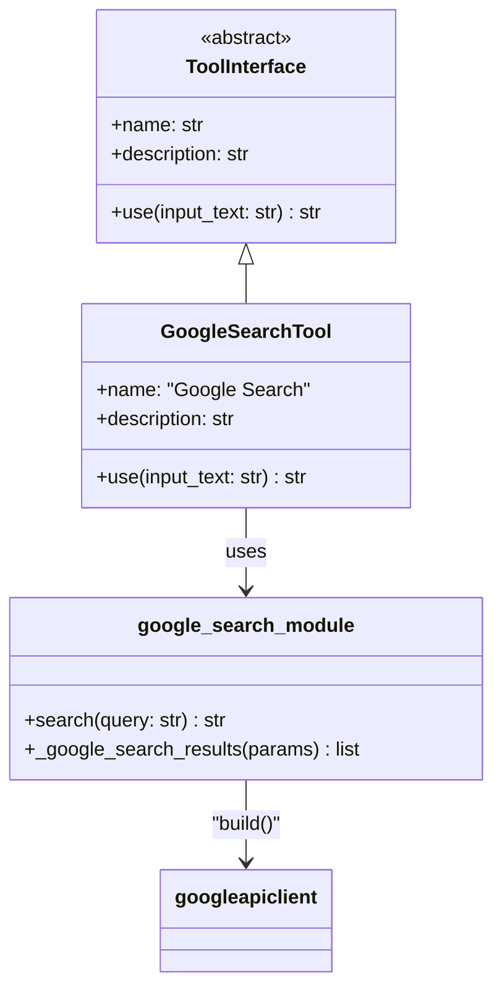
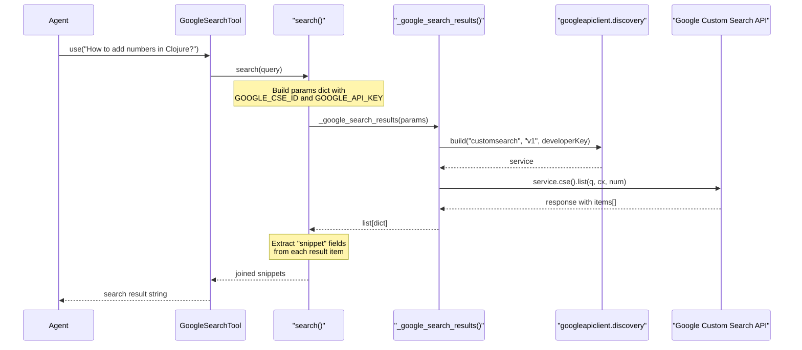
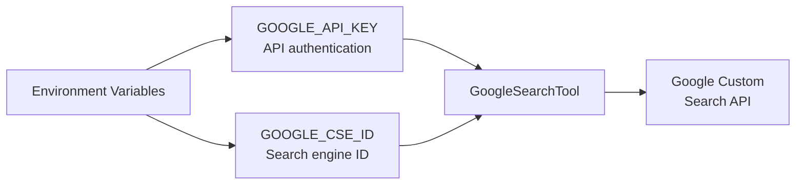
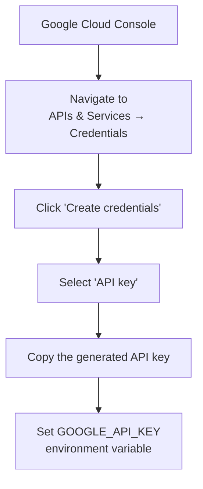
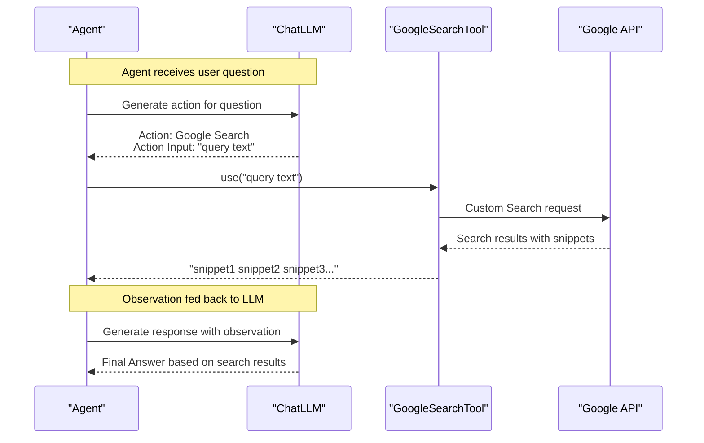
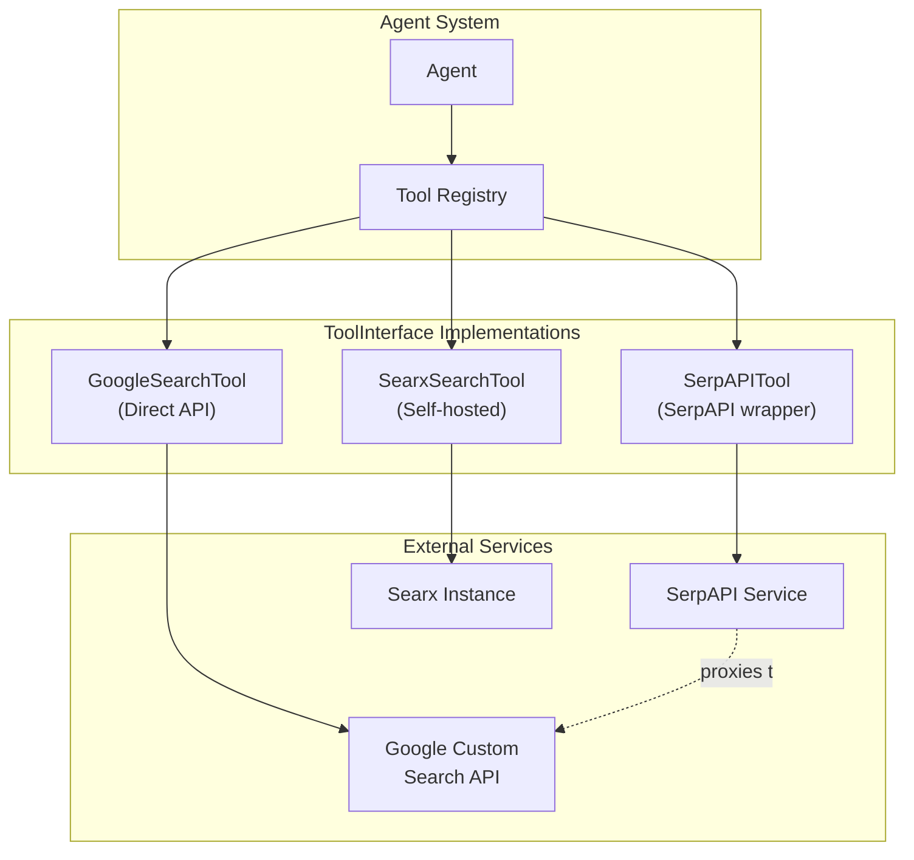

<!-- source: DeepWiki mcp.deepwiki.com · repo mpaepper/llm_agents · extra page GoogleSearchTool · fetched 2026-10-26 -->

# GoogleSearchTool

<details>
<summary>Relevant source files</summary>

The following files were used as context for generating this wiki page:

- [llm_agents/__init__.py](llm_agents/__init__.py)
- [llm_agents/tools/google_search.py](llm_agents/tools/google_search.py)
- [llm_agents/tools/searx.py](llm_agents/tools/searx.py)
- [requirements.txt](requirements.txt)
- [setup.py](setup.py)

</details>


## Purpose and Scope

This document describes the `GoogleSearchTool` implementation, which provides web search capabilities via the Google Custom Search API. This tool enables agents to search the entire web and retrieve relevant information snippets to answer queries.

For information about alternative search tool implementations, see:
- [SerpAPITool](#3.2.1) - Uses SerpAPI service for Google searches
- [SearxSearchTool](#3.2.3) - Uses self-hosted Searx instances
- [HackerNewsSearchTool](#3.2.4) - Specialized for Hacker News content

For general tool architecture concepts, see [ToolInterface](#3.1).

---

## Overview

`GoogleSearchTool` is a search tool implementation that directly integrates with Google's Custom Search JSON API. Unlike `SerpAPITool` which uses a third-party service wrapper, `GoogleSearchTool` makes direct API calls to Google using the `google-api-python-client` library.

**Key Characteristics:**

| Aspect | Details |
|--------|---------|
| **Class Name** | `GoogleSearchTool` |
| **Tool Name** | `"Google Search"` |
| **API Provider** | Google Custom Search API |
| **Python Client** | `google-api-python-client` |
| **Required Credentials** | `GOOGLE_API_KEY`, `GOOGLE_CSE_ID` |
| **Search Scope** | Entire web (configurable) |
| **Default Results** | 10 snippets |

**Sources:** [llm_agents/tools/google_search.py:1-87]()

---

## Implementation Details

### Class Structure

The `GoogleSearchTool` class implements the `ToolInterface` contract, providing standardized integration with the agent system.



**Sources:** [llm_agents/tools/google_search.py:73-80](), [llm_agents/tools/base.py]()

### Core Functions

The implementation consists of three main components:

| Component | Purpose | Location |
|-----------|---------|----------|
| `GoogleSearchTool.use()` | Public interface method called by agent | [llm_agents/tools/google_search.py:79-80]() |
| `search()` | Main search logic and result processing | [llm_agents/tools/google_search.py:54-70]() |
| `_google_search_results()` | Low-level API interaction | [llm_agents/tools/google_search.py:47-51]() |

**Sources:** [llm_agents/tools/google_search.py:47-80]()

---

## Google Custom Search API Integration

### API Call Flow



**Sources:** [llm_agents/tools/google_search.py:47-70]()

### API Request Parameters

The `_google_search_results()` function constructs API requests with the following parameters:

| Parameter | Source | Purpose |
|-----------|--------|---------|
| `q` | Input query string | The search query |
| `cx` | `GOOGLE_CSE_ID` environment variable | Custom Search Engine identifier |
| `developerKey` | `GOOGLE_API_KEY` environment variable | API authentication key |
| `num` | Hardcoded to `10` | Maximum number of results |

**Sources:** [llm_agents/tools/google_search.py:48-51](), [llm_agents/tools/google_search.py:55-60]()

### Response Processing

The `search()` function processes API responses as follows:

1. **Receives items:** Gets list of result dictionaries from `_google_search_results()`
2. **Checks for results:** Returns `"No good Google Search Result was found"` if empty [llm_agents/tools/google_search.py:64-65]()
3. **Extracts snippets:** Iterates through results and collects `"snippet"` fields [llm_agents/tools/google_search.py:66-68]()
4. **Joins output:** Concatenates all snippets with spaces [llm_agents/tools/google_search.py:70]()

**Sources:** [llm_agents/tools/google_search.py:62-70]()

---

## Configuration and Setup

### Required Environment Variables

`GoogleSearchTool` requires two environment variables to be set:



**Sources:** [llm_agents/tools/google_search.py:57-58]()

### Setup Process

The tool requires a multi-step setup process to obtain the necessary credentials. The detailed instructions are provided in the module docstring [llm_agents/tools/google_search.py:9-44]().

#### Step 1: Install Dependencies

The `google-api-python-client` library is required:

```
google-api-python-client>=2.83.0
```

**Sources:** [requirements.txt:4](), [llm_agents/tools/google_search.py:15-20]()

#### Step 2: Create API Key



**Instructions:**
1. Navigate to the APIs & Services → Credentials panel in Google Cloud Console
2. Select "Create credentials"
3. Select "API key" from the drop-down menu
4. Copy the newly created API key

**Sources:** [llm_agents/tools/google_search.py:22-26]()

#### Step 3: Create Custom Search Engine

The Custom Search Engine (CSE) must be configured to search the entire web:

1. Create a custom search engine at [Google Custom Search](https://programmablesearchengine.google.com/)
2. Add any valid URL initially (e.g., `www.stackoverflow.com`)
3. Edit the search engine and enable "Search the entire web"
4. Remove the initial URL from "Sites to search"
5. Copy the "Search engine ID" (this becomes `GOOGLE_CSE_ID`)

**Sources:** [llm_agents/tools/google_search.py:28-36]()

#### Step 4: Enable Custom Search API

The Custom Search API must be enabled in Google Cloud Console:

1. Navigate to APIs & Services → Dashboard
2. Click "Enable APIs and Services"
3. Search for "Custom Search API"
4. Click "Enable"

API URL: `https://console.cloud.google.com/apis/library/customsearch.googleapis.com`

**Sources:** [llm_agents/tools/google_search.py:37-44]()

---

## Integration with Agent System

### Tool Registration

`GoogleSearchTool` is exported from the main package and can be instantiated by agents:

```python
# From llm_agents/__init__.py
from llm_agents.tools.google_search import GoogleSearchTool
```

**Sources:** [llm_agents/__init__.py:7](), [llm_agents/__init__.py:10]()

### Tool Description

The agent receives the following metadata when considering this tool:

| Attribute | Value |
|-----------|-------|
| **name** | `"Google Search"` |
| **description** | `"Get specific information from a search query. Input should be a question like 'How to add number in Clojure?'. Result will be the answer to the question."` |

This description guides the LLM in deciding when and how to use the tool.

**Sources:** [llm_agents/tools/google_search.py:76-77]()

### Usage Pattern



**Sources:** [llm_agents/tools/google_search.py:73-80]()

---

## Code Example

The module includes a standalone example demonstrating direct usage:

```python
if __name__ == '__main__':
    s = GoogleSearchTool()
    res = s.use("Who was the pope in 2023?")
    print(res)
```

This example:
1. Instantiates a `GoogleSearchTool` object
2. Calls the `use()` method with a query
3. Prints the concatenated snippet results

**Sources:** [llm_agents/tools/google_search.py:83-86]()

---

## Comparison with Other Search Tools

### GoogleSearchTool vs SerpAPITool

| Feature | GoogleSearchTool | SerpAPITool |
|---------|------------------|-------------|
| **API Provider** | Google directly | SerpAPI (third-party) |
| **Dependencies** | `google-api-python-client` | `google-search-results` |
| **Configuration** | API key + CSE ID | SerpAPI key only |
| **Setup Complexity** | High (4 steps) | Low (1 key) |
| **Tool Name** | `"Google Search"` | `"Google Search"` |
| **Cost Model** | Google API pricing | SerpAPI subscription |

**Note:** Both tools have the same `name` attribute (`"Google Search"`), so only one should be registered with an agent at a time to avoid conflicts.

**Sources:** [llm_agents/tools/google_search.py:76](), [llm_agents/tools/search.py]()

### Architectural Position



**Sources:** [llm_agents/tools/google_search.py:1-87](), [llm_agents/tools/searx.py:1-88]()

---

## Error Handling

The implementation includes basic error handling:

### No Results Scenario

When `_google_search_results()` returns an empty list or no items contain snippets:

```python
if len(res) == 0:
    return "No good Google Search Result was found"
```

This message is returned to the agent, which can then decide to:
- Reformulate the query
- Try a different tool
- Report the failure to the user

**Sources:** [llm_agents/tools/google_search.py:64-65]()

### Missing Environment Variables

If required environment variables are not set, the code will raise a `KeyError` when accessing `os.environ["GOOGLE_CSE_ID"]` or `os.environ["GOOGLE_API_KEY"]`. This occurs at runtime when `search()` is first called.

**Sources:** [llm_agents/tools/google_search.py:57-58]()

---

## Attribution and Origin

The `GoogleSearchTool` implementation is adapted from LangChain's Google Search utility:

```python
# Based on https://raw.githubusercontent.com/hwchase17/langchain/master/langchain/utilities/google_search.py
```

The setup instructions are adapted from Stack Overflow documentation on programmatic Google searching.

**Sources:** [llm_agents/tools/google_search.py:1](), [llm_agents/tools/google_search.py:11-13]()

---

