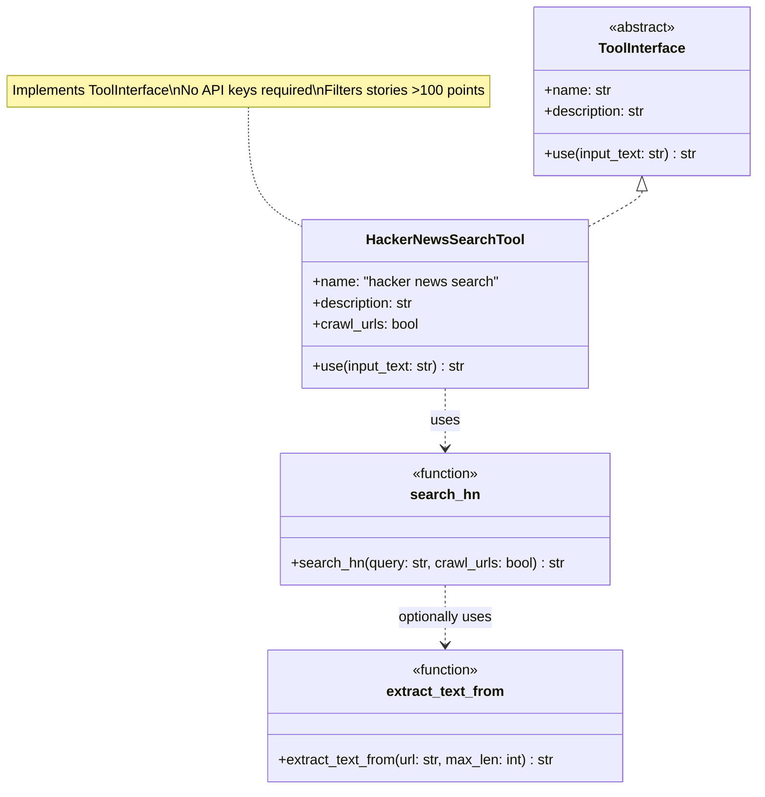
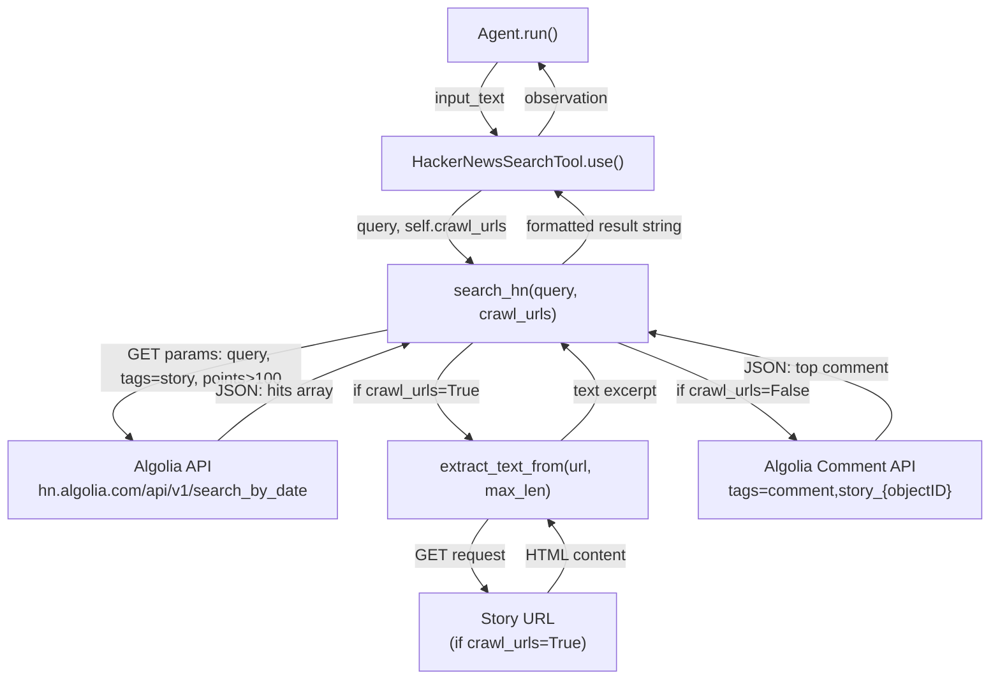
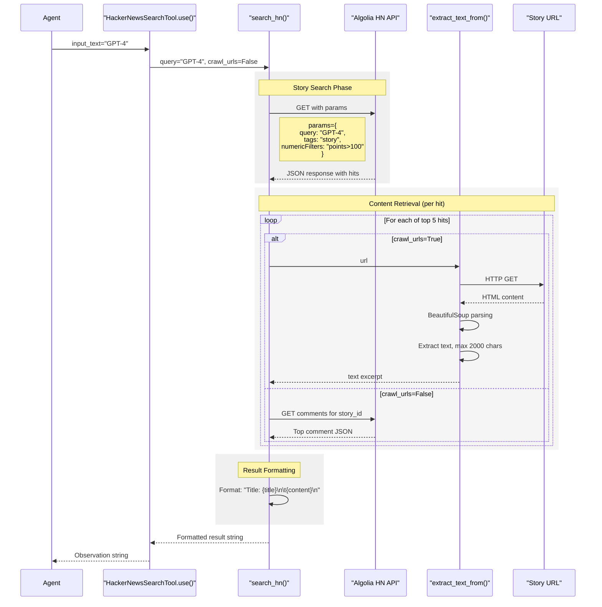
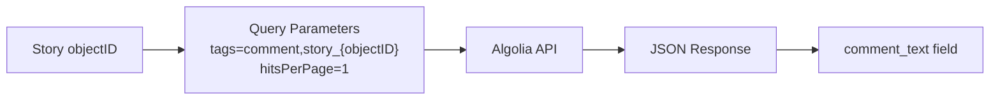
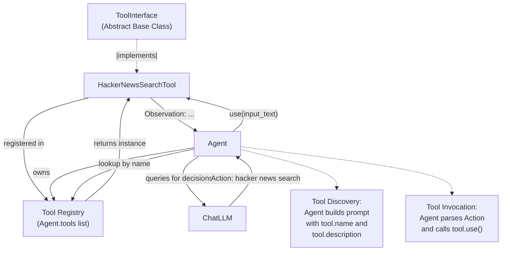

<!-- source: DeepWiki mcp.deepwiki.com · repo mpaepper/llm_agents · extra page HackerNewsSearchTool · fetched 2026-10-26 -->

# HackerNewsSearchTool

<details>
<summary>Relevant source files</summary>

The following files were used as context for generating this wiki page:

- [llm_agents/__init__.py](llm_agents/__init__.py)
- [llm_agents/tools/hackernews.py](llm_agents/tools/hackernews.py)
- [llm_agents/tools/searx.py](llm_agents/tools/searx.py)
- [requirements.txt](requirements.txt)
- [setup.py](setup.py)

</details>


## Purpose and Scope

This document covers the `HackerNewsSearchTool`, which retrieves stories and comments from Hacker News using the Algolia HN Search API. This tool enables agents to access community discussions and insights from the Hacker News platform without requiring any API keys or authentication.

For information about the base tool interface that all tools implement, see [ToolInterface](#3.1). For other search tool options (SerpAPI, Google, Searx), see [Search Tools](#3.2).

## Overview

The `HackerNewsSearchTool` provides agents with the ability to search Hacker News content and retrieve relevant stories with associated comments or excerpts. Unlike other search tools in the system, it requires no API keys or configuration, making it immediately available for use.

**Key Characteristics:**
- **No authentication required**: Uses publicly available Algolia HN Search API
- **Filtered results**: Only returns stories with >100 points (high-quality content)
- **Dual content modes**: Can retrieve either URL content excerpts or top comments
- **Limited scope**: Returns top 5 most recent matching stories
- **Rate limiting**: Subject to Algolia API rate limits

Sources: [llm_agents/tools/hackernews.py:1-62]()

## Class Structure and Interface Implementation

The `HackerNewsSearchTool` class implements the `ToolInterface` contract, exposing the standard `name`, `description`, and `use()` method that the Agent uses for tool discovery and invocation.



**Class Attributes:**

| Attribute | Value | Purpose |
|-----------|-------|---------|
| `name` | `"hacker news search"` | Tool identifier used by Agent for selection |
| `description` | Multi-line string | Explains input format and output structure to LLM |
| `crawl_urls` | `False` | Toggles between extracting URL content vs. fetching comments |

Sources: [llm_agents/tools/hackernews.py:47-56](), [llm_agents/tools/base.py]()

## API Integration Architecture

The tool integrates with two Algolia HN Search API endpoints to retrieve story metadata and comments.



**API Endpoints:**

| Endpoint | Purpose | Parameters |
|----------|---------|------------|
| `https://hn.algolia.com/api/v1/search_by_date` | Story search | `query`, `tags=story`, `numericFilters=points>100` |
| Same endpoint with `tags=comment,story_{objectID}` | Comment retrieval | `tags`, `hitsPerPage=1` |

Sources: [llm_agents/tools/hackernews.py:6-45]()

## Data Flow and Processing

The tool follows a multi-step processing pipeline to transform user queries into formatted search results.



**Processing Steps:**

1. **Query Construction** [llm_agents/tools/hackernews.py:19-23]()
   - Builds query parameters with story tag filter
   - Applies numeric filter for points > 100
   
2. **API Request** [llm_agents/tools/hackernews.py:25-27]()
   - Sends GET request to Algolia endpoint
   - Receives JSON response with hits array

3. **Content Extraction** [llm_agents/tools/hackernews.py:30-43]()
   - Iterates over top 5 hits
   - If `crawl_urls=True`: Fetches and parses story URL content
   - If `crawl_urls=False`: Retrieves top comment for each story

4. **Result Formatting** [llm_agents/tools/hackernews.py:29-44]()
   - Formats each hit as "Title: {title}\n\t{content}"
   - Concatenates all results into single string

Sources: [llm_agents/tools/hackernews.py:18-44]()

## Implementation Details

### Story Search Function

The `search_hn()` function handles the core search logic:

```python
# Pseudo-code representation of search_hn logic
def search_hn(query: str, crawl_urls: bool) -> str:
    # 1. Build query parameters
    params = {"query": query, "tags": "story", "numericFilters": "points>100"}
    
    # 2. Execute search
    response = requests.get(ENDPOINT, params=params)
    hits = response.json()["hits"]
    
    # 3. Process top 5 hits
    result = ""
    for hit in hits[:5]:
        title = hit["title"]
        url = hit["url"]
        result += f"Title: {title}\n"
        
        # 4. Get content (URL excerpt or comment)
        if url is not None and crawl_urls:
            result += f"\tExcerpt: {extract_text_from(url)}\n"
        else:
            # Fetch top comment for this story
            comment = fetch_comment_for_story(hit["objectID"])
            result += f"\tComment: {comment}\n"
    
    return result
```

Sources: [llm_agents/tools/hackernews.py:18-44]()

### Text Extraction

The `extract_text_from()` function extracts readable text from story URLs:

| Step | Function | Details |
|------|----------|---------|
| HTTP Request | `requests.get(url)` | Fetches HTML content |
| HTML Parsing | `BeautifulSoup(html, "html.parser")` | Parses HTML structure |
| Text Extraction | `soup.get_text()` | Extracts all text content |
| Line Processing | Strip and filter lines | Removes empty lines and whitespace |
| Truncation | `[:max_len]` | Limits output to 2000 characters (default) |

Sources: [llm_agents/tools/hackernews.py:9-15]()

### Comment Retrieval

When `crawl_urls=False`, the tool fetches the top comment for each story:



Sources: [llm_agents/tools/hackernews.py:38-43]()

## Configuration

The `HackerNewsSearchTool` requires **no environment variables or API keys**, distinguishing it from other search tools in the system.

### Comparison with Other Search Tools

| Tool | API Key Required | Configuration |
|------|------------------|---------------|
| `HackerNewsSearchTool` | ❌ No | None |
| `SerpAPITool` | ✅ Yes | `SERPAPI_API_KEY` |
| `GoogleSearchTool` | ✅ Yes | `GOOGLE_API_KEY`, `GOOGLE_CSE_ID` |
| `SearxSearchTool` | ❌ No | `SEARX_INSTANCE_URL` |

### Class-Level Configuration

The `crawl_urls` attribute can be modified at the class level to change behavior:

```python
# Default behavior: fetch comments
tool = HackerNewsSearchTool()  # crawl_urls = False

# Modified behavior: crawl URL content
tool = HackerNewsSearchTool()
tool.crawl_urls = True
```

Sources: [llm_agents/tools/hackernews.py:47-56](), [llm_agents/__init__.py:1-10]()

## Dependencies

The tool relies on the following Python packages:

| Package | Purpose | Used In |
|---------|---------|---------|
| `requests` | HTTP client for API calls | Story search, comment retrieval, URL fetching |
| `beautifulsoup4` | HTML parsing | Text extraction from story URLs |

Sources: [llm_agents/tools/hackernews.py:1-3](), [requirements.txt:1-5]()

## Usage Example

The tool is instantiated and registered with an Agent like other tools:

```python
from llm_agents import Agent, ChatLLM, HackerNewsSearchTool

# Create tool instance
hn_tool = HackerNewsSearchTool()

# Create agent with tool
agent = Agent(
    llm=ChatLLM(),
    tools=[hn_tool]
)

# Agent can now use the tool
result = agent.run("What are people saying about GPT-4 on Hacker News?")
```

The Agent sees the tool's description and can invoke it with search queries. The tool returns formatted results that the Agent can reason about.

**Example Tool Output:**

```
Title: GPT-4 is amazing for code generation
	Comment: I've been using GPT-4 for the past week and the code quality is significantly better than GPT-3.5. It handles edge cases much better.
Title: OpenAI announces GPT-4
	Comment: This is a huge leap forward. The reasoning capabilities are impressive...
```

Sources: [llm_agents/tools/hackernews.py:58-61](), [llm_agents/__init__.py:4-10]()

## Integration with Agent System

The `HackerNewsSearchTool` follows the standard tool integration pattern used throughout the system:



**Integration Points:**

1. **Tool Discovery** [llm_agents/agent.py](): Agent includes tool name and description in prompt
2. **Tool Selection** [llm_agents/agent.py](): LLM outputs "Action: hacker news search"
3. **Tool Invocation** [llm_agents/agent.py](): Agent calls `tool.use(input_text)`
4. **Observation Loop** [llm_agents/agent.py](): Result fed back to LLM as observation

Sources: [llm_agents/tools/hackernews.py:47-56](), [llm_agents/tools/base.py]()

## Limitations and Considerations

### Query Filtering

The tool applies a hardcoded filter of `points>100`, which:
- **Advantage**: Ensures high-quality, community-vetted content
- **Limitation**: Excludes newer stories that haven't accumulated points yet

### Result Truncation

- Maximum 5 stories returned [llm_agents/tools/hackernews.py:30]()
- URL excerpts limited to 2000 characters [llm_agents/tools/hackernews.py:9]()
- Only top comment retrieved per story [llm_agents/tools/hackernews.py:39]()

### Performance Considerations

| Scenario | Impact |
|----------|--------|
| `crawl_urls=False` | Fast: Only API calls to Algolia |
| `crawl_urls=True` | Slow: Additional HTTP requests to story URLs + HTML parsing |

### Rate Limiting

The tool is subject to Algolia's public API rate limits. No backoff or retry logic is implemented.

Sources: [llm_agents/tools/hackernews.py:9-44]()

## Testing

The tool can be tested directly via the command-line interface:

```bash
python -m llm_agents.tools.hackernews
```

This executes the `if __name__ == '__main__':` block [llm_agents/tools/hackernews.py:58-61](), which searches for "GPT-4" and prints results.

For information about comprehensive testing infrastructure and fixtures, see [Testing Infrastructure](#5.2).

Sources: [llm_agents/tools/hackernews.py:58-61]()

---

