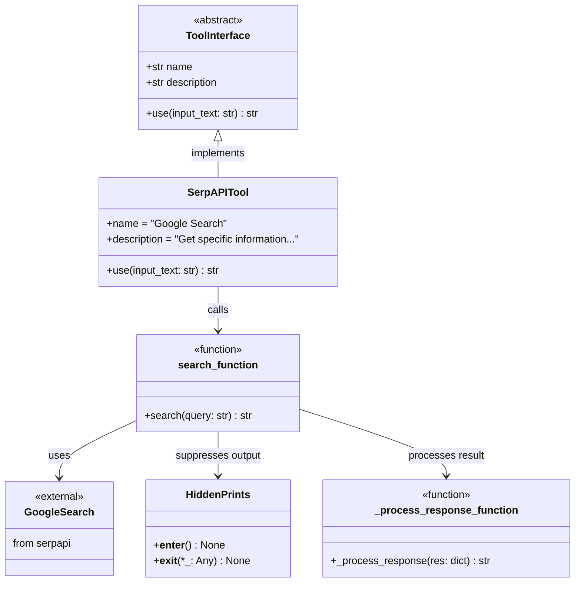
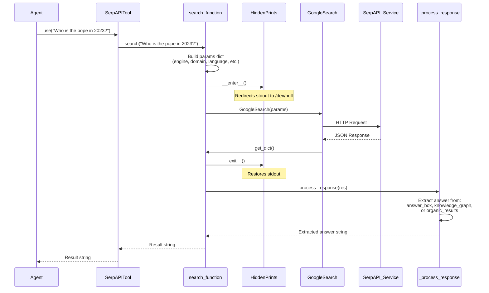
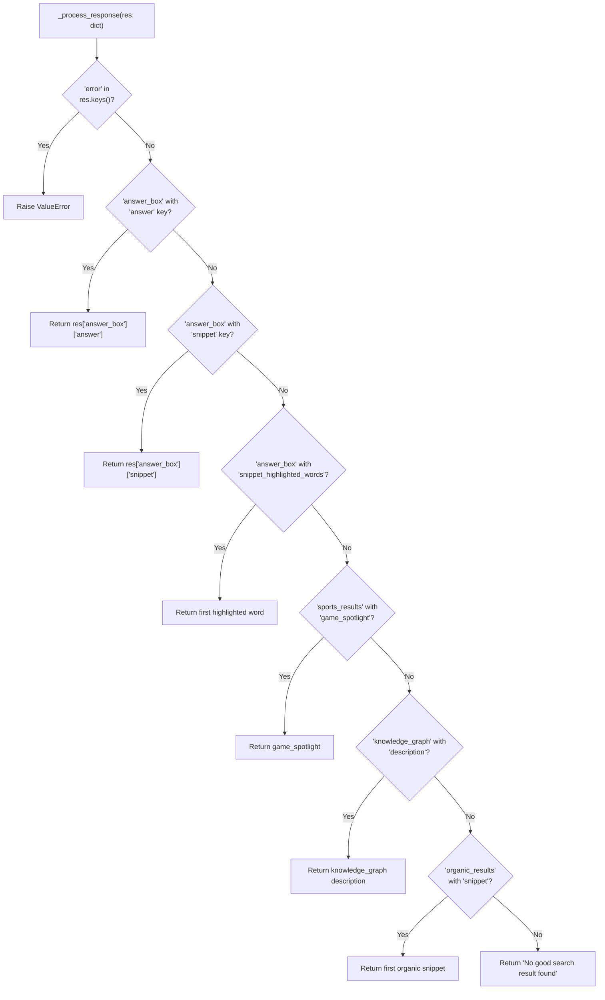
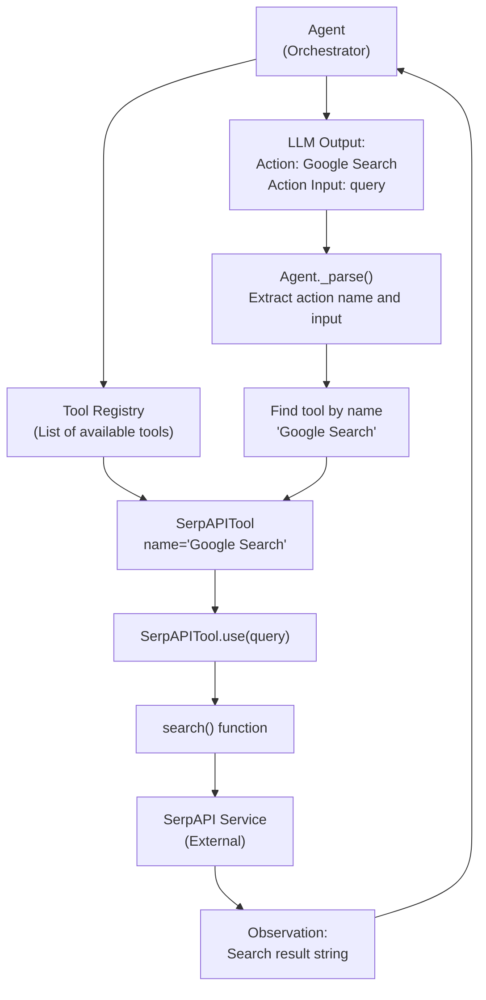

<!-- source: DeepWiki mcp.deepwiki.com · repo mpaepper/llm_agents · extra page SerpAPITool · fetched 2026-10-26 -->

# SerpAPITool

<details>
<summary>Relevant source files</summary>

The following files were used as context for generating this wiki page:

- [llm_agents/__init__.py](llm_agents/__init__.py)
- [llm_agents/tools/search.py](llm_agents/tools/search.py)
- [llm_agents/tools/searx.py](llm_agents/tools/searx.py)
- [requirements.txt](requirements.txt)
- [setup.py](setup.py)

</details>


This page documents the `SerpAPITool` class, which provides Google search capabilities to agents using the SerpAPI service. This tool wraps the SerpAPI Google Search API and processes search results into concise, factual answers.

**Scope**: This page covers the SerpAPI-based search implementation. For other search tool options, see [GoogleSearchTool](#3.2.2), [SearxSearchTool](#3.2.3), and [HackerNewsSearchTool](#3.2.4). For the base tool interface contract, see [ToolInterface](#3.1).

---

## Overview

The `SerpAPITool` class is one of four search tool implementations in the `llm_agents` package. It uses the third-party SerpAPI service to perform Google searches and extract relevant information from the results. Unlike direct Google Custom Search API integration, SerpAPI provides a simplified interface with built-in parsing of Google's various result types (answer boxes, knowledge graphs, organic results, etc.).

**Key Characteristics**:
- **Service**: SerpAPI (third-party service that wraps Google Search)
- **API Key Required**: `SERPAPI_API_KEY` environment variable
- **Tool Name**: `"Google Search"`
- **Response Type**: Single-string answer extracted from search results
- **Dependencies**: `google-search-results>=2.4.2` package

Sources: [llm_agents/tools/search.py:1-88](), [requirements.txt:1-5]()

---

## Class Structure and Interface Implementation

The `SerpAPITool` class implements the `ToolInterface` contract, which requires three components: `name`, `description`, and `use()` method.



**Class Definition**: [llm_agents/tools/search.py:74-81]()

| Attribute | Value | Purpose |
|-----------|-------|---------|
| `name` | `"Google Search"` | Identifier used by Agent to select this tool |
| `description` | `"Get specific information from a search query..."` | Instructions provided to the LLM for when to use this tool |
| `use(input_text)` | Method implementation | Entry point that accepts search query and returns result |

Sources: [llm_agents/tools/search.py:74-81]()

---

## Search Function Implementation

The core search logic is implemented in the `search()` function at the module level, which is then called by the `SerpAPITool.use()` method.



### Parameters Configuration

The `search()` function constructs a parameters dictionary for the SerpAPI request:

[llm_agents/tools/search.py:12-20]()

| Parameter | Value | Purpose |
|-----------|-------|---------|
| `engine` | `"google"` | Specifies Google as the search engine |
| `google_domain` | `"google.com"` | Uses the .com domain |
| `gl` | `"us"` | Geographic location set to United States |
| `hl` | `"en"` | Language set to English |
| `q` | User query | The actual search query |
| `api_key` | `os.environ["SERPAPI_API_KEY"]` | Authentication for SerpAPI |

Sources: [llm_agents/tools/search.py:12-20]()

---

## Response Processing Logic

The `_process_response()` function implements a waterfall strategy to extract the most relevant answer from SerpAPI's JSON response. It checks multiple result types in order of priority.



### Priority Order

The function checks result types in this order:

1. **Answer Box (direct answer)** - [llm_agents/tools/search.py:33-34]()
2. **Answer Box (snippet)** - [llm_agents/tools/search.py:35-36]()
3. **Answer Box (highlighted words)** - [llm_agents/tools/search.py:37-41]()
4. **Sports Results (game spotlight)** - [llm_agents/tools/search.py:42-46]()
5. **Knowledge Graph (description)** - [llm_agents/tools/search.py:47-51]()
6. **Organic Results (first snippet)** - [llm_agents/tools/search.py:52-53]()
7. **Fallback** - Returns `"No good search result found"` - [llm_agents/tools/search.py:55-56]()

This prioritization ensures that structured, high-quality results (like answer boxes) are preferred over generic search snippets.

Sources: [llm_agents/tools/search.py:29-57]()

---

## HiddenPrints Context Manager

The `HiddenPrints` class suppresses console output from the `serpapi` library during search execution. This prevents the SerpAPI client from polluting the agent's output stream.


**Implementation**: [llm_agents/tools/search.py:60-71]()

The context manager:
1. Saves the original `sys.stdout` reference
2. Redirects `sys.stdout` to `/dev/null` on entry
3. Restores the original `sys.stdout` on exit

**Usage**: [llm_agents/tools/search.py:22-24]()

Sources: [llm_agents/tools/search.py:60-71](), [llm_agents/tools/search.py:22-24]()

---

## Integration with Agent System

The `SerpAPITool` is registered in the main package exports and can be instantiated by the `Agent` class during the Thought-Action-Observation loop.



**Registration**: [llm_agents/__init__.py:5]()

The tool is imported and exported from the main package, making it available for agent instantiation. The Agent identifies this tool by its `name` attribute (`"Google Search"`) when parsing LLM action selections.

Sources: [llm_agents/__init__.py:5](), [llm_agents/tools/search.py:74-81]()

---

## Configuration Requirements

### Environment Variable

The `SerpAPITool` requires the `SERPAPI_API_KEY` environment variable to be set before use:

[llm_agents/tools/search.py:19]()

```bash
export SERPAPI_API_KEY="your-api-key-here"
```

### Obtaining a SerpAPI API Key

1. Visit https://serpapi.com
2. Create an account
3. Navigate to the API Key section in your dashboard
4. Copy your API key
5. Set the environment variable in your shell or `.env` file

For detailed API key setup instructions, see [Required API Keys](#4.1).

### Dependency Installation

The tool requires the `google-search-results` package, which provides the `serpapi` client library:

[requirements.txt:5]()

```bash
pip install google-search-results>=2.4.2
```

This dependency is automatically installed when installing the `llm_agents` package.

Sources: [llm_agents/tools/search.py:19](), [requirements.txt:5](), [setup.py:12]()

---

## Error Handling

The `SerpAPITool` implements error handling at the response processing level:

### SerpAPI Error Responses

[llm_agents/tools/search.py:31-32]()

If the SerpAPI service returns an error (e.g., invalid API key, rate limit exceeded), the `_process_response()` function raises a `ValueError` with the error message:

```python
if "error" in res.keys():
    raise ValueError(f"Got error from SerpAPI: {res['error']}")
```

Common error scenarios:

| Error Type | Cause | Resolution |
|------------|-------|------------|
| Invalid API key | `SERPAPI_API_KEY` not set or incorrect | Verify API key in environment variable |
| Rate limit exceeded | Too many requests in time period | Wait or upgrade SerpAPI plan |
| Invalid parameters | Malformed query parameters | Check query format |

### No Results Found

[llm_agents/tools/search.py:55-56]()

When no structured results are found in any of the checked response fields, the function returns:

```python
"No good search result found"
```

This string is returned to the Agent as an observation, allowing the LLM to potentially reformulate the query or try a different approach.

Sources: [llm_agents/tools/search.py:31-32](), [llm_agents/tools/search.py:55-56]()

---

## Usage Example

### Standalone Usage

[llm_agents/tools/search.py:84-87]()

The module includes a `__main__` block demonstrating standalone usage:

```python
if __name__ == '__main__':
    s = SerpAPITool()
    res = s.use("Who is the pope in 2023?")
    print(res)
```

### Agent Integration

When integrated with an Agent (see [The Agent](#2.1)), the tool is automatically invoked based on LLM decisions:

```python
from llm_agents import Agent, SerpAPITool

agent = Agent(tools=[SerpAPITool()])
result = agent.run("What is the capital of France?")
```

The Agent's prompt includes the tool's description, allowing the LLM to decide when to use Google Search. When the LLM outputs:

```
Thought: I need to search for information about France's capital
Action: Google Search
Action Input: capital of France
```

The Agent will:
1. Parse the action name (`"Google Search"`)
2. Match it to `SerpAPITool.name`
3. Call `SerpAPITool.use("capital of France")`
4. Receive the observation result
5. Feed the observation back to the LLM for final answer synthesis

Sources: [llm_agents/tools/search.py:84-87]()

---

## Comparison with Other Search Tools

The `llm_agents` package provides four search tool implementations. Here's when to use `SerpAPITool`:

| Aspect | SerpAPITool | GoogleSearchTool | SearxSearchTool | HackerNewsSearchTool |
|--------|-------------|------------------|-----------------|---------------------|
| **Service** | SerpAPI (paid) | Google Custom Search | Self-hosted Searx | Hacker News API |
| **API Key** | `SERPAPI_API_KEY` | `GOOGLE_API_KEY` + `GOOGLE_CSE_ID` | None (instance URL) | None |
| **Cost** | Paid per search | Limited free tier | Free (self-hosted) | Free |
| **Result Quality** | High (Google results) | High (Google results) | Variable | Domain-specific |
| **Setup Complexity** | Low (just API key) | Medium (2 credentials) | High (self-host) | Low |
| **Best For** | Production use, high quality results | Testing, low volume | Privacy-focused, high volume | Tech news queries |

**When to use SerpAPITool**:
- Production deployments requiring reliable search results
- Applications where search quality is critical
- Scenarios where third-party service dependency is acceptable
- Budget allows for per-search costs

**When to use alternatives**:
- See [GoogleSearchTool](#3.2.2) for direct Google API integration
- See [SearxSearchTool](#3.2.3) for self-hosted, privacy-focused search
- See [HackerNewsSearchTool](#3.2.4) for tech community content

Sources: [llm_agents/tools/search.py:1-88](), [llm_agents/__init__.py:5-7]()

---

## Code Attribution

The `SerpAPITool` implementation is based on the LangChain project's SerpAPI wrapper:

[llm_agents/tools/search.py:1]()

```python
# Based on https://github.com/hwchase17/langchain/blob/master/langchain/utilities/serpapi.py
```

The original LangChain implementation provided the foundation for response processing logic and parameter configuration patterns.

Sources: [llm_agents/tools/search.py:1]()

---

