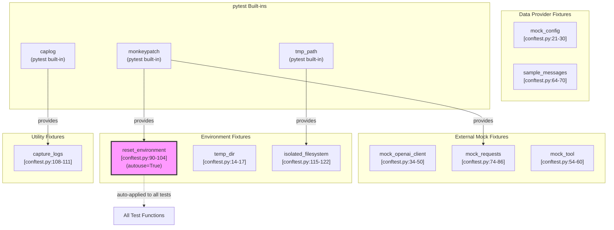
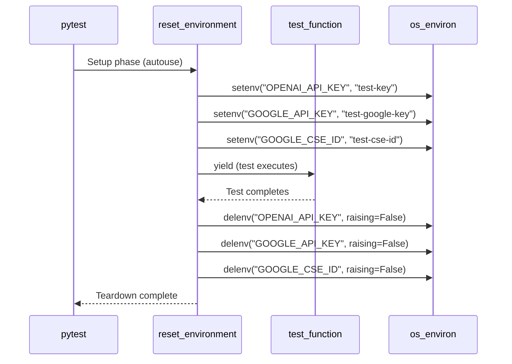
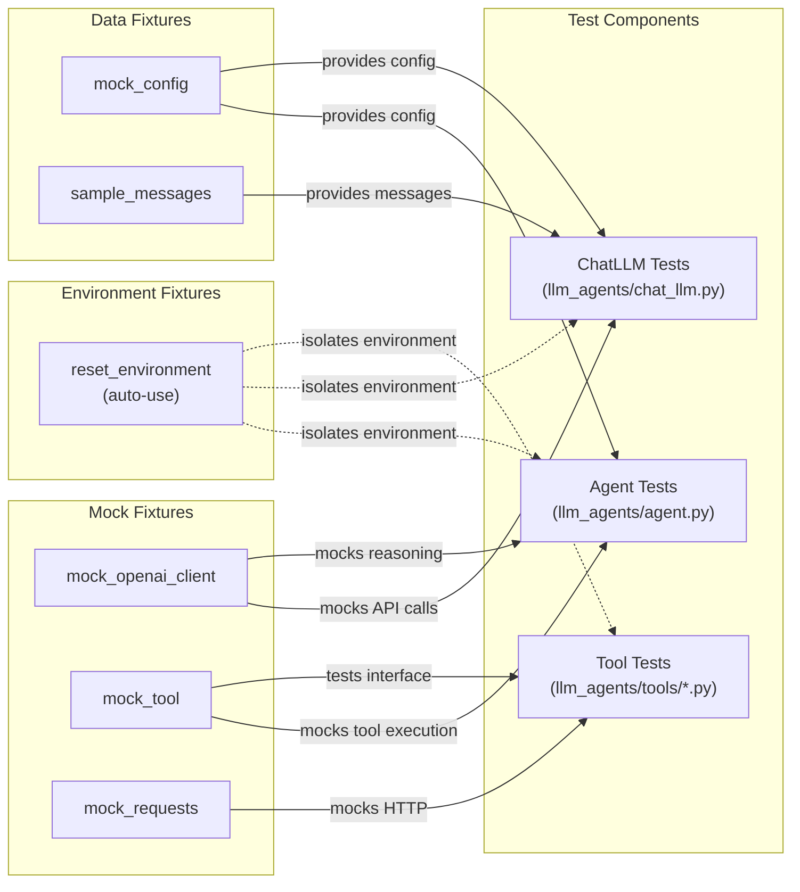

<!-- source: DeepWiki mcp.deepwiki.com · repo mpaepper/llm_agents · extra page Test Fixtures · fetched 2026-10-26 -->

# Test Fixtures

<details>
<summary>Relevant source files</summary>

The following files were used as context for generating this wiki page:

- [tests/conftest.py](tests/conftest.py)
- [tests/test_setup_validation.py](tests/test_setup_validation.py)
- [tests/unit/__init__.py](tests/unit/__init__.py)

</details>


## Purpose and Scope

This document catalogs all shared test fixtures provided by the testing infrastructure. Test fixtures are reusable components defined in [tests/conftest.py]() that provide mocked dependencies, test data, and isolated environments to tests. For information on running tests with these fixtures, see [Running Tests](#5.2.2). For guidance on writing tests that use these fixtures, see [Writing Tests](#5.2.3).

---

## Overview of Test Fixtures

The test suite provides nine shared fixtures through pytest's [tests/conftest.py:1-122]() module. These fixtures automatically handle setup and teardown, mock external dependencies, provide test data, and ensure test isolation. All fixtures are function-scoped unless otherwise noted.

**Sources:** [tests/conftest.py:1-122]()

---

## Fixture Catalog

The following table summarizes all available fixtures:

| Fixture Name | Purpose | Type | Auto-use |
|-------------|---------|------|----------|
| `temp_dir` | Temporary directory for file operations | Generator[Path] | No |
| `mock_config` | Mock configuration dictionary | Dict[str, Any] | No |
| `mock_openai_client` | Mocked OpenAI API client | MagicMock | No |
| `mock_tool` | Generic mock tool instance | Mock | No |
| `sample_messages` | Sample chat messages | List[Dict] | No |
| `mock_requests` | Mocked HTTP requests library | Mock | No |
| `reset_environment` | Environment variable isolation | None | Yes |
| `capture_logs` | Log message capture | LogCaptureFixture | No |
| `isolated_filesystem` | Isolated working directory | Path | No |

**Sources:** [tests/conftest.py:13-122]()

---

## Fixture Architecture

### Fixture Dependency Graph



**Diagram:** Fixture dependency relationships showing which fixtures depend on pytest built-ins and which are automatically applied.

**Sources:** [tests/conftest.py:1-122]()

---

## Mock External Dependencies

These fixtures mock external services and APIs to enable testing without actual network calls or API keys.

### mock_openai_client

Creates a fully mocked OpenAI client instance that returns predictable responses.

**Definition:** [tests/conftest.py:34-50]()

**Structure:**
```python
client = MagicMock()
client.chat.completions.create.return_value = mock_response
mock_response.choices[0].message.content = "Test response"
```

**Usage Pattern:**
```python
def test_chat_generation(mock_openai_client):
    # mock_openai_client is already configured
    response = mock_openai_client.chat.completions.create(...)
    assert response.choices[0].message.content == "Test response"
```

**Key Attributes:**
- `chat.completions.create`: Returns mock response with `choices` list
- `choices[0].message.content`: Contains "Test response"
- `choices[0].message.tool_calls`: Set to `None` by default

**Sources:** [tests/conftest.py:34-50](), [tests/test_setup_validation.py:29-38]()

---

### mock_requests

Patches the `requests` library to prevent actual HTTP calls and return controlled responses.

**Definition:** [tests/conftest.py:74-86]()

**Mocked Methods:**
- `requests.get`: Returns mock response with status 200
- `requests.post`: Returns same mock response

**Mock Response Structure:**
```python
mock_response.status_code = 200
mock_response.json.return_value = {"result": "success"}
mock_response.text = '{"result": "success"}'
```

**Usage Pattern:**
```python
def test_http_call(mock_requests):
    import requests
    response = requests.get("http://example.com")
    assert response.status_code == 200
    assert response.json() == {"result": "success"}
```

**Sources:** [tests/conftest.py:74-86](), [tests/test_setup_validation.py:73-78]()

---

### mock_tool

Provides a generic mock tool that implements the ToolInterface contract.

**Definition:** [tests/conftest.py:54-60]()

**Mock Attributes:**
- `name`: "mock_tool"
- `description`: "A mock tool for testing"
- `run()`: Returns "Mock tool result"

**Usage Pattern:**
```python
def test_tool_execution(mock_tool):
    assert mock_tool.name == "mock_tool"
    result = mock_tool.run("input")
    assert result == "Mock tool result"
```

**Sources:** [tests/conftest.py:54-60](), [tests/test_setup_validation.py:29-38]()

---

## Environment Setup Fixtures

These fixtures manage test isolation by controlling the filesystem and environment variables.

### reset_environment (Auto-use)

Automatically applies to every test function, ensuring isolated environment variables.

**Definition:** [tests/conftest.py:89-104]()

**Auto-use:** `@pytest.fixture(autouse=True)` - runs before and after every test

**Environment Variables Set:**
```python
{
    "OPENAI_API_KEY": "test-key",
    "GOOGLE_API_KEY": "test-google-key",
    "GOOGLE_CSE_ID": "test-cse-id"
}
```

**Lifecycle:**
1. **Setup:** Sets test environment variables before each test
2. **Test Execution:** Test runs with isolated environment
3. **Teardown:** Deletes test variables after test completes



**Diagram:** Lifecycle of the auto-use `reset_environment` fixture showing automatic setup and teardown around each test.

**Sources:** [tests/conftest.py:89-104](), [tests/test_setup_validation.py:68-71]()

---

### temp_dir

Creates a temporary directory that is automatically cleaned up after the test.

**Definition:** [tests/conftest.py:14-17]()

**Returns:** `Generator[Path, None, None]`

**Implementation:**
```python
with tempfile.TemporaryDirectory() as tmpdir:
    yield Path(tmpdir)
```

**Usage Pattern:**
```python
def test_file_operations(temp_dir):
    test_file = temp_dir / "test.txt"
    test_file.write_text("content")
    assert test_file.exists()
    # temp_dir automatically deleted after test
```

**Sources:** [tests/conftest.py:14-17](), [tests/test_setup_validation.py:29-38]()

---

### isolated_filesystem

Creates an isolated working directory and changes `os.cwd()` to that directory for the test duration.

**Definition:** [tests/conftest.py:115-122]()

**Returns:** `Path` (tmp_path directory)

**Implementation:**
```python
original_cwd = os.getcwd()
os.chdir(tmp_path)
yield tmp_path
os.chdir(original_cwd)
```

**Usage Pattern:**
```python
def test_with_cwd_isolation(isolated_filesystem):
    # os.getcwd() == isolated_filesystem
    Path("test.txt").write_text("content")
    assert Path("test.txt").exists()
    # Original cwd restored after test
```

**Difference from `temp_dir`:** This fixture changes the current working directory, while `temp_dir` only provides a path.

**Sources:** [tests/conftest.py:115-122](), [tests/test_setup_validation.py:80-85]()

---

## Data Provider Fixtures

These fixtures supply test data in standardized formats.

### mock_config

Provides a complete configuration dictionary for testing components that require configuration.

**Definition:** [tests/conftest.py:21-30]()

**Returns:** `Dict[str, Any]`

**Configuration Structure:**
```python
{
    "api_key": "test-api-key",
    "model": "test-model",
    "temperature": 0.7,
    "max_tokens": 1000,
    "tools": ["search", "python_repl"],
    "debug": True
}
```

**Usage Pattern:**
```python
def test_configuration(mock_config):
    assert mock_config["api_key"] == "test-api-key"
    assert mock_config["model"] == "test-model"
    assert "search" in mock_config["tools"]
```

**Sources:** [tests/conftest.py:21-30](), [tests/test_setup_validation.py:29-38]()

---

### sample_messages

Provides sample chat messages in the format expected by chat-based LLM APIs.

**Definition:** [tests/conftest.py:64-70]()

**Returns:** `List[Dict[str, str]]`

**Message Structure:**
```python
[
    {"role": "system", "content": "You are a helpful assistant."},
    {"role": "user", "content": "Hello, how are you?"},
    {"role": "assistant", "content": "I'm doing well, thank you!"}
]
```

**Usage Pattern:**
```python
def test_message_processing(sample_messages):
    assert len(sample_messages) == 3
    assert sample_messages[0]["role"] == "system"
    assert sample_messages[1]["role"] == "user"
```

**Sources:** [tests/conftest.py:64-70]()

---

## Test Utility Fixtures

### capture_logs

Enables capturing and asserting on log messages produced during test execution.

**Definition:** [tests/conftest.py:108-111]()

**Returns:** `LogCaptureFixture` (pytest's caplog)

**Configuration:** Sets log level to `DEBUG` for comprehensive capture

**Usage Pattern:**
```python
def test_logging(capture_logs):
    import logging
    logger = logging.getLogger(__name__)
    logger.info("Test message")
    
    assert "Test message" in capture_logs.text
    assert len(capture_logs.records) == 1
```

**Captured Attributes:**
- `capture_logs.text`: Full log output as string
- `capture_logs.records`: List of LogRecord objects
- Individual record attributes: `levelname`, `message`, etc.

**Sources:** [tests/conftest.py:108-111](), [tests/test_setup_validation.py:87-93]()

---

## Fixture-to-Component Mapping

The following diagram shows which fixtures are used to test which components of the codebase:



**Diagram:** Mapping between test fixtures and the components they support testing. Dashed lines indicate auto-use fixtures that apply to all tests.

**Sources:** [tests/conftest.py:1-122](), [tests/test_setup_validation.py:1-93]()

---

## Fixture Validation

The test suite includes meta-tests that validate the fixtures themselves are working correctly.

### Setup Validation Tests

[tests/test_setup_validation.py]() contains tests that verify:

| Validation Test | Purpose | Line Reference |
|----------------|---------|----------------|
| `test_fixtures_available` | Confirms all fixtures can be imported and used | [29-38]() |
| `test_environment_isolation` | Verifies `reset_environment` sets correct values | [68-71]() |
| `test_mock_requests_fixture` | Validates HTTP mocking works | [73-78]() |
| `test_isolated_filesystem` | Confirms filesystem isolation | [80-85]() |
| `test_log_capture` | Verifies log capturing functionality | [87-93]() |

**Sources:** [tests/test_setup_validation.py:1-93]()

---

## Implementation Details

### Path Setup

The conftest module adds the parent directory to `sys.path` to enable imports:

```python
sys.path.insert(0, os.path.abspath(os.path.join(os.path.dirname(__file__), '..')))
```

**Location:** [tests/conftest.py:10]()

This allows test files to import from the `llm_agents` package without installation.

---

### Fixture Scope

All fixtures use the default function scope, meaning they are created and destroyed for each test function. This ensures test isolation at the cost of some performance overhead.

**Scope Table:**

| Scope | Fixtures Using It | Rationale |
|-------|------------------|-----------|
| Function (default) | All 9 fixtures | Maximum test isolation |
| Session | None | No shared state needed across tests |
| Class | None | Not using class-based tests |
| Module | None | Each test needs fresh state |

**Sources:** [tests/conftest.py:13-122]()

---

## Common Fixture Usage Patterns

### Testing LLM Interactions

```python
def test_llm_call(mock_openai_client, sample_messages):
    """Test pattern for LLM-based components."""
    response = mock_openai_client.chat.completions.create(
        messages=sample_messages,
        model="gpt-3.5-turbo"
    )
    assert response.choices[0].message.content == "Test response"
```

### Testing Tool Execution

```python
def test_tool_with_http(mock_tool, mock_requests):
    """Test pattern for tools that make HTTP calls."""
    result = mock_tool.run("query")
    assert result == "Mock tool result"
    mock_requests.assert_called()
```

### Testing File Operations

```python
def test_file_handling(temp_dir):
    """Test pattern for file I/O operations."""
    file_path = temp_dir / "output.txt"
    file_path.write_text("data")
    assert file_path.read_text() == "data"
```

### Testing with Environment Variables

```python
def test_env_dependent_code(reset_environment):
    """Test pattern leveraging auto-use environment fixture."""
    import os
    # reset_environment automatically provides test keys
    assert os.environ["OPENAI_API_KEY"] == "test-key"
```

**Sources:** [tests/conftest.py:1-122](), [tests/test_setup_validation.py:1-93]()

---

