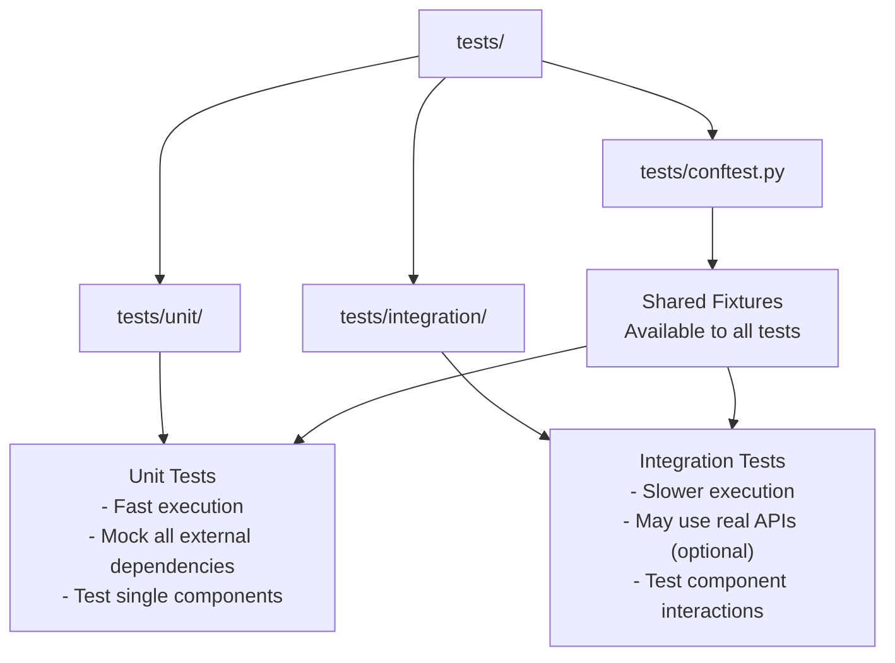
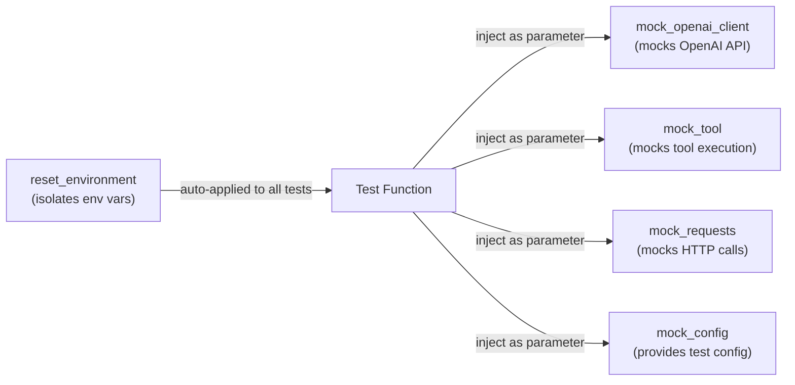
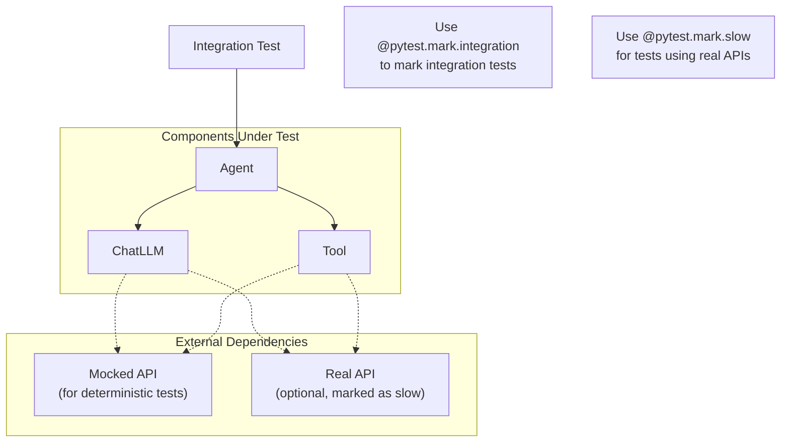
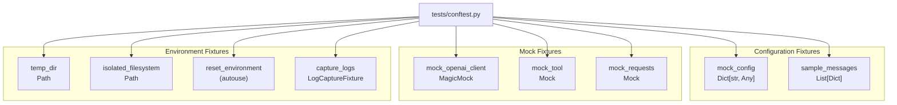
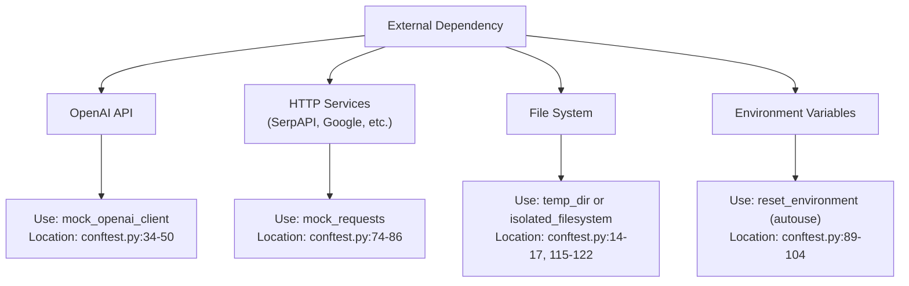
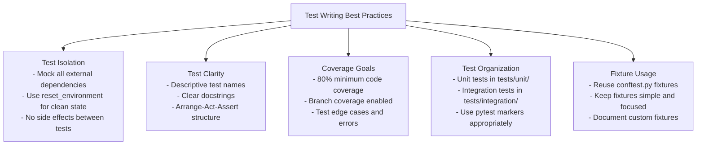

<!-- source: DeepWiki mcp.deepwiki.com · repo mpaepper/llm_agents · extra page Writing Tests · fetched 2026-10-26 -->

# Writing Tests

<details>
<summary>Relevant source files</summary>

The following files were used as context for generating this wiki page:

- [tests/conftest.py](tests/conftest.py)
- [tests/integration/__init__.py](tests/integration/__init__.py)
- [tests/unit/__init__.py](tests/unit/__init__.py)

</details>


## Purpose and Scope

This document provides practical guidelines for writing unit and integration tests for the llm_agents codebase. It covers test organization, fixture usage, mocking strategies, and best practices for ensuring code quality.

For information about running tests and interpreting results, see [Running Tests](#5.2.2). For a comprehensive list of available test fixtures, see [Test Fixtures](#5.2.1).

## Test Organization

The test suite is organized into two categories: unit tests and integration tests. This separation allows developers to run fast, isolated tests during development and comprehensive integration tests before merging.



**Sources:** [tests/unit/__init__.py:1](), [tests/integration/__init__.py:1](), [tests/conftest.py:1-10]()

### Directory Structure

| Directory | Purpose | Characteristics |
|-----------|---------|-----------------|
| `tests/unit/` | Unit tests for individual components | Fast, isolated, all dependencies mocked |
| `tests/integration/` | Integration tests for component interactions | Slower, may involve multiple components |
| `tests/conftest.py` | Shared pytest fixtures | Available to all tests automatically |

## Writing Unit Tests

Unit tests verify individual components in isolation. All external dependencies (OpenAI API, HTTP requests, file system) must be mocked to ensure fast, deterministic execution.

### Basic Unit Test Structure

A typical unit test follows this structure:

```python
import pytest
from llm_agents.agent import Agent

def test_agent_initialization(mock_config):
    """Test that Agent initializes with correct configuration."""
    agent = Agent(config=mock_config)
    
    assert agent.model == "test-model"
    assert agent.temperature == 0.7
```

### Using Fixtures in Unit Tests

The `conftest.py` file provides several fixtures specifically designed for unit testing. Here's how to use them effectively:



**Sources:** [tests/conftest.py:13-61](), [tests/conftest.py:89-104]()

### Example: Testing ChatLLM with Mocked OpenAI

```python
def test_chatllm_generate_response(mock_openai_client):
    """Test ChatLLM generates response using OpenAI client."""
    from llm_agents.chat_llm import ChatLLM
    
    llm = ChatLLM(client=mock_openai_client, model="gpt-4")
    response = llm.generate("Hello, world!")
    
    # Verify OpenAI client was called
    mock_openai_client.chat.completions.create.assert_called_once()
    
    # Verify response content
    assert response == "Test response"
```

This test uses the `mock_openai_client` fixture from [tests/conftest.py:33-50](), which provides a pre-configured mock that returns "Test response".

### Example: Testing Tools with Mocked HTTP

```python
def test_serpapi_tool_execution(mock_requests):
    """Test SerpAPITool makes correct HTTP request."""
    from llm_agents.tools.serpapi import SerpAPITool
    
    tool = SerpAPITool(api_key="test-key")
    result = tool.use("Python programming")
    
    # Verify HTTP request was made
    mock_requests.assert_called()
    
    # Verify result parsing
    assert "result" in result
```

This test uses the `mock_requests` fixture from [tests/conftest.py:74-86]() to intercept HTTP calls.

**Sources:** [tests/conftest.py:33-50](), [tests/conftest.py:74-86]()

## Writing Integration Tests

Integration tests verify that multiple components work together correctly. They may involve real or mocked external services depending on the test scenario.

### Integration Test Patterns



### Example: Testing Agent Execution Loop

```python
import pytest

@pytest.mark.integration
def test_agent_executes_tool_and_returns_answer(mock_openai_client, mock_tool):
    """Test full agent execution: thought -> action -> observation -> answer."""
    from llm_agents.agent import Agent
    
    # Configure mock to return action then final answer
    mock_responses = [
        "Thought: I need to use a tool\nAction: mock_tool\nAction Input: test input",
        "Final Answer: The answer is 42"
    ]
    mock_openai_client.chat.completions.create.side_effect = [
        create_mock_response(resp) for resp in mock_responses
    ]
    
    agent = Agent(
        llm_client=mock_openai_client,
        tools=[mock_tool],
        max_loops=3
    )
    
    result = agent.run("What is the answer?")
    
    # Verify tool was called
    mock_tool.run.assert_called_once_with("test input")
    
    # Verify final answer
    assert result == "The answer is 42"
```

This integration test verifies the complete thought-action-observation loop by orchestrating multiple mocked components.

**Sources:** [tests/conftest.py:33-50](), [tests/conftest.py:53-60]()

## Using Test Fixtures

Test fixtures provide reusable test data and mocked dependencies. Fixtures are injected by adding them as function parameters.

### Fixture Injection Patterns



**Sources:** [tests/conftest.py:13-122]()

### Fixture Usage Reference

| Fixture Name | Type | Purpose | Auto-applied |
|--------------|------|---------|--------------|
| `mock_config` | `Dict[str, Any]` | Test configuration dictionary with API keys and settings | No |
| `mock_openai_client` | `MagicMock` | Mocked OpenAI client returning "Test response" | No |
| `mock_tool` | `Mock` | Generic tool mock with name, description, and run method | No |
| `sample_messages` | `List[Dict]` | Example conversation messages for testing | No |
| `mock_requests` | `Mock` | Mocked `requests.get` and `requests.post` returning success | No |
| `reset_environment` | `None` | Sets test environment variables (OPENAI_API_KEY, etc.) | Yes (autouse) |
| `capture_logs` | `LogCaptureFixture` | Captures log messages at DEBUG level | No |
| `temp_dir` | `Path` | Temporary directory that auto-cleans | No |
| `isolated_filesystem` | `Path` | Temporary directory as working directory | No |

### Example: Using Multiple Fixtures

```python
def test_agent_with_config_and_tool(mock_config, mock_tool, mock_openai_client):
    """Test agent initialization with configuration and tools."""
    from llm_agents.agent import Agent
    
    agent = Agent(
        config=mock_config,
        llm_client=mock_openai_client,
        tools=[mock_tool]
    )
    
    assert agent.temperature == 0.7
    assert len(agent.tools) == 1
    assert agent.tools[0].name == "mock_tool"
```

**Sources:** [tests/conftest.py:20-30](), [tests/conftest.py:33-50](), [tests/conftest.py:53-60]()

## Mocking External Dependencies

Proper mocking ensures tests run quickly and deterministically without relying on external services.

### Mocking Strategy Map



**Sources:** [tests/conftest.py:33-50](), [tests/conftest.py:74-86](), [tests/conftest.py:89-104](), [tests/conftest.py:114-122]()

### OpenAI API Mocking

The `mock_openai_client` fixture provides a pre-configured mock:

```python
def test_llm_with_custom_response(mock_openai_client):
    """Test LLM with custom mock response."""
    # Override default response
    custom_response = MagicMock()
    custom_response.choices = [
        MagicMock(message=MagicMock(content="Custom answer"))
    ]
    mock_openai_client.chat.completions.create.return_value = custom_response
    
    from llm_agents.chat_llm import ChatLLM
    llm = ChatLLM(client=mock_openai_client)
    result = llm.generate("Question")
    
    assert result == "Custom answer"
```

The fixture is defined at [tests/conftest.py:34-50]() and creates a mock with this structure:
- `client.chat.completions.create()` returns a mock response
- Response has `choices[0].message.content = "Test response"`

### HTTP Request Mocking

The `mock_requests` fixture uses `monkeypatch` to replace the `requests` module:

```python
def test_tool_http_call(mock_requests):
    """Test tool making HTTP request."""
    # Configure mock response
    mock_requests.return_value.json.return_value = {"data": "result"}
    
    from llm_agents.tools.serpapi import SerpAPITool
    tool = SerpAPITool(api_key="test")
    result = tool.use("query")
    
    # Verify request was made
    assert mock_requests.called
```

The fixture at [tests/conftest.py:74-86]() mocks both `requests.get` and `requests.post` with a 200 status code response.

### Environment Variable Isolation

The `reset_environment` fixture automatically sets test environment variables for every test:

```python
def test_reads_environment_variable():
    """Test that reads OPENAI_API_KEY from environment."""
    import os
    
    # Environment is already set by reset_environment fixture
    api_key = os.getenv("OPENAI_API_KEY")
    assert api_key == "test-key"
```

This autouse fixture at [tests/conftest.py:89-104]() ensures:
- Test environment variables are set before each test
- Variables are cleaned up after each test
- Tests don't interfere with each other

### File System Isolation

For tests that create files, use `temp_dir` or `isolated_filesystem`:

```python
def test_writes_to_file(isolated_filesystem):
    """Test file writing in isolated environment."""
    import os
    
    # Write to file (in temporary directory)
    with open("test.txt", "w") as f:
        f.write("test content")
    
    # Verify file exists
    assert os.path.exists("test.txt")
    
    # Cleanup is automatic when fixture exits
```

The `isolated_filesystem` fixture at [tests/conftest.py:115-122]() changes the working directory to a temporary location and restores it after the test.

**Sources:** [tests/conftest.py:14-17](), [tests/conftest.py:115-122]()

## Test Structure and Patterns

### Standard Test Function Pattern

```python
def test_<component>_<behavior>_<expected_result>(fixtures):
    """Docstring describing what is being tested."""
    
    # 1. Arrange: Set up test data and mocks
    mock_data = create_test_data()
    configure_mocks(fixtures)
    
    # 2. Act: Execute the code under test
    result = component.method(mock_data)
    
    # 3. Assert: Verify expected behavior
    assert result == expected_value
    mock.assert_called_once_with(expected_args)
```

### Test Naming Convention

Test names should clearly describe what is being tested:

| Pattern | Example | Purpose |
|---------|---------|---------|
| `test_<class>_<method>` | `test_agent_run` | Basic method test |
| `test_<class>_<method>_<scenario>` | `test_agent_run_with_tool` | Specific scenario |
| `test_<class>_<method>_<error>` | `test_agent_run_raises_error` | Error condition |

### Assertion Patterns

Common assertion patterns for the llm_agents codebase:

```python
# Value assertions
assert result == expected_value
assert result is not None
assert len(results) == 3

# Mock call assertions
mock.assert_called_once()
mock.assert_called_with(expected_arg)
mock.assert_called_once_with(arg1, arg2)
mock.assert_not_called()

# Exception assertions
with pytest.raises(ValueError):
    agent.run(invalid_input)

# String content assertions
assert "Final Answer" in response
assert response.startswith("Thought:")

# Type assertions
assert isinstance(tool, ToolInterface)
```

## Log Capture and Debugging

Use the `capture_logs` fixture to verify logging behavior:

```python
def test_agent_logs_actions(capture_logs):
    """Test that agent logs its actions."""
    from llm_agents.agent import Agent
    
    agent = Agent()
    agent.run("Test question")
    
    # Verify log messages
    assert "Starting agent execution" in capture_logs.text
    assert "Executing action" in capture_logs.text
```

The `capture_logs` fixture at [tests/conftest.py:108-111]() captures logs at DEBUG level, allowing tests to verify logging behavior.

**Sources:** [tests/conftest.py:107-111]()

## Best Practices Summary



### Key Guidelines

1. **Always mock external dependencies** in unit tests using the provided fixtures
2. **Use descriptive test names** that explain what is being tested
3. **Follow the Arrange-Act-Assert pattern** for clear test structure
4. **Leverage autouse fixtures** like `reset_environment` for automatic isolation
5. **Write integration tests** for multi-component scenarios using `@pytest.mark.integration`
6. **Test error conditions** as well as success paths
7. **Keep tests independent** - no test should depend on another test's execution
8. **Use appropriate pytest markers** for test categorization

**Sources:** [tests/conftest.py:1-122](), [tests/unit/__init__.py:1](), [tests/integration/__init__.py:1]()

---

